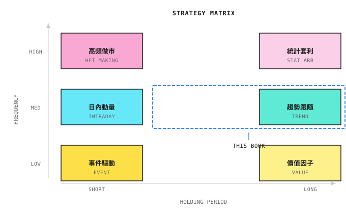
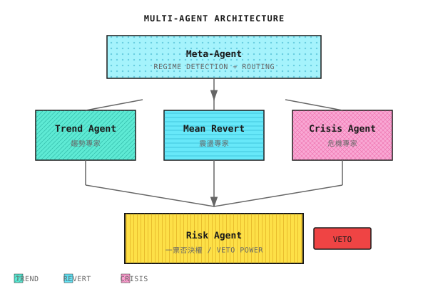
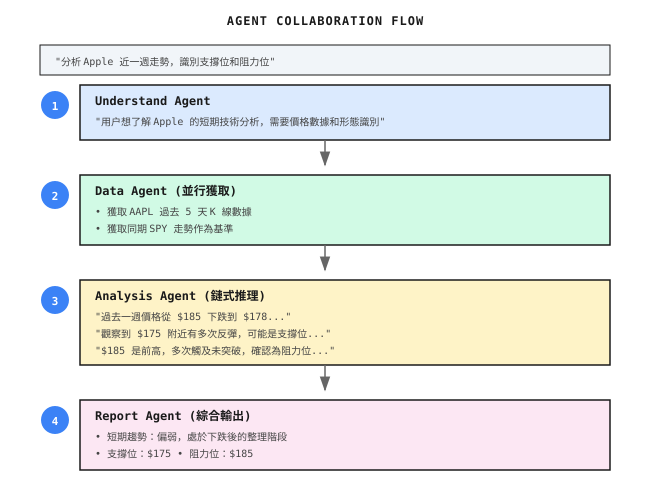
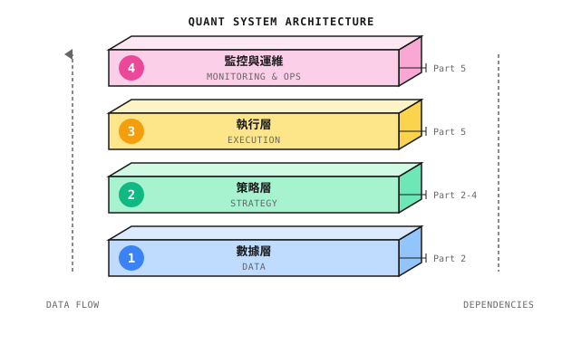
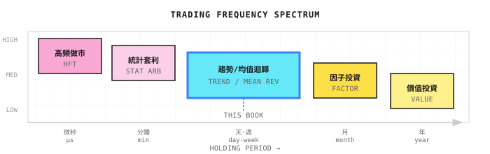
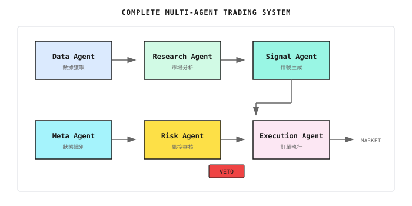
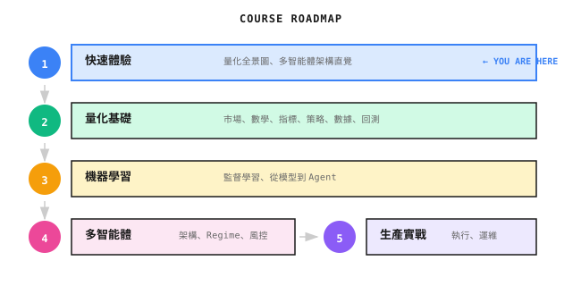

# 第 01 課：量化交易全景圖

> **目標**：先建立全局視野，再深入細節。知道量化世界有哪些玩家、哪些策略、為什麼需要多智能體架構，以及本書聚焦在哪裏。

---

## 一個典型場景（示意）

> 注：以下為合成示例，用於説明常見現象；數字為示意，不對應任何具體個人/賬户。

2020年，一位量化交易者開發了一個基於機器學習的美股策略，主要交易 S&P 500 成分股。回測收益驚人：年化 80%，夏普比率 2.5。

他信心滿滿地投入了 50 萬美元。

前兩個月，策略表現完美——順着市場上漲趨勢做多，賬户增長 30%。然後市場進入震盪期，策略開始反覆被打臉：追漲殺跌，每次都買在高點、賣在低點。三個月後，賬户回撤 40%。

他嘗試調整參數，讓策略更適應震盪市。結果下一波趨勢來臨時，策略完美錯過。

**問題出在哪裏？** 不是模型不夠好，而是**一個模型無法同時擅長所有市場狀態**。趨勢市需要動量策略，震盪市需要均值迴歸，危機市需要風控優先。這是結構性矛盾，不是調參能解決的。

但在討論解決方案之前，我們先建立量化交易的全景認知。

---

## 1.1 量化交易的三個層次

很多人聽到"量化交易"，腦海裏浮現的畫面各不相同：

- **散户**想的是：Python 寫個策略，自動買賣股票，躺着賺錢
- **程序員**想的是：高頻交易、納秒級延遲、FPGA、機房託管
- **金融從業者**想的是：因子模型、風險平價、Smart Beta

他們説的都是"量化"，但完全不是一回事。

### 按資金規模和競爭維度劃分

| 層次 | 典型資金 | 核心競爭力 | 代表玩家 |
|-----|---------|-----------|---------|
| **第一層：高頻做市** | $1B+ | 速度（微秒級）、硬件、交易所關係 | Citadel Securities, Virtu, Jump |
| **第二層：機構量化** | $100M-$10B | 研究深度、因子挖掘、風控體系 | Two Sigma, DE Shaw, 幻方、九坤 |
| **第三層：中小型/個人** | <$100M | 靈活性、細分市場、執行紀律 | 小型對沖基金、自營交易者 |

### 第一層：高頻做市（你打不過的對手）

**他們做什麼**：在買賣價差中賺取利潤，利用微秒級資訊優勢套利，每天交易數百萬筆，每筆賺幾分錢。

**為什麼你打不過**：
```
你的訂單延遲：50-100 毫秒（普通網絡）
他們的延遲：5-50 微秒（交易所託管）
差距：1000-10000 倍
```

當你看到一個"好價格"準備下單時，他們已經完成了 1000 次交易。

> **結論**：除非你有數億資金和頂級技術團隊，否則不要碰高頻。這是軍備競賽，散户必輸。

### 第二層：機構量化（本書的學習目標）

**他們做什麼**：中低頻策略（持倉小時到數週），多因子模型、統計套利、事件驅動，嚴格的風控和組合管理。

**為什麼值得學**：
- 不依賴速度優勢，靠策略和風控取勝
- 方法論可複製，適合系統性學習
- 多智能體架構的主要應用場景

### 第三層：中小型/個人

**優勢**：靈活性高、可做大機構看不上的小容量策略、試錯成本低

**劣勢**：數據和研究資源有限、容易情緒化交易、缺乏系統性風控

**本書的定位**：幫你用機構級的方法論，在個人/小團隊規模下構建系統。

---

## 1.2 主要策略類型

### 策略分類地圖



### 六大策略類型

| 策略類型 | 核心邏輯 | 持倉週期 | 難度 |
|---------|---------|---------|------|
| **高頻做市** | 賺買賣價差，提供流動性 | 秒-分鐘 | ★★★★★ |
| **統計套利** | 相關資產價差迴歸 | 分鐘-天 | ★★★★ |
| **趨勢跟隨** | 價格動量持續性 | 天-週 | ★★★ |
| **均值迴歸** | 價格偏離後迴歸 | 小時-天 | ★★★ |
| **事件驅動** | 財報、併購等事件 | 天-月 | ★★★★ |
| **多因子** | 組合多個 Alpha 因子 | 週-月 | ★★★★ |

### 策略的生命週期

**重要認知**：沒有永遠有效的策略。

```
發現 → 驗證 → 部署 → 衰減 → 退役
```

你的系統必須能**持續進化**——這就是為什麼我們需要多智能體架構。

---

## 1.3 為什麼需要多智能體架構

回到開篇的故事：單一模型為什麼失敗？

### 單一模型的致命缺陷

市場在不同狀態間切換：

| 市場狀態 | 最佳策略 | 單一模型的問題 |
|---------|---------|---------------|
| **趨勢市** | 動量策略：順勢加倉 | 震盪市會被反覆打臉 |
| **震盪市** | 均值迴歸：高拋低吸 | 趨勢市會錯過大行情 |
| **危機市** | 風控優先：減倉避險 | 可能在暴跌中滿倉硬扛 |

**核心問題：一個模型無法同時擅長所有狀態。** 這是結構性缺陷，不是調參能解決的。

### 多智能體的解決思路



> **注**：本課展示的是完整的多智能體目標架構。實際開發中，推薦從**模塊化單體**（Modular Monolith）起步——所有 Agent 在同一進程內運行，通過清晰的接口邊界通信。隨着規模增長再逐步拆分為獨立服務。詳見第 21 課。

**三個核心設計原則：**

1. **專家分工**：不同 Agent 負責不同市場狀態，各自做到極致
2. **動態路由**：Meta-Agent 判斷當前是什麼市場，把任務分發給對應專家
3. **風控獨立**：Risk Agent 擁有一票否決權，任何專家的建議都要過風控

### 常見誤區

| 誤區 | 事實 |
|-----|------|
| "多智能體就是多跑幾個模型" | 關鍵是**協作機制**：誰説了算？衝突怎麼解決？ |
| "單一模型調參調到極致也行" | 市場狀態是**結構性變化**，不是噪聲，調參解決不了 |
| "Agent 會自動賺錢" | Agent 是工具，Alpha 來自你的策略設計和風控紀律 |
| "量化就是預測價格" | 量化是**管理風險下的收益**，預測只是手段之一 |

### 多智能體的適用邊界

任何架構都有適用邊界。多智能體在以下情況可能不如單一模型：

| 失效場景 | 原因 |
|---------|------|
| **市場狀態切換太快** | Meta-Agent 識別滯後，切換時已錯過最佳時機 |
| **狀態邊界模糊** | 趨勢和震盪交替出現，每個專家都只對一半 |
| **協調成本 > 收益** | 簡單市場用複雜架構，過度工程 |

**核心原則**：如果你的策略只在單一市場狀態下運行，單一模型可能更簡單有效。多智能體的價值在於**跨狀態的穩健性**。

---

## 1.4 多智能體協作示例

用一個市場分析任務，展示多智能體如何協作：



### 關鍵協作模式

| 模式 | 説明 | 適用場景 |
|-----|------|---------|
| **Chain (鏈式)** | Agent A → B → C，順序執行 | 有明確依賴關係的任務 |
| **DAG (並行)** | 多個 Agent 同時執行，結果彙總 | 獨立子任務，如分析多隻股票 |
| **Debate (辯論)** | 多個 Agent 對同一問題給出不同觀點 | 需要多角度分析的決策 |
| **Reflection (反思)** | Agent 檢查自己或他人的輸出 | 提高輸出質量 |

---

## 1.5 技術棧與本書定位

### 量化系統的四層架構



| 層次 | 核心問題 | 本書覆蓋 |
|-----|---------|---------|
| **數據層** | 數據從哪來？如何保證質量？ | Part 2 第06課 |
| **策略層** | 信號怎麼生成？風險怎麼控制？ | Part 2-4 |
| **執行層** | 如何最小化交易成本？ | Part 5 第18-19課 |
| **運維層** | 系統掛了怎麼辦？ | Part 5 第20課 |

### 本書聚焦：中頻多智能體系統



| 維度 | 本書定位 | 原因 |
|-----|---------|------|
| **頻率** | 日內到週級 | 不需要硬件軍備競賽 |
| **策略** | 趨勢 + 均值迴歸 + 風控 | 經典有效，適合演示 |
| **架構** | 多智能體協作 | 解決單一模型的結構性問題 |
| **目標** | 風險調整後收益 | 不追求暴利，追求穩健 |

---

## 1.6 完整系統架構預覽

本課建立的認知，對應到完整多智能體交易系統：



| Agent | 職責 | 課程 |
|-------|------|------|
| **Data Agent** | 數據獲取、清洗、對齊 | Part 2 第06課 |
| **Research Agent** | 市場分析、趨勢識別 | Part 2 第04-05課 |
| **Signal Agent** | 生成交易信號 | Part 3 第10課 |
| **Meta Agent** | 市場狀態識別、任務分發 | Part 4 第11-12課 |
| **Risk Agent** | 風控審核、一票否決 | Part 4 第15課 |
| **Execution Agent** | 訂單拆分、執行優化 | Part 5 第19課 |

---

## 1.7 課程路線圖



**貫穿全程的核心問題：**
1. 為什麼單一模型不夠？
2. 多智能體如何解決？
3. 如何構建能持續進化的系統？

---

## 本課交付物

完成本課後，你將獲得：

1. **量化交易的分層認知** - 知道高頻、機構、個人各自在做什麼
2. **策略類型的全景地圖** - 理解六大策略類型的邏輯和適用場景
3. **對多智能體架構的直覺理解** - 知道為什麼需要多個專家而不是一個全能模型
4. **清晰的學習邊界** - 知道本書聚焦什麼，不覆蓋什麼

---

## 本課要點回顧

- [x] 量化交易分三個層次：高頻做市（打不過）、機構量化（學習目標）、個人/小型（起點）
- [x] 六大策略類型：高頻做市、統計套利、趨勢跟隨、均值迴歸、事件驅動、多因子
- [x] 單一模型的結構性缺陷：無法同時擅長趨勢、震盪、危機三種市場
- [x] 多智能體的三個核心原則：專家分工、動態路由、風控獨立
- [x] 本書定位：中頻多智能體量化系統，不追求暴利，追求穩健可持續

---

## 延伸閲讀

- [背景知識：Alpha 與 Beta](背景知識/Alpha%20與%20Beta.md) - 理解收益的來源
- [背景知識：主流量化基金排名](背景知識/主流量化基金排名.md) - 看看頂級機構的策略風格
- [背景知識：中美量化市場差異](背景知識/中美量化市場差異.md) - 不同市場的玩法差異
- [背景知識：歷史著名量化事故](背景知識/歷史著名量化事故.md) - 前車之鑑，風控為什麼是一票否決

---

## 下一課預告

**第 02 課：金融市場與交易基礎**

現在你知道了量化世界的全貌和多智能體架構的核心思想。接下來我們迴歸常識：市場是怎麼運作的？訂單是怎麼成交的？什麼是滑點和市場衝擊？這些基礎知識是構建任何量化系統的前提。
