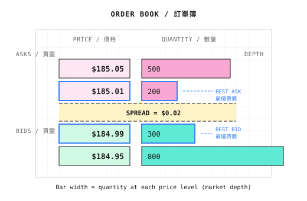
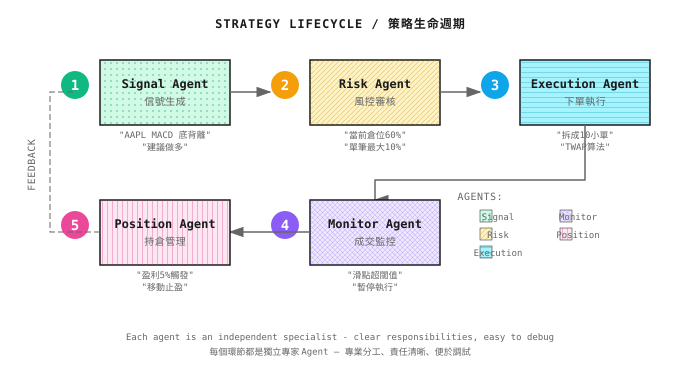

# 第02課：金融市場與交易基礎

> **如果你的 Agent 不懂 order book、slippage 和 market impact，它只是一部寫文章的機器。**

---

## 一堂昂貴的課

一位量化新手開發了一個看似非常賺錢的策略：backtest 年化回報 80%，Sharpe ratio 為 2.0。他興奮地上線。

第一個星期，策略訊號說「買入 1000 股 Tesla」，他照做了。Backtest 預期成本為 $250,000（$250 x 1000 股）。

實際成交價呢？$253,500。

還未開始賺錢，他已經虧了 $3,500。

**發生了什麼事？**

1. **Slippage**：他的 market order「吃穿」了 order book 中多個價位，平均價比預期高出 $2.5/股
2. **手續費**：佣金 + SEC 費用，每筆交易約損失 $50
3. **Market Impact**：他的大額訂單引起其他交易者注意，推高了價格

三個月後，策略的實盤表現比 backtest 差了 40%。策略本身不差，只是他算錯了成本。

**本課目標**：讓你的 Agent 明白真實市場如何運作，避免「backtest 賺錢、實盤蝕錢」的悲劇。

---

## 2.1 市場類型

### 不同市場的特性

| 市場 | 交易時間 | Leverage | 沽空 | 適合的策略 |
|--------|--------------|----------|---------------|-------------------|
| **股票** | 交易所時間（中國 A 股：9:30-15:00） | 有限的 margin trading | 受限制 | Multi-factor、event-driven |
| **期貨** | 接近 24 小時 | 高（5-20x） | 原生支持 | CTA、arbitrage |
| **外匯** | 24 小時（週末除外） | 極高（50-100x） | 原生支持 | Trend following、carry trade |
| **Crypto** | 24/7 | 由交易所訂定（1-100x） | 原生支持 | High-frequency、跨交易所 arbitrage |

**對 Agent 的啟示**：
- Crypto 24/7 -> Agent 必須全日運行，需要更強的自動化
- 期貨 leverage 高 -> Risk Agent 的 stop-loss 邏輯必須更嚴格
- 中國 A 股 T+1（普通股票今日買入，明日才能賣出，部分 ETF 除外）-> Execution Agent 需要考慮隔夜風險

### Primary Market 與 Secondary Market

| | Primary Market | Secondary Market |
|--|----------------|------------------|
| **定義** | 證券首次發行（IPO、增發） | 已發行證券在投資者之間的買賣 |
| **參與者** | 主要是機構，散戶可認購 IPO | 所有投資者 |
| **量化機會** | IPO 策略、定向增發 arbitrage | 絕大部分量化策略 |

**本課程聚焦 secondary market**，這是量化交易的主戰場。

### 交易所與撮合機制

無論是美股、中國 A 股還是加密貨幣，所有交易最終都流向 **Matching Engine**。

交易所並不是你的交易對手，它只是「媒人」，按規則撮合買家與賣家：

```
Matching Rules (most exchanges):
1. Price Priority: Higher bid orders get filled first
2. Time Priority: At the same price, earlier orders get filled first
```

**Multi-Agent 視角**：
- **Execution Agent**：必須理解撮合邏輯，決定用 market order 還是 limit order
- **Research Agent**：透過成交數據識別大額資金流向

---

## 2.2 基本交易單位

### Asset

Asset 就是你交易的標的。不同 asset 有不同的代碼格式：

| 市場 | Asset 例子 | 代碼格式 |
|--------|---------------|-------------|
| 中國 A 股 | 貴州茅台 | 600519.SH |
| 美股 | Apple | AAPL |
| 加密貨幣 | Bitcoin | BTC/USDT |
| 期貨 | 滬深 300 指數期貨 | IF2401 |

### 時間尺度：Tick -> Candlestick

量化系統以不同的粒度處理數據：

```
Tick Data (finest)
    | aggregate
Minute Bars (1min, 5min, 15min)
    | aggregate
Daily / Weekly / Monthly (coarsest)
```

**Tick Data**：每一筆成交、每一次報價變動。High-frequency 策略必不可少，但儲存成本高。

**OHLCV（Candlestick）**：將 tick 聚合後的標準格式：
- **O**pen（開市價）
- **H**igh（最高價）
- **L**ow（最低價）
- **C**lose（收市價）
- **V**olume（成交量）

### Order Book

Order book 顯示市場的「depth」，即不同價位上有多少訂單在排隊：



**Spread（Bid-Ask Spread）** = Best Ask - Best Bid = $185.01 - $184.99 = **$0.02**

- Spread 越小 -> liquidity 越好 -> 交易成本越低
- Spread 越大 -> liquidity 越差 -> slippage 風險越高

---

## 2.3 交易成本的真實影響

> Backtest 年化 50%，實盤卻蝕錢？罪魁禍首就是交易成本。

### Slippage

Backtest 假設你能以最佳價格買入，但在實盤中：

```
You want to buy 1000 shares of AAPL, order book:
  $185.01 - 200 shares  <- You eat these 200 first
  $185.05 - 500 shares  <- Then eat these 500
  $185.10 - 300 shares  <- Finally eat these 300

Actual average price = (185.01x200 + 185.05x500 + 185.10x300) / 1000 = $185.057
Expected price = $185.01
Slippage = $0.047/share = Total $47
```

### 手續費：累積效應

看似微小的手續費，在 high-frequency trading 中會被放大：

```python
# Assuming 0.1% fee per trade
fee_rate = 0.001
trades_per_day = 50
trading_days = 250

# Annualized fee cost
annual_fee = fee_rate * 2 * trades_per_day * trading_days  # buy and sell each
print(f"Annualized fee cost: {annual_fee:.1%}")  # Output: 25.0%
```

**年化手續費成本 25%**，意味着你策略的年化回報要超過 25% 才能打和！

### Market Impact

你的大額訂單本身會改變市場。**Square Root Law** 估算：

```
Market Impact ~ Y x sigma x sqrt(Q/V)

Y = constant (typically 0.5-1.0)
sigma = daily volatility
Q = your order size
V = average daily volume
```

```python
def estimate_market_impact(order_size, daily_volume, daily_volatility, Y=0.5):
    """Estimate market impact cost"""
    participation = order_size / daily_volume
    impact = Y * daily_volatility * (participation ** 0.5)
    return impact

# Example: Order size is 1% of daily volume
impact = estimate_market_impact(
    order_size=1_000_000,
    daily_volume=100_000_000,
    daily_volatility=0.02
)
print(f"Estimated market impact: {impact:.2%}")  # Output: 0.10%
```

### 成本總結

| 成本類型 | 典型範圍 | 受影響最大者 |
|-----------|---------------|---------------------|
| Slippage | 0.01% - 0.5% | 大額訂單、liquidity 低的 asset |
| 手續費 | 每筆 0.01% - 0.1% | High-frequency 策略 |
| Market Impact | 0.05% - 1%+ | 大資金、小型股 |

**Multi-Agent 視角**：Execution Agent 的核心職責，就是把這三項成本減至最低。

### 紙上練習：你的策略真的賺錢嗎？

**情境**：你開發了一個美股 intraday 策略，backtest 參數如下：

| 參數 | 數值 |
|-----------|-------|
| Backtest 年化回報 | 35% |
| 平均每日交易次數 | 20（買入和賣出分開計算） |
| 平均每筆交易金額 | $50,000 |
| 券商佣金 | $0（免佣券商） |
| SEC 費用 | 0.00278%（賣出時收取） |
| 平均 slippage | 0.03% |
| 交易日數 | 252 日/年 |

**問題：實盤回報會是多少？**

---

**逐步計算**：

**第 1 步：計算每筆交易成本**
```
Per-trade slippage cost = $50,000 x 0.03% = $____
Per-trade SEC fee = $50,000 x 0.00278% = $____ (sells only)
```

**第 2 步：計算每日成本**
```
Daily slippage = $____ x 20 trades = $____
Daily SEC = $____ x 10 trades (sells) = $____
Daily total cost = $____
```

**第 3 步：計算年化成本**
```
Annual cost = $____ x 252 days = $____
Total trading volume = $50,000 x 20 x 252 = $252,000,000
Annual cost rate = $____ / $252,000,000 = ____%
```

**第 4 步：計算實盤回報**
```
Live annual return = 35% - ____% = ____%
```

---

**答案**（先自己計算，再核對）：

<details>
<summary>點擊顯示答案</summary>

**關鍵概念釐清**：
- **Principal（本金）**：你投入的資金，例如 $100,000
- **Trade Size（單筆交易金額）**：每筆交易的金額，例如 $50,000
- **Total Trading Volume（總成交額）**：單筆金額 x 交易次數 x 日數（包含 leverage 與 turnover 效應）
- **Turnover Rate**：總成交額 / 本金，代表資金週轉

**計算過程**：
- 每筆 slippage = $50,000 x 0.03% = **$15**
- 每筆 SEC = $50,000 x 0.00278% = **$1.39**
- 每日 slippage = $15 x 20 = **$300**
- 每日 SEC = $1.39 x 10 = **$13.9**
- 每日總成本 = **$313.9**
- 年度總成本 = $313.9 x 252 = **$79,103**

**成本率計算（容易混淆！）**：
| 計算方式 | 公式 | 結果 | 意義 |
|-------------------|---------|--------|---------|
| 相對於成交額 | $79,103 / $252,000,000 | 0.031% | 每筆交易的成本 |
| 相對於本金 | $79,103 / $100,000 | **79.1%** | 成本蠶食了多少本金 |

其中：年度成交額 = $50,000 x 20 筆 x 252 日 = $252,000,000（turnover = 2520x！）

**最終答案**：
- 若策略本金為 $100,000：
- 年度成本**相對於本金** = $79,103 / $100,000 = **79.1%**
- **實盤年化回報 = 35% - 79.1% = -44.1%**

**結論：這個策略在實盤中會慘虧！** Backtest 中被忽略的 0.03% slippage（相對單筆金額很小），累積起來相對本金高達 79%，在高 turnover 下是致命傷。

</details>

**思考題**：
1. 如果 slippage 降至 0.01%，策略還能賺錢嗎？
2. 如果交易頻率降至每日 5 次，結果會怎樣？
3. 這對策略設計有什麼啟示？

---

## 2.4 策略生命週期

一筆完整的交易，會由 multi-agent 系統從開始流轉到完成：



**詳細流程**：

1. **訊號生成（Signal Agent）**
   - 「AAPL 的 MACD 出現 bullish divergence，建議做 long」

2. **風險審核（Risk Agent）**
   - 「目前總持倉為 60%，單一持倉上限為 10%，這筆交易只能做 10%」
   - 可能拒絕、縮減倉位或批准

3. **訂單執行（Execution Agent）**
   - 「訂單太大，拆成 10 張小訂單，用 TWAP 算法每 30 秒發送一張」

4. **執行監控（Monitor Agent）**
   - 「第 5 張子訂單的 slippage 超過 threshold，暫停後續執行」
   - 實時回饋執行質素

5. **持倉管理與平倉（Position Agent）**
   - 「持倉升 5%，觸發 trailing stop」
   - 「持倉跌 2%，觸發 stop-loss 平倉」
   - 循環完成

**每個階段都可以是獨立的專職 Agent**，這就是 multi-agent 架構的優勢：專職分工、職責清晰、更易 debug。

---

## 本課成果

完成本課後，你將擁有：

1. **對市場結構的理解**：知道不同市場（股票/期貨/crypto）的特性與限制
2. **交易成本意識**：能估算 slippage、手續費和 market impact 對策略的影響
3. **策略生命週期視角**：理解由訊號到平倉的完整循環

### 驗證清單

用以下檢查點確認你真正理解了本課：

| 檢查點 | 驗證標準 | 自我測試方法 |
|------------|----------------------|------------------|
| **成本計算** | 能獨立完成紙上練習，誤差 < 10% | 不看答案重新計算 |
| **Order Book 理解** | 能解釋為何大額訂單會產生 slippage | 畫出 order book，模擬 1000 股 market order 的成交 |
| **市場差異** | 能說出中國 A 股 vs 美股 vs crypto 的 3 個主要分別 | 不看筆記口述 |
| **生命週期** | 能畫出由訊號到平倉的策略流程 | 在白紙上畫出，標註每個 Agent 的角色 |

**如果你做到以上各項**：
- 成本計算準確 -> 你具備成本意識
- 能畫出 order book 成交過程 -> 你理解 market microstructure
- 能畫出完整生命週期 -> 你具備系統思維

**如果做不到**：
- 重讀相關章節
- 用具體數字走一遍例子（例如 AAPL $185）
- 在延伸閱讀中找更詳細的解釋

---

## 重點回顧

- [x] 理解不同市場（股票/期貨/外匯/crypto）的特性及其對策略的影響
- [x] 掌握 OHLCV 與 order book 的基礎
- [x] 認清交易成本的三大殺手：slippage、手續費、market impact
- [x] 理解完整的策略生命週期循環：Signal -> Risk -> Execution -> Monitoring -> Exit

---

## 延伸閱讀

- [背景知識：交易所與 Order Book 機制](背景知識/交易所與訂單簿機制.md) - 深入了解 L1/L2/L3 數據的分別
- [背景知識：HF Market Microstructure](背景知識/高頻市場微結構.md) - 想與 HFT 競爭的必讀內容
- [背景知識：加密貨幣交易特點](背景知識/加密貨幣交易特點.md) - 24/7 市場的獨特挑戰

---

## 下一課預告

**第03課：數學與統計基礎**

市場在波動，但我們如何量化這些波動？為何我們用「return」而不是「價格」？什麼是「fat-tailed distribution」，為何 normal distribution 假設會令你爆倉？下一課揭曉。
