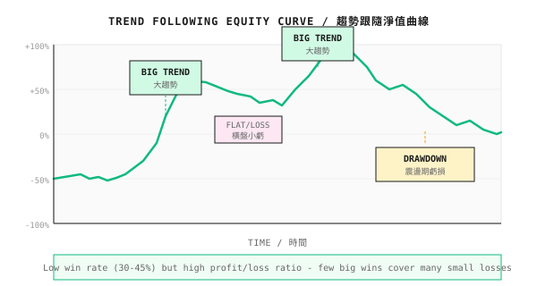
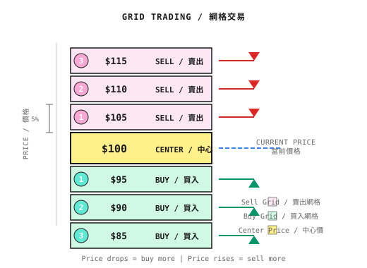
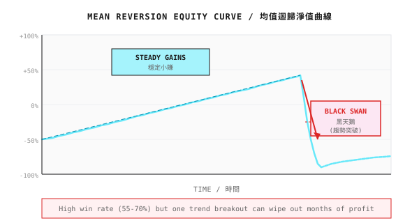

# 第05課：經典策略範式

> **量化交易不是發明新策略，而是在對的市場使用對的策略。**

---

## 兩位交易員的命運

2020 年 3 月，COVID-19 觸發全球股市崩盤。

**交易員 A** 使用 trend following 策略。跌市初期，他的策略及時沽空，一個月內賺了 40%。其後市場見底反彈，他順勢做多，年底時賬戶增長了兩倍。

**交易員 B** 使用 mean reversion 策略。看到大跌，他相信「跌極必反彈」，不斷買入。結果越買越跌，在見底的前一天爆倉。

同一個市場，兩種策略，結果截然相反。

**2021 年，情況逆轉。**

市場進入橫行期，交易員 A 的 trend 策略不斷被打臉：追高殺低，總是在高位買入、在低位賣出。他虧掉了 2020 年一半的利潤。

與此同時，交易員 B（用新資金）的 mean reversion 策略大放異彩：高沽低買，穩定獲利。到年底，他的賬戶增長了 60%。

**這給我們什麼啟示？**

1. **沒有一種策略適用於所有市場**
2. **趨勢市需要 trend 策略；橫行市需要 mean reversion 策略**
3. **辨識市場狀態比選擇策略更重要**

這正是我們需要 multi-agent 系統的原因：讓不同的專家策略處理不同的市場狀態。

---

## 5.1 Trend Following

### 核心理念

> "The trend is your friend, until it isn't."

Trend following 的理念：**市場有慣性，升的傾向繼續升，跌的傾向繼續跌。**

| 特點 | 說明 |
|----------------|-------------|
| 獲利模式 | 捕捉大趨勢，從「頭」與「尾」獲利 |
| 勝率 | 通常只有 30-45% |
| 風險回報比 | 高，單次獲利可達虧損的 3-10 倍 |
| 適合市場 | 有明確趨勢的市場（牛/熊） |
| 致命情境 | 在橫行市被 whipsaw |

### 雙均線策略

最經典的 trend following 策略：

```
Rules:
- Golden cross buy: Short-term MA crosses above long-term MA (e.g., MA5 > MA20)
- Death cross sell: Short-term MA crosses below long-term MA (e.g., MA5 < MA20)
```

**直觀理解**：
- 短期 MA 代表「當前情緒」
- 長期 MA 代表「長期趨勢」
- 短期超越長期 = 趨勢可能轉向上

| 參數組合 | 使用場景 | 特點 |
|-----------------|----------|-----------------|
| MA5/MA20 | 短線交易 | 靈敏，假信號多 |
| MA10/MA60 | 中線交易 | 平衡 |
| MA20/MA120 | 長線投資 | 穩定，滯後嚴重 |

**實際表現**：

| 市場狀態 | 雙均線表現 |
|--------------|---------------------|
| 強趨勢（牛/熊） | 獲利，捕捉大部分走勢 |
| 弱趨勢 | 小賺/小虧 |
| 橫行 | 虧損，假信號頻繁 |

**優化方向**：
- 加入趨勢 filter（只在 ADX > 25 時開倉）
- 加入成交量確認（高成交量時信號更可靠）
- Multi-timeframe 確認（日線 golden cross + 週線趨勢向上）

### 日內趨勢交易

適合全職交易員的策略：

```
Rules:
1. Observe price direction for 30 minutes after open
2. If price breaks 0.5% above open, go long
3. Stop-loss at 0.5% below open price
4. Close before market close, no overnight risk
```

| 優點 | 缺點 |
|------|------|
| 沒有隔夜風險 | 需要持續監察 |
| 信號清晰 | 交易成本高 |
| 即日結算 | 可能錯過大趨勢 |

### Trend Following 的風險特徵



**重點觀察**：
- Trend 策略在橫行期會連續出現小額虧損
- 需要有連續 10-20 次 stop-loss 的心理準備
- 利潤來自少數幾次大趨勢交易，足以彌補所有虧損而有餘

---

## 5.2 Mean Reversion

### 核心理念

> "What goes up must come down, what goes down must come up."

Mean reversion 的理念：**價格最終會回歸某個「正常」水平。**

| 特點 | 說明 |
|----------------|-------------|
| 獲利模式 | 低買高賣，從「震盪」中獲利 |
| 勝率 | 通常 55-70% |
| 風險回報比 | 低，單次獲利通常小於虧損 |
| 適合市場 | 橫行、區間震盪市場 |
| 致命情境 | 趨勢突破，一路買入下跌 |

### Grid Trading 策略

在預設的價格區間內，以等距間隔設置買賣點：



**規則**：
- 價格跌至 95 -> 買入 1 單位
- 價格跌至 90 -> 再買入 1 單位
- 價格升至 105 -> 賣出 1 單位
- 價格升至 110 -> 再賣出 1 單位

| 參數 | 建議值 | 說明 |
|-----------|----------------|-------------|
| Grid 間距 | 3-5% | 太細則手續費蠶食利潤；太闊則信號太少 |
| Grid 總數 | 5-10 | 太多則資金被攤薄；太少則容錯空間小 |
| 每格倉位 | 總資金 / grid 數量 | 確保最壞情況不會爆倉 |

**Grid Trading 的真相**：

| 市場狀態 | Grid 表現 |
|--------------|------------------|
| 橫行 | 穩定獲利，捕捉每一次震盪 |
| 上升趨勢 | 小額獲利，但倉位被賣出，錯過進一步升幅 |
| 下跌趨勢 | **重大虧損**，一路下跌一路買入，資金被套牢 |

**重要警告**：Grid trading 最怕單邊下跌。務必設置整體 stop-loss。

### Pairs Trading

找出兩個高度相關的資產，當它們的 spread 偏離正常水平時進行交易：

> **重要**：SPY（約 $600）與 IVV（約 $550）的絕對價格不同，因此不能簡單地比較價格比率。應該改用**回報 spread 的 Z-score**，並以等額美元金額交易。

```
Example: SPY vs IVV (both track S&P 500)

Step 1: Calculate daily return spread
  - SPY daily return: +0.52%
  - IVV daily return: +0.48%
  - Return spread: +0.04%

Step 2: Calculate Z-score of the spread
  - Mean spread over 20 days: 0.00%
  - Std dev of spread: 0.02%
  - Today's Z-score: (0.04% - 0.00%) / 0.02% = +2.0

Step 3: Trade signal (Z-score > 2.0)
  - SPY "outperformed" temporarily
  - Short $10,000 SPY, Long $10,000 IVV
  - Wait for Z-score to return to 0, then close
```

**為何用等額美元金額？**
- SPY 價格約 $600，IVV 價格約 $550
- 要做到 dollar-neutral：沽空 16.7 股 SPY（$10,000），買入 18.2 股 IVV（$10,000）
- 這確保交易兩邊的 exposure 相等

**為何有效？**
- 兩隻 ETF 追蹤完全相同的指數（S&P 500）
- 相同的宏觀 factor 對它們的影響一致
- 回報 spread 的偏離通常是暫時且細小的
- 使用回報（而非價格），可以對不同的價格水平進行標準化

**關鍵概念：Cointegration**

| 概念 | 定義 | 例子 |
|---------|------------|---------|
| Correlation | 兩個序列一同變動 | 黃金與黃金 ETF |
| Cointegration | 兩個序列之間的差值穩定 | SPY 與 IVV |

Correlation 不等於 cointegration。Cointegration 是 pairs trading 的基礎。

### Mean Reversion 的風險特徵



**重點觀察**：
- Mean reversion 在橫行期非常穩定
- 但一次趨勢突破就可以抹去數月的利潤
- 必須有嚴格的 stop-loss，不能「死守待反彈」

---

## 5.3 Multi-Strategy Portfolio

### 為何要組合？

| 單一策略的問題 | Portfolio 的解決方案 |
|------------------------|-------------------|
| Trend 策略在橫行市虧損 | Mean reversion 作補償 |
| Mean reversion 在趨勢市虧損 | Trend 策略作補償 |
| 單一策略集中風險 | Multi-strategy 分散風險 |

### 策略 Correlation

組合的關鍵在於**低 correlation**：

| 策略 A | 策略 B | Correlation | Portfolio 效果 |
|------------|------------|-------------|------------------|
| Trend following | Trend following | 高 | 無分散效果 |
| Trend following | Mean reversion | 低/負 | 分散效果良好 |
| 股票 long | 債券 | 負 | 分散效果極佳 |

### 資金分配方法

**方法 1：Equal Weight**
```
Strategy A: 33%
Strategy B: 33%
Strategy C: 34%
```
簡單，但沒有考慮各策略的風險差異。

**方法 2：Risk Parity**
```
Allocate inversely proportional to volatility:
Strategy A volatility 20% -> weight proportional to 1/0.20 = 5
Strategy B volatility 10% -> weight proportional to 1/0.10 = 10
Strategy C volatility 40% -> weight proportional to 1/0.40 = 2.5

Normalized:
Strategy A: 5/17.5 ~ 29%
Strategy B: 10/17.5 ~ 57%
Strategy C: 2.5/17.5 ~ 14%
```
令每個策略對 portfolio 的風險貢獻相等。

**方法 3：動態調整**
- 趨勢市 -> 增加 trend 策略權重
- 橫行市 -> 增加 mean reversion 策略權重
- 這需要準確的 Regime Detection（詳見第11課）

---

## 5.4 高風險策略警告

### Martingale 策略（極度謹慎使用）

```
Logic:
Bet $100 first time, lose
Bet $200 second time, lose
Bet $400 third time, lose
Bet $800 fourth time, win!

Won $800, lost $700 before, net profit $100
```

**看似美好，實則危險**：

| 連續虧損次數 | 累計投入 | 單次下注 |
|-------------------|----------------------|------------|
| 1 | $100 | $100 |
| 2 | $300 | $200 |
| 3 | $700 | $400 |
| 4 | $1,500 | $800 |
| 5 | $3,100 | $1,600 |
| 6 | $6,300 | $3,200 |
| 7 | $12,700 | $6,400 |
| 8 | $25,500 | $12,800 |
| 9 | $51,100 | $25,600 |
| 10 | $102,300 | $51,200 |

**連續虧損 10 次需要 $100,000**，但利潤只有最初的 $100。

**為何會連輸 10 次？**
- 以 50% 勝率計算，連續虧損 10 次的概率 = 0.5^10 ~ 0.1%
- 看似很小，但交易 1000 次就會遇上一次
- 一次已足以爆倉

**如果非用不可**：
- 設置最大加倍次數（例如最多 3 次）
- 設置每日最大虧損（例如 10%）
- 明白這本質上是「以爆倉風險換取高勝率」

---

## 5.5 期權策略簡介（進階）

> 期權是高風險的進階工具。本節只是簡介；交易前請徹底學習 Greeks。

### 期權基礎

| 術語 | 含義 |
|------|---------|
| Call Option | 以約定價格買入的權利 |
| Put Option | 以約定價格賣出的權利 |
| Strike Price | 約定的買賣價格 |
| Expiration | 期權到期日 |
| Premium | 買入期權的價格 |

### Bull Call Spread

**操作**：
1. 買入較低 strike 的 call option（例如 $100 Call）
2. 賣出較高 strike 的 call option（例如 $110 Call）

```
P&L Diagram:
Profit |        ____
       |       /
   0   |------*
       |     /|
Loss   |____/ |
       └──────┴────── Stock Price
          100  110
```

| 特點 | 說明 |
|---------|-------------|
| 成本 | 低於直接買入 Call |
| 最大虧損 | 支付的淨 premium |
| 最大獲利 | Strike 差價 - 淨 premium |
| 使用場景 | 預期溫和上升 |

### 到期日期權（高風險）

押注到期前 1-3 日 volatility 爆發：

**原理**：
- 接近到期時，期權的時間價值迅速衰減
- 但若出現重大事件（業績公布、Fed 會議），volatility 可能爆發
- Gamma 極高；價格輕微波動就會帶來巨大獲利（或虧損）

| 特點 | 說明 |
|---------|-------------|
| 潛在獲利 | 可達 10 倍或以上 |
| 潛在虧損 | Premium 歸零（100% 虧損） |
| 勝率 | 通常低於 20% |
| 倉位大小 | <= 總資金的 5% |

### Gamma Scalping（專業級）

**原理**：持有期權倉位，反覆買賣標的資產以對沖 Delta。

```
Simplified:
1. Hold Call options (long Gamma)
2. Price rises -> Delta increases -> Sell stock to hedge
3. Price falls -> Delta decreases -> Buy stock to hedge
4. Repeat, profit from oscillation
```

**獲利條件**：Realized volatility > Implied volatility

| 要求 | 說明 |
|-------------|-------------|
| 交易手續費 | 必須極低 |
| 交易頻率 | 高，每日可能數十次 |
| 技術門檻 | 必須掌握期權定價及 Greeks |

---

## 5.6 策略選擇框架

### 如何選擇策略？（可證偽的規則）

含糊的「看大勢」沒有意義；需要可量化、可驗證的規則：

| 指標條件 | 判斷 | 建議策略 | 失效信號 |
|--------------------|---------------|---------------------|---------------------|
| ADX > 25 且持續 5 日以上 | 趨勢確認 | Trend following | ADX < 20 連續 3 日 |
| ADX < 20 且價格在 Bollinger Bands 內震盪 | 橫行確認 | Mean reversion | 價格突破 Bollinger 2 sigma 且 ADX 上升 |
| Volatility > 歷史第 90 百分位 | 危機模式 | 減倉/對沖 | Volatility 回落至第 50 百分位以下 |
| 以上皆不滿足 | 不確定 | 減倉 50% | 任何條件滿足 |

**可證偽的策略選擇規則**：

```
If following conditions met -> Use trend following:
  1. ADX(14) > 25 for 5 consecutive days
  2. Price on same side of 20-day MA for 10 consecutive days
  3. Last 20 days return significantly != 0 (t-test p < 0.05)

If following conditions met -> Use mean reversion:
  1. ADX(14) < 20 for 5 consecutive days
  2. Price oscillating within Bollinger Bands (20-day, 2 sigma)
  3. Last 20 days return close to 0 (t-test p > 0.2)

If none of above conditions met -> Reduce position to 50%, wait for clear signal
```

### 處理 Regime 轉換期

**最危險的時刻不是趨勢市或橫行市，而是轉換期。**

| 轉換情境 | 風險 | 應對策略 |
|--------------------|------|-------------------|
| 橫行 -> 趨勢 | Mean reversion 被套牢，stop-loss 連環觸發 | 突破信號一出現，立即減少 mean reversion 倉位 |
| 趨勢 -> 橫行 | Trend 策略被 whipsaw，反覆 stop-loss | ADX 下降時逐步減少 trend 倉位 |
| 正常 -> 危機 | 所有策略同時虧損，correlation 急升 | 首要任務是在 volatility 急升時減倉，而非切換策略 |

**轉換期的保守規則**：

1. **確認滯後**：Regime 轉換的確認需要 3-5 日；不要追逐第一日的信號
2. **先減倉**：在不確定期間，先減倉再切換策略，而非全盤替換
3. **接受轉換成本**：預留 5-10% 作為「切換成本」，接受這些虧損

**必須在 backtesting 中測試**：
- 轉換期虧損佔總虧損的百分比（若 >50%，切換邏輯有問題）
- 切換延遲日數（若 >5 日，考慮更靈敏的指標）
- 錯誤切換次數（若過於頻繁，增加確認條件）

### 策略比較總結

| 維度 | Trend Following | Mean Reversion | Grid Trading |
|-----------|-----------------|----------------|--------------|
| 勝率 | 30-45% | 55-70% | 60-75% |
| 風險回報比 | 3:1 或以上 | 約 1:2 | 約 1:3 |
| Max drawdown | 20-40% | 15-30% | 可能爆倉 |
| 資金效率 | 一般 | 較高 | 低（資金被攤薄） |
| 心理壓力 | 連續 stop-loss | 持有虧損倉位 | 被套牢 |
| 適合市場 | 趨勢 | 橫行 | 橫行 |

### 常見誤解

**誤解 1：勝率越高的策略越好**

不一定。勝率 40% 但風險回報比 3:1 的策略，其期望回報遠高於勝率 70% 但風險回報比 0.5:1 的策略。關鍵在於 Expected Return = 勝率 x 獲利 - 敗率 x 虧損。

**誤解 2：Backtest 最佳參數就是最優**

這是危險的假設。最優參數往往是 overfitting 的結果。如果參數變動 +/-20% 就令回報大幅改變，說明這些參數只是碰巧在歷史數據上有效。

**誤解 3：Trend 策略可以通過「調整參數」在橫行市獲利**

不可能。Trend 策略的邏輯假設「趨勢存在」。橫行市沒有趨勢；無論如何調整參數都無法令它獲利。正確做法是切換至 mean reversion。

**誤解 4：Grid trading 是「穩賺」策略**

極度危險。Grid trading 在橫行市確實能穩定獲利，但單邊下跌就會一路買入，資金被套牢。必須設置整體 stop-loss。

**誤解 5：經典策略永遠有效**

當太多參與者使用同一策略，它就會失效，這就是 **Strategy Crowding** 風險。2024 年初，中國頂尖量化基金因小市值 factor 擠擁而集體虧損 8-13%，揭示了策略同質化的系統性風險。任何策略的超額回報，在被廣泛採用後都會衰減。詳細的 crowding 案例研究見第18課。

### Multi-Agent 視角

在 multi-agent 系統中：

| Agent | 主要策略 | 啟動條件 |
|-------|---------------|---------------------|
| Trend Agent | Trend following | Regime Agent 判斷為趨勢市 |
| Mean Reversion Agent | Mean reversion | Regime Agent 判斷為橫行市 |
| Crisis Agent | 防守策略 | Volatility 急升或出現異常 |
| Portfolio Agent | Multi-strategy 組合 | 動態調整策略權重 |
| Risk Agent | 風險控制 | 常開，擁有否決權 |

---

## 代碼實現（可選）

### 雙均線策略 Backtest 框架

```python
import pandas as pd
import numpy as np

def dual_ma_strategy(df, short_window=5, long_window=20):
    """
    Dual moving average strategy
    Returns position signal: 1=long, -1=short, 0=flat
    """
    df = df.copy()
    df['MA_Short'] = df['close'].rolling(short_window).mean()
    df['MA_Long'] = df['close'].rolling(long_window).mean()

    # Generate signals
    df['signal'] = 0
    df.loc[df['MA_Short'] > df['MA_Long'], 'signal'] = 1   # Golden cross long
    df.loc[df['MA_Short'] < df['MA_Long'], 'signal'] = -1  # Death cross short

    return df['signal']


def grid_trading_signal(price, grid_center, grid_step, num_grids):
    """
    Grid trading signal
    Returns suggested position change
    """
    position_change = 0
    for i in range(1, num_grids + 1):
        buy_level = grid_center * (1 - grid_step * i)
        sell_level = grid_center * (1 + grid_step * i)

        if price <= buy_level:
            position_change = i  # Buy more as it falls
        elif price >= sell_level:
            position_change = -i  # Sell more as it rises

    return position_change


def calculate_strategy_metrics(returns):
    """Calculate strategy evaluation metrics"""
    total_return = (1 + returns).prod() - 1
    annual_return = (1 + total_return) ** (252 / len(returns)) - 1
    volatility = returns.std() * np.sqrt(252)
    sharpe = annual_return / volatility if volatility > 0 else 0

    # Correct max drawdown calculation using multiplicative equity curve
    equity_curve = (1 + returns).cumprod()
    rolling_max = equity_curve.cummax()
    drawdown = (equity_curve - rolling_max) / rolling_max
    max_drawdown = drawdown.min()

    return {
        'total_return': f'{total_return:.2%}',
        'annual_return': f'{annual_return:.2%}',
        'volatility': f'{volatility:.2%}',
        'sharpe_ratio': f'{sharpe:.2f}',
        'max_drawdown': f'{max_drawdown:.2%}'
    }
```

---

## 本課成果

完成本課後，你將具備：

1. **對兩大策略範式的理解**：trend following 與 mean reversion 的本質差異
2. **經典策略的實現思路**：雙均線、grid trading、pairs trading
3. **策略組合框架**：理解如何透過低 correlation 策略分散風險
4. **對高風險策略陷阱的警覺**：Martingale、到期日期權陷阱

### 驗證清單

| 檢查點 | 驗證標準 | 自測方法 |
|------------|----------------------|------------------|
| **策略特點** | 能說出 trend following 與 mean reversion 的勝率/風險回報特點 | 不看筆記填寫比較表 |
| **策略選擇** | 能根據 ADX 數值判斷使用哪種策略 | 給定 ADX=30，解釋策略選擇理由 |
| **風險辨識** | 能解釋為何 Martingale 危險 | 計算連續虧損 8 次所需的資金 |
| **轉換成本** | 能說出 regime 轉換期的三大風險 | 畫出轉換期的倉位調整流程圖 |

**情境練習**：

1. **情境 A**：SPY 的 ADX 在過去 2 週由 15 升至 28，價格突破 20 日 MA
   - 問題：應該選擇哪種策略？為什麼？

2. **情境 B**：你的 grid 策略在過去 3 個月穩定獲利 15%，然後 SPY 在 5 日內突然下跌 12%
   - 問題：應該如何調整？繼續加倉還是 stop-loss？

3. **情境 C**：Martingale 策略在連續虧損 6 次後終於獲勝
   - 問題：這 7 次交易的總利潤是多少？總共投入了多少資金？

<details>
<summary>點擊查看答案</summary>

1. **情境 A 答案**：切換至 trend following 策略。理由：ADX > 25 且上升，價格突破 MA，符合趨勢確認條件。

2. **情境 B 答案**：應該 stop-loss！Grid trading 最怕單邊下跌。5 日內跌 12% 遠超正常震盪。設置整體 stop-loss（例如虧損 5%）是必要的。

3. **情境 C 答案**：
   - 初始下注 $100
   - 第 7 次交易贏得 $6,400，之前累計虧損 $6,300
   - 淨利潤只有 $100，但總投入 $12,700
   - 風險回報比極差：冒著 $12,700 的風險只賺 $100

</details>

---

## 重點回顧

- [x] 理解 trend following 的特點：低勝率、高風險回報比、怕橫行
- [x] 理解 mean reversion 的特點：高勝率、低風險回報比、怕趨勢突破
- [x] 掌握 grid trading 與 pairs trading 的基本原理
- [x] 認清 Martingale 策略的致命風險
- [x] 理解 multi-strategy portfolio 的價值與方法

---

## 延伸閱讀

- [背景知識：高頻交易與市場微結構](背景知識/高頻市場微結構.md)：更複雜的策略類型
- [背景知識：加密貨幣交易特點](背景知識/加密貨幣交易特點.md)：針對 24/7 市場的策略調整

---

## 下一課預告

**第06課：數據工程的殘酷現實**

無論策略多好，只要數據有問題，一切都是白費。API rate limit、數據缺失、時間對齊、survivorship bias……這些問題扼殺的策略比 model 問題還多。下一課，我們直面數據的殘酷現實。
