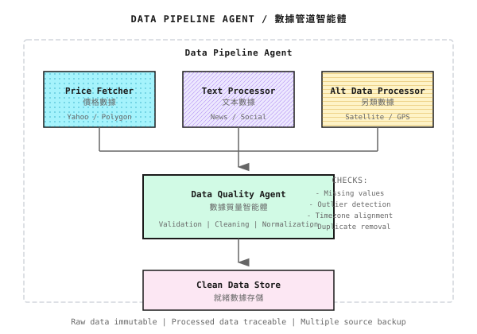

# 第 06 課：數據工程的殘酷現實

> **數據問題殺死的策略比模型問題多得多。**

---

## 一個令人崩潰的週末

週五晚上 11 點，小王部署了他精心開發的美股量化策略。回測年化 80%，夏普比率 2.5，一切看起來完美。

週一早上 9 點，他被告警短訊吵醒："策略異常，無法獲取數據"。

他爬起來檢查，發現 Alpha Vantage API 返回了 **429 Too Many Requests**。他的程序每分鐘請求 10 次，超過了免費賬戶的 API 限流（每分鐘 5 次）。

修復後，策略終於開始運行。

週一下午 2 點，又一條告警："策略倉位異常"。

這次是數據問題：API 返回了一個**缺失的分鐘 K 線**，導致 MACD 計算出 NaN，程序把 NaN 當成賣出信號，清空了所有倉位。

修復後，他決定做一個全面的數據檢查。然後他發現了更多問題：

- 某些時間戳是 UTC，某些是 ET（美東時間）
- 有幾根 K 線的成交量是 0（盤前盤後時段）
- 歷史數據和實時數據的字段名不一樣（`close` vs `Close`）

**整整一週，他沒有寫一行策略代碼，全在處理數據問題。**

這就是數據工程的殘酷現實。

---

## 6.1 數據源選擇

### 免費數據源

| 數據源 | 覆蓋市場 | 優點 | 缺點 |
|-------|---------|------|------|
| **Yahoo Finance** (yfinance) | 美股、ETF | 免費、歷史長 | **近年有不穩定反饋**（接口變動/限流/缺失數據等），需要容錯 |
| **Alpaca Markets** | 美股 | IEX 數據免費，API 友好 | 免費版數據覆蓋有限 |
| **Binance API** | 加密貨幣 | 實時、免費 | 只有 Binance 數據 |
| **Alpha Vantage** | 股票、外匯、加密 | 免費層可用 | 免費層請求配額通常很低（限流會調整，以官網為準） |
| **CCXT** | 加密貨幣 | 統一接口 | 依賴各交易所 API |

> **注意**：數據服務商可能在產品、接口、配額、定價上發生調整甚至停服/遷移。這提醒我們數據源也有"退市風險"，建議做好備份方案。

### 付費數據源（2024-2025 參考價格）

| 數據源 | 覆蓋市場 | 月費 | 特點 |
|-------|---------|------|------|
| **Bloomberg** | 全球 | **$2,500+** | 機構標配，數據質量最高 |
| **LSEG Workspace**（原 Refinitiv）| 全球 | 按需報價 | LSEG 旗下，原 Reuters 數據 |
| **Polygon.io**（現已更名為 Massive）| 美股 | **$99+** | 實時+歷史，開發者友好 |
| **Nasdaq Data Link**（原 Quandl）| 另類數據 | 按數據集定價 | 衞星、消費數據等 |

### 如何選擇？

```
個人學習/研究：
    → 免費數據源 + 容忍數據問題

小型基金（< $1M AUM）：
    → 付費數據源（基礎套餐）+ 自建數據校驗

機構級（> $10M AUM）：
    → Bloomberg/Refinitiv + 多數據源交叉驗證
```

**核心原則**：**數據質量決定策略上限**。垃圾進，垃圾出。

> **數據源的演進路徑**
>
> | 階段 | 推薦數據源 | 説明 |
> |------|-----------|------|
> | 學習/原型 | Yahoo Finance (yfinance) | 免費日線，夠用 |
> | 小規模實盤 | Polygon.io / Alpaca | 實時行情，API 友好 |
> | 機構級生產 | Databento / 交易所直連 | L1/L2 實時數據，低延遲 |
>
> 本課的練習使用 Yahoo Finance 完全夠用。當你準備進入實盤交易時，需要升級到專業級數據源——詳見第 19 課。

---

## 6.2 API 的痛苦現實

### 你以為的代碼 vs 實際的代碼

**你以為**：
```python
data = api.get_history("AAPL", days=365)
```

**實際**：

<details>
<summary>💻 偽代碼參考（需替換為具體 SDK，如 yfinance / alpaca / ccxt）</summary>

```python
# 注意：以下為偽代碼，展示健壯數據獲取的設計模式
# api, log, EmptyDataError, RateLimitError 需替換為你使用的具體庫

import time
from typing import Optional
import pandas as pd

def get_history_robust(
    symbol: str,
    days: int,
    max_retries: int = 5,
    backoff_base: float = 2.0
) -> Optional[pd.DataFrame]:
    """
    健壯的數據獲取函數

    處理的問題：
    - Rate Limiting（指數退避重試）
    - 空數據（驗證+報警）
    - 連接錯誤（自動重連）
    - 超時（設置合理超時）
    """
    for attempt in range(max_retries):
        try:
            # 設置超時（替換為你的 API 調用）
            data = api.get_history(
                symbol,
                days=days,
                timeout=30
            )

            # 驗證數據（通用邏輯）
            if data is None:
                raise EmptyDataError(f"No data for {symbol}")

            if len(data) == 0:
                raise EmptyDataError(f"Empty data for {symbol}")

            if len(data) < days * 0.9:  # 數據量不足90%
                log.warning(f"Data incomplete: got {len(data)}, expected ~{days}")

            # 檢查異常值
            if data['close'].isnull().any():
                log.warning("NaN values detected, filling...")
                data['close'] = data['close'].ffill()

            return data

        except RateLimitError:
            wait_time = backoff_base ** attempt
            log.info(f"Rate limited, waiting {wait_time}s...")
            time.sleep(wait_time)

        except ConnectionError:
            log.warning("Connection lost, reconnecting...")
            api.reconnect()
            time.sleep(1)

        except TimeoutError:
            log.warning("Request timeout, retrying...")

        except Exception as e:
            log.error(f"Unexpected error: {e}")
            if attempt == max_retries - 1:
                raise

    return None
```

</details>

### 常見 API 問題

| 問題 | 表現 | 解決方案 |
|-----|------|---------|
| **Rate Limiting** | 429 錯誤 | 指數退避重試 + 請求隊列 |
| **數據缺失** | 空響應或部分數據 | 多數據源備份 + 缺失檢測 |
| **數據延遲** | 數據時間戳落後 | 記錄延遲 + 調整策略 |
| **格式不一致** | 字段名變化 | 統一數據適配層 |
| **連接不穩定** | 斷連、超時 | 心跳檢測 + 自動重連 |

### Rate Limiting 的真實成本

假設你需要獲取 100 個標的的分鐘 K 線：

| API 限制 | 完成時間 |
|---------|---------|
| 1 請求/秒 | 100 秒 |
| 10 請求/秒 | 10 秒 |
| 無限制 | < 1 秒 |

**高頻策略需要高 API 配額**，這是付費數據源的核心價值。

---

## 6.3 時間對齊問題

### 時區混亂

不同數據源使用不同時區：

| 數據源 | 默認時區 |
|-------|---------|
| Binance | UTC |
| Yahoo Finance | 交易所當地時間 |
| A股數據 | UTC+8 |
| 美股數據 | ET (Eastern Time) |

> **生產提示：標準化數據模型**
> 不同市場和數據源使用不同的代碼格式（`600519.SH`、`AAPL`、`0700.HK`、`BTC/USDT`）。生產系統需要一個**統一的規範化層**（Normalizer），將外部格式轉換為內部標準格式（如 `SYMBOL.EXCHANGE`：`AAPL.NASDAQ`、`0700.HKEX`）。這是實現多市場交易的前提條件。同時注意符號解析的常見陷阱：退市股票靜默失敗、公司行為導致代碼變更、多段式代碼（如 BRK.B）等。詳見第 19 課。

**如果不處理**：
- 9:30 A股數據 + 9:30 美股數據 → 實際相差 12 小時
- 策略用"同一時刻"的數據，實際是不同時刻

**解決方案**：**全部轉換為 UTC**，存儲和計算都用 UTC。

```python
import pandas as pd

def normalize_timezone(df, source_tz='UTC'):
    """統一轉換為 UTC"""
    if df.index.tz is None:
        df.index = df.index.tz_localize(source_tz)
    df.index = df.index.tz_convert('UTC')
    return df
```

### Tick 到 K 線的聚合

從 Tick 數據聚合 K 線，需要注意：

| 問題 | 説明 |
|-----|------|
| 開盤價 | 該時間段第一筆成交價 |
| 收盤價 | 該時間段最後一筆成交價 |
| 最高價 | 該時間段最高成交價 |
| 最低價 | 該時間段最低成交價 |
| 成交量 | 該時間段所有成交量之和 |

**陷阱**：如果某分鐘沒有成交，怎麼辦？

```
方案 1：用前一分鐘的收盤價填充 OHLC
方案 2：標記為缺失，後續處理
方案 3：從聚合中排除該時間點
```

不同方案會導致不同的指標計算結果。**必須統一處理規則**。

### 跨資產數據對齊

股票、期貨、外匯的交易時間不同：

| 資產 | 交易時間 |
|-----|---------|
| A股 | 9:30-11:30, 13:00-15:00 |
| 美股 | 9:30-16:00 ET |
| 外匯 | 7×24（接近）|
| 加密貨幣 | 7×24 |

**如果策略需要跨資產信號**：
- A股收盤時，美股還沒開盤
- 用 A 股收盤價 + 美股開盤價？會有時差
- 需要仔細設計"同步點"

---

## 6.4 數據質量問題

### 異常值檢測與處理

| 異常類型 | 識別方法 | 處理方法 |
|---------|---------|---------|
| 價格跳變 | 漲跌幅 > 20% | 檢查是否真實（拆股？）|
| 成交量異常 | 0 或極大值 | 檢查交易所狀態 |
| 缺失值 | NaN | 前值填充或刪除 |
| 重複數據 | 時間戳重複 | 保留第一條或最後一條 |

```python
def detect_anomalies(df, price_col='close', volume_col='volume'):
    """檢測數據異常"""
    issues = []

    # 價格跳變
    returns = df[price_col].pct_change()
    jumps = returns.abs() > 0.20
    if jumps.any():
        issues.append(f"Price jumps detected: {jumps.sum()} times")

    # 成交量為 0
    zero_volume = df[volume_col] == 0
    if zero_volume.any():
        issues.append(f"Zero volume: {zero_volume.sum()} bars")

    # 缺失值
    nulls = df.isnull().sum()
    if nulls.any():
        issues.append(f"Null values: {nulls.to_dict()}")

    # 時間戳重複
    duplicates = df.index.duplicated()
    if duplicates.any():
        issues.append(f"Duplicate timestamps: {duplicates.sum()}")

    return issues
```

### 股票分紅、拆股調整

股票的歷史價格需要"復權"：

| 事件 | 實際變化 | 未復權數據 | 復權後數據 |
|-----|---------|-----------|-----------|
| 10送10 | 股數翻倍，價格減半 | 前後價格斷崖 | 平滑連續 |
| 分紅 | 扣除分紅 | 除息日跳空 | 調整歷史價格 |

**不復權的後果**：
- 回測時，策略會在除權日產生虛假信號
- 計算收益率會出現極端值

### 期貨換月處理

期貨合約有到期日，需要"換月"：

```
2024年1月：持有 IF2401（1月合約）
2024年1月到期前：切換到 IF2402（2月合約）

問題：IF2401 收盤價 4000，IF2402 收盤價 4050
      不是真實漲跌，而是合約不同
```

**處理方法**：
- 拼接時計算價差，調整歷史價格
- 或使用"主力合約連續"數據（數據商已處理）

---

## 6.5 倖存者偏差 (Survivorship Bias)

### 什麼是倖存者偏差？

如果你只用"現在還存在的股票"做回測：

```
2010 年的股票池：1000 只
2024 年還存在的：800 只
退市/破產的：200 只

你的回測只用了 800 只，忽略了那 200 只失敗的公司
→ 回測收益被高估
```

### 倖存者偏差有多嚴重？

| 研究 | 結論 |
|-----|------|
| 學術研究 | 年化收益高估 1-3% |
| 價值投資策略 | 高估更嚴重（便宜股更容易退市）|
| 小盤股策略 | 偏差最大 |

### 如何避免？

| 方法 | 實現難度 | 效果 |
|-----|---------|------|
| 使用含退市股票的數據庫 | 高 | 最準確 |
| 使用歷史指數成分股 | 中 | 較準確 |
| 在結論中説明偏差 | 低 | 至少誠實 |

**付費數據源通常提供"無倖存者偏差"的數據集**，這是另一個付費價值。

---

## 6.6 另類數據簡介

### 什麼是另類數據？

傳統數據：價格、成交量、財務報表
另類數據：**傳統數據之外的一切**

| 類型 | 數據源 | 應用場景 |
|-----|-------|---------|
| **衞星數據** | 停車場車輛數、油罐儲量 | 預測零售業績、原油庫存 |
| **文本數據** | 新聞、社交媒體、財報 | 情感分析、事件驅動 |
| **信用卡數據** | 消費支出統計 | 預測公司營收 |
| **網絡流量** | 網站訪問量 | 預測電商業績 |
| **GPS 數據** | 手機位置 | 人流分析 |

### 另類數據的挑戰

| 挑戰 | 説明 |
|-----|------|
| **噪聲大** | 信號/噪聲比遠低於價格數據 |
| **合規風險** | 隱私問題、數據來源合法性 |
| **Alpha 衰減快** | 一旦被廣泛使用，優勢消失 |
| **成本高** | 數據本身貴 + 處理成本高 |

### 多智能體視角



---

## 6.7 數據管道設計原則

### 三大原則

| 原則 | 説明 |
|-----|------|
| **不可變性** | 原始數據永不修改，處理後生成新文件 |
| **可追溯性** | 每條數據記錄來源、處理時間、處理版本 |
| **冗餘備份** | 至少兩個數據源交叉驗證 |

### 數據管道架構

```
數據採集層
    │
    ├─→ 原始數據存儲（不可變）
    │         │
    │         ▼
    ├─→ 數據清洗層
    │     - 異常值處理
    │     - 缺失值填充
    │     - 時區標準化
    │         │
    │         ▼
    ├─→ 特徵工程層
    │     - 技術指標計算
    │     - 標籤生成
    │         │
    │         ▼
    └─→ 就緒數據存儲 → 策略使用
```

### 監控與告警

| 監控項 | 閾值建議 | 告警動作 |
|-------|---------|---------|
| 數據延遲 | > 1 分鐘 | 警告 |
| 數據缺失率 | > 1% | 警告 |
| 異常值比例 | > 0.1% | 檢查 |
| API 錯誤率 | > 5% | 暫停策略 |

---

## 💻 代碼實現（可選）

### 數據質量檢查框架

```python
import pandas as pd
from dataclasses import dataclass
from typing import List

@dataclass
class DataQualityReport:
    symbol: str
    start_date: str
    end_date: str
    total_rows: int
    missing_rows: int
    null_values: dict
    anomalies: List[str]
    is_valid: bool

def check_data_quality(df: pd.DataFrame, symbol: str) -> DataQualityReport:
    """全面的數據質量檢查"""

    anomalies = []

    # 檢查時間連續性
    # 注意：這裏以“日頻數據”為例（按工作日粗略估計）。
    # 分鐘/Tick 數據需要結合交易所交易時段、節假日、午休等生成 expected_index。
    idx = pd.DatetimeIndex(df.index)
    expected_index = pd.bdate_range(start=idx.min().normalize(), end=idx.max().normalize())
    expected_rows = len(expected_index)
    actual_rows = len(df)
    missing_rows = expected_rows - actual_rows

    if missing_rows > expected_rows * 0.05:
        anomalies.append(f"High missing rate: {missing_rows/expected_rows:.1%}")

    # 檢查 NULL 值
    null_counts = df.isnull().sum().to_dict()

    # 檢查價格跳變
    if 'close' in df.columns:
        returns = df['close'].pct_change()
        extreme_moves = (returns.abs() > 0.2).sum()
        if extreme_moves > 0:
            anomalies.append(f"Extreme price moves: {extreme_moves}")

    # 檢查成交量
    if 'volume' in df.columns:
        zero_volume = (df['volume'] == 0).sum()
        if zero_volume > 0:
            anomalies.append(f"Zero volume periods: {zero_volume}")

    # 檢查時間戳重複
    duplicates = df.index.duplicated().sum()
    if duplicates > 0:
        anomalies.append(f"Duplicate timestamps: {duplicates}")

    return DataQualityReport(
        symbol=symbol,
        start_date=str(df.index[0]),
        end_date=str(df.index[-1]),
        total_rows=actual_rows,
        missing_rows=missing_rows,
        null_values=null_counts,
        anomalies=anomalies,
        is_valid=len(anomalies) == 0
    )
```

---

## 本課交付物

完成本課後，你將獲得：

1. **對數據問題的深刻認知** - 知道數據工程才是量化的主戰場
2. **API 使用的最佳實踐** - 健壯的數據獲取代碼框架
3. **數據質量檢查能力** - 能識別和處理常見數據問題
4. **數據管道設計思路** - 理解生產級數據系統的架構

---

## 本課要點回顧

- [x] 理解免費數據源和付費數據源的權衡
- [x] 掌握處理 API 限流、數據缺失等問題的方法
- [x] 認識時區混亂、倖存者偏差等隱蔽問題
- [x] 瞭解另類數據的價值和挑戰
- [x] 理解數據管道的設計原則

---

## 延伸閲讀

- [背景知識：交易所與訂單簿機制](背景知識/交易所與訂單簿機制.md) - Tick 數據的來源
- [背景知識：加密貨幣交易特點](背景知識/加密貨幣交易特點.md) - 7×24 數據的挑戰

---

## 下一課預告

**第 07 課：回測系統的陷阱**

數據沒問題，回測可能還是騙你。Look-Ahead Bias、過擬合、交易成本忽略……這些陷阱讓無數看起來完美的策略在實盤中慘敗。下一課揭開回測的真相。
