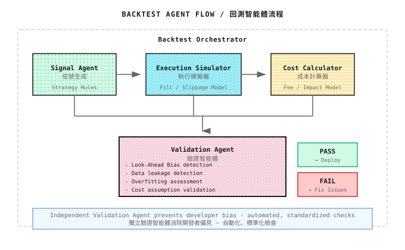

# 第 07 課：回測系統的陷阱

> **回測年化 100%，實盤虧損 50%。這不是意外，是必然。**

---

## 完美策略的覆滅

2019 年，一位量化研究員開發了一個"完美"的 A 股策略。

回測數據：
- 年化收益：120%
- 夏普比率：3.5
- 最大回撤：8%
- 勝率：68%

他信心滿滿地投入了 500 萬人民幣。

**第一個月**：收益 +2%，符合預期
**第二個月**：收益 -5%，開始不安
**第三個月**：收益 -8%，開始懷疑
**第六個月**：累計虧損 35%

他仔細檢查了代碼，發現三個致命錯誤：

1. **Look-Ahead Bias**：策略用了"第二天的開盤價"判斷是否入場，但實際上第二天開盤前你不知道開盤價是多少

2. **過擬合**：他測試了 200 多個參數組合，選了最好的那個。但那只是"恰好在歷史數據上表現好"，不是真正有效

3. **交易成本忽略**：回測假設滑點 0.1%，實盤滑點 0.5%；回測沒算衝擊成本，實盤大單經常被"吃"

**回測不是預測未來，而是描述過去。如果你不知道回測的陷阱，過去的描述就會變成對未來的誤導。**

---

## 7.1 Look-Ahead Bias（前瞻偏差）

### 什麼是 Look-Ahead Bias？

在回測中**使用了未來信息**做決策。

最常見的錯誤：

| 錯誤 | 説明 |
|-----|------|
| 用收盤價判斷入場 | 收盤價是收盤後才知道的 |
| 用當日數據算指標 | 當日結束前，MACD 等指標是不確定的 |
| 用未來數據做標籤 | "3 天后漲了"作為標籤，但交易時你不知道 |

### 直觀理解

```
時間線：
9:30 ─────── 10:00 ─────── 11:00 ─────── 收盤
  │            │            │            │
  你在這裏     │            │         ← 你不知道這些信息
              │            ↑
              │         實時可知
              ↑
           實時可知
```

**回測時容易犯的錯**：用收盤後的完整數據，假裝在任意時刻做決策。

### 典型錯誤案例

```python
# 錯誤代碼（Look-Ahead Bias）
for i in range(len(data)):
    if data['close'][i] > data['open'][i]:  # 今天收陽
        buy_price = data['open'][i]  # ← 錯！你是收盤後才知道"收陽"的
        # 實際上開盤時你不知道今天會收陽還是收陰

# 正確代碼
for i in range(1, len(data)):  # 從第二天開始
    if data['close'][i-1] > data['open'][i-1]:  # 昨天收陽
        buy_price = data['open'][i]  # 今天開盤價入場
```

### 如何避免？

| 原則 | 實現 |
|-----|------|
| **信號與執行分離** | T 日信號，T+1 日執行 |
| **只用過去數據** | 計算指標時用 `shift(1)` |
| **假設最壞成交價** | 買入用最高價，賣出用最低價 |

---

## 7.2 數據泄漏

### 什麼是數據泄漏？

訓練模型時，**測試集信息"泄漏"到了訓練集**。

### 時間序列中的泄漏

金融數據有時間順序，不能像普通 ML 那樣隨機劃分：

```
錯誤的劃分方式：
訓練集: [1月, 3月, 5月, 7月, 9月, 11月]  ← 隨機選
測試集: [2月, 4月, 6月, 8月, 10月, 12月]  ← 隨機選

問題：訓練集包含 3 月數據，但 2 月是測試集
      用"未來"數據訓練，預測"過去"
```

**正確的劃分**：

```
正確的劃分方式：
訓練集: [1月 - 8月]
驗證集: [9月 - 10月]
測試集: [11月 - 12月]

保持時間順序！
```

### 特徵工程中的泄漏

| 泄漏類型 | 示例 |
|---------|------|
| **未來收益作為特徵** | 用"未來 5 天收益"作為輸入特徵 |
| **全局歸一化** | 用整個數據集的均值/標準差歸一化 |
| **標籤參與特徵** | 用收益率計算的指標預測收益率 |

```python
# 錯誤：全局歸一化（泄漏了未來數據的分佈信息）
mean = df['close'].mean()  # 包含未來數據
std = df['close'].std()    # 包含未來數據
df['normalized'] = (df['close'] - mean) / std

# 正確：滾動窗口歸一化
df['normalized'] = (df['close'] - df['close'].rolling(20).mean()) / df['close'].rolling(20).std()
```

### 特徵重要性中的泄漏

如果一個特徵的重要性極高（如 >50%），很可能是泄漏：

```
懷疑泄漏的信號：
- 某特徵重要性 > 50%
- 模型準確率 > 90%
- 訓練集和測試集表現一樣好
```

---

## 7.3 過擬合

### 什麼是過擬合？

模型"記住"了歷史數據的噪音，而非學到真正的規律。

### 過擬合的表現

```
訓練集表現：年化 80%，夏普 3.0
測試集表現：年化 5%，夏普 0.5

巨大的差距 = 過擬合
```

### 為什麼量化特別容易過擬合？

| 原因 | 説明 |
|-----|------|
| **參數太多** | 100 個參數，只有 1000 個樣本 |
| **多重檢驗** | 測試 1000 個策略，總有幾個"有效" |
| **信噪比低** | 市場噪音大，真實信號弱 |
| **分佈不穩定** | 過去的規律未來可能失效 |

### 多重檢驗問題

假設你測試 100 個隨機策略（實際上都無效）：

```
p < 0.05 的概率：5%
100 個策略中，期望有 5 個"顯著"

問題：這 5 個策略看起來有效，但只是運氣好
```

**Bonferroni 校正**：如果測試 n 個策略，顯著性閾值應該是 0.05/n

```
測試 100 個策略 → 閾值 0.05/100 = 0.0005
測試 1000 個策略 → 閾值 0.05/1000 = 0.00005
```

### 過擬合的檢測

| 指標 | 過擬合信號 |
|-----|-----------|
| 訓練/測試差距 | 訓練 >> 測試 |
| 參數敏感性 | 微調參數，結果劇變 |
| 跨時期穩定性 | 不同年份表現差異大 |
| 策略複雜度 | 規則越複雜，越可能過擬合 |

### 如何減少過擬合？

| 方法 | 説明 |
|-----|------|
| **簡化模型** | 越簡單越不容易過擬合 |
| **增加數據** | 更多樣本，更難記住噪音 |
| **正則化** | L1/L2 懲罰複雜模型 |
| **早停** | 驗證集表現下降時停止訓練 |
| **集成方法** | 多個模型投票，減少個體偏差 |

---

## 7.4 交易成本忽略

### 常被忽略的成本

| 成本類型 | 典型值（2024-2025）| 回測常見假設 |
|---------|-------|-------------|
| **手續費** | 美股零佣金（零售）；A股萬1-萬2.5 | 0% 或低估 |
| **滑點** | 0.01-0.5%（視流動性）| 0% 或固定值 |
| **市場衝擊** | 0.1-1%+ | 完全忽略 |
| **借券費用** | 年化 0.5-50%+（視難借程度）| 忽略 |
| **資金成本** | 年化 4-5%（當前利率環境）| 忽略 |

> **美股"零佣金"注意**：雖然主流券商（Fidelity、Schwab、Robinhood）免佣金，但仍有 SEC 費（費率會調整，量級為每賣出 $1M 數十美元）和 PFOF（訂單流支付）等隱性成本。

### 滑點的真實影響

假設策略每年交易 200 次，單邊滑點 0.2%：

```
年交易成本 = 200次 × 0.2% × 2（買+賣）= 80%

如果你的策略年化收益是 50%，扣除滑點後：
實際收益 = 50% - 80% = -30%
```

**高頻策略被滑點殺死是常態**。

### 市場衝擊建模

大單會"吃掉"訂單簿，抬高/壓低成交價：

```
平方根法則估算：

衝擊成本 ≈ σ × √(Q/V)

σ = 日波動率（如 2%）
Q = 你的訂單量
V = 日均成交量

示例：
訂單量 = 日均成交量的 1%
衝擊成本 ≈ 2% × √0.01 = 0.2%
```

### 正確的成本建模

```python
def estimate_trading_cost(
    price: float,
    quantity: float,
    daily_volume: float,
    daily_volatility: float,
    commission_rate: float = 0.0003  # 萬三
) -> dict:
    """估算交易成本"""

    # 手續費
    commission = price * quantity * commission_rate

    # 滑點（假設市價單吃掉 2-3 檔）
    slippage_rate = 0.001 * (quantity / daily_volume) ** 0.5
    slippage = price * quantity * slippage_rate

    # 市場衝擊
    participation = quantity / daily_volume
    impact_rate = daily_volatility * (participation ** 0.5)
    market_impact = price * quantity * impact_rate

    total = commission + slippage + market_impact

    return {
        'commission': commission,
        'slippage': slippage,
        'market_impact': market_impact,
        'total': total,
        'total_rate': total / (price * quantity)
    }
```

---

## 7.5 正確的回測方法

### Walk-Forward 驗證

**核心思想**：模擬真實的策略開發過程——用過去訓練，在"未來"測試，滾動前進。

```
第 1 輪：
  訓練: [1月-6月]  →  測試: [7月]
第 2 輪：
  訓練: [2月-7月]  →  測試: [8月]
第 3 輪：
  訓練: [3月-8月]  →  測試: [9月]
...

每輪都是"樣本外"測試
```

**優點**：
- 模擬真實情況
- 多次樣本外測試，結果更可靠
- 能檢測參數穩定性

### Out-of-Sample 測試

**嚴格保留一部分數據，完全不參與開發**：

```
開發階段可用數據：[2015-2022]
  ├─ 訓練集: [2015-2019]
  ├─ 驗證集: [2020-2021]
  └─ 調參、選模型都在這裏完成

最終測試數據：[2022-2023]
  └─ 只用一次！
     一旦看過，就不再是 OOS
```

**關鍵原則**：OOS 數據只能用一次。如果你根據 OOS 結果調整策略，它就變成了 IS（樣本內）。

### Monte Carlo 模擬

**通過隨機擾動，測試策略的魯棒性**：

```
原始回測：年化 30%

Monte Carlo 模擬（1000 次）：
- 隨機打亂交易順序
- 隨機調整入場時間 ±1 天
- 隨機調整成本 ±20%

結果分佈：
  5th percentile: 年化 8%
  50th percentile: 年化 25%
  95th percentile: 年化 45%

→ 真實表現可能在 8%-45% 之間
```

**如果 Monte Carlo 後大部分情況都虧損，策略不可靠**。

### 回測質量門（Quality Gate）

> **這是全書最重要的清單之一。** 在開始實盤前，每一項都必須通過。打印出來貼在牆上。

#### 第一層：數據完整性

| # | 檢查項 | 通過標準 | 失敗後果 |
|---|-------|---------|---------|
| 1.1 | 數據覆蓋 | 訓練+測試 ≥ 5 年，包含至少 1 次牛熊週期 | 未經歷極端市場，策略穩定性未知 |
| 1.2 | 復權/換月處理 | 使用後復權價格，期貨主力連續 | 假信號、收益虛高 |
| 1.3 | 倖存者偏差 | 包含退市股票數據 | 高估歷史收益 50%+ |
| 1.4 | 時區對齊 | 所有數據源統一時區（UTC 或本地） | 跨市場信號錯亂 |

#### 第二層：時間完整性

| # | 檢查項 | 通過標準 | 失敗後果 |
|---|-------|---------|---------|
| 2.1 | Look-Ahead Bias | 信號 T 日生成，T+1 日執行 | 回測收益虛高 2-10x |
| 2.2 | 數據泄漏 | 訓練/測試嚴格按時間分離 | 過擬合不可檢測 |
| 2.3 | 特徵計算 | 所有特徵用 shift(1) 或更早數據 | 用了未來信息 |
| 2.4 | 標籤定義 | 標籤只用當前時刻之前的數據 | 標籤泄漏 |

#### 第三層：過擬合檢測

| # | 檢查項 | 通過標準 | 失敗後果 |
|---|-------|---------|---------|
| 3.1 | OOS 表現 | OOS 收益 > 訓練收益的 50% | 嚴重過擬合 |
| 3.2 | 參數穩定性 | 參數 ±20% 變化，收益變化 < 30% | 參數敏感，不可復現 |
| 3.3 | 多重檢驗 | 測試 n 個策略，p 值閾值 = 0.05/n | 假陽性策略 |
| 3.4 | 跨時期穩定性 | 每年夏普 > 0.5，無大幅波動 | 只在特定時期有效 |

#### 第四層：成本建模

| # | 檢查項 | 通過標準 | 失敗後果 |
|---|-------|---------|---------|
| 4.1 | 手續費 | 包含真實費率（美股零售零佣金，機構約$0.003/股；A股約萬二） | 低估成本 |
| 4.2 | 滑點 | 保守假設（建議 0.1-0.3%） | 高頻策略虧損 |
| 4.3 | 市場衝擊 | 大單考慮平方根衝擊模型 | 容量虛高 |
| 4.4 | 資金成本 | 融資做空考慮借券費用 | 做空策略盈利虛高 |

#### 第五層：驗證方法

| # | 檢查項 | 通過標準 | 失敗後果 |
|---|-------|---------|---------|
| 5.1 | Walk-Forward | 至少 10 輪滾動驗證 | 單次驗證不可靠 |
| 5.2 | Monte Carlo | 90% 模擬結果 > 0 | 運氣成分太大 |
| 5.3 | 壓力測試 | 2008、2020、2022 三次危機都測試 | 危機時爆倉 |
| 5.4 | 收益衰減 | 回測收益 × 0.5 後仍可接受 | 實盤預期過高 |

**使用方法**：
1. 每項必須通過，任一項失敗則不可實盤
2. 通過的項打 ✅，失敗的項標註具體問題
3. 修復後重新運行整個檢查流程

**快速自檢**（在每次回測後問自己）：
- "我用了未來信息嗎？" → 檢查層 2
- "換個時期還有效嗎？" → 檢查層 3
- "成本扣掉還賺錢嗎？" → 檢查層 4
- "運氣成分大嗎？" → 檢查層 5

---

## 7.6 常見誤區

**誤區一：回測收益高就是好策略**

最危險的假設。回測收益高可能是過擬合、Look-Ahead Bias、成本低估的結果。真正重要的是 OOS（樣本外）表現和參數穩定性。

**誤區二：測試了 100 個策略，選最好的那個**

典型的多重檢驗問題。測試 100 個隨機策略，期望有 5 個"顯著"（p<0.05），但它們只是運氣好。正確做法：p 值閾值 = 0.05/100 = 0.0005。

**誤區三：回測用收盤價成交是合理假設**

不合理。收盤價是收盤後才知道的。實際交易中，你在收盤前下單，成交價可能是收盤價 ± 滑點。正確做法：信號 T 日生成，T+1 日執行。

**誤區四：模擬交易表現好就能實盤**

不夠。模擬交易通常滑點理想、無市場衝擊、100% 成交。實盤需要漸進部署：模擬交易 → 1-5% 資金實盤 → 逐步加倉。

---

## 7.7 從回測到實盤的差距

> **行業共識**：回測到實盤的性能衰減平均為 **30-50%**。這不是悲觀估計，而是無數實盤驗證後的行業經驗。

### 為什麼實盤總是比回測差？

| 因素 | 回測 | 實盤 | 收益影響 |
|-----|------|------|---------|
| 成交價 | 收盤價或假設價 | 實際成交價（通常更差）| -5~20% |
| 滑點 | 固定假設（0.1%）| 隨市場變化（0.2-0.5%）| -10~30% |
| 市場衝擊 | 完全忽略 | 大單顯著抬高成本 | -5~50% |
| 成交量 | 假設 100% 成交 | 可能部分成交 | -5~15% |
| 延遲 | 忽略 | 50-500ms | -2~10% |
| 故障 | 不存在 | 網絡斷、API 錯誤 | 不可預測 |
| 心理因素 | 不存在 | 恐懼和貪婪 | 不可預測 |
| 模型過擬合 | 不可見 | 暴露 | -20~80% |

### 性能衰減的行業數據

根據多家量化機構的實盤跟蹤統計：

```
┌─────────────────────────────────────────────────────────┐
│                回測到實盤性能衰減分佈                      │
├─────────────────────────────────────────────────────────┤
│  衰減幅度        │  佔比    │  主要原因                   │
├─────────────────────────────────────────────────────────┤
│  < 20%          │  10%    │  低頻策略、優秀成本建模       │
│  20-30%         │  25%    │  正常衰減範圍                │
│  30-50%         │  40%    │  典型情況（行業均值）         │
│  50-70%         │  15%    │  成本低估、輕度過擬合         │
│  > 70%          │  10%    │  嚴重過擬合、成本嚴重低估      │
└─────────────────────────────────────────────────────────┘
```

**關鍵洞察**：如果你的策略在回測中收益驚人（年化>100%），幾乎可以肯定實盤會大打折扣。

### 預期收益衰減公式

**保守估計法**（推薦）：

```
實盤預期收益 = 回測收益 × 0.5 - 隱性成本

隱性成本包括：
- 數據滯後：-2~5%
- 執行差異：-3~10%
- 模型衰減：-5~15%
```

**分場景估計**：

| 策略類型 | 回測年化 | 樂觀預期 | 保守預期 | 衰減因子 |
|---------|---------|---------|---------|---------|
| 低頻價值 | 30% | 20% | 12% | 0.4-0.65 |
| 中頻動量 | 50% | 30% | 18% | 0.35-0.6 |
| 高頻做市 | 100% | 40% | 20% | 0.2-0.4 |
| ML因子 | 80% | 35% | 15% | 0.2-0.45 |

**核心原則**：**如果回測收益減半後仍然可接受，再考慮實盤**。

### 衰減的主要原因分解

```
回測收益 100%
    │
    ├── 交易成本低估 ────────────────────── -20%
    │     • 滑點假設 0.1%，實際 0.3%
    │     • 忽略市場衝擊
    │
    ├── 過擬合 ─────────────────────────── -25%
    │     • 參數在歷史數據上過度優化
    │     • 多重檢驗未校正
    │
    ├── 執行差異 ───────────────────────── -10%
    │     • 延遲導致價格偏移
    │     • 部分成交影響策略邏輯
    │
    ├── 市場regime變化 ─────────────────── -10%
    │     • 歷史模式不再有效
    │     • 新的市場參與者結構
    │
    └── 實盤預期收益 ─────────────────────  35%
```

### 漸進式部署

| 階段 | 資金規模 | 目標 |
|-----|---------|------|
| **Paper Trading** | $0 | 驗證系統穩定性 |
| **微量實盤** | 1-5% 總資金 | 驗證執行質量 |
| **小規模實盤** | 10-20% | 積累實盤數據 |
| **正常運行** | 計劃規模 | 持續監控 |

---

## 7.8 多智能體視角

### 回測系統的 Agent 分工



### 為什麼需要獨立的 Validation Agent？

- **策略開發者有偏見**：總想證明自己的策略有效
- **自動檢測更可靠**：不會遺漏檢查項
- **標準化流程**：確保每個策略都經過同樣的審核

---

## 💻 代碼實現（可選）

### Walk-Forward 驗證框架

```python
import pandas as pd
import numpy as np
from typing import Callable, List, Dict

def walk_forward_validation(
    data: pd.DataFrame,
    strategy_fn: Callable,
    train_window: int = 252,  # 約 1 年
    test_window: int = 63,    # 約 3 個月
    step: int = 21            # 每月滾動一次
) -> List[Dict]:
    """
    Walk-Forward 驗證

    參數：
    - data: 包含價格數據的 DataFrame
    - strategy_fn: 策略函數，接收訓練數據，返回模型/參數
    - train_window: 訓練窗口大小（天數）
    - test_window: 測試窗口大小（天數）
    - step: 滾動步長（天數）

    返回：
    - 每輪測試的結果列表
    """
    results = []
    total_len = len(data)

    for start in range(0, total_len - train_window - test_window, step):
        train_end = start + train_window
        test_end = train_end + test_window

        train_data = data.iloc[start:train_end]
        test_data = data.iloc[train_end:test_end]

        # 在訓練集上訓練/優化
        model = strategy_fn(train_data)

        # 在測試集上評估
        test_returns = evaluate_strategy(model, test_data)

        results.append({
            'train_start': train_data.index[0],
            'train_end': train_data.index[-1],
            'test_start': test_data.index[0],
            'test_end': test_data.index[-1],
            'test_return': test_returns.sum(),
            'test_sharpe': calculate_sharpe(test_returns)
        })

    return results


def detect_look_ahead_bias(backtest_fn: Callable, data: pd.DataFrame) -> bool:
    """
    檢測 Look-Ahead Bias

    原理：如果用未來數據，交易時間應該和信號時間匹配不上
    """
    trades = backtest_fn(data)

    for trade in trades:
        signal_time = trade['signal_time']
        execution_time = trade['execution_time']

        # 信號時間應該 < 執行時間
        if signal_time >= execution_time:
            print(f"可能存在 Look-Ahead Bias: 信號時間 {signal_time} >= 執行時間 {execution_time}")
            return True

    return False


def monte_carlo_backtest(
    base_results: pd.Series,
    n_simulations: int = 1000,
    return_perturbation: float = 0.1
) -> Dict:
    """
    Monte Carlo 模擬

    參數：
    - base_results: 原始回測的逐日收益
    - n_simulations: 模擬次數
    - return_perturbation: 收益擾動幅度

    返回：
    - 模擬結果統計
    """
    simulated_returns = []

    for _ in range(n_simulations):
        # 隨機打亂順序 + 添加噪音
        shuffled = base_results.sample(frac=1, replace=False)
        noisy = shuffled * (1 + np.random.uniform(-return_perturbation, return_perturbation, len(shuffled)))
        total_return = (1 + noisy).prod() - 1
        simulated_returns.append(total_return)

    simulated_returns = np.array(simulated_returns)

    return {
        'mean': simulated_returns.mean(),
        'std': simulated_returns.std(),
        'percentile_5': np.percentile(simulated_returns, 5),
        'percentile_50': np.percentile(simulated_returns, 50),
        'percentile_95': np.percentile(simulated_returns, 95),
        'prob_positive': (simulated_returns > 0).mean()
    }
```

---

## 本課交付物

完成本課後，你將獲得：

1. **對回測陷阱的深刻認知** - 知道為什麼回測賺錢、實盤虧錢
2. **偏差檢測能力** - 能識別 Look-Ahead Bias 和數據泄漏
3. **正確的回測方法論** - Walk-Forward、OOS、Monte Carlo
4. **實盤預期管理** - 理解回測到實盤的收益衰減
5. **回測質量門清單** - 可複用的 20 項檢查標準

### ✅ 驗收標準

| 檢查項 | 驗收標準 | 自測方法 |
|-------|---------|---------|
| **Look-Ahead 檢測** | 能在代碼中識別前瞻偏差 | 給定代碼片段，指出使用未來數據的位置 |
| **數據劃分** | 能正確劃分訓練/驗證/測試集 | 給定 5 年數據，畫出時間分割圖 |
| **過擬合識別** | 能説出 3 個過擬合信號 | 不看筆記，列舉檢測指標 |
| **Quality Gate** | 能默寫 20 項檢查的核心標準 | 從頭填寫檢查清單 |

**📝 診斷練習**：

某策略回測結果如下，診斷可能的問題：
- 訓練集年化收益：85%
- 測試集年化收益：12%
- 參數微調 ±10% 後收益變化 50-200%
- 共測試了 150 個策略變體
- 只有 2018-2022 年數據

<details>
<summary>點擊查看診斷結果</summary>

**問題診斷**：

1. **嚴重過擬合** - 訓練 85% vs 測試 12%，差距 7 倍，遠超 50% 閾值
2. **參數敏感** - ±10% 變化導致 50-200% 收益變化，不滿足穩定性要求
3. **多重檢驗問題** - 150 個變體，p 值閾值應為 0.05/150 = 0.00033
4. **數據不足** - 4 年數據未覆蓋 2008、2020 危機，穩定性未知

**結論**：此策略不可實盤。需要：
- 簡化模型減少參數
- 獲取更長時間數據（至少 10 年）
- 應用 Bonferroni 校正篩選策略
- 進行 Walk-Forward 和 Monte Carlo 驗證

</details>

---

## 本課要點回顧

- [x] 理解 Look-Ahead Bias 的本質和檢測方法
- [x] 掌握時間序列數據劃分的正確方式，避免數據泄漏
- [x] 認識過擬合的危害和多重檢驗問題
- [x] 學會正確建模交易成本
- [x] 掌握 Walk-Forward、OOS、Monte Carlo 等驗證方法

---

## 延伸閲讀

- [背景知識：歷史著名量化事故](../Part1-快速體驗/背景知識/歷史著名量化事故.md) - 回測失敗的真實案例
- [背景知識：夏普比率的統計陷阱](背景知識/夏普比率的統計陷阱.md) - 多重檢驗與 Deflated Sharpe Ratio
- [背景知識：Tick 級回測框架](背景知識/Tick級回測框架.md) - 高精度回測與隊列位置模擬
- *Advances in Financial Machine Learning* - Chapter 12: Backtesting

---

## Part 2（截至第 07 課）小結

到這裏，你已經把量化基礎裏最容易踩坑的兩座大山（數據、回測）拆開了。

截至第 07 課，你學到了：

| 課程 | 核心收穫 |
|-----|---------|
| 第 02 課 | 市場結構、交易成本、策略生命週期 |
| 第 03 課 | 時間序列、收益率、風險度量、厚尾分佈 |
| 第 04 課 | 技術指標的本質是特徵工程，不是買賣信號 |
| 第 05 課 | 趨勢跟隨 vs 均值迴歸，策略選擇取決於市場狀態 |
| 第 06 課 | 數據工程的挑戰：API、時區、質量、偏差 |
| 第 07 課 | 回測陷阱和正確的驗證方法 |

## 下一課預告

**第 08 課：Beta、對沖與市場中性**

你的策略賺錢了，但這些錢是從哪裏來的？是你的 Alpha（真正的超額收益），還是只是跟着市場漲了（Beta）？下一課我們深入理解風險的來源，學會如何分解收益、如何對沖，以及為什麼散戶很難做真正的市場中性。
