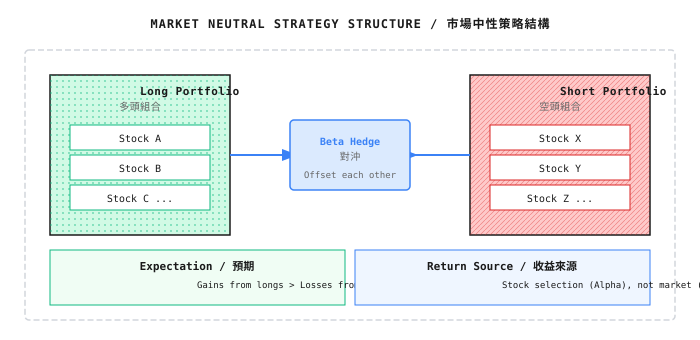
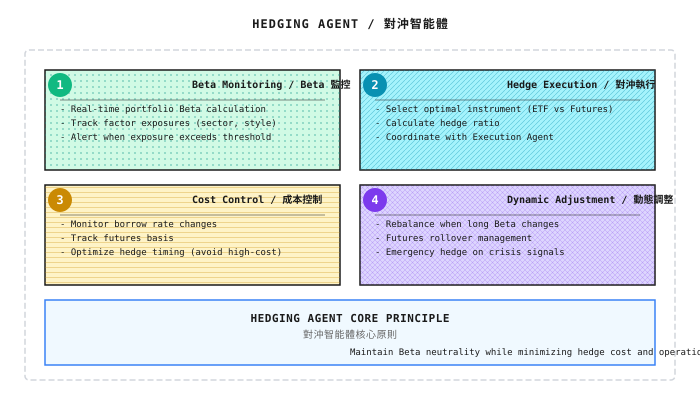
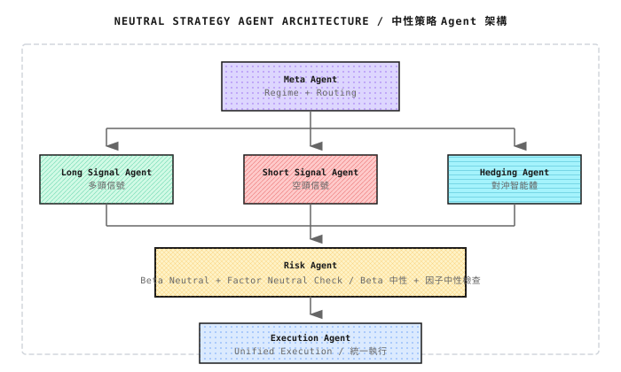

# 第 08 課：Beta、對沖與市場中性

> **你以為自己在產生 Alpha，其實可能只是在賭方向。**

---

## 一個典型情境（示意）

> 註：以下為虛構例子，用以說明常見現象；數字僅作示意，並不對應任何特定機構或產品。

2021 年，一支量化團隊向投資者展示業績：年化收益 32%，Sharpe ratio 1.8，最大 drawdown 僅 12%。投資者欣然入市。

一年後，投資者發現了真相：

那一年，Nasdaq 100 指數上升了 27%。

當他們做了簡單的 regression 分析，結果令人尷尬：
- **Beta = 1.15**（策略與大市高度相關）
- **真正的 Alpha = 32% - 1.15 x 27% = 1%**

換言之，這個「高回報策略」八成的收益來自**大市本身的上升**，而非任何獨特的交易能力。

更糟的是，2022 年大市下跌 33% 時，這個策略虧損 38%。投資者終於明白：他們買的不是「Alpha 策略」，而是一個**有槓桿的大市押注**。

**這個故事的教訓**：

> 不理解 Beta，就不知道收益從哪裏來；不理解對沖，就不知道風險在哪裏。

---

## 8.1 重新認識 Beta

### 8.1.1 Beta 的本質

在第一課的背景知識中，我們簡單介紹過 Alpha 和 Beta。現在讓我們更深入地理解它們。

**Beta** 衡量你的 portfolio 相對於市場 benchmark 的**敏感度**。

```
Beta = 1.0  -> Market up 10%, you up 10%
Beta = 1.5  -> Market up 10%, you up 15% (but you'll also lose 50% more when it falls)
Beta = 0.5  -> Market up 10%, you up 5% (half the volatility)
Beta = 0    -> Your returns are unrelated to market movement (this is "market neutral")
Beta < 0    -> Market up, you down; market down, you up (inverse)
```

### 8.1.2 為甚麼 Beta 比 Alpha 更重要？

很多人沉迷於尋找 Alpha，卻忽略了一個殘酷的現實：

| 維度 | Beta 收益 | Alpha 收益 |
|------|-----------|------------|
| **來源** | 承擔市場風險的回報 | 獨特技能/資訊的回報 |
| **可得性** | 任何人都能取得（買 index） | 極少人能持續取得 |
| **成本** | 極低（index fund 費用 0.03%） | 極高（hedge fund 2%+20%） |
| **Capacity** | 近乎無限 | 有限（Alpha 會衰減） |
| **可持續性** | 長期穩定（market risk premium） | 不確定（策略可能失效） |

**關鍵洞察**：

> 如果你的策略 Beta = 1，你的「策略收益」中有多少是 Alpha，有多少是 Beta？
>
> 對大多數散戶和不少「量化基金」而言，**八成以上的收益來自 Beta**。

### 8.1.3 紙上練習：分解你的收益

**情境**：你的策略在過去一年表現如下：
- 策略收益：+25%
- 同期 S&P 500（benchmark）：+18%
- 你的策略 Beta（以 regression 計算）：1.2

**問題**：你真正的 Alpha 是多少？

```
Alpha = Strategy return - Beta x Benchmark return
Alpha = 25% - 1.2 x 18%
Alpha = 25% - 21.6%
Alpha = 3.4%
```

> 註：嚴格而言，Alpha/Beta 通常是對**超額收益**（扣除無風險利率）做 regression 估算，Alpha 即截距。此簡化公式用於幫助直觀理解。

**解讀**：
- 你以為自己賺了 25%
- 實際上，21.6% 是因為你承擔了比大市更高的風險（Beta = 1.2）
- 只有 3.4% 是你的「真正能力」
- 如果明年大市下跌 20%，你可能會虧損 24%（1.2 x 20%）

<details>
<summary>程式碼實作（供工程師參考）</summary>

```python
import numpy as np
import pandas as pd
from scipy import stats

def decompose_returns(strategy_returns: pd.Series,
                      benchmark_returns: pd.Series,
                      rf_rate: float = 0.02) -> dict:
    """
    Decompose strategy returns into Alpha and Beta components

    Parameters:
        strategy_returns: Daily strategy return series
        benchmark_returns: Daily benchmark return series
        rf_rate: Annualized risk-free rate

    Returns:
        Dictionary with alpha, beta, r_squared
    """
    # Convert to excess returns
    rf_daily = rf_rate / 252
    excess_strategy = strategy_returns - rf_daily
    excess_benchmark = benchmark_returns - rf_daily

    # Linear regression: R_strategy = alpha + beta * R_benchmark
    slope, intercept, r_value, p_value, std_err = stats.linregress(
        excess_benchmark, excess_strategy
    )

    beta = slope
    alpha_daily = intercept
    alpha_annual = alpha_daily * 252  # Annualize

    # Return decomposition
    # Use compounded returns instead of simple sums (closer to typical backtest conventions)
    total_return = (1 + strategy_returns).prod() - 1
    benchmark_total_return = (1 + benchmark_returns).prod() - 1
    beta_contribution = beta * benchmark_total_return
    alpha_contribution = total_return - beta_contribution

    return {
        'beta': beta,
        'alpha_annual': alpha_annual,
        'r_squared': r_value ** 2,
        'total_return': total_return,
        'benchmark_total_return': benchmark_total_return,
        'beta_contribution': beta_contribution,
        'alpha_contribution': alpha_contribution,
        'beta_pct': beta_contribution / total_return * 100 if total_return != 0 else 0
    }

# Example usage
# result = decompose_returns(strategy_rets, spy_rets)
# print(f"Beta: {result['beta']:.2f}")
# print(f"Alpha (annualized): {result['alpha_annual']:.2%}")
# print(f"Beta contribution to returns: {result['beta_pct']:.1f}%")
```

</details>

---

## 8.2 Hedge 的本質

### 8.2.1 甚麼是 Hedge？

**Hedge** 的核心概念非常簡單：

> 持有相反方向的倉位，以抵銷你不想承擔的風險。

**比喻**：你買了北京到上海的機票，但擔心航班會被取消。你也可以同時買一張高鐵票作為「hedge」——如果航班正常，高鐵票就浪費了（hedge 成本）；如果航班取消，高鐵票就能救你。

### 8.2.2 Notional Hedging 與 Beta Hedging

這是很多人犯的第一個錯誤：**以為金額相等就代表風險相等**。

**個案**：

你持有 $1M 科技股（Beta = 1.5）。為了 hedge，你 short $1M 的 S&P 500 ETF（Beta = 1.0）。

**問題**：這是完美的 hedge 嗎？

```
Your long Beta exposure: $1M x 1.5 = $1.5M
Your short Beta exposure: $1M x 1.0 = $1M
Net Beta exposure: $1.5M - $1M = $0.5M (long)

You still have $0.5M of Beta exposure unhedged!
```

**正確的 Beta hedging**：

```
Short amount needed = Long amount x (Long Beta / Short instrument Beta)
                    = $1M x (1.5 / 1.0)
                    = $1.5M

Verification:
Long Beta exposure: $1M x 1.5 = $1.5M
Short Beta exposure: $1.5M x 1.0 = $1.5M
Net Beta exposure: 0
```

### 8.2.3 紙上練習：計算 Hedge Ratio

| 情境 | long 倉 | long 倉 Beta | short 工具 Beta | 所需 short 金額 | 驗證 |
|------|------|-----------|---------------|--------------|------|
| A | $500K 增長股 | 1.3 | 1.0 (SPY) | ? | ? |
| B | $1M 公用股 | 0.6 | 1.0 (SPY) | ? | ? |
| C | $800K 科技股 | 1.8 | 1.2 (QQQ) | ? | ? |

<details>
<summary>點擊查看答案</summary>

| 情境 | 計算 | short 金額 | 淨 Beta |
|------|------|----------|---------|
| A | $500K x 1.3 / 1.0 | **$650K** | 500Kx1.3 - 650Kx1.0 = 0 |
| B | $1M x 0.6 / 1.0 | **$600K** | 1Mx0.6 - 600Kx1.0 = 0 |
| C | $800K x 1.8 / 1.2 | **$1.2M** | 800Kx1.8 - 1.2Mx1.2 = 0 |

**關鍵發現**：
- 情境 A：由於 long 倉 Beta > 1，需要 short 比 long 倉金額更多
- 情境 B：由於 long 倉 Beta < 1，需要 short 比 long 倉金額更少
- 情境 C：用 QQQ 做 hedge 時，須考慮 QQQ 本身的 Beta

</details>

---

## 8.3 Hedge 工具比較

### 8.3.1 ETF short 與 指數期貨 Hedge

| 維度 | ETF short | 指數期貨 |
|------|----------|----------|
| **資金效率** | 低（≥150% margin，Reg T 要求） | 高（僅需 5-15% margin） |
| **成本** | 借貨利息（每年 1-10%） | Basis 成本（低息環境 <1%，高息時 2-4%） |
| **Rolling** | 無 | 需要每月/每季 roll |
| **精確度** | 可匹配確切金額 | 合約大小固定 |
| **可得性** | 視乎券商的借貨庫存 | 標準化合約，liquidity 良好 |
| **散戶可及性** | 部分可行 | 通常需要專業帳戶 |

### 8.3.2 Basis Risk

**Basis** = 期貨價格 - 現貨價格

這是用期貨 hedge 時最大的隱藏風險：

```
Normal situation:
  Futures premium = Spot price + Carry cost (interest - dividends)
  Basis usually positive, converges to zero at expiry

Abnormal situation (during crisis):
  Massive capital rushes into futures to short
  Futures trade at large discount (futures < spot)
  Your hedge position actually loses money
```

**例子（約數）：2020 年 3 月**

> 註：下表為約略數值，用以說明「basis risk」的機制，並非精確的歷史數據。

| 日期 | S&P 500 現貨 | S&P 500 期貨 | Basis | 影響 |
|------|--------------|--------------|-------|------|
| 3/9 | 2746 | 2730 | -16 | 輕微折讓 |
| 3/12 | 2480 | 2400 | **-80** | 嚴重折讓 |
| 3/16 | 2386 | 2280 | **-106** | 極端折讓 |

**影響**：如果你 short 期貨作 hedge，你不單要承受現貨下跌，還會因為期貨折讓擴大而額外虧損。

### 8.3.3 現實中的 Hedge 成本考慮

| 成本類型 | 來源 | 年度估算 | 備註 |
|----------|------|----------|------|
| **借貨利息** | 借入股票/ETF 以 short | 1-10% | 熱門股票可高於 30% |
| **期貨 basis** | 期貨溢價成本 | 0.5-2% | 正常市況 |
| **交易成本** | Bid-ask spread + commission | 每次 0.1-0.3% | 期貨較低 |
| **Roll 成本** | 期貨合約換月 | 每次 roll 0.1-0.5% | 每月/每季 |
| **機會成本** | 被佔用的 margin/資金 | 2-5% | 無風險利率 |

**關鍵公式**：

> **Hedge 後淨收益 = Alpha - Hedge 成本**
>
> 如果 Alpha < Hedge 成本，hedge 後的策略就會虧損。

---

## 8.4 Market Neutral 策略

### 8.4.1 甚麼是「真正」的 Market Neutral？

**Market Neutral** 指：

> 無論大市方向如何，策略收益都不受影響（Beta ~ 0）



### 8.4.2 Market Neutral 的三個層次

| 層次 | 定義 | 難度 | 效果 |
|------|------|------|------|
| **Dollar Neutral** | long 倉與 short 倉金額相等 | 簡單 | 無法真正消除 Beta |
| **Beta Neutral** | long 倉與 short 倉的 Beta exposure 相等 | 中等 | 消除市場風險 |
| **Factor Neutral** | long 倉與 short 倉的 factor exposure 相等 | 困難 | 消除多種系統性風險 |

**Dollar Neutral 的問題**：

```
Assume:
  Long: $1M tech stocks (Beta = 1.5)
  Short: $1M utility stocks (Beta = 0.6)

Looks "market neutral" (equal dollar amounts)

Actual Beta exposure:
  Net Beta = $1M x 1.5 - $1M x 0.6 = $0.9M

You're actually long $0.9M of market exposure!
```

### 8.4.3 為甚麼散戶做不到 Market Neutral？

| 障礙 | 機構 | 散戶 |
|------|------|------|
| **借貨成本** | 每年 0.5-2%（prime client 費率） | 每年 3-10%（散戶費率） |
| **借貨可得性** | 有 prime broker 關係 | 經常借不到想 short 的股票 |
| **資金效率** | 2-4 倍槓桿 | 通常沒有槓桿 |
| **交易成本** | 每次 0.01-0.05% | 每次 0.1-0.5% |
| **Portfolio 規模** | 100+ 隻股票 | 通常 10-20 隻股票 |
| **風險基建** | 實時 factor exposure 監控 | 人手追蹤 |

**讓我們算一算**：

假設你有一個「真正有效」的 neutral 策略：
- 毛 Alpha：每年 8%（已經相當不錯）
- 借貨成本：每年 5%（散戶費率）
- 交易成本：每年 2%（500% turnover，每次 0.2%）
- **淨收益：8% - 5% - 2% = 1%**

倒不如買國債。

### 8.4.4 機構如何做到？

| 優勢 | 具體內容 |
|------|----------|
| **規模經濟** | $1B 規模下，固定成本可忽略不計 |
| **Prime broker 關係** | 借貨利率 < 1%，股票池豐富 |
| **槓桿** | 2-4 倍槓桿放大 Alpha |
| **技術基建** | 毫秒級執行、實時風控 |
| **人才** | 10 人以上團隊專職研究 |

**Renaissance 的 Medallion Fund**：

```
Estimated operating parameters:
- Gross returns: 60-80%/year
- Fees: 5% management + 44% performance
- Net returns: ~35-40%/year
- Beta: Near 0
- Capacity: Internal money only, ~$12B (2024 estimate)
```

---

## 8.5 常見誤區

### 誤區 1：「 long 倉科技股，short 倉金融股 = market neutral」

**問題**：板塊對沖 != 大市對沖。

```
Tech stock Beta ~ 1.3
Financials Beta ~ 1.1

Equal allocation:
Net Beta = 0.5 x 1.3 - 0.5 x 1.1 = 0.1 (still long market)

Bigger problem:
You're simultaneously long "growth factor," short "value factor"
This isn't market neutral - it's a factor bet
```

### 誤區 2：「Hedge 後 volatility 低 = 安全」

**問題**：低 volatility != 低風險。

```
Case: LTCM
  - Strategy volatility was low (10% annual)
  - But 25x leverage
  - Actual risk exposure = 10% x 25 = 250%
  - One "impossible event" caused bankruptcy
```

### 誤區 3：「Neutral 策略在 backtest 中賺錢 = 實盤賺錢」

**問題**：Backtest 忽略了很多隱性成本。

```
Backtest assumes:
  x Stock borrow always available
  x Borrow cost fixed
  x No slippage
  x No market impact

Live reality:
  - Can't borrow stocks you want to short
  - Borrowed stocks get recalled
  - Insufficient liquidity causes slippage
  - Your trades get front-run
```

### 誤區 4：「 short 和做 long 倉一樣容易」

**問題**：short 有天然的不對稱性。

| 維度 | long 倉 | short 倉 |
|------|------|------|
| 最大虧損 | 100%（股價跌至零） | **無限**（股價可無限上升） |
| 成本 | 無（買入持有） | 有（借貨利息持續累計） |
| 時間 | 可無限期持有 | 可能被迫還股 |
| 心理 | 虧損時可等待回升 | 虧損時被迫回補 |

---

## 8.6 Multi-Agent 視角

在 multi-agent 量化系統中，Beta 管理與 hedge 需要專門的 Agent。

### 8.6.1 Hedging Agent 的職責



### 8.6.2 與其他 Agent 的協作

| 協作對象 | 協作方式 |
|----------|----------|
| **Signal Agent** | 接收倉位變動 signal，計算新的 hedge 需求 |
| **Risk Agent** | 匯報 Beta exposure，接收風險預算限制 |
| **Execution Agent** | 發送 hedge 訂單，接收執行回饋 |
| **Cost Agent** | 查詢借貨成本，取得期貨 basis 數據 |
| **Regime Agent** | 危機期間接收 signal，加強 hedge 力度 |

### 8.6.3 Neutral 策略中的 Agent 架構



---

## 驗證清單

完成本課後，用以下標準驗證你的學習：

| 檢查項目 | 通過標準 | 自我測試方法 |
|----------|----------|--------------|
| 理解 Beta | 能解釋 Beta = 1.2 的意思 | 用自己的話解釋 |
| 分解收益 | 能計算 Alpha 與 Beta 的貢獻 | 完成紙上練習 |
| 計算 Hedge Ratio | 能正確計算 Beta neutral 所需的 short 金額 | 完成 hedge 練習 |
| 理解 Hedge 成本 | 能列出至少 3 項 hedge 成本 | 解釋為何散戶做不到 neutral |
| 辨識誤區 | 能指出「等額 hedge」的問題 | 解釋 Dollar Neutral 的缺陷 |

### 綜合練習

**設計一個簡化的 neutral 策略框架**：

1. 假設你有 $1M 資金，想建立一個 Beta neutral 策略
2. long 倉：持有 5 隻增長股，平均 Beta = 1.4
3. Short：用 SPY 做 hedge
4. 問題：
   - 需要 short 多少 SPY？
   - 如果借貨利率為每年 5%，hedge 成本是多少？
   - 要覆蓋成本，最少需要多少毛 Alpha？

<details>
<summary>點擊查看答案</summary>

1. **short 金額**：
   - long 倉 Beta exposure = $1M x 1.4 = $1.4M
   - 需要 short SPY（Beta = 1.0）：$1.4M

2. **Hedge 成本**：
   - 借貨利息 = $1.4M x 5% = $70,000/年
   - 佔資金比例 = $70K / $1M = 7%

3. **Breakeven Alpha**：
   - 毛 Alpha 要 > 7% 才能僅僅覆蓋借貨成本
   - 再加上交易成本（假設 1%），需要 > 8%
   - 這意味着你的選股能力必須非常強

**結論**：對散戶而言，這個策略很可能不切實際。

</details>

---

## 本課成果

完成本課後，你將擁有：

1. **Beta 分解框架** - 了解你的收益實際從何而來
2. **Hedge ratio 計算方法** - 知道如何正確計算 hedge 金額
3. **Hedge 成本清單** - 了解隱性成本對策略的影響
4. **Market neutral 可行性評估** - 判斷 neutral 策略是否適合你

---

## 重點回顧

- [x] Beta 衡量策略對大市的敏感度，是收益的主要來源之一
- [x] Notional hedging（金額相等）!= Beta hedging（Beta exposure 相等）
- [x] Hedge 成本（借貨、basis、交易）可以吞噬 Alpha
- [x] Market neutral 策略對散戶幾乎不可行（成本、工具、規模）
- [x] 「 long 與 short 倉金額相等」並不等於「market neutral」

---

## 延伸閱讀

- [背景知識：Alpha 與 Beta](../Part1-快速體驗/背景知識/Alpha%20與%20Beta.md) - Alpha 和 Beta 的基礎定義
- [第 15 課：風險控制與資金管理](../Part4-多智能體/第15課：風險控制與資金管理.md) - 風險管理的更多內容
- [背景知識：歷史著名量化事故](../Part1-快速體驗/背景知識/歷史著名量化事故.md) - LTCM 等 hedge 失敗案例

---

## 下一課預告

**第 09 課：監督學習在量化交易中的應用**

理解了 Beta 與 hedge 的本質後，我們開始探索如何用 machine learning 預測市場。但請記住：**預測只是第一步；將預測轉化為可交易的 Alpha 才是關鍵**——而這需要扣除所有成本，包括我們今天討論的 hedge 成本。
