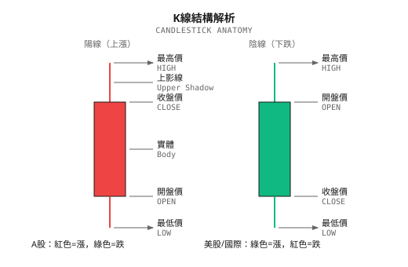

# K線形態與量價分析

> **核心觀點**：K線形態和量價關係是傳統技術分析的基石，但單獨使用時預測能力有限。正確用法是將其作為特徵工程的輸入，而非直接的交易信號。

---

## 為什麼要了解這些？

如果你使用過任何交易軟件（TradingView、同花順、thinkorswim），你一定見過各種 K 線形態的標註和成交量柱狀圖。很多交易者依賴這些視覺模式做決策。

**作為量化從業者，你需要理解這些概念的原因**：

1. **溝通語言**：和交易員、分析師交流時的共同語言
2. **特徵工程**：這些模式可以被量化為 ML 模型的輸入特徵
3. **策略評估**：理解傳統方法的侷限性，才能設計更好的系統
4. **市場心理**：K線形態反映了買賣雙方的博弈過程

---

## 1. K線基礎

### 1.1 K線的構成

一根 K 線包含四個價格信息：



### 1.2 K線的信息含量

| K線部分 | 反映的信息 |
|--------|-----------|
| 實體長度 | 多空力量對比強度 |
| 上影線 | 上方拋壓（賣方力量） |
| 下影線 | 下方支撐（買方力量） |
| 實體位置 | 當日多空博弈結果 |

---

## 2. 常見單根 K 線形態

### 2.1 十字星 (Doji)

```
    ┃
   ─┼─  ← 開盤價 ≈ 收盤價
    ┃
```

**特徵**：實體極小或沒有，上下影線可長可短

| 類型 | 形態 | 含義 |
|-----|------|------|
| 標準十字星 | 上下影線相近 | 多空平衡，猶豫不決 |
| 蜻蜓十字 | 長下影，無上影 | 下方有強支撐 |
| 墓碑十字 | 長上影，無下影 | 上方有強壓力 |

**傳統解讀**：趨勢可能反轉的信號
**實際效果**：單獨使用時預測準確率約 50-55%

### 2.2 錘子線與上吊線 (Hammer / Hanging Man)

```
   ┃
   █  ← 小實體在頂部
   ┃
   ┃ ← 長下影線（至少是實體的2倍）
```

**區別在於出現位置**：
- **錘子線**：出現在下跌趨勢底部 → 可能反轉向上
- **上吊線**：出現在上漲趨勢頂部 → 可能反轉向下

### 2.3 射擊之星 (Shooting Star)

```
   ┃ ← 長上影線
   ┃
   █  ← 小實體在底部
```

**含義**：出現在上漲趨勢頂部，暗示上方壓力大，可能見頂

### 2.4 大陽線與大陰線

| 形態 | 特徵 | 含義 |
|-----|------|------|
| 大陽線 | 實體長，影線短 | 多方強勢控盤 |
| 大陰線 | 實體長，影線短 | 空方強勢控盤 |

**量化定義**：實體長度 > 近期 ATR 的 1.5 倍

---

## 3. 常見組合 K 線形態

### 3.1 吞沒形態 (Engulfing)

```
看漲吞沒（出現在下跌趨勢）：    看跌吞沒（出現在上漲趨勢）：

    █                              ┃
    █  第一根小陰線               ███ 第一根小陽線
   ┏━┓                            ┏━┓
   ┃ ┃ 第二根大陽線               █ █ 第二根大陰線
   ┃ ┃ 完全包住第一根             █ █ 完全包住第一根
   ┗━┛                            ┗━┛
```

**條件**：
1. 第二根 K 線實體完全覆蓋第一根
2. 兩根 K 線顏色相反
3. 出現在明確的趨勢中

### 3.2 早晨之星與黃昏之星 (Morning Star / Evening Star)

```
早晨之星（底部反轉）：

█     ← 第一根：大陰線
█
█
  ┼   ← 第二根：小實體（十字星或小K線），跳空低開
 ┏┓
 ┃┃   ← 第三根：大陽線，收盤深入第一根實體
 ┃┃
```

**黃昏之星**：早晨之星的鏡像，出現在頂部

### 3.3 三隻烏鴉與三白兵

| 形態 | 結構 | 含義 |
|-----|------|------|
| 三隻烏鴉 | 連續三根大陰線，依次低開低收 | 強烈看跌 |
| 三白兵 | 連續三根大陽線，依次高開高收 | 強烈看漲 |

---

## 4. 量價分析基礎

### 4.1 成交量的含義

成交量 = 買賣雙方達成交易的數量

**核心原則**：價格是方向，成交量是動力

| 量價配合 | 含義 | 可靠性 |
|---------|------|--------|
| 價漲量增 | 上漲有資金支撐 | 趨勢可能持續 |
| 價漲量縮 | 上漲動能不足 | 趨勢可能衰竭 |
| 價跌量增 | 恐慌性拋售 | 可能加速下跌或接近底部 |
| 價跌量縮 | 下跌動能衰減 | 可能企穩 |

### 4.2 關鍵量價形態

#### 放量突破

```
價格 ─────────┐
              └──────── 突破
成交量       ████████ ← 成交量顯著放大（>1.5倍均量）
```

**含義**：突破得到資金確認，可信度高

#### 縮量回調

```
價格    /\
       /  \  ← 回調
      /
成交量 ██  █ ← 回調時成交量萎縮
```

**含義**：回調是正常的獲利了結，不是趨勢反轉

#### 量價背離

```
價格   /\  /\  /\ ← 價格創新高
      /  \/  \/
成交量 ██ █  ▪ ← 成交量遞減
```

**含義**：上漲動能衰竭，可能見頂（與 MACD 背離類似）

### 4.3 常用成交量指標

| 指標 | 公式 | 用途 |
|-----|------|------|
| **量比** | 當前成交量 / 過去N日均量 | 判斷當日交易活躍度 |
| **換手率** | 成交量 / 流通股本 | 判斷籌碼換手程度 |
| **OBV** | 累計成交量（上漲日加、下跌日減、平盤不變）| 資金流向 |
| **VWAP** | Σ(價格 × 成交量) / Σ成交量 | 機構交易基準價 |

---

## 5. 形態識別的實證研究

### 5.1 學術研究結論

多項學術研究對 K 線形態的預測能力進行了檢驗：

| 研究 | 樣本 | 結論 |
|-----|------|------|
| Lo, Mamaysky & Wang (2000) | 美股 1962-1996 | 部分形態有統計顯著性，但經濟顯著性有限 |
| Marshall, Young & Rose (2006) | DJIA 成分股 1992-2001 | 大多數形態無顯著超額收益 |
| Caginalp & Laurent (1998) | S&P 500 成分股 | 某些形態在特定條件下有效 |

**總結**：
- 單獨使用形態，勝率通常在 50-55% 之間
- 扣除交易成本後，大多數形態策略不盈利
- 形態的有效性可能隨時間衰減（被市場學習）

### 5.2 為什麼形態"看起來有效"？

1. **確認偏誤**：人們記住成功案例，忘記失敗案例
2. **後視偏差**：事後看圖總能找到"完美"的形態
3. **倖存者偏差**：只看到成功的交易者在分享
4. **定義模糊**：什麼算"標準"的錘子線？沒有精確定義

### 5.3 形態何時可能有效？

研究表明，形態在以下條件下表現更好：

- **結合成交量**：有量配合的形態可靠性更高
- **關鍵位置**：出現在支撐/阻力位附近
- **市場環境**：在特定的波動率環境下
- **時間框架**：較長時間框架（日線、週線）比分鐘線更可靠

---

## 6. 量化實現：形態作為特徵

### 6.1 形態量化的挑戰

傳統形態分析是"模式匹配"，但定義模糊：
- "長下影線"具體多長算長？
- "小實體"多小算小？
- "趨勢中"如何定義趨勢？

**解決方案**：將形態轉化為連續特徵，而非離散信號

### 6.2 特徵工程示例

```python
def calculate_candlestick_features(df):
    """
    將 K 線形態轉化為連續特徵
    df 需要包含: open, high, low, close, volume 列
    """
    # 基礎計算
    df['body'] = df['close'] - df['open']
    df['body_abs'] = df['body'].abs()
    df['upper_shadow'] = df['high'] - df[['open', 'close']].max(axis=1)
    df['lower_shadow'] = df[['open', 'close']].min(axis=1) - df['low']
    df['range'] = df['high'] - df['low']

    # 特徵1：實體佔比（0=十字星，1=無影線）
    df['body_ratio'] = df['body_abs'] / df['range'].replace(0, np.nan)

    # 特徵2：上影線佔比
    df['upper_shadow_ratio'] = df['upper_shadow'] / df['range'].replace(0, np.nan)

    # 特徵3：下影線佔比
    df['lower_shadow_ratio'] = df['lower_shadow'] / df['range'].replace(0, np.nan)

    # 特徵4：K線位置（收盤價在當日範圍中的位置）
    df['close_position'] = (df['close'] - df['low']) / df['range'].replace(0, np.nan)

    # 特徵5：相對實體大小（與近期ATR比較）
    atr = calculate_atr(df, period=14)
    df['relative_body'] = df['body_abs'] / atr

    # 特徵6：吞沒程度（當前實體覆蓋前一根的比例）
    df['engulfing_ratio'] = df['body_abs'] / df['body_abs'].shift(1)

    return df

def calculate_volume_features(df, periods=[5, 20]):
    """
    計算成交量相關特徵
    """
    for p in periods:
        # 量比
        df[f'volume_ratio_{p}'] = df['volume'] / df['volume'].rolling(p).mean()

    # OBV（處理首行 NaN）
    price_change = np.sign(df['close'].diff())
    df['obv'] = (price_change.fillna(0) * df['volume']).cumsum()

    # OBV 趨勢（OBV 的移動平均斜率）
    df['obv_slope'] = df['obv'].rolling(10).apply(
        lambda x: np.polyfit(range(len(x)), x, 1)[0]
    )

    # 量價相關性（近期價格變化與成交量的相關性）
    df['price_volume_corr'] = df['close'].pct_change().rolling(20).corr(
        df['volume'].pct_change()
    )

    return df
```

### 6.3 特徵使用建議

| 特徵類型 | 適合的模型 | 注意事項 |
|---------|-----------|---------|
| 連續形態特徵 | 樹模型、神經網絡 | 需要標準化 |
| 二元形態標籤 | 邏輯迴歸、規則系統 | 定義需要一致 |
| 序列形態 | LSTM、Transformer | 需要時間窗口 |

---

## 7. 多智能體視角

在多智能體系統中，K線形態和量價分析可以這樣定位：

| Agent | 使用方式 |
|-------|---------|
| **Trend Agent** | 使用大陽/大陰線判斷趨勢強度 |
| **Mean Reversion Agent** | 使用十字星、錘子線識別潛在反轉點 |
| **Regime Agent** | 量價背離作為市場狀態轉換的信號之一 |
| **Risk Agent** | 異常放量作為風險預警信號 |

**關鍵原則**：
- 形態特徵是輸入之一，不是唯一依據
- 結合其他特徵（MACD、RSI、基本面）綜合判斷
- Agent 輸出的是概率，不是確定性信號

---

## 8. 常見誤區

### 誤區1：形態是"密碼"

> "學會看 K 線形態就能穩定盈利"

**真相**：如果形態如此有效，使用它的人越多，有效性就越低（反身性）

### 誤區2：形態放之四海皆準

> "錘子線一定是底部信號"

**真相**：相同形態在不同市場環境、不同標的上表現可能完全不同

### 誤區3：成交量永遠有效

> "放量就是主力進場"

**真相**：成交量可能是散户恐慌、算法交易、指數調倉等多種原因

### 誤區4：形態可以精確預測

> "出現黃昏之星，明天一定跌"

**真相**：形態只提供概率優勢（如果有的話），不是確定性預測

---

## 本文要點回顧

- [x] K線形態是買賣雙方博弈的圖形化表達
- [x] 單獨使用形態的預測能力有限（50-55% 勝率）
- [x] 量價配合可以提高形態的可靠性
- [x] 正確用法是將形態量化為 ML 特徵，而非直接信號
- [x] 在多智能體系統中，形態是多個輸入之一

---

## 延伸閲讀

- [第04課：技術指標的真實角色](../第04課：技術指標的真實角色.md) - MACD、RSI 等指標詳解
- [第09課：監督學習在量化中的應用](../../Part3-機器學習/第09課：監督學習在量化中的應用.md) - 如何將特徵輸入 ML 模型
- [背景知識：特徵工程常見陷阱](../../Part3-機器學習/背景知識/特徵工程常見陷阱.md) - 避免特徵工程中的錯誤

---

## 參考文獻

- Nison, S. (1991). *Japanese Candlestick Charting Techniques*
- Lo, A., Mamaysky, H., & Wang, J. (2000). Foundations of Technical Analysis. *Journal of Finance*
- Murphy, J. (1999). *Technical Analysis of the Financial Markets*
