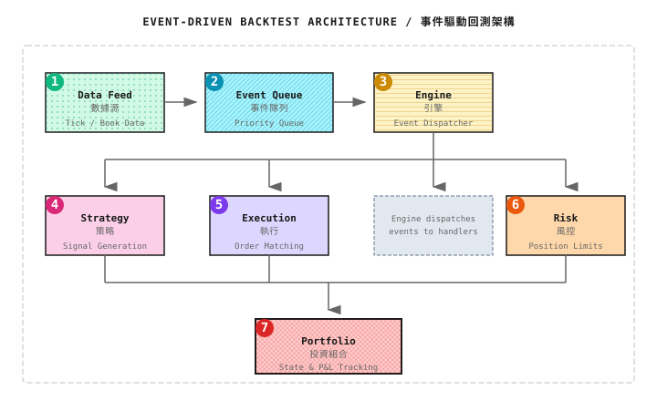
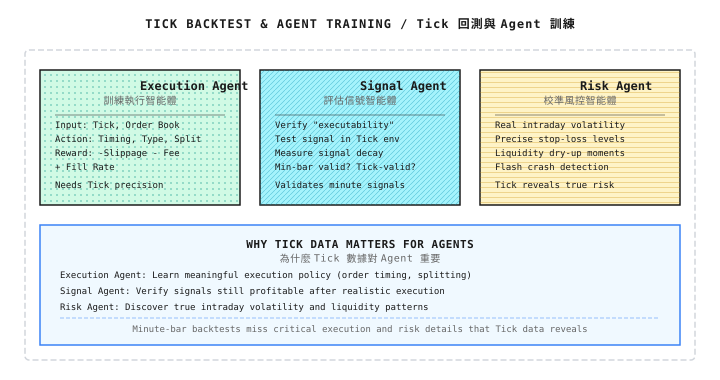

# 背景知識：Tick 級 Backtest 框架

> 「用日線 bar 去 backtest 分鐘級策略，就像用世界地圖在市內街道導航——解像度完全不夠。」

---

## 1. 為什麼需要 Tick 級 Backtest？

### 1.1 不同數據粒度的適用場景

| 數據粒度 | 適合的策略 | 精度 | 數據量 |
|----------|------------|------|--------|
| Daily | Trend following、Value investing | 低 | 小 |
| Minute | 日內 momentum、Mean reversion | 中 | 中 |
| Tick/L2 | Market making、HFT arbitrage、精準執行 | 高 | 大 |

### 1.2 分鐘 bar Backtest 的局限

```
Scenario: A 5-minute bar shows
  Open: $100.00
  High: $100.50
  Low:  $99.80
  Close: $100.20

Question: What was the price path during these 5 minutes?

Possibility 1: Up then down then up
  $100.00 → $100.50 → $99.80 → $100.20

Possibility 2: Down then up
  $100.00 → $99.80 → $100.50 → $100.20

Possibility 3: Volatile oscillation
  Multiple touches of high and low

Would your stop-loss at $99.90 be triggered? Can't tell from bars.
```

### 1.3 Tick 數據可以回答的問題

| 問題 | Bar Backtest | Tick Backtest |
|------|--------------|---------------|
| Limit order 會否成交？ | 只能猜測 | 精確判斷 |
| 確切成交時間？ | 未知 | 毫秒級精度 |
| Queue position 的影響？ | 無法模擬 | 可以估算 |
| Path-dependent stop-loss？ | 不準確 | 準確 |
| 真實 slippage 分佈？ | 固定假設 | 實際計算 |

---

## 2. Tick 數據結構

### 2.1 Trade Tick 數據

```python
@dataclass
class TradeTick:
    """Trade-by-trade data"""
    timestamp: float      # Unix timestamp (seconds with decimal fraction)
    symbol: str           # Symbol code
    price: float          # Trade price
    size: float           # Trade size
    side: str             # 'buy' or 'sell' (aggressor side)
    trade_id: str         # Trade ID
```

**樣本數據**：
```
timestamp,symbol,price,size,side,trade_id
1704067200.123,AAPL,185.50,100,buy,T001
1704067200.156,AAPL,185.51,50,buy,T002
1704067200.189,AAPL,185.50,200,sell,T003
1704067200.201,AAPL,185.49,150,sell,T004
```

### 2.2 Order Book Snapshot

```python
@dataclass
class OrderBookSnapshot:
    """Order book snapshot"""
    timestamp: float
    symbol: str
    bids: List[Tuple[float, float]]  # [(price, size), ...]
    asks: List[Tuple[float, float]]  # [(price, size), ...]

    @property
    def mid_price(self) -> float:
        if self.bids and self.asks:
            return (self.bids[0][0] + self.asks[0][0]) / 2
        return 0.0

    @property
    def spread(self) -> float:
        if self.bids and self.asks:
            return self.asks[0][0] - self.bids[0][0]
        return float('inf')
```

### 2.3 Order Book Delta

```python
@dataclass
class OrderBookDelta:
    """Order book incremental update"""
    timestamp: float
    symbol: str
    side: str           # 'bid' or 'ask'
    price: float
    size: float         # New quantity (0 means delete price level)
    action: str         # 'add', 'modify', 'delete'
```

---

## 3. Event-Driven 與 Vectorized Backtest

### 3.1 Vectorized Backtest

**特點**：
- 用 NumPy/Pandas 批量計算
- 速度快（數秒內處理數年數據）
- 適合簡單策略

**局限**：
- 難以模擬 order 狀態
- 無法處理複雜的執行邏輯
- Path-dependent 邏輯難以表達

```python
# Vectorized backtest example
import pandas as pd
import numpy as np

def vectorized_backtest(df: pd.DataFrame,
                        signal_col: str,
                        price_col: str = 'close') -> pd.Series:
    """
    Simple vectorized backtest
    signal_col: 1=long, -1=short, 0=flat
    """
    # Shift signal by 1 period (avoid lookahead)
    position = df[signal_col].shift(1).fillna(0)

    # Calculate returns
    returns = df[price_col].pct_change()
    strategy_returns = position * returns

    # Cumulative returns
    cumulative = (1 + strategy_returns).cumprod()

    return cumulative
```

### 3.2 Event-Driven Backtest

**特點**：
- 逐個 event 處理
- 可以精確模擬 order 的生命週期
- 適合複雜策略及 tick 數據

**代價**：
- 速度較慢
- 代碼複雜度較高

```
Event stream:
  t=0.001: MarketData(AAPL, bid=185.50, ask=185.51)
  t=0.002: Signal(BUY, size=100)
  t=0.002: OrderSubmit(LIMIT, 185.50, 100)
  t=0.005: MarketData(AAPL, bid=185.49, ask=185.50)
  t=0.010: Trade(185.50, 50)  ← Partial fill
  t=0.015: MarketData(AAPL, bid=185.50, ask=185.51)
  t=0.020: Trade(185.50, 50)  ← Remaining fill
  t=0.020: OrderFilled(complete)
```

---

## 4. Event-Driven 框架實現

### 4.1 核心組件



### 4.2 Event 類型定義

```python
from enum import Enum
from dataclasses import dataclass
from typing import Optional, List

class EventType(Enum):
    MARKET_DATA = "market_data"
    SIGNAL = "signal"
    ORDER = "order"
    FILL = "fill"
    CANCEL = "cancel"

@dataclass
class Event:
    """Base event"""
    timestamp: float
    event_type: EventType

@dataclass
class MarketDataEvent(Event):
    """Market data event"""
    symbol: str
    bid: float
    ask: float
    bid_size: float
    ask_size: float
    last_price: Optional[float] = None
    last_size: Optional[float] = None

    def __post_init__(self):
        self.event_type = EventType.MARKET_DATA

@dataclass
class SignalEvent(Event):
    """Strategy signal event"""
    symbol: str
    direction: int      # 1=buy, -1=sell, 0=close
    strength: float     # Signal strength [0, 1]

    def __post_init__(self):
        self.event_type = EventType.SIGNAL

@dataclass
class OrderEvent(Event):
    """Order event"""
    symbol: str
    order_type: str     # 'market', 'limit'
    side: str           # 'buy', 'sell'
    quantity: float
    price: Optional[float] = None  # Limit order price
    order_id: Optional[str] = None

    def __post_init__(self):
        self.event_type = EventType.ORDER

@dataclass
class FillEvent(Event):
    """Fill event"""
    symbol: str
    order_id: str
    side: str
    quantity: float
    price: float
    commission: float

    def __post_init__(self):
        self.event_type = EventType.FILL
```

### 4.3 Event Queue

```python
import heapq
from typing import List

class EventQueue:
    """Priority event queue (sorted by timestamp)"""

    def __init__(self):
        self._queue: List[tuple] = []
        self._counter = 0  # For ordering events at same timestamp

    def push(self, event: Event):
        """Add event"""
        heapq.heappush(self._queue,
                       (event.timestamp, self._counter, event))
        self._counter += 1

    def pop(self) -> Optional[Event]:
        """Pop earliest event"""
        if self._queue:
            _, _, event = heapq.heappop(self._queue)
            return event
        return None

    def is_empty(self) -> bool:
        return len(self._queue) == 0

    def peek(self) -> Optional[Event]:
        """View earliest event (without removing)"""
        if self._queue:
            return self._queue[0][2]
        return None
```

### 4.4 Execution Simulator

```python
class TickExecutionSimulator:
    """Tick-level execution simulator"""

    def __init__(self,
                 commission_rate: float = 0.0003,
                 latency_ms: float = 1.0):
        self.commission_rate = commission_rate
        self.latency_ms = latency_ms
        self.pending_orders = {}
        self.order_counter = 0

    def submit_order(self, order: OrderEvent,
                     current_book: OrderBookSnapshot) -> List[Event]:
        """
        Submit order, return generated events
        """
        events = []
        self.order_counter += 1
        order.order_id = f"ORD_{self.order_counter:06d}"

        # Simulate latency
        exec_time = order.timestamp + self.latency_ms / 1000

        if order.order_type == 'market':
            # Market order attempts immediate fill
            fill = self._execute_market_order(order, current_book, exec_time)
            if fill:
                events.append(fill)
        else:
            # Limit order enters pending queue
            self.pending_orders[order.order_id] = {
                'order': order,
                'remaining': order.quantity,
                'submit_time': order.timestamp
            }

        return events

    def on_market_data(self, md: MarketDataEvent) -> List[Event]:
        """
        Check pending orders on market data update
        """
        events = []

        for order_id, pending in list(self.pending_orders.items()):
            order = pending['order']
            remaining = pending['remaining']

            # Check if fillable
            fill_qty, fill_price = self._check_limit_fill(
                order, remaining, md
            )

            if fill_qty > 0:
                fill = FillEvent(
                    timestamp=md.timestamp,
                    symbol=order.symbol,
                    order_id=order_id,
                    side=order.side,
                    quantity=fill_qty,
                    price=fill_price,
                    commission=fill_qty * fill_price * self.commission_rate
                )
                events.append(fill)

                pending['remaining'] -= fill_qty
                if pending['remaining'] <= 0:
                    del self.pending_orders[order_id]

        return events

    def _execute_market_order(self, order: OrderEvent,
                              book: OrderBookSnapshot,
                              exec_time: float) -> Optional[FillEvent]:
        """Execute market order"""
        if order.side == 'buy':
            if not book.asks:
                return None
            # Simplified: take ask level 1
            fill_price = book.asks[0][0]
        else:
            if not book.bids:
                return None
            fill_price = book.bids[0][0]

        return FillEvent(
            timestamp=exec_time,
            symbol=order.symbol,
            order_id=order.order_id,
            side=order.side,
            quantity=order.quantity,
            price=fill_price,
            commission=order.quantity * fill_price * self.commission_rate
        )

    def _check_limit_fill(self, order: OrderEvent,
                          remaining: float,
                          md: MarketDataEvent) -> tuple:
        """Check if limit order can fill"""
        if order.side == 'buy':
            # Buy order: if ask level 1 <= limit price, can fill
            if md.ask <= order.price:
                fill_qty = min(remaining, md.ask_size)
                return fill_qty, md.ask
        else:
            # Sell order: if bid level 1 >= limit price, can fill
            if md.bid >= order.price:
                fill_qty = min(remaining, md.bid_size)
                return fill_qty, md.bid

        return 0, 0
```

### 4.5 Backtest Engine

```python
class TickBacktestEngine:
    """Tick-level backtest engine"""

    def __init__(self, strategy, execution_sim: TickExecutionSimulator):
        self.strategy = strategy
        self.execution = execution_sim
        self.event_queue = EventQueue()
        self.portfolio = Portfolio()
        self.current_book = None

    def load_data(self, data_source):
        """Load tick data into event queue"""
        for tick in data_source:
            if isinstance(tick, TradeTick):
                event = self._trade_to_event(tick)
            elif isinstance(tick, OrderBookSnapshot):
                event = self._book_to_event(tick)
            self.event_queue.push(event)

    def run(self) -> dict:
        """Run backtest"""
        while not self.event_queue.is_empty():
            event = self.event_queue.pop()
            self._process_event(event)

        return self._calculate_results()

    def _process_event(self, event: Event):
        """Process single event"""
        if event.event_type == EventType.MARKET_DATA:
            self._on_market_data(event)
        elif event.event_type == EventType.SIGNAL:
            self._on_signal(event)
        elif event.event_type == EventType.ORDER:
            self._on_order(event)
        elif event.event_type == EventType.FILL:
            self._on_fill(event)

    def _on_market_data(self, md: MarketDataEvent):
        """Handle market data"""
        # Update current order book
        self.current_book = md

        # Check pending order fills
        fills = self.execution.on_market_data(md)
        for fill in fills:
            self.event_queue.push(fill)

        # Strategy processing
        signal = self.strategy.on_data(md, self.portfolio)
        if signal:
            self.event_queue.push(signal)

    def _on_signal(self, signal: SignalEvent):
        """Handle strategy signal"""
        order = self.strategy.signal_to_order(signal, self.portfolio)
        if order:
            self.event_queue.push(order)

    def _on_order(self, order: OrderEvent):
        """Handle order"""
        fills = self.execution.submit_order(order, self.current_book)
        for fill in fills:
            self.event_queue.push(fill)

    def _on_fill(self, fill: FillEvent):
        """Handle fill"""
        self.portfolio.update(fill)
        self.strategy.on_fill(fill)

    def _calculate_results(self) -> dict:
        """Calculate backtest results"""
        return {
            'total_return': self.portfolio.total_return,
            'sharpe_ratio': self.portfolio.sharpe_ratio,
            'max_drawdown': self.portfolio.max_drawdown,
            'total_trades': self.portfolio.trade_count,
            'total_commission': self.portfolio.total_commission,
            'equity_curve': self.portfolio.equity_curve
        }
```

---

## 5. Order Queue 模擬

### 5.1 為什麼 Queue Position 重要？

```
Scenario: You placed a limit buy order at $100.00

Order Book:
  Bid Level 1: $100.00 × 10,000 shares (you're in position 5,000)

Trade Flow:
  Seller market sells 3,000 shares → First 3,000 filled, you're still 2,000 behind
  Seller market sells 1,500 shares → First 4,500 filled, you're still 500 behind
  Price jumps to $100.05            → Your order will never fill

Conclusion: Even if price "touches" your limit, you may not get filled
```

### 5.2 Queue Position 估算

```python
class QueuePositionEstimator:
    """Queue position estimator"""

    def __init__(self, queue_position_pct: float = 0.5):
        """
        queue_position_pct: Your assumed relative position in queue
                           0 = front, 1 = back
        """
        self.queue_pct = queue_position_pct

    def estimate_queue_ahead(self,
                             order: OrderEvent,
                             book: OrderBookSnapshot) -> float:
        """Estimate order quantity ahead of you"""
        if order.side == 'buy':
            # Find your price level in bid side
            for price, size in book.bids:
                if price == order.price:
                    return size * self.queue_pct
            # Price not in current book, probably all ahead of you
            return float('inf')
        else:
            for price, size in book.asks:
                if price == order.price:
                    return size * self.queue_pct
            return float('inf')

    def update_queue_on_trade(self,
                              queue_ahead: float,
                              trade: TradeTick,
                              order: OrderEvent) -> float:
        """Update queue position based on trade"""
        if order.side == 'buy' and trade.side == 'sell':
            # Seller aggressor, consumes bid side
            if trade.price == order.price:
                queue_ahead = max(0, queue_ahead - trade.size)
        elif order.side == 'sell' and trade.side == 'buy':
            if trade.price == order.price:
                queue_ahead = max(0, queue_ahead - trade.size)

        return queue_ahead

    def can_fill(self, queue_ahead: float, order_size: float) -> tuple:
        """Determine if can fill"""
        if queue_ahead <= 0:
            fill_qty = order_size
            return True, fill_qty
        return False, 0
```

### 5.3 完整的 Limit Order 模擬

```python
class RealisticLimitOrderSimulator:
    """Limit order simulator considering queue position"""

    def __init__(self,
                 queue_estimator: QueuePositionEstimator,
                 commission_rate: float = 0.0003):
        self.queue_est = queue_estimator
        self.commission = commission_rate
        self.orders = {}  # order_id -> order state

    def submit_limit_order(self,
                           order: OrderEvent,
                           book: OrderBookSnapshot) -> str:
        """Submit limit order"""
        order_id = f"LMT_{len(self.orders):06d}"

        queue_ahead = self.queue_est.estimate_queue_ahead(order, book)

        self.orders[order_id] = {
            'order': order,
            'queue_ahead': queue_ahead,
            'remaining': order.quantity,
            'status': 'pending'
        }

        return order_id

    def on_trade(self, trade: TradeTick) -> List[FillEvent]:
        """Process market trade, update queue positions"""
        fills = []

        for order_id, state in list(self.orders.items()):
            if state['status'] != 'pending':
                continue

            order = state['order']

            # Update queue position
            state['queue_ahead'] = self.queue_est.update_queue_on_trade(
                state['queue_ahead'],
                trade,
                order
            )

            # Check if can fill
            can_fill, fill_qty = self.queue_est.can_fill(
                state['queue_ahead'],
                state['remaining']
            )

            if can_fill and fill_qty > 0:
                # Actual fill quantity depends on counterparty
                actual_fill = min(fill_qty, trade.size)

                fill = FillEvent(
                    timestamp=trade.timestamp,
                    symbol=order.symbol,
                    order_id=order_id,
                    side=order.side,
                    quantity=actual_fill,
                    price=order.price,
                    commission=actual_fill * order.price * self.commission
                )
                fills.append(fill)

                state['remaining'] -= actual_fill
                if state['remaining'] <= 0:
                    state['status'] = 'filled'

        return fills
```

---

## 6. 性能優化

### 6.1 數據儲存格式

| 格式 | 讀取速度 | 壓縮 | Random access | 建議用途 |
|------|----------|------|---------------|----------|
| CSV | 慢 | 無 | 差 | 小數據、debug |
| Parquet | 快 | 高 | 好 | 大規模 backtest |
| HDF5 | 快 | 中 | 好 | Time series 數據 |
| Arrow/Feather | 極快 | 中 | 好 | Memory mapping |

```python
# Parquet example
import pandas as pd

# Write
df.to_parquet('ticks.parquet', compression='snappy')

# Read (only load needed columns)
df = pd.read_parquet('ticks.parquet',
                     columns=['timestamp', 'price', 'size'])
```

### 6.2 記憶體優化

```python
import numpy as np

# Use smaller data types
dtype_mapping = {
    'price': np.float32,      # 4 bytes vs 8 bytes
    'size': np.int32,         # 4 bytes
    'side': np.int8,          # 1 byte (0=sell, 1=buy)
}

# Pre-allocate arrays
n_ticks = 1_000_000
prices = np.empty(n_ticks, dtype=np.float32)
sizes = np.empty(n_ticks, dtype=np.int32)
```

### 6.3 並行處理

```python
from concurrent.futures import ProcessPoolExecutor
from typing import List

def backtest_single_day(date: str, strategy_params: dict) -> dict:
    """Single day backtest"""
    # Load day's data
    # Run backtest
    # Return results
    pass

def parallel_backtest(dates: List[str],
                      strategy_params: dict,
                      n_workers: int = 4) -> List[dict]:
    """Parallel backtest multiple days"""
    with ProcessPoolExecutor(max_workers=n_workers) as executor:
        futures = [
            executor.submit(backtest_single_day, date, strategy_params)
            for date in dates
        ]
        results = [f.result() for f in futures]

    return results
```

---

## 7. 常見誤解

**誤解 1：Tick backtest 一定比 minute backtest 準確**

不一定。如果：
- 策略本身是分鐘級決策
- Queue 和 slippage 沒有被正確模擬
- 數據質素有問題

那麼 tick backtest 可能引入更多 noise，而不是更高的精度。

**誤解 2：有 tick 數據就可以做 HFT**

Tick 數據是必要條件，但並不充分。你還需要：
- 低 latency 的執行能力
- 正確的手續費/rebate 假設
- 考慮你的 order 對市場的 market impact

**誤解 3：忽略數據清洗**

Tick 數據常見問題：
- 重複記錄
- Timestamp 錯誤
- 異常價格（負數、極端跳升）
- 交易所維護期間的垃圾數據

```python
def clean_ticks(df: pd.DataFrame) -> pd.DataFrame:
    """Clean tick data"""
    # Remove duplicates
    df = df.drop_duplicates(subset=['timestamp', 'trade_id'])

    # Sort
    df = df.sort_values('timestamp')

    # Filter abnormal prices
    median_price = df['price'].median()
    df = df[df['price'].between(median_price * 0.9,
                                 median_price * 1.1)]

    # Filter abnormal sizes
    df = df[df['size'] > 0]

    return df
```

---

## 8. Multi-Agent 視角

Tick 級 backtest 在 multi-agent 系統中的角色：



---

## 9. 實戰建議

### 9.1 循序漸進採用

```
Stage 1: Validate strategy logic
  - Use minute/hourly data
  - Fixed slippage assumption
  - Fast iteration

Stage 2: Refine execution assumptions
  - Use tick data for key signals
  - Square-root slippage model
  - Verify strategy is still profitable

Stage 3: Full tick backtest
  - Order book replay
  - Queue simulation
  - Compare with live data to calibrate
```

### 9.2 關鍵指標比較

```python
def compare_granularity(minute_result: dict,
                        tick_result: dict) -> dict:
    """Compare backtest results at different granularities"""
    return {
        'return_diff': tick_result['return'] - minute_result['return'],
        'sharpe_diff': tick_result['sharpe'] - minute_result['sharpe'],
        'fill_rate': tick_result.get('fill_rate', 1.0),
        'avg_slippage': tick_result.get('avg_slippage', 0),
        'verdict': 'tick_worse' if tick_result['return'] < minute_result['return'] * 0.8 else 'acceptable'
    }
```

---

## 10. 總結

| 重點 | 說明 |
|------|------|
| 適用場景 | HFT 策略、精準執行模擬、Limit order 策略 |
| 核心優勢 | Queue 模擬、精確 slippage、Path-dependent 邏輯 |
| 實現方式 | Event-driven 架構 |
| 主要挑戰 | 數據量大、Queue 模擬複雜、計算成本高 |
| 循序漸進 | 先用 minute 數據驗證邏輯，再用 tick 驗證執行 |

---

## 延伸閱讀

- [背景知識：執行模擬器實現](../../Part5-生產與實戰/背景知識/執行模擬器實現.md) - 執行模擬的詳細實現
- [背景知識：交易所與訂單簿機制](交易所與訂單簿機制.md) - Order book 基礎
- [第 7 課：回測系統的陷阱](../第07課：回測系統的陷阱.md) - Backtest 常見問題
