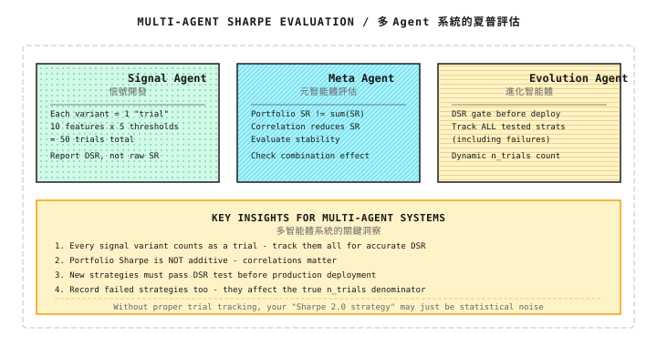

# 背景知識：Sharpe Ratio 的統計陷阱

> 「你那個 Sharpe 2.0 的策略，可能只是統計 noise。」

---

## 1. Sharpe Ratio 的 Estimation Error

### 1.1 為何 Sample Sharpe 不可靠

Sharpe ratio 的定義很簡單：

```
SR = (μ - rf) / σ

Where:
  μ  = Mean return
  rf = Risk-free rate
  σ  = Standard deviation of returns
```

**問題**：μ 和 σ 都是由有限樣本估算出來的，兩者都有 estimation error。

### 1.2 Sharpe Ratio 的 Standard Error

Lo (2002) 推導出 Sharpe ratio 的近似 standard error：

```
SE(SR) ≈ √[(1 + SR²/2) / N]

Where:
  N = Number of observations (e.g., trading days)
```

> **注意**：此公式假設 return 為 IID（independent and identically distributed）。
> 如果 return 存在 autocorrelation（例如 momentum 效應、mean reversion），
> standard error 需要調整。Lo (2002) 亦提供了經 autocorrelation 調整的 standard error 公式，
> 對於 return 模式持續的策略，其數值可能遠大於 IID 版本。

**紙上練習**：

| 真實 Sharpe | Observation 數量 N | Standard Error SE | 95% Confidence Interval |
|-------------|----------------|-------------------|-------------------------|
| 1.0 | 252（1 年） | 0.077 | [0.85, 1.15] |
| 1.0 | 756（3 年） | 0.045 | [0.91, 1.09] |
| 2.0 | 252（1 年） | 0.109 | [1.79, 2.21] |
| 2.0 | 756（3 年） | 0.063 | [1.88, 2.12] |

**關鍵發現**：
- 1 年數據的 Sharpe estimation error 約為 ±0.15（95% confidence）
- 即使真實 Sharpe 為 0，sample Sharpe 超過 0.06 的機率約為 16%（超過 0.12 的機率只有約 3%）

### 1.3 代碼實現

```python
import numpy as np
from scipy import stats

def sharpe_ratio(returns: np.ndarray,
                 rf: float = 0.0,
                 periods_per_year: int = 252) -> float:
    """Calculate annualized Sharpe ratio"""
    excess_returns = returns - rf / periods_per_year
    return np.sqrt(periods_per_year) * excess_returns.mean() / excess_returns.std()


def sharpe_standard_error(sr: float, n: int) -> float:
    """Calculate standard error of Sharpe ratio"""
    return np.sqrt((1 + sr**2 / 2) / n)


def sharpe_confidence_interval(sr: float, n: int,
                                confidence: float = 0.95) -> tuple:
    """Calculate confidence interval for Sharpe ratio"""
    se = sharpe_standard_error(sr, n)
    z = stats.norm.ppf((1 + confidence) / 2)
    return (sr - z * se, sr + z * se)


def sharpe_p_value(sr: float, n: int) -> float:
    """
    Test whether Sharpe ratio is significantly greater than 0
    H0: True Sharpe = 0
    """
    se = sharpe_standard_error(0, n)  # Standard error under H0
    z = sr / se
    return 1 - stats.norm.cdf(z)
```

**使用例子**：

```python
# Assume you have 1 year of backtest data, sample Sharpe = 1.5
sr = 1.5
n = 252

se = sharpe_standard_error(sr, n)
ci = sharpe_confidence_interval(sr, n)
p = sharpe_p_value(sr, n)

print(f"Sample Sharpe: {sr:.2f}")
print(f"Standard Error: {se:.3f}")
print(f"95% Confidence Interval: [{ci[0]:.2f}, {ci[1]:.2f}]")
print(f"p-value: {p:.4f}")

# Output:
# Sample Sharpe: 1.50
# Standard Error: 0.081
# 95% Confidence Interval: [1.34, 1.66]
# p-value: 0.0000
```

---

## 2. Multiple Testing 問題

### 2.1 策略挖掘的詛咒

**情境**：你測試了 100 個策略，然後揀選 Sharpe 最高的那一個。

```
Problem:
  - Each strategy is independent, all have true Sharpe of 0
  - After testing 100, expected maximum sample Sharpe ≈ 0.19 (pure noise!)

This is the statistical trap of "strategy mining"
```

### 2.2 數學原理

如果測試 K 個獨立策略，最大 Sharpe 的期望值為：

```
E[max(SR₁, SR₂, ..., SRₖ)] ≈ SE × √(2 × ln(K))

Where SE is the standard error of a single Sharpe
```

**紙上練習**：

| 測試的策略數量 K | SE = 0.063 時的預期最大 Sharpe |
|---------------------|-------------------------------------|
| 10 | 0.063 × √(2×ln(10)) = 0.135 |
| 100 | 0.063 × √(2×ln(100)) = 0.191 |
| 1,000 | 0.063 × √(2×ln(1000)) = 0.234 |
| 10,000 | 0.063 × √(2×ln(10000)) = 0.270 |

**結論**：你測試的策略越多，「最佳策略」的 sample Sharpe 就越高，即使它們全部都只是 noise。

---

## 3. Deflated Sharpe Ratio

### 3.1 什麼是 Deflated Sharpe

這是 Bailey & Lopez de Prado (2014) 提出的修正方法，考慮了：

1. **Multiple testing**：測試了多少個策略
2. **數據長度**：樣本數量
3. **Skewness 與 kurtosis**：return 分佈的 non-normality

### 3.2 計算公式

```
DSR = Φ[(SR - SR* × √(1 + (γ₃/6)×SR + ((γ₄-3)/24)×SR²)) /
        √(1/N + (γ₃²/6)/N + ((γ₄-3)²/24)/N)]

Where:
  Φ = Standard normal CDF
  SR = Sample Sharpe
  SR* = Benchmark Sharpe (accounting for multiple testing)
  γ₃ = Skewness of returns
  γ₄ = Kurtosis of returns
  N = Sample size
```

**SR* 的計算**（預期最大 Sharpe）：

```
SR* = √(2 × ln(K)) × √(1/N) × (1 - γ × √(2 × ln(K)) + ...)

Simplified version:
SR* ≈ √(Var[SR]) × [(1-γ)×Z_K + γ×Z_K×exp(-Z_K²/2)]

Where Z_K = Φ⁻¹(1 - 1/K)
```

### 3.3 完整實現

```python
import numpy as np
from scipy import stats

def deflated_sharpe_ratio(
    returns: np.ndarray,
    n_trials: int,
    rf: float = 0.0,
    periods_per_year: int = 252
) -> dict:
    """
    Calculate Deflated Sharpe Ratio

    Parameters:
    -----------
    returns : Return series
    n_trials : Number of strategies/parameter combinations tested
    rf : Risk-free rate
    periods_per_year : Annualization factor

    Returns:
    --------
    dict : Contains original Sharpe, DSR, p-value, etc.
    """
    n = len(returns)
    excess = returns - rf / periods_per_year

    # Basic statistics
    mu = excess.mean()
    sigma = excess.std(ddof=1)
    skew = stats.skew(excess)
    kurt = stats.kurtosis(excess)  # Excess kurtosis

    # Annualized Sharpe
    sr = np.sqrt(periods_per_year) * mu / sigma

    # Expected maximum Sharpe (based on multiple testing)
    if n_trials > 1:
        z = stats.norm.ppf(1 - 1 / n_trials)
        euler_gamma = 0.5772156649
        sr_star = np.sqrt(1/n) * (
            (1 - euler_gamma) * z +
            euler_gamma * z * np.exp(-z**2 / 2)
        ) * np.sqrt(periods_per_year)
    else:
        sr_star = 0

    # Standard error of Sharpe ratio (accounting for non-normality)
    # Note: scipy.stats.kurtosis() returns EXCESS kurtosis (already subtracts 3),
    # so we use kurt/24 directly, not (kurt-3)/24
    sr_var = (1 + (skew/6)*sr + (kurt/24)*sr**2) / n
    sr_std = np.sqrt(sr_var) * np.sqrt(periods_per_year)

    # Deflated Sharpe test statistic
    if sr_std > 0:
        z_stat = (sr - sr_star) / sr_std
        p_value = 1 - stats.norm.cdf(z_stat)
    else:
        z_stat = np.nan
        p_value = 1.0

    # DSR = Probability that strategy Sharpe significantly exceeds benchmark
    dsr = 1 - p_value

    return {
        'sharpe_ratio': sr,
        'expected_max_sr': sr_star,
        'deflated_sr': dsr,
        'p_value': p_value,
        'z_statistic': z_stat,
        'n_observations': n,
        'n_trials': n_trials,
        'skewness': skew,
        'kurtosis': kurt,
        'is_significant': p_value < 0.05
    }
```

### 3.4 使用例子

```python
# Simulate strategy returns
np.random.seed(42)
daily_returns = np.random.normal(0.0005, 0.01, 252)  # 1 year of data

# Assume we tested 50 parameter combinations
result = deflated_sharpe_ratio(daily_returns, n_trials=50)

print(f"Original Sharpe: {result['sharpe_ratio']:.2f}")
print(f"Expected Max Sharpe (50 trials): {result['expected_max_sr']:.2f}")
print(f"Deflated SR: {result['deflated_sr']:.2%}")
print(f"p-value: {result['p_value']:.4f}")
print(f"Is Significant: {result['is_significant']}")
```

---

## 4. 實用指引

### 4.1 何時需要擔心

| 情況 | 風險水平 | 建議 |
|-----------|------------|----------------|
| Sample Sharpe < 1.0，測試少於 10 個策略 | 低 | 可能有效，繼續驗證 |
| Sample Sharpe 1.0-2.0，測試 10-100 個策略 | 中 | 計算 DSR，小心 overfitting |
| Sample Sharpe > 2.0，測試超過 100 個策略 | 高 | 幾乎肯定是 overfitting |
| Sample Sharpe > 3.0 | 極高 | 檢查是否有數據錯誤或 look-ahead bias |

### 4.2 如何匯報 Sharpe Ratio

**錯誤做法**：
> 「我的策略 Sharpe 是 2.5」

**正確做法**：
> 「基於 3 年日數據（756 個 observation），sample Sharpe 為 2.5，
> 95% confidence interval 為 [2.3, 2.7]，測試了 30 個參數組合後，
> Deflated SR = 0.92，p-value = 0.04」

### 4.3 減輕 Multiple Testing 的方法

```
1. Pre-determine the number of strategies to test
   - Write down the list of strategies to test
   - Don't add strategies as you go

2. Out-of-sample validation
   - Reserve 20-30% of data not used in development
   - Only test the final strategy once on this data

3. Bonferroni correction
   - Significance level = 0.05 / K
   - K strategies require p < 0.05/K to be significant

4. Record all tests
   - Record even failed strategies
   - Use for calculating true n_trials
```

---

## 5. 常見誤區

**誤區 1：Sharpe 越高越好**

極高的 Sharpe（>3）通常意味着：
- 數據錯誤（重複計算、含有 look-ahead 資訊）
- Overfitting
- 策略 capacity 太小

**誤區 2：3 年數據足以準確估算 Sharpe**

3 年數據（756 日）的 standard error 約為 0.04-0.05，這意味着：
- 真實 Sharpe 為 1.0 的策略，sample Sharpe 可能在 0.9-1.1 之間
- 幾乎無法區分 Sharpe 1.0 與 1.2 的策略

**誤區 3：Backtest Sharpe = 實盤 Sharpe**

Backtest 通常會高估，原因包括：
- 忽略 slippage 與 market impact
- 細微的 look-ahead bias
- Survivorship bias

**經驗法則**：實盤 Sharpe ≈ Backtest Sharpe × 0.5-0.7

---

## 6. Multi-Agent 視角

在 multi-agent 架構中，Sharpe ratio 的統計問題需要特別留意：



---

## 7. 總結

| 重點 | 說明 |
|-----------|-------------|
| Estimation error | 1 年數據的 Sharpe standard error ≈ 0.07-0.08 |
| Multiple testing | 測試 100 個策略，預期最大 Sharpe ≈ 0.19（純 noise） |
| Deflated SR | 計及 multiple testing 的顯著性檢驗 |
| 實用建議 | 匯報 confidence interval、計算 DSR、保持懷疑 |

---

## 延伸閱讀

- [第03課：數學與統計基礎](../第03課：數學與統計基礎.md) - 統計學基礎
- [第07課：回測系統的陷阱](../第07課：回測系統的陷阱.md) - Backtesting 中的其他 bias
- Bailey, D. H., & Lopez de Prado, M. (2014). *The Deflated Sharpe Ratio*
- Lo, A. W. (2002). *The Statistics of Sharpe Ratios*
