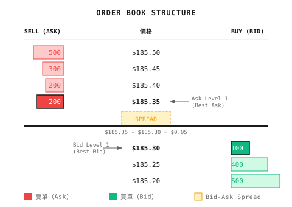

# 背景知識：高頻市場微結構（Market Microstructure）

> 「在毫秒級別，市場並非 random walk，而是買家與賣家之間的博弈。」
> 高頻交易（HFT）是 quantitative trading 的極端形態。散戶無法參與，但理解它有助你認清市場實際如何運作。

---

## 1. 什麼是 Market Microstructure？

**傳統觀點**：股價由基本面決定——盈利、宏觀經濟、行業趨勢

**Microstructure 觀點**：股價由 order flow 決定——誰在買、誰在賣、以什麼價格掛單

```
Time scale comparison:

Fundamental Analysis: Months → Years
Technical Analysis: Days → Weeks
Market Microstructure: Milliseconds → Seconds
```

---

## 2. 核心概念：Order Book

**Order Book**：所有尚未成交的買賣訂單



### 關鍵術語

| 術語 | 定義 | 意義 |
|------|------|------|
| Bid (Level 1) | 最高買入價 | 現在賣出的最佳價格 |
| Ask (Level 1) | 最低賣出價 | 現在買入的最佳價格 |
| Spread | Ask - Bid | 隱含交易成本 |
| Mid | (Bid + Ask) / 2 | 公允價格估算 |
| Depth | 每個價位的訂單數量 | 市場的承接能力 |

### L1/L2/L3 數據層級

**L1 數據**：
- Best Bid
- Best Ask
- 對應的 size

**L2 數據**：
```
Ask Level 5: $100.10 x 500
Ask Level 4: $100.08 x 300
Ask Level 3: $100.06 x 200
Ask Level 2: $100.04 x 100
Ask Level 1: $100.02 x 50    ← Best Ask
-------------------------
Bid Level 1: $100.00 x 80    ← Best Bid
Bid Level 2: $99.98  x 150
Bid Level 3: $99.96  x 400
Bid Level 4: $99.94  x 600
Bid Level 5: $99.92  x 1000
```

**L3 數據**：每個價位上的每一張個別訂單（Order ID、時間戳）

---

## 3. 訂單類型

### Market Order

```
Instruction: "Buy 100 shares immediately, any price"

Execution:
  - Fills at current ask level 1 price $185.35
  - If ask level 1 only has 50 shares, remaining 50 fills at ask level 2 $185.40

Pros: Guaranteed execution
Cons: May slip (adverse price)
```

### Limit Order

```
Instruction: "Buy 100 shares at $185.30 or lower"

Execution:
  - If there's a sell order at ≤$185.30 → Immediate fill
  - Otherwise → Enters order book and waits

Pros: Price control
Cons: May not execute
```

### 其他訂單類型

| 類型 | 功能 | 場景 |
|------|------|------|
| Stop | 價格觸發後變成 market order | 風險控制 |
| Stop-Limit | 觸發後變成 limit order | 精確止蝕 |
| IOC (Immediate or Cancel) | 能成交多少就成交多少 | 緊急執行 |
| FOK (Fill or Kill) | 全部成交，否則取消 | 避免部分成交 |
| Iceberg | 只顯示部分數量 | 隱藏大額訂單意圖 |

---

## 4. Bid-Ask Spread 與 Liquidity

### Spread 的組成

| 組成 | 說明 | 比例 |
|------|------|------|
| Inventory cost | 補償 market maker 持有存貨的風險 | 20-30% |
| Adverse selection | 防範與 informed trader 交易時的虧損 | 40-50% |
| Order processing cost | 交易系統及人手成本 | 10-20% |

**Adverse selection** 是關鍵：market maker 擔心與 informed trader 交易時蝕錢

```
Scenario:
  Someone knows Apple is about to release good news, quietly buys heavily
  Market maker doesn't know, sells to them at low price
  After news releases, market maker loses money

Response:
  Market makers widen spreads to compensate for these expected losses
```

### Spread 與 Liquidity

```
Good Liquidity:
  - Tight spread ($0.01)
  - Large order sizes
  - Large orders don't move price
  - Examples: AAPL, MSFT, SPY

Poor Liquidity:
  - Wide spread ($0.10+)
  - Small order sizes
  - Large orders significantly move price
  - Examples: Small caps, illiquid ETFs
```

---

## 5. Market Impact

**定義**：你的交易對價格造成的影響

```
You want to buy 10,000 shares of AAPL
Current order book:
  Ask Level 1: $185.35 × 200 shares
  Ask Level 2: $185.40 × 300 shares
  Ask Level 3: $185.45 × 500 shares
  ...

If buying all at once:
  Fill 200 @ $185.35
  Fill 300 @ $185.40
  Fill 500 @ $185.45
  ...

Average execution price might be $185.60
$0.25 higher than mid price → Market impact cost
```

### 影響因素

| 因素 | 影響 | 原因 |
|------|------|------|
| 訂單大小 | 越大 impact 越大 | 消耗更多 depth |
| 市場 liquidity | Liquidity 越低 impact 越大 | Order book 較薄 |
| 執行速度 | 越快 impact 越大 | 無法隱藏意圖 |
| 信息含量 | Informed trading 的 impact 更持久 | Price discovery |

### Market Impact 模型

```
Simplified square-root rule:

Market Impact ≈ σ × √(Q / V)

Where:
  σ = Daily volatility
  Q = Trade quantity
  V = Average daily volume

Example:
  Volatility = 2%
  Trade size = 1% of average daily volume

  Impact ≈ 2% × √0.01 = 0.2%
```

---

## 6. Market Maker 的角色

**Market Maker**：同時掛出買單及賣單，賺取 spread

```
Market Maker Strategy:
  Place buy order @ $185.30
  Place sell order @ $185.35

  If both sides fill:
    Sell price - Buy price = $0.05 profit

  Risks:
    Only one side fills → Inventory risk exposure
    Directional market → Losses
```

### Market Maker vs Directional Trader

| 維度 | Market Maker | Directional Trader |
|------|--------------|-------------------|
| 目標 | 賺取 spread | 賺取價格波動 |
| 持倉時間 | 極短（數秒/數分鐘） | 較長（數小時/數日） |
| 風險 exposure | 盡量減少方向性 | 有方向性 exposure |
| 利潤來源 | Spread − Adverse selection − Inventory cost | 預測準確度 |

---

## 7. Price Discovery 過程

**Price Discovery**：市場如何把信息反映在價格上

```
Information release → Informed traders order → Order flow changes → Price adjusts

Timeline example:
  T+0ms: Positive news released
  T+1ms: High-speed traders detect news
  T+5ms: Large buy orders flood in
  T+10ms: Ask level 1 consumed, price rises
  T+100ms: Price mostly reflects new information
  T+1000ms: Regular investors see price change
```

### Order Flow Toxicity

**Toxic Order Flow**：由 informed trader 主導的 order flow

```
Indicator: VPIN (Volume-Synchronized Probability of Informed Trading)

High VPIN → Informed traders active → High risk for market makers
Low VPIN → Noise traders dominate → Market makers safe

Applications:
  - Market makers adjust spreads based on VPIN
  - Warn of market stress (high VPIN may precede crash)
```

---

## 8. Order Flow 與 Kyle's Lambda

### 8.1 Order Flow Imbalance

**定義**：每個時間單位內買單與賣單的淨差額

```
OFI = Buy-initiated volume - Sell-initiated volume

OFI > 0: Buy pressure dominates, price tends to rise
OFI < 0: Sell pressure dominates, price tends to fall
```

**如何判斷成交方向？**

使用 Lee-Ready algorithm：
```
If trade price > mid price: Buy-initiated (Taker is buyer)
If trade price < mid price: Sell-initiated (Taker is seller)
If trade price = mid price: Use previous trade's direction
```

**直觀解釋**：

> 想像 order book 是一條街。Bid level 1 與 ask level 1 之間是「無人地帶」（spread）。
> 如果有人願意「穿越無人地帶」，以 ask 價買入，代表他很急——通常是 informed trader。
> 他們的方向往往代表真正的價格壓力。

### 8.2 Kyle's Lambda (λ)

**來源**：Albert Kyle 1985 年的經典論文

**核心想法**：價格對 order flow 的敏感度

```
ΔP = λ × OrderFlow

Where:
  ΔP = Price change
  λ  = Price impact coefficient (Kyle's Lambda)
  OrderFlow = Signed order flow (buys - sells)
```

**λ 的解讀**：

| λ 值 | 市場狀態 | Trader 應對 |
|------|----------|-------------|
| 低 λ | Liquidity 良好，大單 impact 小 | 可以落大單 |
| 高 λ | Liquidity 差，大單 impact 大 | 應該拆單 |

### 8.3 λ 的估算方法

**方法 1：Linear Regression**

```
Collect data over a period:
  - Price change ΔP every 5 minutes
  - Net order flow OFI every 5 minutes

Regression: ΔP = α + λ × OFI + ε

λ is the regression coefficient
```

**紙上練習**：

假設你收集到以下數據：

| 時段 | OFI ($Million) | ΔP (%) |
|------|----------------|--------|
| 09:30-09:35 | +2.0 | +0.10% |
| 09:35-09:40 | -1.5 | -0.08% |
| 09:40-09:45 | +3.0 | +0.14% |
| 09:45-09:50 | -0.5 | -0.02% |
| 09:50-09:55 | +1.0 | +0.06% |

簡單估算：λ ≈ 0.05% / $1M = **每百萬 5 bps**

解讀：每淨買入 $100 萬，價格約上升 5 個 basis point。

**方法 2：由 Order Book Depth 估算**

```
λ ≈ Spread / (2 × Depth)

Where:
  Spread = Bid-ask spread
  Depth  = Order book depth (e.g., bid level 1 + ask level 1 total)
```

**示例**：
```
Spread = $0.02
Bid Level 1 = 5000 shares × $100 = $500,000
Ask Level 1 = 5000 shares × $100 = $500,000
Depth = $1,000,000

λ ≈ $0.02 / (2 × $1,000,000)
  ≈ 0.00001 per dollar
  ≈ 1 bp per $100,000
```

### 8.4 λ 的應用

**應用 1：Execution Cost 估算**

```
Planning to execute $500,000 buy order
λ = 1 bp / $100,000

Expected impact = λ × OrderSize
         = 1 bp × 5
         = 5 bps = 0.05%

If stock price $100, expected execution price ≈ $100.05
```

**應用 2：最優執行策略**

```
Large order slicing principle:

Single order size < Depth × (Acceptable impact / λ)

Example:
  - Acceptable impact: 10 bps
  - λ = 2 bps / $100,000
  - Single order limit = 10 / 2 × $100,000 = $500,000
```

**應用 3：Liquidity 監察**

```python
def calculate_lambda(price_changes: list,
                     order_flows: list) -> float:
    """
    Estimate Kyle's Lambda using linear regression
    """
    import numpy as np
    from scipy import stats

    # Filter outliers
    valid = [(dp, of) for dp, of in zip(price_changes, order_flows)
             if abs(of) > 0]

    if len(valid) < 10:
        return float('nan')

    dp = np.array([v[0] for v in valid])
    of = np.array([v[1] for v in valid])

    slope, intercept, r_value, p_value, std_err = stats.linregress(of, dp)

    return slope  # This is λ


def monitor_liquidity(historical_lambda: float,
                      current_lambda: float,
                      threshold: float = 2.0) -> dict:
    """
    Monitor liquidity changes
    """
    ratio = current_lambda / historical_lambda

    return {
        'lambda_ratio': ratio,
        'liquidity_warning': ratio > threshold,
        'suggested_action': 'reduce_order_size' if ratio > threshold else 'normal'
    }
```

### 8.5 λ 與市場狀態

| 市場事件 | λ 變化 | 原因 |
|----------|--------|------|
| 業績公佈前 | ↑ 上升 | Market maker 撤退，depth 減少 |
| 高 volatility | ↑ 上升 | 不確定性增加 |
| 開市/收市 | ↑ 上升 | Liquidity 集中 |
| 平靜的交易日 | ↓ 下降 | Market maker 積極報價 |
| 指數 rebalancing | ↑↑ 大幅上升 | 被動基金大單湧入 |

### 8.6 常見誤解

**誤解 1：λ 是常數**

λ 隨時間變化：
- 日內：開市高、中午低、收市高
- 事件驅動：新聞發佈時飆升
- 季節性：業績期間普遍較高

**誤解 2：只看 λ，忽略 Spread**

完整交易成本 = Spread + λ × OrderSize

小單主要受 Spread 影響，大單主要受 λ 影響。

**誤解 3：用日線數據估算 λ**

λ 是 microstructure 概念，應使用 tick 或分鐘數據。日線數據會損失日內信息。

---

## 9. 高頻交易策略

### HFT vs 一般 Quant

| 維度 | HFT | 一般 Quant |
|------|-----|------------|
| 持倉時間 | 毫秒至數秒 | 數分鐘至數日至數週 |
| Latency 要求 | 微秒級 | 數秒可接受 |
| 資金門檻 | $10M+ | $10K+ |
| 技術門檻 | 極高（FPGA、microwave） | 中等（Python） |
| 競爭對手 | 頂級機構 | 所有市場參與者 |
| 信息優勢 | 速度優勢 | 分析優勢 |

### 核心策略類型

| 策略類型 | 描述 | 利潤來源 |
|----------|------|----------|
| Market Making | 雙邊報價賺取 spread | Spread 收入 − Adverse selection − Inventory risk |
| Statistical Arbitrage* | 利用價格偏離的 mean reversion | 價格錯配的修正 |
| News Trading | 快速解讀新聞（毫秒至數分鐘） | 信息優勢 |
| Latency Arbitrage | 利用交易所之間的延遲 | 速度優勢 |
| Structural Arbitrage | 利用市場結構機制（rebate、auction、ETF creation/redemption） | 對系統的理解 |

> **\* 關於 Statistical Arbitrage**：Stat arb 並非高頻交易獨有。按持倉時間分類：
> - **高頻 stat arb**（毫秒至數秒）：跨交易所的 microstructure 信號
> - **日內 stat arb**（數分鐘至數小時）：Pairs trading、ETF-成分股套利
> - **中低頻 stat arb**（數日至數週）：Multi-factor、sector-neutral 策略
>
> 是否走高頻路線，取決於：**信號衰減速度 vs. 交易成本**。衰減越快，越「迫使」你走高頻。

**Latency Arbitrage 示例**：

```
NYSE Price: $185.35
BATS Price: $185.30 (delayed update)

Strategy:
  Buy on BATS @ $185.30
  Sell on NYSE @ $185.35
  Theoretical spread $0.05

⚠️ Real-world risks:
  - Leg risk: May only fill one side
  - Queue risk: Your order may not get filled at posted price
  - Adverse selection: Price may reverse instantly
  - Fees/slippage: May eat into profit

Prerequisite: Be faster than everyone else, and profit must cover fees and slippage
```

---

## 10. HFT 技術基建

### Latency 層級

| 層級 | Latency | 技術 | 成本 |
|------|---------|------|------|
| 秒級 | 1000+ ms | 雲端伺服器 + Python | $ |
| 毫秒級 | 1-100 ms | 專用伺服器 + C++ | $$ |
| 微秒級 | 1-1000 μs | Co-location + C++ | $$$ |
| 納秒級 | < 1000 ns | FPGA + Microwave | $$$$ |

### Co-location

**數據中心託管**：把伺服器放在交易所的數據中心

- 物理距離：數米 vs 數千公里
- Latency 差距：微秒 vs 毫秒
- 成本：$10,000-$100,000/月

### 網絡優化

**傳統光纖** vs **Microwave 通訊**：

```
Chicago → New York
Fiber: ~14.5 ms
Microwave: ~8.5 ms (99% of light speed)

6ms difference = Huge advantage
```

**激光通訊**：與 microwave 各有取捨——激光帶寬較高，但較受霧/雨影響；microwave 較抗天氣，但帶寬較低。兩者按不同場景使用。

### 硬件加速

**FPGA（Field-Programmable Gate Array）**：
- 直接在硬件電路中處理交易邏輯
- Latency：納秒級
- 開發成本：$1M+
- 所需團隊：硬件工程師 + Quant trader

**GPU**：
- 並行計算大量策略
- ML model inference
- Latency：微秒級

---

## 11. 交易成本拆解

一宗交易的總成本（2024-2025）：

```
Total Cost = Explicit Cost + Implicit Cost

Explicit Cost:
  - Commission: $0 for most US retail brokers (since 2019)
        or ~$0.003-0.005/share (institutional investors)
  - Exchange fees (~$0.003/share, make/take rates vary by exchange)
  - SEC fee (~$27.80/million sold)

Implicit Cost:
  - Bid-ask spread ($0.01-0.02/share)
  - Market impact ($0.02-0.10/share, depends on order size)
  - Timing cost (price change from decision to execution)
  - PFOF execution quality loss (cost of zero commission)

Example (Retail):
  Buy 1,000 shares @ $230
  Commission: $0 (but with PFOF)
  Spread cost: $10-20
  Impact cost: $20-50

  Total cost: $30-70 ≈ 0.02-0.03%
```

> **關於零佣金模式**：Broker 透過 PFOF（Payment for Order Flow）把你的 order flow 賣給 market maker，成交價可能略差於 NBBO。

---

## 12. 為何散戶做不了 HFT

### 速度差距

```
You: 100ms latency (already fast)
HFT: 0.01ms latency

By the time your order arrives, market has changed 10000 times
```

### 成本差距

| 項目 | HFT 機構 | 散戶 |
|------|----------|------|
| Co-location | $50K/月 | 無法接入 |
| 數據費用 | $100K/年 | 免費延遲數據 |
| 技術團隊 | $5M/年 | 自己一個 |
| 資金 | $100M+ | $10K |

### 信息差距

- L3 數據：機構專有
- Dark pool 數據：機構專有
- Order flow 數據：market maker 專有

### 實際影響

**HFT 對散戶的影響**：
- 正面：提供 liquidity，收窄 spread
- 負面：被「徵稅」（成交價稍差）

**應對策略**：
- 用 limit order 而非 market order
- 避開開市/收市的波動時段
- 不要做超短線日內交易

---

## 13. HFT 的歷史與爭議

### 重要事件

| 年份 | 事件 |
|------|------|
| 2005 | Reg NMS 實施，交易開始碎片化 |
| 2010 | Flash Crash，道指 5 分鐘內急跌 1000 點 |
| 2012 | Knight Capital 在 45 分鐘內虧損 $460M |
| 2014 | *Flash Boys* 出版，HFT 爭議達到頂峰 |
| 2015 | Citadel 成為最大 market maker |

### 監管與爭議

**支持者的觀點**：
- 提供 liquidity
- 收窄 bid-ask spread
- 提高市場效率

**批評者的觀點**：
- 系統性風險
- 對一般投資者不公平
- Flash crash 風險

**監管趨勢**：
- Circuit breaker
- 最小 tick size
- 撤單費用

---

## 14. Multi-Agent 視角

Market microstructure 知識在 multi-agent 架構中的應用：

```
Execution Agent
  │
  ├─ Monitor order book depth
  ├─ Evaluate market impact cost
  ├─ Decide execution strategy:
  │    - Large order → Split execution
  │    - Small order → Immediate execution
  │    - Urgent → Accept slippage
  │
  ↓
Risk Agent
  │
  ├─ Monitor toxicity indicators like VPIN
  ├─ Pause trading during high toxicity
  └─ Alert when liquidity dries up

Market State Agent
  │
  ├─ Track spread changes
  ├─ Identify liquidity regimes
  └─ Adjust strategy parameters
```

---

## 15. 常見誤解

**誤解 1：成交價就是真實成本**

不完整。真實成本還包括：
- 你推高價格的部分（impact cost）
- 訂單掛單期間的價格變動（timing cost）

**誤解 2：Liquidity 永遠都在**

危機時 liquidity 會消失：
- Market maker 撤退
- Spread 急劇擴闊
- 訂單無法成交

2010 年 Flash Crash 期間，部分股票的 spread 擴闊至數美元。

**誤解 3：所有 HFT 都是操縱**

大部分 HFT 策略都是提供 liquidity：
- Market maker 收窄 spread
- 套利者消除價格偏離
- 提高市場效率

當然也存在掠奪性策略，但並非全部如此。

---

## 16. 實用建議

### 給低頻 Trader

```
1. Avoid large market orders
   - Split execution
   - Use limit orders

2. Avoid high-volatility periods
   - First and last half-hour have wide spreads
   - Major news releases have poor liquidity

3. Mind liquidity
   - Single trade size < 1% of daily volume
   - Otherwise market impact cost too high
```

### 給策略開發者

```
1. Include realistic costs in backtests
   - Not just commission
   - Include spread and impact

2. Monitor volume
   - Strategy capacity = 1-5% of average daily volume
   - Returns degrade significantly beyond that

3. Use slippage models
   - Simple: Fixed percentage slippage
   - Advanced: Order book simulation
```

---

## 17. 延伸閱讀

### 書籍
- *Flash Boys* - Michael Lewis（通俗讀物）
- *Trading and Exchanges* - Larry Harris（market microstructure 經典）
- *Algorithmic and High-Frequency Trading* - Cartea, Jaimungal, Penalva（學術專著）

### 數據源
- Lobster（學術用 order book 數據）
- TAQ（NYSE Trades and Quotes 數據）
- 交易所 L2/L3 數據訂閱

---

## 總結

| 要點 | 說明 |
|------|------|
| 核心概念 | Order book、Bid-ask spread、Market depth |
| 關鍵成本 | Spread + Market impact + Timing cost |
| Market maker 角色 | 提供 liquidity，賺取 spread |
| Price discovery | Order flow 反映信息 |
| Kyle's Lambda | 衡量價格對 order flow 的敏感度 |
| HFT 特點 | 速度競爭、資金門檻高、散戶無法參與 |
| Multi-agent 應用 | Execution Agent 優化執行 |

> **核心洞察**：HFT 是技術與資金的極端競賽。散戶的正確策略不是加入這場競賽，而是選擇 HFT 無法競爭的時間尺度——以耐性與分析能力取勝。
