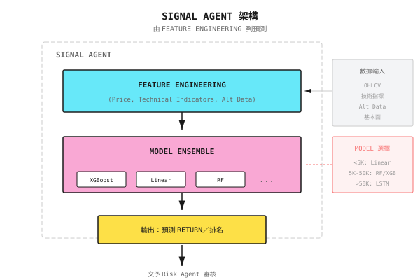

# 第 09 課：Supervised Learning 在量化交易中的應用

> **Machine learning 不是魔法，而是統計規律的放大鏡。如果數據裏沒有規律，再強的 model 也提取不出 Alpha。**

---

## 由「聖杯」到「工具」

2017 年，一間 hedge fund 招攬了一班頂尖 AI 研究員，承諾用 deep learning「革新」量化交易。

他們建立了一個 10 層的 LSTM 網絡，用 20 年的分鐘級數據訓練，在 GPU cluster 上跑了三個月。

**Backtest 結果：年化回報 150%，Sharpe ratio 4.0。**

創辦人興奮地宣佈：「我們找到聖杯了！」

**上線三個月後：**

- 第 1 個月：+5%（符合預期）
- 第 2 個月：-8%（開始擔心）
- 第 3 個月：-15%（恐慌）

累計虧損 18%，同期 S&P 500 卻上升 8%。

**發生了甚麼事？**

1. **Overfitting 於歷史噪音**：10 層 LSTM 有數以百萬計的參數，完美「背誦」了歷史數據，但那些規律只是噪音
2. **預測不等於獲利**：Model 的準確率是 52%，聽落不錯，但扣除交易成本後是淨虧損
3. **Distribution drift**：2017 年的市場結構已經與訓練數據（1997-2016）不同

**教訓**：Machine learning 在量化交易中的正確角色，不是「預測價格走勢」，而是**由噪音中提取微弱但穩健的訊號**。本課教你如何正確使用 supervised learning。

---

## 9.1 以量化角度看 Supervised Learning

### 甚麼是 Supervised Learning？

用已知答案的數據去「訓練」model，令它能夠預測未知數據的答案。

```
Training Data:
  Input X (Features)          ->  Output Y (Labels)
  [Yesterday's return, Volume, RSI]  ->  [Tomorrow up/down]
  [0.02, 1.5M, 65]            ->  [Up]
  [-0.01, 2.0M, 35]           ->  [Down]

What the model learns:
  "When RSI > 60 and volume increases, probability of rising tomorrow is higher"

Prediction phase:
  New input [0.01, 1.8M, 70]  ->  Model predicts [Up?]
```

### 量化交易中的「Labeling」困境

傳統 machine learning：label 清晰（貓/狗、垃圾郵件/非垃圾郵件）

量化問題：**label 應該如何定義？**

| Labeling 方式 | 問題 |
|-------------------|---------|
| 「明日上升 = 1，下跌 = 0」 | 升 0.01% 與升 5% 都算「上升」？ |
| 「5 日 return > 1%」 | 這 5 日內，可能先跌 10% 再反彈 |
| 「Return 本身」 | 噪音太多，model 難以找到規律 |
| 「Sharpe > 1 的持倉」 | 需要回看整個持倉期，有 look-ahead bias 風險 |

**正確做法**：Label 應該反映**可執行的交易決策**，而不是抽象的預測目標。

### 常見迷思

| 迷思 | 現實 |
|---------------|---------|
| 「準確率越高越好」 | 52% 準確率配 3:1 賺蝕比，遠勝 70% 準確率配 1:1 |
| 「越複雜的 model 越強」 | 金融數據 signal-to-noise ratio 低，簡單 model 往往更穩健 |
| 「Feature 越多越好」 | Feature 太多會導致 curse of dimensionality 與 overfitting |
| 「Deep learning 萬能」 | Deep learning 需要大量數據，而量化交易通常沒有 |

---

## 9.2 Feature Engineering：量化交易的核心戰場

> 80% 的 Alpha 來自 feature engineering，而不是 model 選擇。

### Feature 的類型

| Feature 類型 | 例子 | 資訊來源 |
|--------------|----------|-------------------|
| **Price Features** | Return、volatility、momentum | OHLCV |
| **Technical Indicators** | RSI、MACD、Bollinger Bands | 由價格衍生 |
| **Statistical Features** | Skewness、kurtosis、autocorrelation | 分佈特徵 |
| **Cross-Asset Features** | 板塊 momentum、市場 sentiment | 相關資產 |
| **Alternative Data** | 衛星圖像、社交媒體 | 外部數據 |

### Feature 構建例子

假設我們有 AAPL 的日線數據，構建以下 feature：

```
Base Data (5 days):
Date      Open    High    Low     Close   Volume
Day 1    $180   $182   $178   $181   10M
Day 2    $181   $185   $180   $184   12M
Day 3    $184   $186   $183   $183   11M
Day 4    $183   $184   $180   $181   15M
Day 5    $181   $183   $179   $182   13M

Feature Calculation (after Day 5 close):

1. Momentum Features
   5-day return = (182 - 181) / 181 = 0.55%
   3-day return = (182 - 184) / 184 = -1.09%

2. Volatility Features
   5-day return sequence: [1.66%, -0.54%, -1.09%, 0.55%]
   Daily volatility = std() = 1.11%
   Annualized volatility = 1.11% x sqrt(252) = 17.6%

3. Volume Features
   5-day average volume = (10+12+11+15+13)/5 = 12.2M
   Today's volume / average = 13/12.2 = 1.07 (slightly above average)

4. Price Position
   5-day high = $186, low = $178
   Current position = (182-178)/(186-178) = 50% (middle position)
```

### 好 Feature 的標準

| 標準 | 驗證方法 | 不達標的後果 |
|----------|---------------------|------------------------|
| **Predictive Power** | Univariate test IC > 0.03 | 浪費運算資源 |
| **Stability** | 不同時期的 IC 變動小 | Overfitting 於特定時期 |
| **Low Correlation** | 與現有 feature 的 correlation < 0.7 | 資訊冗餘 |
| **Interpretable** | 能清楚解釋背後邏輯 | 難以 debug |

### Feature Selection 的實用方法

**方法 1：Univariate Screening**

計算每個 feature 與 label 之間的 correlation（IC，Information Coefficient）：

```
IC = corr(Feature ranking, Return ranking)

Good features: IC mean > 0.03, IC stability (IC/std(IC)) > 0.5
```

**方法 2：Importance Pruning**

訓練一個簡單 model（例如 Random Forest），檢視 feature importance：

```
If top 5 features contribute > 80% importance:
  -> Keep only top 5-10 features
  -> Other features may be noise
```

**方法 3：Recursive Elimination**

逐步剔除最不重要的 feature，觀察 model 表現：

```
Starting: 50 features, Sharpe 1.2
Reduced to 30: Sharpe 1.3 (actually improved!)
Reduced to 10: Sharpe 1.4 (continues to improve)
Reduced to 5: Sharpe 1.1 (starts declining)

-> Optimal feature count is around 10
```

---

## 9.3 常見 Model 與其適用場景

### Model 比較

| Model | 優點 | 缺點 | 適用場景 |
|-------|------|------|-----------|
| **Linear Regression** | 簡單、可解釋、抗 overfitting | 只能捕捉線性關係 | Factor investing、risk model |
| **Random Forest** | 非線性、抗 overfitting、有 feature importance | 慢、外推能力差 | Classification、feature selection |
| **XGBoost/LightGBM** | 強大、快速、能處理缺失值 | 易 overfit、黑盒 | 一般 classification/regression |
| **LSTM** | 能捕捉時間依賴 | 需要大量數據、慢 | 只適用於數據充足的場景 |
| **Transformer** | 強大的 attention mechanism | 數據需求更大、難訓練 | 研究前沿、生產環境少見 |

### Model 失效條件

**Linear Model 失效：**
- Feature 與 return 之間的關係是非線性
- 存在強烈的 interaction effect（例如「低估值 + 高 momentum」）

**Tree Model 失效：**
- 需要外推（預測訓練範圍以外的數值）
- Feature 連續變化（tree model 做的是階梯式預測）

**Deep Learning 失效：**
- 數據量 < 100,000 個樣本（通常會 overfit）
- Feature 質素差（garbage in, garbage out）
- 嚴重的 distribution drift（歷史不代表未來）

### 量化交易中的實際選擇

```
Ask yourself: How much data do I have?

Data < 5,000 samples (e.g., 20 years of daily data)
  -> Linear model, Ridge regression
  -> Features < 20

Data 5,000-50,000 samples (e.g., 1 year of minute data)
  -> Random Forest, XGBoost
  -> Features 20-50

Data > 50,000 samples (e.g., tick data)
  -> Can try LSTM/Transformer
  -> But still need to verify if they outperform simple models
```

---

## 9.4 金融數據的特殊挑戰

### 低 Signal-to-Noise Ratio

金融訊號極其微弱：

| 數據類型 | Signal-to-Noise Ratio | 可達到的預測能力 |
|-----------|-----------------------|----------------------------|
| 圖像識別 | 高 | 準確率 95%+ |
| 自然語言 | 中 | 準確率 80%+ |
| 金融預測 | **極低** | 52-55% 準確率已屬頂尖 |

**為何金融的 signal-to-noise 這麼低？**
- 市場接近有效：明顯的規律很快就被 arbitrage 掉
- 參與者眾多：你找到的規律，其他人也在用
- 噪音主導：短期價格走勢有 90% 是隨機波動

### Non-Stationary Distribution

Training 數據與預測數據的分佈不同：

```
Training Set (2015-2019):
  Average volatility 15%
  Trend-dominated

Test Set (2020):
  Volatility spikes to 80%
  Extreme rallies and crashes

-> Model fails in 2020
```

**應對方法：**
- 使用 rolling window，不斷 retrain
- 用 rolling statistics 做 feature normalization
- 為不同 regime 分別建立 model

### Class Imbalance

如果用「大升（>3%）= 1，否則 = 0」：

```
Big gain days: ~5%
Normal days: ~95%

Model learns to "always predict 0", 95% accuracy, but completely useless
```

**應對方法：**
- 調整 class weight
- 用 AUC 取代準確率作評估
- 用 stratified sampling 確保 training set 的 class 平衡

---

## 9.5 Model 評估：重點不在準確率

### 量化專用的評估指標

| 指標 | 計算方式 | 良好標準 |
|--------|-------------|---------------|
| **IC (Information Coefficient)** | corr(預測排名, 實際 return 排名) | > 0.03 |
| **IR (Information Ratio)** | IC 平均值 / IC 標準差 | > 0.5 |
| **Long-Short Return** | 最高五分位 - 最低五分位的 return 差 | 顯著為正 |
| **Turnover-Adjusted Return** | Return - 交易成本 | 仍為正數 |

### Model 評估例子

假設 model 預測 100 隻股票明日的 return 排名：

```
Model Predicted Ranking (high->low):
  Stock A: 1 (predicted to rise most)
  Stock B: 2
  ...
  Stock Z: 100 (predicted to fall most)

Actual Return Ranking (high->low):
  Stock A: 5
  Stock B: 10
  ...
  Stock Z: 95

IC = corr([1,2,...,100], [5,10,...,95])
   = 0.85 (predicted ranking highly correlated with actual ranking)
```

**解讀：**
- IC = 0.85 代表預測排名與實際排名高度一致
- 如果 long Top 10、short Bottom 10，預期會有顯著的超額回報
- 但在真實市場中，IC 通常只有 0.02-0.05

### 現實預期

```
Top quantitative funds' IC: 0.03-0.05
Average quantitative strategy IC: 0.01-0.03
Random guessing IC: 0

Don't aim for IC > 0.1, that's almost certainly overfitting
```

### 生產級 IC 計算

前面展示的簡單 IC 計算用作快速分析沒有問題，但生產系統需要穩健地處理各種邊緣情況。以下是可用於生產環境的實作：

```python
import numpy as np
from scipy.stats import spearmanr

def calculate_ic(
    signals: np.ndarray,
    returns: np.ndarray,
    method: str = "spearman"
) -> float:
    """Calculate Information Coefficient (IC) - correlation between signals and returns

    Args:
        signals: Prediction signal array
        returns: Actual returns array
        method: "spearman" (recommended) or "pearson"

    Returns:
        IC value, range [-1, 1]
    """
    if len(signals) != len(returns):
        raise ValueError("signals and returns must have same length")
    if len(signals) < 2:
        return 0.0

    # Handle missing values - essential for production
    mask = ~(np.isnan(signals) | np.isnan(returns))
    signals, returns = signals[mask], returns[mask]

    if len(signals) < 2:
        return 0.0

    if method == "spearman":
        ic, _ = spearmanr(signals, returns)
    else:
        ic = np.corrcoef(signals, returns)[0, 1]

    return float(ic) if not np.isnan(ic) else 0.0
```

#### 為何 Spearman 優於 Pearson

| 方面 | Spearman | Pearson |
|--------|----------|---------|
| **對 Outlier 的敏感度** | 穩健，因為使用排名 | 極度敏感，單一 outlier 已可扭曲結果 |
| **關係類型** | 捕捉單調（非線性）關係 | 只捕捉線性關係 |
| **分佈假設** | 不需要 | 假設常態分佈 |
| **對金融數據的適配度** | 較佳，因為 return 有 fat tail | 差，違反常態假設 |

**重點**：金融 return 以 fat tail 與 outlier 見稱。單一極端日子（例如市場崩盤）已足以完全扭曲 Pearson correlation。Spearman 先將數值轉為排名，所以不受 outlier 數值大小影響。

#### 使用例子

**基本 IC 計算：**

```python
# Daily signals and next-day returns
signals = np.array([0.02, -0.01, 0.03, 0.01, -0.02])
returns = np.array([0.015, -0.005, 0.02, 0.008, -0.01])

ic = calculate_ic(signals, returns)
print(f"IC: {ic:.4f}")  # IC: 0.9000 (strong correlation)
```

**Rolling IC（時間序列）：**

```python
def rolling_ic(
    signals: pd.Series,
    returns: pd.Series,
    window: int = 20
) -> pd.Series:
    """Calculate rolling IC over a sliding window"""
    ic_series = pd.Series(index=signals.index, dtype=float)

    for i in range(window, len(signals)):
        sig_window = signals.iloc[i-window:i].values
        ret_window = returns.iloc[i-window:i].values
        ic_series.iloc[i] = calculate_ic(sig_window, ret_window)

    return ic_series

# Example: 20-day rolling IC
rolling_ic_values = rolling_ic(signal_series, return_series, window=20)
```

**Information Ratio (IR) 計算：**

```python
def calculate_ir(ic_series: pd.Series) -> float:
    """Calculate Information Ratio = mean(IC) / std(IC)

    IR > 0.5 indicates a robust signal
    """
    ic_clean = ic_series.dropna()
    if len(ic_clean) < 2 or ic_clean.std() == 0:
        return 0.0
    return ic_clean.mean() / ic_clean.std()

# Example
ir = calculate_ir(rolling_ic_values)
print(f"IR: {ir:.2f}")  # IR > 0.5 is good
```

#### 生產環境注意事項

1. **數據對齊**：確保 signal 與 return 正確對齊。時間 T 的 signal 應對應 T 至 T+1（或你的預測 horizon）的 return。Off-by-one 錯誤是最常見的 IC 計算 bug。

2. **最小樣本量**：IC 至少需要 30 個觀察值才有意義。樣本更少時，correlation 的估計方差很高，並不可靠。

3. **IC Decay 監控**：持續追蹤 IC 隨時間的變化。IC 呈下降趨勢代表：
   - Alpha decay（你的訊號變得擁擠）
   - Regime change（市場結構轉變）
   - Model drift（feature 不再具預測力）

```python
# IC decay detection
recent_ic = rolling_ic_values.tail(20).mean()
historical_ic = rolling_ic_values.tail(60).head(40).mean()

if recent_ic < historical_ic * 0.5:
    print("WARNING: IC has decayed by 50%+")
```

4. **Cross-Sectional 與 Time-Series IC**：
   - **Cross-sectional IC**：同一時間點跨股票的 correlation（選股的典型做法）
   - **Time-series IC**：單一資產隨時間的 correlation（擇時訊號的典型做法）

   上述實作兩者皆適用，只需確保數據結構正確。

---

## 9.6 Multi-Agent 視角

### Signal Agent 的 Model 選擇

在 multi-agent 系統中，supervised learning model 是 Signal Agent 的核心：



### Model 失效時怎麼辦？

Signal Agent 需要偵測自己的 model 是否失效：

| 偵測指標 | 門檻 | 觸發動作 |
|------------------|-----------|------------------|
| Rolling IC 連續 20 日 < 0 | - | 將 signal 權重減少 50% |
| 預測分佈異常 | Skewness > 2 | 暫停輸出 signal |
| Model confidence 下降 | 預測 variance 上升 | 通知 Meta Agent |

**關鍵設計**：Signal Agent 並非永遠正確，它需要一個「自我懷疑」的機制。

---

## 代碼實作（選讀）

<details>
<summary>展開代碼示例</summary>

```python
import pandas as pd
import numpy as np
from sklearn.ensemble import RandomForestClassifier
from sklearn.model_selection import TimeSeriesSplit

def create_features(df: pd.DataFrame, lookback: int = 20) -> pd.DataFrame:
    """Build quantitative features"""
    features = pd.DataFrame(index=df.index)

    # Momentum features
    features['ret_1d'] = df['close'].pct_change(1)
    features['ret_5d'] = df['close'].pct_change(5)
    features['ret_20d'] = df['close'].pct_change(20)

    # Volatility features
    features['vol_20d'] = df['close'].pct_change().rolling(20).std()

    # Volume features
    features['vol_ratio'] = df['volume'] / df['volume'].rolling(20).mean()

    # Price position
    features['price_pos'] = (
        (df['close'] - df['low'].rolling(20).min()) /
        (df['high'].rolling(20).max() - df['low'].rolling(20).min())
    )

    return features.shift(1)  # Avoid look-ahead bias

def create_label(df: pd.DataFrame, horizon: int = 5, threshold: float = 0.02):
    """Create label: whether future n-day return exceeds threshold"""
    future_ret = df['close'].pct_change(horizon).shift(-horizon)
    label = (future_ret > threshold).astype(int)
    return label

def calculate_ic(predictions: pd.Series, returns: pd.Series) -> float:
    """Calculate Information Coefficient"""
    return predictions.corr(returns, method='spearman')

def walk_forward_train(df: pd.DataFrame, n_splits: int = 5):
    """Walk-Forward training and evaluation"""
    features = create_features(df)
    labels = create_label(df)

    # Align data
    valid_idx = features.dropna().index.intersection(labels.dropna().index)
    X = features.loc[valid_idx]
    y = labels.loc[valid_idx]

    tscv = TimeSeriesSplit(n_splits=n_splits)
    results = []

    for train_idx, test_idx in tscv.split(X):
        X_train, X_test = X.iloc[train_idx], X.iloc[test_idx]
        y_train, y_test = y.iloc[train_idx], y.iloc[test_idx]

        model = RandomForestClassifier(n_estimators=100, max_depth=5, random_state=42)
        model.fit(X_train, y_train)

        predictions = model.predict_proba(X_test)[:, 1]
        # Calculate forward returns (next 5 days), aligned with prediction horizon
        forward_returns = df.loc[X_test.index, 'close'].pct_change(5).shift(-5)
        ic = calculate_ic(pd.Series(predictions, index=X_test.index),
                         forward_returns)

        results.append({
            'test_start': X_test.index[0],
            'test_end': X_test.index[-1],
            'ic': ic,
            'accuracy': (model.predict(X_test) == y_test).mean()
        })

    return pd.DataFrame(results)
```

</details>

---

## 本課成果

完成本課後，你將擁有：

1. **對 supervised learning 在量化交易中角色的理解** - 知道它能做甚麼、不能做甚麼
2. **實用的 feature engineering 技能** - 能構建並篩選有效的量化 feature
3. **Model 選擇框架** - 根據數據量揀選合適的 model
4. **正確的評估方法** - 用 IC/IR 而非準確率來評估 model

### 驗收標準

| 檢查項目 | 驗收標準 | 自我測試方法 |
|------------|---------------------|------------------|
| **Feature 構建** | 能由 OHLCV 數據構建 5 個 feature | 給定價格數據，手動計算 feature 數值 |
| **Model 選擇** | 能根據數據量建議合適的 model | 給定「3 年日線」場景，說出建議 |
| **IC 計算** | 能解釋 IC=0.03 的意思 | 不看筆記，解釋 IC 的業務意義 |
| **Failure Detection** | 能列出 3 個 model 失效訊號 | 設計 Signal Agent 的自我檢查邏輯 |

---

## 本課總結

- [x] 理解 supervised learning 在量化交易中的正確角色：提取微弱訊號，而不是預測價格走勢
- [x] 掌握核心 feature engineering 方法：構建、篩選、評估
- [x] 認清金融數據的特殊挑戰：低 signal-to-noise、non-stationarity、class imbalance
- [x] 學會用 IC/IR 取代準確率來評估 model
- [x] 理解 Signal Agent 如何整合 supervised learning model

---

## 延伸閱讀

- *Advances in Financial Machine Learning*，作者 Marcos Lopez de Prado
- [背景知識：LLM 量化研究進展](背景知識/LLM量化研究進展.md) - 最新研究方向

---

## 下一課預告

**第 10 課：從 Model 到 Agent**

Model 只輸出預測，但交易需要決策。如何將一個「預測 model」包裝成「能夠做決策的 Agent」？下一課，我們會跨越由 model 到 Agent 的鴻溝。
