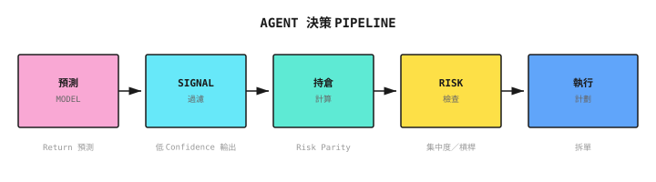
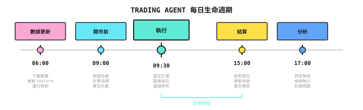
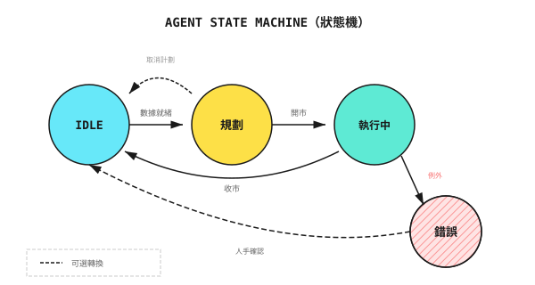
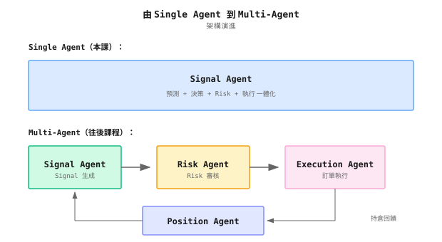

# 第 10 課：從模型到 Agent

> **模型說「明天會升」，但會升幾多？應該買幾多？幾時沽出？模型不會回答這些問題，但 Agent 必須回答。**

---

## 模型的局限

一個量化團隊訓練了一個高質素的預測模型：

- IC = 0.05（頂級水平）
- 每日預測 500 隻股票的回報排名
- Backtest 驗證穩定有效

他們用簡單規則把模型接上交易系統：
- 每日買入預測排名最前的 10 隻股票
- 資金平均分配給每隻股票
- 持有 5 日後沽出

**第一個月**：+3% 回報，符合預期

**第二個月**：-5% 回報

發生甚麼事？

1. **沒有考慮相關性**：買入的 10 隻股票全是科技股，科技板塊下跌時一同虧損
2. **沒有考慮 volatility**：有些股票日 volatility 達 5%，有些只有 1%，但資金卻平均分配
3. **沒有止蝕機制**：其中一隻股票持續下跌 15%，仍然持有至第 5 日
4. **沒有處理突發事件**：其中一隻股票停牌，資金被鎖死

**模型只負責「預測」，Agent 則必須負責「決策」。** 決策包括：
- **買甚麼？**（選擇資產）
- **買幾多？**（Position sizing）
- **幾時買／沽？**（Timing）
- **出事怎麼辦？**（異常處理）

本課教你如何把「預測模型」升級為「能夠做決策的 Agent」。

---

## 10.1 預測 vs 決策

### 核心分別

| | 預測模型 | 交易 Agent |
|--|-----------------|---------------|
| **輸入** | Feature 向量 | Feature + State + 約束條件 |
| **輸出** | 預測值／機率 | 具體行動 |
| **評估** | 預測誤差（IC、MSE） | 回報／風險／成本 |
| **時間** | 單點預測 | 持續決策 |
| **錯誤處理** | 無 | 必須有 |

### 直觀例子

```
Model output:
  "AAPL expected return tomorrow +0.5%, confidence 60%"

Agent must answer:
  1. Should I buy? -> Need to compare with other stocks, consider current positions
  2. How much to buy? -> Need to consider capital, risk limits, correlations
  3. At what price? -> Market order or limit order? At what level?
  4. Where's the stop-loss? -> If prediction is wrong, how much loss before exit?
  5. When to sell? -> Target price, holding period, or dynamic take-profit?
```

### Agent 的決策 Pipeline



---

## 10.2 Agent 的核心組件

### State

Agent 需要知道「我現在處於甚麼狀況」：

| State 類型 | 示例內容 |
|------------|-----------------|
| **Market State** | 現價、volatility、成交量、趨勢／上落市 |
| **Position State** | 現有持倉、成本、盈虧、持倉時間 |
| **Account State** | 可用現金、保證金、已用槓桿 |
| **System State** | API 是否正常？latency 多少？有沒有警報？ |

### Action Space

Agent 可以採取的行動：

```
Basic Actions:
  - BUY(symbol, quantity, order_type, price)
  - SELL(symbol, quantity, order_type, price)
  - HOLD()

Composite Actions:
  - REBALANCE(target_weights)
  - REDUCE_RISK(target_exposure)
  - CLOSE_ALL()

Constraints:
  - Single trade no more than 10% of available capital
  - Total leverage no more than 2x
  - Single stock no more than 20% of total position
```

### 決策函數

把 state 映射到 action：

```
action = decide(state, prediction, constraints)

Example:
  state = {
    cash: $100,000,
    positions: {AAPL: 100 shares, $180 cost},
    market_regime: "trend"
  }

  prediction = {
    AAPL: +0.5%,
    MSFT: +0.8%,
    GOOGL: +0.3%
  }

  constraints = {
    max_position: 20%,
    max_drawdown: 10%,
    stop_loss: 5%
  }

  action = decide(state, prediction, constraints)
  -> BUY(MSFT, 50 shares, LIMIT, $380)
```

---

## 10.3 Position Sizing：從預測到持倉

### 平均分配（最簡單）

```
Rule: Buy Top N, allocate 1/N of funds to each

Example:
  Top 5 stocks, capital $100,000
  Each gets $20,000
```

**問題**：沒有考慮預測強度、volatility 差異和相關性

### 按預測強度分配

```
Rule: Stronger prediction, larger allocation

Predicted returns:
  AAPL: +1.0%
  MSFT: +0.5%
  GOOGL: +0.3%

Weight calculation:
  AAPL: 1.0 / 1.8 = 56%
  MSFT: 0.5 / 1.8 = 28%
  GOOGL: 0.3 / 1.8 = 16%
```

**問題**：高 volatility 的股票可能獲得過高權重

### Volatility 調整（Risk Parity）

```
Rule: Let each stock contribute equal risk

Volatility:
  AAPL: 25%
  MSFT: 20%
  GOOGL: 15%

Inverse volatility weights:
  AAPL: 1/0.25 = 4
  MSFT: 1/0.20 = 5
  GOOGL: 1/0.15 = 6.67

Normalized:
  AAPL: 4/15.67 = 26%
  MSFT: 5/15.67 = 32%
  GOOGL: 6.67/15.67 = 42%
```

### Kelly 公式（最優）

理論上最優的持倉比例：

```
Kelly fraction = p/a - q/b

p = win rate
q = 1 - p
a = average loss rate
b = average win rate

Example:
  Win rate 55%, win/loss ratio 1.5:1
  Kelly = 0.55/1 - 0.45/1.5 = 0.55 - 0.30 = 25%

In practice: Use half-Kelly (12.5%) for more conservative approach
```

### Half-Kelly + Van Tharp 混合模型（推薦）

**為甚麼要用混合模型？**

單獨使用 Kelly 公式有兩個問題：
1. **假設可無限分割**：現實中，股票有最小交易單位
2. **忽略 fat-tail 風險**：市場崩潰時，虧損可以遠超歷史平均

Van Tharp 的 R-Multiple 方法正好補足這個缺口 - 它強制把止蝕納入持倉計算，確保單筆交易的虧損永遠不會超過帳戶的固定百分比。

**兩種方法的角色**：

| 方法 | 角色 | 目的 |
|--------|------|---------|
| **Half-Kelly** | 進攻 - 設定上限 | 最大化長期複利增長 |
| **Van Tharp R-Multiple** | 防守 - 設定下限 | 生存 - 單次虧損不致命 |

**公式**：

```
Half-Kelly (Offensive Ceiling):
  f = (p × (b + 1) - 1) / b, then divide by 2

  p = win rate
  b = reward/risk ratio (average win / average loss)

Van Tharp R-Multiple (Defensive Floor):
  position_size = (equity × risk_pct) / stop_loss_distance

  equity = account equity
  risk_pct = risk per trade (typically 1%)
  stop_loss_distance = entry price - stop loss price
```

**實作模式**：

```python
def half_kelly(win_rate: float, reward_risk_ratio: float) -> float:
    """Calculate Half-Kelly position ceiling"""
    full_kelly = (win_rate * (reward_risk_ratio + 1) - 1) / reward_risk_ratio
    return max(0, full_kelly / 2)

def van_tharp_limit(equity: float, risk_pct: float, stop_loss_dist: float, price: float) -> float:
    """Calculate Van Tharp position ceiling (returns position ratio)"""
    max_loss = equity * risk_pct
    shares = max_loss / stop_loss_dist
    position_value = shares * price
    return position_value / equity

# Final position = minimum of all three
strategy_cap = half_kelly(win_rate=0.55, reward_risk_ratio=1.5)  # e.g., 0.10 (10%)
risk_cap = van_tharp_limit(equity=100000, risk_pct=0.01, stop_loss_dist=5, price=100)  # e.g., 0.08 (8%)
max_notional_per_pair = 0.05  # Hard limit: no more than 5% per trade

final_position = min(strategy_cap, risk_cap, max_notional_per_pair)
```

**實例演算**：

```
Account: $100,000
Strategy history: 55% win rate, 1.5:1 reward/risk ratio
Target: AAPL at $200, stop-loss at $190 (distance $10)

Step 1: Half-Kelly Ceiling
  f = (0.55 × 2.5 - 1) / 1.5 / 2 = 0.375 / 2 = 18.75%
  -> Maximum investment $18,750

Step 2: Van Tharp Floor
  Max loss per trade = $100,000 × 1% = $1,000
  Shares allowed = $1,000 / $10 = 100 shares
  Position value = 100 × $200 = $20,000
  -> By risk control, max investment $20,000

Step 3: Hard Limit
  Per-trade cap = $100,000 × 5% = $5,000

Final position = min($18,750, $20,000, $5,000) = $5,000
-> Buy 25 shares of AAPL
```

**核心原則**：

> **Half-Kelly 定義進攻上限；Van Tharp R-Multiple 定義生存下限。**

兩者結合可確保：
1. 機會出現時不會太保守（Kelly 的數學最優化）
2. 判斷錯誤時不致命（Van Tharp 的風險控制下限）
3. 硬性上限防止過度集中（不論模型的 confidence 有多高）

### 持倉計算示例

假設：
- 資金 $100,000
- 單一持倉上限 20%（$20,000）
- 總持倉上限 80%（$80,000）

模型預測 Top 3：

| 股票 | 預測回報 | Volatility | 原始權重 | 風險調整後權重 | 最終持倉 |
|-------|------------------|------------|------------|----------------------|----------------|
| AAPL | +1.0% | 25% | 40% | 30% | $24,000 -> **$20,000**（受上限限制） |
| MSFT | +0.8% | 20% | 32% | 35% | $28,000 -> **$20,000**（受上限限制） |
| GOOGL | +0.7% | 15% | 28% | 35% | $28,000 -> **$20,000**（受上限限制） |

最終：AAPL/MSFT/GOOGL 各 $20,000，總持倉 60%

---

## 10.4 整合風險控制

### Agent 內建的風險規則

| 規則類型 | 示例 | 觸發的行動 |
|-----------|---------|------------------|
| **止蝕** | 單一持倉虧損 > 5% | 平倉 |
| **止賺** | 單一持倉盈利 > 10% | 減持 50% |
| **總 Drawdown** | 帳戶 drawdown > 15% | 停止開新倉 |
| **集中度** | 單一股票 > 25% | 禁止加倉 |
| **時間** | 持倉 > 20 日 | 強制平倉 |

### 與 Risk Agent 協作

```
Signal Agent proposes:
  "Buy AAPL $30,000"

Agent internal check:
  OK - Single trade < max position
  OK - Enough cash available
  X  - If bought, tech sector will exceed 60%

Internal processing options:
  A) Reduce order to $15,000
  B) Simultaneously sell some other tech stocks
  C) Abandon this trade

-> Choose A, submit $15,000 order to Risk Agent for review

Risk Agent review:
  OK - Meets account-level risk controls
  OK - No anomalies
  -> Approve for execution
```

---

## 10.5 異常處理

### 必須處理的異常

| 異常類型 | 場景 | 處理方法 |
|----------------|----------|-----------------|
| **訂單被拒** | 資金不足、股票停牌 | 記錄 log，調整計劃 |
| **部分成交** | 流動性不足 | 決定是否追單 |
| **價格 Gap** | 隔夜大幅波動 | 重新評估止蝕價 |
| **API Timeout** | 網絡問題 | 重試機制 + circuit breaker |
| **數據缺失** | 數據源故障 | 使用備用數據源或暫停 |

### 異常處理設計原則

1. **Fail Fast**：不確定時，停止而不是繼續執行
2. **Graceful Degradation**：主要功能失效時要有備用方案
3. **人手介入**：嚴重異常觸發警報，等待人手決定
4. **事後審計**：所有異常都記錄下來以供檢討

---

## 10.6 Agent 生命週期

### 每日流程



### 狀態機視角



---

## 10.7 Multi-Agent 視角

### Signal Agent 的定位

```
Signal Agent Responsibilities:
  - Run prediction models
  - Generate raw signals (prediction rankings/returns)
  - Initial position calculation
  - Signal confidence assessment

Signal Agent Does Not:
  - Final order decision (Risk Agent)
  - Order execution (Execution Agent)
  - Position monitoring (Position Agent)
```

### 從單一 Agent 到 Multi-Agent



本課講解的是「單一 Agent 包辦一切」的簡化版本。由第 11 課開始，我們會把不同職責拆分給專職的 Agent。

---

## 代碼實作（選讀）

<details>
<summary>展開代碼示例</summary>

```python
from dataclasses import dataclass
from typing import Dict, List, Optional
from enum import Enum

class OrderType(Enum):
    MARKET = "market"
    LIMIT = "limit"

@dataclass
class Order:
    symbol: str
    quantity: int
    side: str  # "buy" or "sell"
    order_type: OrderType
    price: Optional[float] = None

@dataclass
class Position:
    symbol: str
    quantity: int
    avg_cost: float
    current_price: float

    @property
    def pnl_pct(self) -> float:
        return (self.current_price - self.avg_cost) / self.avg_cost

class TradingAgent:
    def __init__(
        self,
        capital: float,
        max_position_pct: float = 0.2,
        max_total_exposure: float = 0.8,
        stop_loss_pct: float = 0.05
    ):
        self.capital = capital
        self.max_position_pct = max_position_pct
        self.max_total_exposure = max_total_exposure
        self.stop_loss_pct = stop_loss_pct
        self.positions: Dict[str, Position] = {}

    def get_current_exposure(self) -> float:
        """Calculate current total exposure as fraction of capital"""
        total_value = sum(
            pos.quantity * pos.current_price
            for pos in self.positions.values()
        )
        return total_value / self.capital

    def calculate_position_size(
        self,
        symbol: str,
        prediction: float,
        volatility: float,
        current_price: float
    ) -> int:
        """Calculate position size"""
        # Check total exposure limit
        current_exposure = self.get_current_exposure()
        remaining_exposure = self.max_total_exposure - current_exposure
        if remaining_exposure <= 0:
            return 0  # Already at max total exposure

        # Raw weight based on prediction strength
        raw_weight = abs(prediction)

        # Volatility adjustment
        vol_adjusted_weight = raw_weight / volatility

        # Cap single position, also respect remaining exposure headroom
        capped_weight = min(vol_adjusted_weight, self.max_position_pct, remaining_exposure)

        # Calculate shares
        position_value = self.capital * capped_weight
        shares = int(position_value / current_price)

        return shares

    def check_stop_loss(self) -> List[Order]:
        """Check stop-loss triggers"""
        orders = []
        for symbol, pos in self.positions.items():
            if pos.pnl_pct < -self.stop_loss_pct:
                orders.append(Order(
                    symbol=symbol,
                    quantity=pos.quantity,
                    side="sell",
                    order_type=OrderType.MARKET
                ))
        return orders

    def generate_orders(
        self,
        predictions: Dict[str, float],
        volatilities: Dict[str, float],
        prices: Dict[str, float]
    ) -> List[Order]:
        """Generate orders"""
        orders = []

        # 1. Check stop-loss first
        stop_loss_orders = self.check_stop_loss()
        orders.extend(stop_loss_orders)

        # 2. Calculate target positions
        for symbol, pred in predictions.items():
            if pred > 0.001:  # Only process positive predictions
                target_shares = self.calculate_position_size(
                    symbol, pred,
                    volatilities.get(symbol, 0.2),
                    prices[symbol]
                )

                current_shares = self.positions.get(symbol, Position(symbol, 0, 0, 0)).quantity
                diff = target_shares - current_shares

                if diff > 0:
                    orders.append(Order(
                        symbol=symbol,
                        quantity=diff,
                        side="buy",
                        order_type=OrderType.LIMIT,
                        price=prices[symbol] * 0.999  # Slightly below current price
                    ))
                elif diff < 0:
                    orders.append(Order(
                        symbol=symbol,
                        quantity=-diff,
                        side="sell",
                        order_type=OrderType.LIMIT,
                        price=prices[symbol] * 1.001  # Slightly above current price
                    ))

        return orders
```

</details>

---

## 本課成果

完成本課後，你將擁有：

1. **由預測轉為決策的思維** - 理解模型輸出如何變成具體的交易行動
2. **Agent 架構設計** - State、action space 與決策函數的設計方法
3. **Position sizing 技能** - 平均分配、按預測加權、risk parity 的計算方法
4. **異常處理意識** - 知道哪些異常必須處理

### 驗收標準

| 檢查項目 | 驗收標準 | 自我測試方法 |
|------------|---------------------|------------------|
| **預測 vs 決策** | 能說出 3 個核心分別 | 不看筆記，列出分別 |
| **持倉計算** | 能手動計算 risk parity 權重 | 給定 3 隻股票的 volatility，計算權重 |
| **決策 Pipeline** | 能畫出由預測到落單的完整流程 | 在白紙上畫出來 |
| **異常處理** | 能列出 5 類必須處理的異常 | 設計異常處理表 |

**情境練習：**

模型預測：AAPL +1.2%，TSLA +0.8%，MSFT +0.5%
Volatility：AAPL 25%，TSLA 50%，MSFT 20%
資金：$100,000，單一持倉上限 20%

問題：用 risk parity 計算，每隻股票應分配多少資金？

<details>
<summary>點擊查看答案</summary>

Inverse volatility：
- AAPL：1/0.25 = 4
- TSLA：1/0.50 = 2
- MSFT：1/0.20 = 5
- 合計：11

標準化權重：
- AAPL：4/11 = 36.4%
- TSLA：2/11 = 18.2%
- MSFT：5/11 = 45.4%

資金分配（考慮 20% 單一持倉上限）：
- AAPL：$36,400 -> **$20,000**（受上限限制）
- TSLA：$18,200 -> $18,200
- MSFT：$45,400 -> **$20,000**（受上限限制）

最終：AAPL $20k，TSLA $18.2k，MSFT $20k，總持倉 58.2%

</details>

---

## 本課總結

- [x] 理解預測模型與交易 Agent 的核心分別
- [x] 掌握 Agent 的核心組件：state、action space、決策函數
- [x] 學會多種 position sizing 方法：平均分配、按預測加權、risk parity、Kelly
- [x] 認識必須處理的異常類型與處理原則
- [x] 理解 Signal Agent 在 multi-agent 系統中的定位

---

## 延伸閱讀

- *Active Portfolio Management*，Grinold & Kahn - 持倉管理的經典著作
- [第 15 課：風險控制與資金管理](../Part4-多智能體/第15課：風險控制與資金管理.md) - 更詳細的風險控制內容

---

## Part 3 總結

恭喜你完成 Machine Learning 階段！

| 課程 | 重點收穫 |
|--------|---------------|
| 第 09 課 | 監督學習在量化交易中的角色、feature engineering、模型選擇、IC 評估 |
| 第 10 課 | 由預測到決策的轉變、Agent 架構、position sizing |

**下一階段預告：**

Part 4 將深入 Multi-Agent 系統：
- 第 11 課：為何需要 Multi-Agent
- 第 12 課：Market Regime 偵測
- 第 13 課：Regime 誤判與系統性崩潰模式
- 第 14 課：LLM 在量化交易中的應用
- 第 15 課：風險控制與資金管理
- 第 16 課：Portfolio 構建與風險敞口管理
- 第 17 課：Online Learning 與策略演化

你將學會如何建立完整的 multi-agent 交易系統，讓不同的專家 Agent 協作，完成由分析到執行的完整流程。
