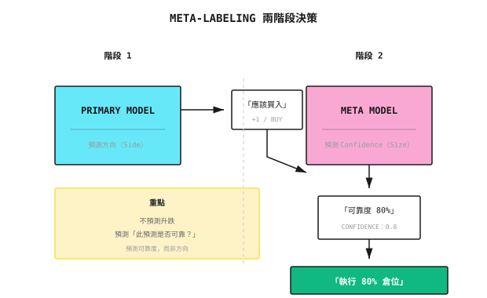

# 背景知識：Meta-Labeling 方法

> 「不是預測升跌，而是預測『這個預測是否可靠』。」

---

## 傳統方法的問題

**情境**：你有一個 trend-following 模型，會產生買入／賣出訊號

```
Traditional Flow:
Signal Generated -> Execute Directly -> Results are mixed

Problem:
  - Some signals have high win rate (when trend is clear)
  - Some signals have low win rate (in ranging markets)
  - The model cannot distinguish between these two situations
```

**結果**：在不應該交易時交易，浪費成本，拖累 return。

---

## Meta-Labeling 的核心思想

**兩階段決策**：



---

## 詳細流程

### 步驟 1：Primary Model 產生訊號

Primary model 可以是任何策略：
- 技術分析規則
- Machine learning 模型
- 基本面因子

```
Primary Model Output:
  +1 = Buy signal
  -1 = Sell signal
   0 = No signal
```

### 步驟 2：建構 Meta Label

針對 primary model 的每個訊號，判斷該訊號是否正確：

```
Meta Label Definition:
  If primary signal direction is correct and profitable -> Meta Label = 1
  If primary signal direction is wrong or loses money -> Meta Label = 0

Combined with Triple Barrier:
  Primary model says "buy", triggers upper barrier (take-profit) -> Meta Label = 1
  Primary model says "buy", triggers lower barrier (stop-loss) -> Meta Label = 0
```

### 步驟 3：訓練 Meta Model

Meta model 學習預測 primary model 訊號的成功機率：

```
Features:
  - Primary model signal direction
  - Current volatility
  - Trend strength
  - Primary model historical accuracy
  - Market state indicators

Target:
  - Predict whether the signal will be profitable (binary classification)
  - Or predict confidence level (regression)
```

### 步驟 4：執行決策

```
Final Decision = Primary Model Direction x Meta Model Confidence

Example:
  Primary Model: Buy (+1)
  Meta Model: Confidence 0.3 (low)

  Decision:
    Option A: Don't execute (confidence too low)
    Option B: Small position buy (30% of normal size)
```

---

## 數值例子

**設定**：Trend-following primary model，過去 100 個訊號

| 訊號 # | Primary 方向 | 實際結果 | Meta Label |
|--------|--------------|----------|------------|
| 1 | Buy | 賺 2% | 1 |
| 2 | Buy | 蝕 1% | 0 |
| 3 | Sell | 賺 1.5% | 1 |
| 4 | Buy | 蝕 0.5% | 0 |
| ... | ... | ... | ... |

**統計**：
- 總訊號數：100
- 賺錢訊號：55（win rate 55%）
- 蝕錢訊號：45

**Meta Model 分析**：

```
High Confidence Signals (Meta Model > 0.7): 30
  - Profitable: 25 (83% win rate)
  - Losing: 5

Low Confidence Signals (Meta Model < 0.3): 25
  - Profitable: 8 (32% win rate)
  - Losing: 17

Strategy: Only execute high confidence signals
  - Trading frequency reduced 70%
  - Win rate improved from 55% to 83%
  - Trading costs reduced
```

---

## Meta Model 的 Feature 設計

### 市場狀態 Feature

| Feature | 計算方法 | 預測邏輯 |
|---------|----------|----------|
| Volatility | 20 日 return 標準差 | 高 volatility 時 trend 訊號較易失效 |
| Trend Strength | ADX 指標 | 強 trend 令訊號更可靠 |
| Volume Change | 當前成交量 / 20 日平均成交量 | 帶成交量的突破較可靠 |
| VIX Level | 恐慌指數 | VIX 高時訊號可靠性下降 |

### Primary Model Feature

| Feature | 計算方法 | 預測邏輯 |
|---------|----------|----------|
| Signal Strength | Primary model 原始分數 | 訊號愈強愈可靠 |
| Rolling Win Rate | 過去 20 個訊號的準確率 | 近期表現愈好 = 愈可靠 |
| Signal Consistency | 多個指標是否一致 | 多重確認 = 更可靠 |
| Time Since Last Signal | 訊號間隔 | 訊號過於頻密可能只是 noise |

### 時間 Feature

| Feature | 計算方法 | 預測邏輯 |
|---------|----------|----------|
| Day of Week | 星期一至五編碼 | 星期一／五的 volatility 可能不同 |
| Time of Month | 月初／月底 | 月底可能有機構 rebalancing |
| Earnings Season | 是否處於業績公布期 | 業績公布期 noise 較多 |

---

## Position Sizing

Meta model 的 confidence 可直接用於倉位管理：

```
Method 1: Linear Mapping
  Position = Confidence x Max Position

  Confidence 0.8 -> 80% position
  Confidence 0.3 -> 30% position

Method 2: Threshold Filtering
  Confidence > 0.6 -> Full position
  Confidence < 0.6 -> No trade

Method 3: Convex Function Mapping
  Position = Confidence^2 x Max Position

  More aggressively reduce low confidence positions:
  Confidence 0.8 -> 64% position
  Confidence 0.5 -> 25% position
  Confidence 0.3 -> 9% position
```

---

## 與直接預測的比較

| 方法 | 目標 | 優點 | 缺點 |
|------|------|------|------|
| 直接預測 | 預測升／跌 | 簡單直接 | Win rate 難以超過 55% |
| Meta-Labeling | 預測訊號可靠性 | 提升有效 win rate | 減少交易機會 |

**關鍵洞察**：

```
Direct Prediction:
  100 trades, 55% win rate
  Expected profit = 55 x 1% - 45 x 1% = 10%

Meta-Labeling:
  30 high confidence trades, 80% win rate
  Expected profit = 24 x 1% - 6 x 1% = 18%

  Although fewer trades, returns are higher
```

---

## Multi-Agent 視角

Meta-Labeling 很自然地配合 multi-agent 架構：

```
Signal Agent (Primary Model)
  |
  +- Output: Trading direction
  |
  v
Confidence Agent (Meta Model)
  |
  +- Input: Signal Agent's signal + market state
  +- Output: Confidence of that signal
  |
  v
Risk Agent
  |
  +- Adjust position based on confidence
  +- Low confidence -> Reject trade or small position
  +- High confidence -> Allow normal position

Meta Agent
  |
  +- Monitor Confidence Agent's accuracy
     -> If persistently failing, switch to conservative mode
```

---

## 常見誤解

**誤解 1：Meta model 會學到與 primary model 一樣的東西**

錯誤。兩者的目標不同：
- Primary model：預測價格方向
- Meta model：預測 primary model 何時有效

Meta model 可以發現「primary model 在高 volatility 時失效」之類的規律。

**誤解 2：高 confidence 一定正確**

不保證。Meta model 同樣會出錯：
- 對歷史規律 overfitting
- 市場 regime 轉變
- 樣本量不足

仍然需要 stop-loss 及風險控制。

**誤解 3：Meta-Labeling 可以拯救差劣的 primary model**

作用有限。如果 primary model 的 win rate 太低（<50%），meta model 能做的事情有限：
- 只能減少虧損
- 無法創造正的 expectancy

Primary model 本身必須具備一定的預測能力。

---

## 實務建議

### 1. 確認 Primary Model 具備基礎 Alpha

```
First confirm:
  - Primary model win rate > 50%
  - Or win/loss ratio > 1
  - Positive returns out-of-sample

Without base Alpha, Meta-Labeling cannot create it
```

### 2. 保持 Meta Model 簡單

```
Recommended:
  - Logistic regression
  - Shallow decision trees
  - Simple neural networks (1-2 layers)

Avoid:
  - Deep models (easy to overfit)
  - Too many features (adds noise)
```

### 3. 獨立驗證

```
Validation Process:
  1. Train primary model on training set
  2. Use primary model to generate signals on validation set
  3. Train meta model using validation set signal results
  4. Evaluate overall performance on test set

Key: Primary and meta models use different data
```

---

## 總結

| 重點 | 說明 |
|------|------|
| 核心思想 | 用第二個模型預測 primary model 的可靠性 |
| 輸出 | Confidence score -> 用於過濾訊號或 position sizing |
| 優勢 | 提升有效 win rate，減少無效交易 |
| 前提 | Primary model 必須具備正的 expectancy |
| Multi-Agent 應用 | 由 Confidence Agent 專責 confidence 評估 |
