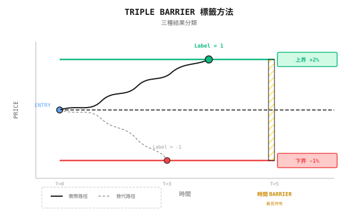

# 背景知識：Triple Barrier 標籤方法

> 「傳統的升／跌 label 忽略了一個關鍵問題：你可以持倉多久？」

---

## 傳統 label 的問題

假設你用 machine learning 預測 AAPL 明天是升還是跌：

```
Label = 1 if tomorrow's close > today's close else 0
```

**問題在哪裏？**

| 場景 | 明天方向 | 傳統 label | 實際結果 |
|----------|---------------------|-------------------|---------------|
| 開市 -3%，收市 +0.5% | 升 | 1（正確） | 觸發止蝕，虧損 3% |
| 穩步上升 +2% | 升 | 1（正確） | 持有，賺 2% |
| 升 5%，收市 +0.1% | 升 | 1（正確） | 沒有止賺，錯失 5% |

傳統 label 完全忽略了**持倉期間的波動**與**風險管理**。

---

## Triple Barrier 的核心概念

設定三道「barrier」，哪一道最先被觸發，就決定 label：



**三道 Barrier**：
1. **上 Barrier**：價格升至止賺水平 -> Label = 1
2. **下 Barrier**：價格跌至止蝕水平 -> Label = -1
3. **垂直 Barrier（時間）**：持倉期結束 -> Label = 0，或按最終方向決定

---

## 詳細計算示例

**設定**：
- 入場價：$185.00（AAPL）
- 止賺：2%（$188.70）
- 止蝕：1%（$183.15）
- 最長持倉期：5 日

**情境 1**：第 2 日升至 $189.00
```
Result: Upper barrier triggered
Label: 1 (Profitable exit)
Actual return: +2%
```

**情境 2**：第 3 日跌至 $182.50
```
Result: Lower barrier triggered
Label: -1 (Stop-loss exit)
Actual return: -1%
```

**情境 3**：5 日內在 $184-$187 之間上落
```
Result: Time barrier triggered
Label: 0 or based on final price
Actual return: Depends on exit price
```

---

## 動態 Barrier：基於 volatility

固定 2% 止賺在不同的市場環境下並不合理：

| 市場狀態 | 日均 volatility | 固定 2% 止賺 | 問題 |
|--------------|----------------------|----------------------|---------|
| 低 volatility | 0.5% | 需要 4 日才到達 | 時間 barrier 可能先被觸發 |
| 高 volatility | 3% | 即日觸發 | 無法捕捉趨勢 |

**解決方法**：用 ATR（Average True Range）或 rolling standard deviation 來定義 barrier

```
Upper Barrier = Entry Price x (1 + k x sigma)
Lower Barrier = Entry Price x (1 - k x sigma)

Where:
  sigma = Past 20 days return standard deviation
  k = Multiplier (typically 1-3)
```

**示例**：
- sigma = 1.5%
- k = 2
- 入場價 = $185

```
Upper Barrier = $185 x (1 + 2 x 1.5%) = $190.55
Lower Barrier = $185 x (1 - 2 x 1.5%) = $179.45
```

---

## 非對稱 Barrier

在真實交易中，止賺與止蝕往往並不對稱：

| 策略類型 | 止賺倍數 | 止蝕倍數 | 賺蝕比 |
|---------------|---------------------|-------------------|----------------|
| Trend Following | 3sigma | 1sigma | 3:1 |
| Mean Reversion | 1sigma | 2sigma | 1:2 |
| 高勝率 | 1sigma | 1sigma | 1:1 |

**Trend 策略示例**：
```
Take-profit = 3 x 1.5% = 4.5%
Stop-loss = 1 x 1.5% = 1.5%

Win rate only needs >25% to be profitable:
Expected value = Win rate x 4.5% - (1-Win rate) x 1.5%
At Win rate = 30%: Expected value = 0.3% (positive return)
```

---

## Label 分佈的重要性

Triple Barrier 會產生三種 label；分佈會影響模型訓練：

| Label | 意思 | 理想比例 | 現實情況 |
|-------|---------|-------------|----------------|
| 1 | 止賺離場 | 33% | 上落市中可能 <20% |
| -1 | 止蝕離場 | 33% | 趨勢市中可能 <20% |
| 0 | 時間離場 | 33% | 往往 >50% |

**處理 class imbalance**：
- Oversample 少數類別（SMOTE）
- Undersample 多數類別
- 調整 class weight
- 調整 barrier 闊度，令分佈更平均

---

## 與傳統 label 的比較

| 維度 | 傳統 label | Triple Barrier |
|-----------|-------------------|----------------|
| 資訊量 | 只有方向 | 方向 + 風險 + 時間 |
| 與實盤交易的一致性 | 低 | 高 |
| 計算複雜度 | O(1) | 每個樣本 O(T) |
| Label 噪音 | 高 | 較低 |
| 適合的策略 | 簡單預測 | 真實交易系統 |

---

## Multi-Agent 視角

在 multi-agent 架構中，Triple Barrier 可以這樣應用：

```
Signal Agent: Predict labels (1, 0, -1)
     |
Risk Agent: Dynamically adjust barrier widths
     |
     - High volatility period -> Wider barriers, avoid frequent stop-losses
     - Low volatility period -> Narrower barriers, improve capital efficiency
     |
Execution Agent: Monitor barrier triggers, execute exits
```

---

## 常見誤解

**誤解 1：Barrier 愈闊愈好**

錯。Barrier 闊一點可以減少止蝕觸發，但：
- 每筆交易的虧損更大
- 資金被鎖定的時間更長
- 可能錯失其他機會

**誤解 2：時間 barrier 不重要**

非常重要。沒有時間 barrier，資金可能被長期鎖住。如果 5 日都沒有觸發任何 barrier，判斷可能已經錯了，應該離場重新評估。

**誤解 3：Triple Barrier label 一定比傳統 label 好**

不一定。如果你的策略不使用止賺／止蝕（例如 T+1 必須翌日賣出），傳統 label 可能更合適。Labeling 方法應該配合實際的交易邏輯。

---

## 實務建議

1. **由簡單開始**：先用固定百分比 barrier，驗證後再加入 volatility 調整
2. **檢查 label 分佈**：當三種 label 的比例非常不均時要作出調整
3. **Backtest 保持一致**：如果訓練使用 Triple Barrier，backtest 應模擬相同的止賺／止蝕邏輯
4. **考慮交易成本**：Barrier 太窄會導致頻繁交易，成本蠶食回報

---

## 總結

| 重點 | 說明 |
|-----------|-------------|
| 核心概念 | 用止賺、止蝕和時間 barrier 來決定 label |
| 優點 | Label 與實際交易邏輯一致，噪音減少 |
| 關鍵參數 | Barrier 闊度、對稱性、時間長度 |
| 動態調整 | 根據 volatility 設定 barrier（ATR 或 sigma） |
| Multi-Agent 應用 | Risk Agent 根據市場狀態調整 barrier |
