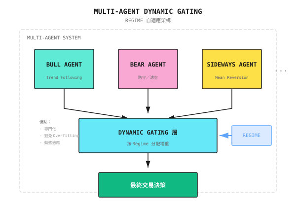

# 背景知識：前沿 ML 與 RL 方法（2025）

> 本文回顧截至 2025 年，量化交易中最前沿的 machine learning 與 reinforcement learning 方法。這些都是頂尖量化機構（Two Sigma、Citadel、幻方量化、九章量化）正在探索或已經採用的技術。

---

## 1. 技術演進概覽

### 1.1 由傳統到前沿

| 世代 | 代表技術 | 現況 |
|------------|---------------------------|--------|
| 第 1 代 | Linear Regression, Logistic | 基礎方法，仍在使用 |
| 第 2 代 | LSTM, GRU | 仍然可行（低延遲、小數據），但主流焦點已轉向 Transformer |
| 第 3 代 | Transformer, GNN | 現時主流 |
| 第 4 代 | Foundation Models, Diffusion | **前沿探索** |

> **注意**：LSTM/GRU 並未完全過時。在低延遲場景（inference <1ms）、小數據集或簡單時間序列預測中，它們仍然是合理的選擇。詳細指引見 [模型架構選擇指南](模型架構選擇指南.md)。

### 1.2 領先機構的技術佈局

| 機構 | 公開的技術方向 | 算力投入 |
|-------------|----------------------------|-------------------|
| 幻方量化 | DeepSeek LLM、Firefly II AI Cluster | $150M+ |
| 九章量化 | 與 Microsoft 合作垂直領域 AI | 未披露 |
| Two Sigma | Data Science + 大規模 ML | 支撐 $60B AUM |
| Citadel | HFT 基礎設施 + AI | 持續招聘 AI 人才 |

---

## 2. Decision Transformer

### 2.1 核心理念

**把 reinforcement learning 問題轉化為 sequence modeling 問題**：

```
Traditional RL: State -> Policy -> Action -> Reward -> Update Policy
Decision Transformer: (Return, State, Action) sequence -> Next Action
```

**關鍵創新**：
- 毋須估計 value function
- 毋須 policy gradient
- 直接用 Transformer 建模「如果我想要這個 return，應該怎樣做」

### 2.2 GPT-2 + LoRA 應用於交易

**最新研究（2024 年 11 月）**：

```
Architecture:
Pre-trained GPT-2
    |
LoRA Fine-tuning (Low-Rank Adaptation)
    |
Decision Transformer for Trading
```

**為何有效**：
- GPT-2 的 pre-trained weights 提供強大的 sequence modeling 能力
- LoRA 只 fine-tune 一小部分參數（約 0.1%），效率高且能防止 overfitting
- 適合金融數據稀缺的場景

**表現**：與 CQL、IQL、BC 等 offline RL 算法相比具競爭力，在部分場景更勝一籌

### 2.3 TACR（Transformer Actor-Critic with Regularization）

**針對的問題**：傳統 RL 假設 Markov property（只看當前 state），但金融市場存在長期依賴

**方法**：利用 Decision Transformer 的 attention mechanism 為歷史 MDP 序列建模

**練習**：實作一個簡單的 Decision Transformer 交易框架

---

## 3. LLM 驅動的 Alpha 挖掘

### 3.1 AlphaAgent 框架

**核心理念**：以 multi-agent 協作進行 alpha factor 挖掘

**架構**：

```
┌─────────────────────────────────────────────────────┐
│                   AlphaAgent System                  │
├─────────────────────────────────────────────────────┤
│  Research Agent     →  Generate factor hypotheses    │
│       ↓                                              │
│  Backtest Agent     →  Validate factor effectiveness │
│       ↓                                              │
│  Risk Agent         →  Assess factor risk properties │
│       ↓                                              │
│  Portfolio Agent    →  Optimize weights & allocation │
└─────────────────────────────────────────────────────┘
```

**主要特點**：
- **Multi-agent 分工**：每個 agent 專注單一任務，避免單一 LLM 的能力瓶頸
- **迭代優化**：透過 backtest 回饋不斷改進 factor
- **Risk-aware**：Risk Agent 內嵌於工作流程，而非事後補救
- **可解釋性**：每個決策節點都有清晰的推理鏈

**與傳統方法比較**：

| 特性 | 傳統量化 | Single LLM | AlphaAgent |
|---------|------------------|------------|------------|
| Factor 挖掘效率 | 低（人手） | 中 | 高 |
| 風險控制 | 事後 | 弱 | 內建 |
| 可解釋性 | 高 | 低 | 高 |
| 迭代速度 | 慢 | 快 | 快 |

### 3.2 LLM-Guided RL

**來源**：arXiv 2508.02366（2025）

**核心理念**：

```
LLM: Generate high-level strategy ("Market is in uptrend, suggest overweight tech stocks")
 |
RL Agent: Execute specific trades ("Buy 100 shares AAPL, limit $185")
 |
Reward: Feedback to LLM for strategy improvement
```

**優點**：
- LLM 提供可解釋的高層邏輯
- RL 優化底層執行細節
- 兩者互補

**實驗結果**：6 隻股票中有 4 隻的 Sharpe ratio 優於純 RL baseline

### 3.3 Alpha-GPT 2.0

**定位**：Human-in-the-Loop AI

**流程**：
1. LLM 生成 factor 候選
2. 人類專家審核／修改
3. Backtest 驗證
4. 回饋以作改進

**適用場景**：需要人手監督的機構應用

**練習**：實作一個簡單的 LLM factor 生成 pipeline

---

## 4. Graph Neural Networks (GNN)

### 4.1 為何需要 GNN

**傳統方法的限制**：
- 假設股票之間互相獨立
- 忽略關係連結

**市場現實**：
- 供應鏈關係（Apple -> TSMC）
- 行業相關性（銀行股同步升跌）
- 宏觀因素（利率影響所有股票）

### 4.2 Role-Aware Graph Transformer

**來源**：2025 年 12 月的研究

**多重關係建模**：

| 邊類型 | 意義 | 建構方法 |
|-----------|-----------|---------------------|
| Correlation | 價格相關性 | 歷史 return 相關係數 |
| Fundamental | 基本面相似度 | PE、PB、ROE 等 |
| Sector | 行業關係 | GICS 分類 |
| Supply Chain | 供應鏈 | 財報披露 |

**角色感知**：
- Hub Stocks（例如 AAPL、MSFT）：影響許多其他股票
- Bridge Stocks：連接不同行業
- Peripheral Stocks：被動跟隨

### 4.3 TFT-GNN 混合模型

**Temporal Fusion Transformer + Graph Neural Network**

```
Time Dimension: TFT captures
    |
Relationship Dimension: GNN models
    |
Fusion Layer
    |
Prediction
```

**表現**：MSE 降低 10.6%（相較單用 TFT）

**練習**：實作簡單的股票關係圖建構及 GNN 預測

---

## 5. Diffusion Models

### 5.1 應用場景

| 場景 | 傳統方法 | Diffusion Model 的優勢 |
|----------|-------------------|---------------------------|
| 合成數據生成 | GAN | 更穩定，無 mode collapse |
| 市場模擬 | Monte Carlo | 統計特性更貼近現實 |
| LOB 模擬 | Rule-based 模型 | 捕捉複雜動態 |

### 5.2 TRADES 框架

**來源**：arXiv 2502.07071（2025 年 2 月）

**定位**：TRAnsformer-based Denoising Diffusion for LOB Simulations

**架構**：
```
Limit Order Book State
    |
Transformer Encoder (Captures spatiotemporal features)
    |
DDPM (Denoising Diffusion)
    |
Generated Order Flow
```

**表現**：Predictive Score 提升 3.27 倍（對比 SOTA）

**開源**：DeepMarket（首個開源的 LOB 深度學習模擬框架）

### 5.3 Wavelet + DDPM 方法

**來源**：arXiv 2410.18897

**創新**：把時間序列轉換成圖像

```
Multiple Time Series (price, volume, spread)
    |
Wavelet Transform -> Image
    |
DDPM generates new images
    |
Inverse Wavelet Transform -> Synthetic time series
```

**優點**：
- 能捕捉金融數據的 stylized facts（fat tails、volatility clustering）
- 生成質素優於 GAN
- 可用於 backtest 數據增強

### 5.4 應用價值

| 應用 | 說明 |
|-------------|-------------|
| Data Augmentation | 擴充稀缺的歷史數據 |
| Stress Testing | 生成極端市場情境 |
| Backtest Robustness | 在多種情境下驗證策略 |
| 私隱保護 | 生成合成數據取代真實數據 |

**練習**：研究 TRADES 框架的可用性，評估整合可行性

---

## 6. Time Series Foundation Models

### 6.1 概覽

| 模型 | 開發者 | 參數量 | 特點 |
|-------|-----------|------------|----------|
| Chronos-2 | Amazon | 120M | 最新（2025 年 10 月） |
| TimeGPT | Nixtla | - | 以 100B+ tokens 訓練 |
| TimesFM | Google | - | - |
| Moirai | Salesforce | - | - |

### 6.2 Chronos-2

**發佈日期**：2025 年 10 月 20 日

**能力**：
- Zero-shot forecasting（毋須 fine-tuning）
- Univariate / Multivariate / Covariates
- 單一架構支援所有場景

**下載量**：600M+（Hugging Face）

### 6.3 金融應用的考慮

**研究發現**：
- 通用 foundation models 在金融上效果有限
- 與領域對齊的模型（例如 FinCast）表現較好
- 金融數據的低 signal-to-noise ratio 是主要挑戰

**建議**：
- 用作 baseline 參考
- 可能需要以金融數據 fine-tuning
- 不建議直接用於 production 信號

**練習**：評估 Chronos-2 在股票預測任務上的 zero-shot 表現

---

## 7. Reinforcement Learning 前沿

### 7.1 算法選擇指南（2025）

| 場景 | 建議算法 | 原因 |
|----------|----------------------|--------|
| 投資組合配置 | **PPO** | Continuous action space，穩定 |
| 訂單執行優化 | **SAC** | 利於探索，適應波動 |
| 離散交易決策 | **DQN** | 簡單有效 |
| 風險感知投資 | **QR-DDPG** | Quantile regression 捕捉尾部風險 |

### 7.2 混合方法的趨勢

**2025 年數據**：
- 混合方法採用率：42%（2020 年只有 15%）
- 純 RL 採用率：58%（2020 年為 85%）

**混合方法的優勢**：
| 組合 | 應用 | 提升幅度 |
|-------------|-------------|-------------|
| LSTM-DQN | 投資組合優化 | +15.4% |
| CNN-PPO | 加密貨幣交易 | +17.9% |
| Attention-DDPG | Market Making | +16.3% |

### 7.3 IMM（Imitative Market Maker）

**來源**：IJCAI 2024

**創新**：
- 多價位 order book 建模
- Imitation learning（向專家 market maker 學習）
- 整合專家信號

**應用**：以 RL 優化 market making 策略

### 7.4 FinRL 框架

**定位**：金融 reinforcement learning 的開源標準框架

**特點**：
- 基於 OpenAI Gym 的標準化環境
- 整合 DQN、PPO、A3C、SAC 等算法
- 支援 backtest 及風險評估

**建議用途**：作為 RL 策略開發的起點

**練習**：評估將 FinRL 整合入現有框架的可行性

---

## 8. Multi-Agent 系統

### 8.1 Dynamic Gating 架構

**核心理念**：



**優點**：
- 每個 Agent 專注於特定市場狀態
- 避免單一模型 overfitting
- 動態適應市場變化

### 8.2 FinMem

**定位**：具備分層記憶的 LLM 交易 Agent

**記憶結構**：
- Short-term Memory：近期市場事件
- Working Memory：當前持倉及決策脈絡
- Long-term Memory：歷史模式與經驗教訓

### 8.3 TwinMarket

**來源**：Yang et al. 2025

**特點**：模擬市場中的個體行為與集體動態

**應用**：
- 研究金融泡沫的形成
- 理解市場的 emergence 現象
- 在複雜市場中測試策略表現

**練習**：研究 multi-agent gating 機制的實作

---

## 9. 實踐路線圖

### 9.1 優先次序

| 優先級 | 技術 | 原因 |
|----------|------------|--------|
| P0 | LLM-Guided RL | 可解釋性 + 表現 |
| P0 | AlphaAgent | 自動化 factor 挖掘 |
| P1 | GNN 關係建模 | 捕捉市場結構 |
| P1 | Decision Transformer | 取代傳統 RL |
| P2 | Diffusion Models | Data augmentation／stress testing |
| P2 | Time Series Foundation Models | Zero-shot 預測能力 |

### 9.2 實施建議

**短期（1-3 個月）**：
- 評估 FinRL 框架
- 實作簡單的 LLM factor 生成 pipeline
- 建構股票關係圖

**中期（3-6 個月）**：
- 實作 Decision Transformer 框架
- 整合 GNN 作關係預測
- 開發 multi-agent gating 系統

**長期（6-12 個月）**：
- 完成 AlphaAgent 系統
- 以 Diffusion models 做 data augmentation
- Production 級別的部署及監控

---

## 10. 參考資源

### 論文
- AlphaAgent: Multi-agent alpha factor mining framework
- LLM-Guided RL: arXiv 2508.02366
- Decision Transformer for Trading: arXiv 2411.17900
- TRADES: arXiv 2502.07071
- GNN Survey for Stock: ACM Computing Surveys 2024
- RL in Finance Review: arXiv 2512.10913

### 開源框架
- FinRL: https://github.com/AI4Finance-Foundation/FinRL
- DeepMarket: （隨 TRADES 論文發佈）
- Chronos-2: https://huggingface.co/amazon/chronos-2
- FinGPT: https://github.com/AI4Finance-Foundation/FinGPT

### 數據集
- FinRL Contest Dataset
- LOBSTER（學術用 LOB 數據）

---

> **核心原則**：要追蹤前沿，但不要盲目追新。每項技術都需要在你自己的場景中驗證，而不是照搬論文結論。領先機構的優勢在於有能力大規模試錯和迭代，而不是用了某個「神奇」的模型。
