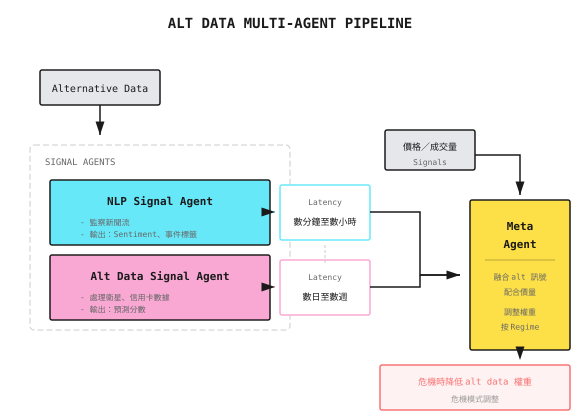

# 背景知識：另類數據（NLP 與衛星）

> 「當所有人都在看同一份價量數據，Alpha 就在別處。」

---

## 甚麼是另類數據？

**傳統數據**：價格、成交量、財務報表——人人都容易取得

**另類數據**：從非傳統來源提取、具預測價值的資訊

| 數據類型 | 來源例子 | 預測目標 |
|-----------|-----------------|-------------------|
| 文字情緒 | 新聞、社交媒體、業績電話會議 | 短期價格波動 |
| 衛星圖像 | 停車場、農地、油罐 | 收入預測 |
| 信用卡交易 | 消費者支付數據 | 零售表現 |
| 網絡流量 | App 下載量、網站訪問量 | 用戶增長 |
| 供應鏈 | 貨運追蹤、港口數據 | 供需預測 |

---

## 文字數據與 NLP

### 情緒分析基礎

把文字轉換為數值信號：

```
News Headline: "Apple quarterly revenue hits record high, exceeds analyst expectations"
Sentiment Score: +0.8 (positive)

News Headline: "Tesla faces safety concerns, under regulatory investigation"
Sentiment Score: -0.7 (negative)
```

### 建構情緒信號

**簡單方法**：字典計數

```
Positive words: {"growth", "exceeds", "record", "breakthrough"...}
Negative words: {"decline", "loss", "investigation", "recall"...}

Sentiment Score = (Positive word count - Negative word count) / Total words
```

**進階方法**：Pre-trained language models

```
Using BERT/GPT-type models:
1. Input: Full news text
2. Output: Sentiment category (positive/neutral/negative) or continuous score
3. Advantage: Understands context and sarcasm
```

### 文字數據來源比較

| 來源 | 時效性 | 覆蓋範圍 | 噪音 | 成本 |
|--------|------------|----------|-------|------|
| 新聞（Reuters、Bloomberg） | 分鐘級 | 大型股 | 低 | $$$$ |
| Twitter/X | 秒級 | 熱門股 | 高 | $ |
| Reddit（r/wallstreetbets） | 分鐘級 | 散戶熱捧股 | 極高 | 免費 |
| 業績電話會議逐字稿 | 按季 | 全面覆蓋 | 低 | $$ |
| SEC Filings | 即時 | 全面覆蓋 | 低 | 免費 |

### 文字信號的時間衰減

```
Sentiment signal strength after news release:

   Strength
    |
 100| ####
  80| #### ####
  60| #### #### ####
  40| #### #### #### ####
  20| #### #### #### #### ####
    +-----------------------------> Time
        5min  30min  1hr   4hr   1day

Conclusion: Sentiment signals are mainly effective within hours of release
```

---

## 衛星數據的應用

### 典型應用場景

**零售**：停車場車輛計數
```
Monitoring: Walmart, Target parking lots
Indicator: Vehicle count changes
Prediction: Quarterly same-store sales growth
Lead Time: 1-2 weeks before earnings report
```

**能源**：油罐存量監測
```
Monitoring: Global oil storage facilities
Method: Calculate storage from floating roof tank shadows
Prediction: Crude oil inventory changes
Data Frequency: Weekly updates
```

**農業**：作物健康監測
```
Monitoring: US Midwest farmland
Indicator: Vegetation index (NDVI)
Prediction: Corn, soybean yields
Impact: Agricultural commodity futures pricing
```

**航運**：港口活動追蹤
```
Monitoring: Major global ports
Indicator: Container counts, vessel dwell time
Prediction: Import/export activity, supply chain bottlenecks
Application: Shipping stocks, retail inventory
```

### 衛星數據處理 Pipeline

```
1. Image Acquisition
   +- Satellite pass frequency: Every 1-7 days
   +- Resolution: 0.3-10 meters
   +- Cloud cover: Requires multi-day averaging

2. Image Processing
   +- Atmospheric correction
   +- Geometric registration
   +- Target detection (parking lot boundaries, tank locations)

3. Feature Extraction
   +- Vehicle counting (object detection models)
   +- Area calculation (pixel analysis)
   +- Time series construction

4. Signal Generation
   +- Compare with historical data
   +- Seasonal adjustment
   +- Standardization (Z-Score)
```

---

## 另類數據的 Alpha Decay

**核心問題**：數據一旦被廣泛使用，Alpha 就會消失

```
Alternative Data Lifecycle:

Discovery Phase   | Few institutions use it, Alpha is significant
                  |
Diffusion Phase   | More people access it, Alpha declines
                  |
Maturity Phase    | Becomes mainstream, Alpha ≈ 0
                  |
                  +-----------------------------> Time

Typical Cycle: 2-5 years
```

**例子**：衛星停車場數據
- 2015 年：只有少數對沖基金使用，超額回報顯著
- 2018 年：多家數據供應商提供，競爭加劇
- 2022 年：已成標配，需要更精細的分析才能提取 Alpha

---

## 成本效益分析

| 數據類型 | 年度成本 | 股票覆蓋 | 預期 IC | 成本效益 |
|-----------|-------------|----------------|-------------|---------------------|
| 新聞情緒 | $50K+ | 500+ | 0.03 | 中 |
| 社交媒體 | $10K | 100+ | 0.02 | 低 |
| 衛星圖像 | $100K+ | 50+ | 0.05 | 低 |
| 信用卡交易 | $500K+ | 200+ | 0.08 | 中 |
| 網絡流量 | $30K | 100+ | 0.04 | 中 |

**經濟邏輯**：
```
Assumptions:
- Data cost: $100,000/year
- Covers 50 stocks
- IC improvement: 0.05

Required Capital Scale:
- $1,000,000 per stock position
- Total scale $50,000,000
- Annualized improvement 0.05 x 12% ≈ 0.6%
- Return improvement $300,000

Conclusion: At least $50M scale needed to break even
```

---

## 自建 vs 購買

| 維度 | 自建 | 購買 |
|-----------|-------|-----|
| 成本結構 | 固定成本高，邊際成本低 | 按數據量付費 |
| 時間投入 | 6-12 個月 | 即插即用 |
| 獨特性 | 可能擁有獨特 Alpha | 與其他人相同 |
| 維護 | 需要持續投入 | 供應商負責 |
| 適合規模 | 大型機構 | 中小型基金 |

**小型團隊建議**：
- 由免費數據開始（SEC filings、Reddit、Twitter）
- 驗證信號有效後才購買付費數據
- 專注在數據處理上做出差異化，而不是數據獲取

---

## Multi-Agent 視角

另類數據在 multi-agent 架構中的角色：



---

## 常見迷思

**迷思 1：另類數據一定有 Alpha**

不一定。很多另類數據：
- 與價格同步反應（沒有領先性）
- 噪音太大，難以提取信號
- 樣本太少，無法驗證統計顯著性

**迷思 2：LLM 可以輕易提取情緒**

要小心。LLM 的挑戰包括：
- 理解金融領域術語
- 辨識諷刺與雙關語
- 一致性與可重現性
- Inference 成本

**迷思 3：衛星數據非常準確**

現實更複雜：
- 雲層遮擋造成數據缺失
- 車輛偵測存在誤差（10-20%）
- 季節性及特殊事件需要調整
- 不同停車場佈局影響偵測

---

## 實戰建議

### 1. 由免費數據開始

```
Recommended Starting Sources:
- SEC EDGAR (financial statements, 8-K filings)
- Twitter API (requires developer account)
- Reddit API
- Free news APIs
```

### 2. 專注信號的獨特性

```
Ask Yourself:
- Is this signal correlated with price-volume signals?
- How many people are already using this data?
- What's unique about my processing method?
```

### 3. 小心 Data Snooping

```
Validation Process:
1. Discover signal in-sample
2. Test out-of-sample (must be unseen data)
3. Calculate p-value after multiple testing correction
4. Understand the economic logic behind the signal
```

---

## 總結

| 重點 | 說明 |
|-----------|-------------|
| 核心價值 | 在價量數據以外尋找差異化資訊 |
| 主要類型 | 文字情緒、衛星圖像、交易數據、網絡流量 |
| 主要挑戰 | 成本高、Alpha 衰減快、噪音大 |
| 適合規模 | $50M+ 才能覆蓋數據成本 |
| 起步建議 | 免費數據 + 獨特的處理方法 |
