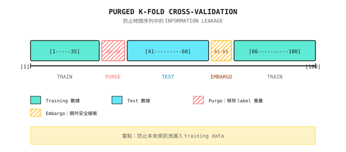

# 背景知識：時間序列 Cross-Validation（Purged CV）

> 「在金融數據上使用標準 K-Fold，就像用明天的報紙去預測今天的股價。」

---

## 為甚麼標準 Cross-Validation 在金融中會失效？

**標準 K-Fold 的假設**：樣本之間互相獨立。

**金融數據的現實**：
- 今日的 return 與昨日高度相關（autocorrelation）
- 用來預測第 100 日的 feature，可能包含第 99、98 日的資訊
- Label（return）往往涉及多日窗口

**結果**：資訊由測試集「洩漏」到訓練集，造成嚴重的 overfitting。

---

## 一個具體的洩漏個案

**情境**：預測未來 5 日 return

```
Data: Days 1-100
Label: ret_5d[t] = (close[t+5] - close[t]) / close[t]

Sample 95's label uses: Days 95-100 prices
Sample 96's label uses: Days 96-101 prices (partial overlap!)
```

**標準 K-Fold 可能會**：
- 訓練集包含樣本 95（label 涉及第 95-100 日）
- 測試集包含樣本 96（label 涉及第 96-101 日）
- 第 96-100 日的資訊同時出現在訓練與測試之中！

---

## 三種時間序列 CV 方法

### 方法 1：簡單時間切分（Walk-Forward）

```
Fold 1: Train [1-60]  -> Test [61-70]
Fold 2: Train [1-70]  -> Test [71-80]
Fold 3: Train [1-80]  -> Test [81-90]
Fold 4: Train [1-90]  -> Test [91-100]
```

**優點**：簡單，沒有未來資訊洩漏
**缺點**：訓練集愈來愈大，早期數據可能已經過時

### 方法 2：Rolling Window

```
Fold 1: Train [1-60]   -> Test [61-70]
Fold 2: Train [11-70]  -> Test [71-80]
Fold 3: Train [21-80]  -> Test [81-90]
Fold 4: Train [31-90]  -> Test [91-100]
```

**優點**：訓練集大小固定，使用最近期的數據
**缺點**：樣本使用率低

### 方法 3：Purged K-Fold（建議使用）

在標準 K-Fold 的基礎上：
1. **時間排序**：按時間順序切成 K 個 fold
2. **Purge**：移除 label 與測試集重疊的訓練樣本
3. **Embargo**：在 purge 區域之外再加一段安全緩衝

---

## Purged CV 詳解

**問題設定**：
- Feature 窗口：過去 20 日
- Label 窗口：未來 5 日
- 數據：第 1-100 日

**步驟**：

```
1. Split Folds (assume 5 folds)
   Fold 3 test set: Days 41-60

2. Identify Leakage Zone
   Test labels involve: Days 41-65 (41+5-1 to 60+5-1)
   Training features involve: Days 21-40 may also affect test

3. Purge
   Remove training samples whose labels overlap with test set
   Remove: Days 36-40 (labels involve 36-45, overlaps with 41-65)

4. Embargo
   Remove N additional samples after the Purge boundary
   If Embargo = 5 days, remove training samples from days 41-45
```

**視覺化**：



---

## Embargo 的作用

**為甚麼需要 Embargo？**

即使已經 purge 了 label 重疊的樣本，仍然可能存在：
- Feature 的 autocorrelation（今日的 MA20 與明日的 MA20 幾乎一樣）
- 資訊傳遞的延遲（新聞的影響會持續數日）
- 市場狀態的持續性（trend 不會一夜之間消失）

**建議的 Embargo 長度**：

| 數據頻率 | Label 窗口 | 建議 Embargo |
|----------|------------|--------------|
| Daily | 5 日 | 3-5 日 |
| Daily | 20 日 | 10-20 日 |
| Minute | 1 小時 | 30-60 分鐘 |
| Tick | 100 Ticks | 50-100 Ticks |

**經驗法則**：Embargo ≈ 0.5 x Label 窗口

---

## 實際計算例子

**設定**：
- 數據：1000 個樣本（4 年 daily）
- Label：10 日未來 return
- K = 5 folds
- Embargo = 5 日

**Fold 分配**：

| Fold | 原本測試範圍 | Purge 移除 | Embargo 移除 | 有效訓練樣本 |
|------|--------------|------------|--------------|--------------|
| 1 | 1-200 | 無 | 無 | 210-1000 (790) |
| 2 | 201-400 | 191-200 | 401-405 | 1-190, 406-1000 (785) |
| 3 | 401-600 | 391-400 | 601-605 | 1-390, 606-1000 (785) |
| 4 | 601-800 | 591-600 | 801-805 | 1-590, 806-1000 (785) |
| 5 | 801-1000 | 791-800 | 無 | 1-790 (790) |

**注意**：每個 fold 為防止洩漏，會損失約 15 個樣本。

---

## 與其他方法的比較

| 方法 | 資訊洩漏 | 樣本使用率 | 運算複雜度 | 適用場景 |
|------|----------|------------|------------|----------|
| 標準 K-Fold | 嚴重 | 高 | 低 | 不適用於金融 |
| 簡單時間切分 | 無 | 中 | 低 | 快速驗證 |
| Rolling Window | 無 | 低 | 中 | 策略穩定性測試 |
| Purged K-Fold | 無 | 較高 | 中 | 模型選擇、hyperparameter tuning |
| Purged + Embargo | 無 | 中 | 中 | 最嚴謹的驗證 |

---

## Multi-Agent 視角

在 multi-agent 系統中，不同的 Agent 需要不同的 CV 策略：

```
Signal Agent (predicting 5-day returns):
  - Purge: 5-day label window
  - Embargo: 3 days
  - Conservative model performance estimate

Regime Agent (identifying market states):
  - Purge: Usually not needed (state is current)
  - Embargo: Longer (state transitions have inertia)
  - Focus on accuracy during state transitions

Risk Agent (predicting volatility):
  - Purge: Volatility window (e.g., 20 days)
  - Embargo: 5 days
  - Volatility clustering requires longer Embargo
```

---

## 常見誤解

**誤解 1：使用 Purged CV 就能防止 overfitting**

錯誤。Purged CV 只能防止資訊洩漏，無法防止：
- Feature 過多造成的 overfitting
- Data snooping（反覆測試直至找到好結果）
- 模型過度複雜

**誤解 2：Embargo 愈長愈好**

不盡然。Embargo 過長會：
- 浪費有效的訓練樣本
- 令訓練數據過於陳舊
- 增加運算成本

**誤解 3：只需要在最終測試時使用 Purged CV**

錯誤。Hyperparameter tuning 同樣必須使用 Purged CV，否則會選出 overfitting 的參數。

---

## 實務建議

### 1. 檢查是否需要 Purging

```
Need Purging when:
- Labels involve multi-day windows (e.g., future N-day returns)
- Features involve long windows (e.g., 60-day moving average)
- Samples have overlap

Less Need for Purging when:
- Labels are instantaneous (e.g., next tick direction)
- Samples are completely independent (e.g., cross-section of different stocks)
```

### 2. 驗證 Purge 的效果

```
Comparison Experiment:
1. Train with standard K-Fold, record test accuracy
2. Train with Purged K-Fold, record test accuracy
3. Larger difference indicates more severe original leakage
```

### 3. 預留完全獨立的測試集

```
Data Allocation:
- 70%: Purged K-Fold for model selection and hyperparameter tuning
- 30%: Completely isolated final test set, use only once
```

---

## 總結

| 重點 | 說明 |
|------|------|
| 核心問題 | 時間序列樣本並非獨立，標準 CV 會造成洩漏 |
| Purge 的作用 | 移除 label 與測試集重疊的訓練樣本 |
| Embargo 的作用 | 在 Purge 邊界之外加入安全緩衝 |
| 建議方法 | Purged K-Fold + Embargo |
| 驗證方法 | 比較標準 CV 與 Purged CV 的結果 |
