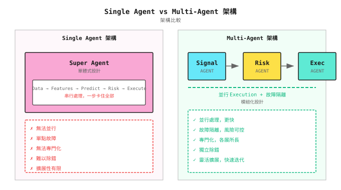
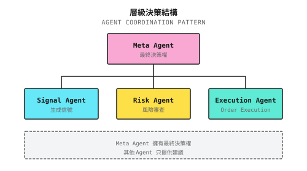
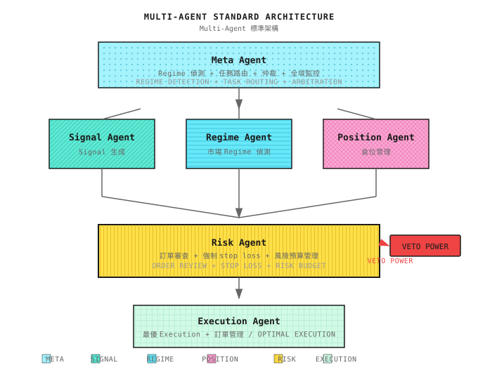

# 第11課：為什麼需要 Multi-Agent

> **一個人不可能同時係外科醫生、律師同機師。交易系統也一樣 - 專業分工才能做到出色。**

---

## 全能型的困境

2018 年，一個量化團隊開發了一個「全能 Agent」：

- 可以識別 market regime
- 可以生成交易信號
- 可以管理 risk
- 可以執行訂單
- 可以監控異常

**Backtest 結果令人驚艷**：年化回報 45%、Sharpe ratio 2.3、最大 drawdown 12%。

他們滿懷信心地上線實盤。

**三個月後的 postmortem**：

| 問題 | 發生了什麼 | 根本原因 |
|-------|---------------|------------|
| 信號延遲 | 市場急動時，Agent 仲在計算 risk | 串行處理，無法 parallelize |
| Risk control 失效 | 極端行情下 stop loss 被跳過 | 一個模組失效就卡住所有嘢 |
| 難以 debug | 蝕錢了，唔知問題喺邊度 | 職責混雜，無法隔離 |
| 難以改進 | 想優化 execution，又怕影響信號 | 高度耦合，牽一髮動全身 |

**核心問題**：他們的 Agent 係一個「超級大腦」，乜都做，結果乜都做唔好。

就好像叫一位外科醫生同時擔任麻醉師、護士同醫院院長 - 理論上可行，實際上注定失敗。

---

## 11.1 單一 Agent 的結構性缺陷

### 點解一個 Agent 唔夠？

| 缺陷 | 說明 | 影響 |
|--------|-------------|--------|
| **無法 parallelize** | 一個 Agent 只能順序處理任務 | 錯過時間敏感的機會 |
| **Single point of failure** | 一個模組 crash，整個系統停頓 | Risk 失控 |
| **無法專業化** | 乜都做，乜都唔精 | 整體表現平庸 |
| **難以 debug** | 問題在邊？Signal？Risk？Execution？ | Postmortem 效率低 |
| **擴展性有限** | 加功能要改動整個系統 | 迭代緩慢 |

### 視覺化對比



---

## 11.2 Multi-Agent 的核心優勢

### 優勢一：專業化

每個 Agent 只做一件事，但做到出色：

| Agent | 專長 | 評估指標 |
|-------|----------------|-------------------|
| **Signal Agent** | 預測未來回報 | IC、IR、Directional accuracy |
| **Risk Agent** | 保護資金 | Max drawdown、VaR |
| **Execution Agent** | 最優成交價 | Slippage、Fill rate |
| **Regime Agent** | 識別市場狀態 | Switching accuracy、Latency |

**比喻**：交易系統好似醫院 - 需要專科醫生，而不是一個萬能醫生。

### 優勢二：Parallel Processing

```
Scenario: Market suddenly moves, need to do multiple things simultaneously

Single Agent:
  09:30:00 Receive quote
  09:30:01 Calculate signal
  09:30:02 Calculate risk
  09:30:03 Prepare order
  09:30:04 Submit order  <- 4 second delay, may miss opportunity

Multi-Agent:
  09:30:00 Quote broadcast
           |-- Signal Agent: Calculate signal
           |-- Risk Agent: Assess risk
           +-- Execution Agent: Prepare execution environment
  09:30:01 Signal ready -> Risk Agent instant approval
  09:30:01.5 Order submitted  <- 1.5 seconds, 2.5x faster
```

### 優勢三：Fault Isolation

```
Scenario: Execution Agent has a bug

Single Agent:
  Entire system crashes
  -> Cannot stop-loss
  -> Cannot monitor
  -> Catastrophic outcome

Multi-Agent:
  Execution Agent fails
  -> Risk Agent detects execution anomaly
  -> Triggers emergency circuit breaker
  -> Notifies human intervention
  -> Other Agents continue running
  -> Loss controlled
```

### 優勢四：獨立迭代

```
Scenario: Want to optimize execution algorithm

Single Agent:
  Modify execution code
  -> Worried about affecting signal logic
  -> Need full regression testing
  -> 2 week iteration cycle

Multi-Agent:
  Only modify Execution Agent
  -> Interface unchanged, other Agents unaffected
  -> Test execution logic independently
  -> 2 day iteration cycle
```

---

## 11.3 Multi-Agent 協作機制

### 通訊模式

| 模式 | 適用場景 | 範例 |
|---------|----------|---------|
| **Request-Response** | 需要確認的操作 | Signal -> Risk：「我可以買 AAPL 嗎？」 |
| **Publish-Subscribe** | 廣播通知 | Data Agent 發佈新報價，所有 subscriber 都收到 |
| **Queue** | 異步處理 | 訂單 queue，Execution Agent 逐張處理 |
| **Shared State** | 需要一致的視圖 | 所有 Agent 共享持倉狀態 |

### 決策仲裁

當多個 Agent 意見衝突時，點樣決定？

**方案一：層級結構**



**方案二：投票機制**

```
Signal Agent: Buy AAPL (+1 vote)
Risk Agent: Don't buy, concentration limit exceeded (-1 vote)
Regime Agent: Currently trending market, inclined to follow signal (+1 vote)

Vote result: +1, execute buy (possibly reduce position to satisfy risk)
```

**方案三：Veto Power**

```
Risk Agent has veto power:
  Any trade must be approved by Risk Agent
  If Risk Agent says "no", trade doesn't execute
  This is the last line of defense for protecting capital
```

### 職責邊界

| Agent | 負責 | 不負責 |
|-------|----------------|---------------------|
| **Signal Agent** | 生成信號、預測回報 | Risk、Execution |
| **Risk Agent** | 審核訂單、強制 stop loss | 信號質素 |
| **Execution Agent** | 最優 execution、訂單管理 | 信號、Risk |
| **Regime Agent** | 識別市場狀態 | 交易決策 |
| **Meta Agent** | 協調、仲裁、全局決策 | 具體 execution |

**黃金法則**：每個 Agent 只關心自己的職責，並信任其他 Agent 做好自己的工作。

---

## 11.4 Multi-Agent 架構設計

### 標準架構



### Agent 職責詳解

| Agent | 輸入 | 輸出 | 關鍵指標 |
|-------|-------|--------|-------------|
| **Data Agent** | 外部數據源 | 清洗後的數據 | Latency、Completeness |
| **Signal Agent** | Features | 預測回報/排名 | IC、IR |
| **Regime Agent** | 價格、Volatility | 當前市場狀態 | Accuracy、Switching latency |
| **Position Agent** | 當前持倉 | 目標持倉 | Turnover、Cost |
| **Risk Agent** | 待處理訂單 | 批准/拒絕/調整 | 避免的損失 |
| **Execution Agent** | 已批准訂單 | Execution report | Slippage、Fill rate |
| **Meta Agent** | 全局狀態 | 調度指令 | 系統健康度 |

---

## 11.5 Multi-Agent 何時失效

### 幾時 Multi-Agent 其實更差？

| 場景 | 原因 | 更好的選擇 |
|----------|--------|---------------|
| **極簡單的策略** | 只有幾條規則，無需分工 | 單一 script |
| **低 latency 要求** | Agent 之間通訊有 overhead，可能增加 1-10ms | 單 process 優化 |
| **團隊太細** | 1 個人無法維護多個 Agent | 先用單一 Agent 驗證 |
| **協調成本 > 收益** | Agent 太多，通訊複雜度爆炸 | 減少 Agent 數量 |

### 常見 Multi-Agent 問題

| 問題 | 症狀 | 解決方案 |
|---------|---------|----------|
| **Deadlock** | Agent 互相等待 | Timeout 機制 + Priority |
| **訊息遺失** | 關鍵信號未送達 | Acknowledgment + Retry |
| **狀態不一致** | 不同 Agent 見到不同持倉 | Shared state + Sync 機制 |
| **Cascade failure** | 一個故障觸發連鎖反應 | Circuit breaker + Graceful degradation |

---

## 11.6 漸進式演進路徑

### 由單一 Agent 到 Multi-Agent

> **實踐原則：先喺一個 process 內做好。** Multi-agent 系統在概念上係多個獨立實體協作，但部署上唔需要由第一日就做成 microservices。建議路徑：Modular Monolith → 選擇性抽離（例如將 risk engine 變成獨立 service）→ 完全分散式。Module 邊界由第一日就要清晰；部署邊界可以延後。詳見第21課的架構演進章節。

唔好一開始就建複雜系統。建議路徑：

```
Stage 1: Single Agent
  |-- Validate strategy viability
  |-- Fast iteration
  +-- Accumulate experience

Stage 2: Signal + Risk Separation
  |-- Signal Agent
  +-- Risk Agent (veto power)

Stage 3: Add Execution
  |-- Signal Agent
  |-- Risk Agent
  +-- Execution Agent

Stage 4: Add Regime
  |-- Regime Agent
  |-- Signal Agent (adjust based on Regime)
  |-- Risk Agent
  +-- Execution Agent

Stage 5: Complete Architecture
  |-- Meta Agent
  |-- Data Agent
  |-- Regime Agent
  |-- Signal Agent
  |-- Position Agent
  |-- Risk Agent
  +-- Execution Agent
```

### 每個階段的驗收標準

| 階段 | 驗收標準 |
|-------|---------------------|
| 1 -> 2 | 策略 Sharpe > 1，需要更嚴格的 risk control |
| 2 -> 3 | Slippage 成本 > 回報的 10%，需要優化 execution |
| 3 -> 4 | 不同市場狀態下表現差異大，需要 Regime detection |
| 4 -> 5 | 系統複雜度需要統一 orchestration |

---

## 11.7 Multi-Agent 視角

### 本課的位置

```
Parts 1-3: Building individual Agent capabilities
  |-- Understanding markets
  |-- Mastering math and statistics
  |-- Learning machine learning
  +-- From models to Agents

Part 4 (starting from this lesson): Building multi-Agent systems
  |-- Lesson 11: Why Multi-Agent <- You are here
  |-- Lesson 12: Regime Detection (Regime Agent)
  |-- Lesson 13: Regime Misjudgment and Systemic Collapse
  |-- Lesson 14: LLM Applications in Quant
  |-- Lesson 15: Risk Control and Money Management (Risk Agent)
  |-- Lesson 16: Portfolio Construction and Exposure Management
  +-- Lesson 17: Online Learning and Strategy Evolution
```

### 後續課程預覽

| 課程 | 焦點 Agent | 核心能力 |
|--------|-------------|-----------------|
| 第12課 | Regime Agent | 識別牛市/熊市/ranging 市場 |
| 第13課 | Resilience Layer | 誤判診斷、degradation 策略 |
| 第14課 | Research Agent (LLM) | 資訊提取、分析輔助 |
| 第15課 | Risk Agent | Veto power、資金管理 |
| 第16課 | Portfolio Agent | 持倉配置、exposure monitoring |
| 第17課 | Evolution Agent | Online learning、策略進化 |

---

## 課程成果

完成本課後，你將擁有：

1. **對 multi-agent 架構的深入理解** - 知道點解需要分工與協作
2. **架構設計能力** - 可以畫出標準 multi-Agent 系統架構
3. **協作機制設計** - 理解通訊、仲裁、職責邊界
4. **漸進式演進策略** - 知道幾時由單一 Agent 升級到 multi-Agent

### 驗收標準

| 檢查點 | 驗收標準 | 自測方法 |
|------------|---------------------|------------------|
| **單一 Agent 缺陷** | 可以列出 5 個結構性問題 | 唔睇筆記列出 |
| **架構圖** | 可以畫出標準 multi-Agent 架構 | 喺白紙上畫，標註各 Agent 職責 |
| **協作機制** | 可以解釋 3 種決策仲裁方法 | 給定衝突場景，說出解決方案 |
| **演進路徑** | 可以描述由單一到 multi 的 5 個階段 | 唔睇筆記描述 |

**設計練習**：

你有一個運行中的單一 Agent 策略，表現如下：
- 年化回報 25%
- 最大 drawdown 18%
- 在 ranging 市場顯著虧損
- Execution slippage 約佔回報的 15%

問題：應該點樣演進架構？先拆邊個 Agent？

<details>
<summary>點擊查看答案</summary>

**分析**：
1. Ranging 市場虧損 -> 需要 Regime Agent 識別市場狀態
2. 15% slippage -> 需要 Execution Agent 優化 execution
3. 18% drawdown 偏高 -> Risk Agent 需要更強的控制

**建議演進順序**：
1. **第一步**：拆出 Risk Agent（18% drawdown 太高，risk control 優先）
2. **第二步**：加入 Regime Agent（解決 ranging 市場虧損問題）
3. **最後**：拆出 Execution Agent（優化 15% slippage）

**理由**：先保護資金，再提升回報。

</details>

---

## 課程總結

- [x] 理解單一 Agent 的 5 個結構性缺陷
- [x] 掌握 multi-agent 的 4 大核心優勢：專業化、parallel processing、fault isolation、獨立迭代
- [x] 學會 3 種決策仲裁機制：層級結構、投票、veto power
- [x] 認識 multi-agent 失效的場景：極簡單策略、低 latency、細團隊
- [x] 掌握由單一 Agent 到 multi-Agent 的漸進式演進路徑

---

## 延伸閱讀

- [背景知識：Multi-Agent 框架對比](背景知識/多智能體框架對比.md) - 主流 framework 的技術選型
- [背景知識：量化開源框架對比](背景知識/量化開源框架對比.md) - 量化系統的技術棧

---

## 下一課預覽

**第12課：Regime Detection**

趨勢市場用 trend-following，震盪市場用 mean reversion - 人人都識這個道理。但問題是：**你點樣知道自己身處邊種市場？** 下一課我們深入探討 Regime Agent 的核心能力。
