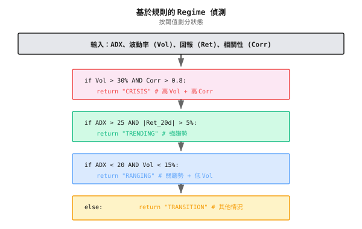
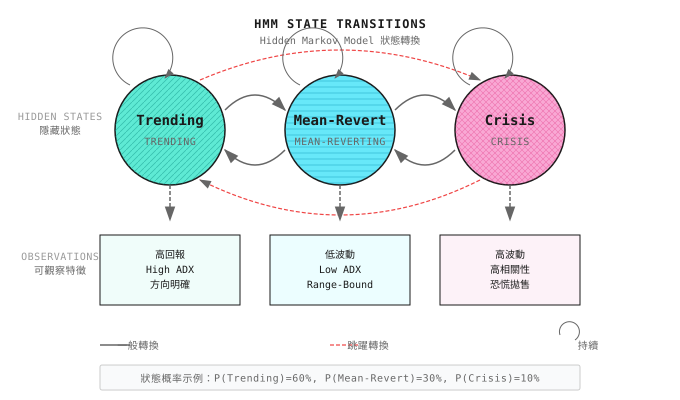
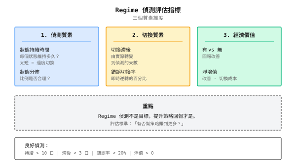
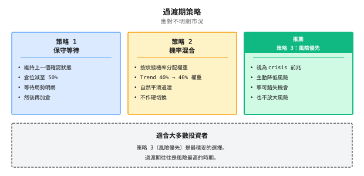
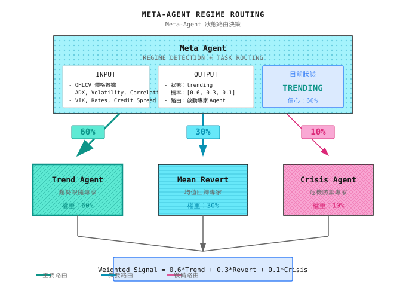

# 第12課：Regime Detection

> **目標**：令系統知道「而家係咩市況」，從而揀啱策略。

---

## 一個典型場景（示意）

> 注意：以下為虛構例子，用來說明常見現象；數字僅供示意，並不對應任何特定機構/產品。

2021 年初，一間量化基金同時運行兩個策略：trend following 同 mean reversion。兩個策略在各自有利的市況下都表現出色。

問題係他們用咗**固定權重** - 各 50%。

結果：
- 趨勢市場中，trend 策略賺 20%，mean reversion 蝕 15%，淨賺 2.5%
- 震盪市場中，mean reversion 賺 15%，trend 策略蝕 20%，淨蝕 2.5%
- 全年兩者互相抵銷，回報接近零

他們的競爭對手呢？同樣兩個策略，但加了一個 **Regime Detection 模組**：
- 趨勢市場中，trend 策略權重 80%，mean reversion 20%
- 震盪市場中，反之亦然

結果：年化回報 18%，Sharpe ratio 1.6。

**差別在哪？** 唔係策略本身，而係**知道幾時該用邊個策略**。這就係 regime detection 的價值 - 它係 multi-agent 系統的「router」。

---

## 12.1 什麼是 Market Regime

### 三種基本狀態

市場在任何時刻都處於某種「狀態」。雖然狀態之間的界線並不清晰，但大致可以分類：

| 狀態 | 特徵 | 最佳策略 | 典型持續時間 |
|-------|-----------------|---------------|------------------|
| **Trending** | 價格持續向單一方向移動，volatility 上升 | Momentum/Trend following | 數星期至數月 |
| **Mean-Reverting** | 價格在區間內震盪，mean reversion 有效 | Mean reversion/Grid | 數星期至數月 |
| **Crisis** | 劇烈波動、correlation 急升、liquidity 枯竭 | Risk control 優先/現金為王 | 數日至數星期 |

### 點解 Regime Detection 咁難？

| 挑戰 | 說明 |
|-----------|-------------|
| **後視鏡問題** | 狀態事後清晰，即時模糊 |
| **邊界模糊** | Trend 同 ranging 之間沒有明確分界線 |
| **狀態嵌套** | 日線 ranging、週線 trending、月線 ranging 可以並存 |
| **偵測滯後** | 當你確認狀態時，它可能已接近尾聲 |
| **切換成本** | 頻繁切換策略本身就是成本 |

### 紙上練習：識別歷史狀態

睇下呢啲數據，判斷每個時期的市場狀態：

| 時期 | 20日回報 | 20日 Volatility | ADX | 你的判斷 |
|--------|---------------|-------------------|-----|---------------|
| A | +12% | 18% | 35 | ? |
| B | -2% | 8% | 15 | ? |
| C | -25% | 45% | 28 | ? |
| D | +3% | 12% | 22 | ? |

<details>
<summary>點擊展開答案</summary>

| 時期 | 判斷 | 理由 |
|--------|----------|-----------|
| A | **Trending（向上）** | 高回報 + 中等 volatility + 高 ADX（>25 代表強趨勢） |
| B | **Ranging** | 低回報 + 低 volatility + 低 ADX（<20 代表無趨勢） |
| C | **Crisis** | 大幅下跌 + volatility 極高（年化 >30% 屬警戒水平） |
| D | **弱趨勢/Transition** | 回報同 ADX 都處於中間地帶，難以判斷 |

**關鍵發現**：時期 D 最難判斷 - 這係現實中最常見的情況 - 大部分時間市場都處於「灰色地帶」。

</details>

---

## 12.2 Regime Detection 的四種方法

### 方法比較

| 方法 | 原理 | 優點 | 缺點 | 適用場景 |
|--------|-----------|------|------|----------|
| **Rules-based** | 用 indicator 閾值 | 簡單、可解釋、無滯後 | 閾值難揀、邊界生硬 | 快速 prototype、baseline |
| **Statistical** | 用統計檢驗識別結構性變化 | 數學上嚴謹 | 需要歷史數據、有滯後 | Offline 分析 |
| **Machine Learning** | 用 ML model 分類 | 可捕捉複雜 pattern | 需要 label、有 overfitting 風險 | 有足夠 label 數據時 |
| **Hidden Markov** | 假設狀態遵循 Markov chain | 可估計狀態機率 | 假設未必成立 | 狀態數量已知時 |

### 方法一：Rules-Based（最實用）

用技術 indicator 閾值的組合判斷狀態：



**紙上練習：設計你的規則**

給定以下市場數據，用上述規則判斷狀態：

| 場景 | ADX | 20日 Volatility | 20日回報 | 資產 Correlation | 狀態 |
|----------|-----|-------------------|---------------|-------------------|-------|
| 1 | 32 | 22% | +8% | 0.4 | ? |
| 2 | 18 | 12% | -1% | 0.3 | ? |
| 3 | 25 | 38% | -15% | 0.85 | ? |
| 4 | 23 | 18% | +3% | 0.5 | ? |

<details>
<summary>點擊展開答案</summary>

| 場景 | 狀態 | 決策路徑 |
|----------|-------|---------------|
| 1 | **Trending** | Vol=22% < 30%（非 crisis）-> ADX=32 > 25 且 Ret=8% > 5%（trending） |
| 2 | **Ranging** | Vol=12% < 30%（非 crisis）-> ADX=18 < 20 且 Vol=12% < 15%（ranging） |
| 3 | **Crisis** | Vol=38% > 30% 且 Corr=0.85 > 0.8（crisis 優先） |
| 4 | **Transition** | 不滿足任何明確條件（ADX=23 介乎 20-25） |

</details>

### 方法二：Hidden Markov Model (HMM)

HMM 假設市場在數個隱藏狀態之間切換 - 我們只能觀察到價格，睇唔到真實狀態。



**HMM 核心輸出**：
- **State probabilities**：而家處於各狀態的機率（例如 Trending 60%、Ranging 30%、Crisis 10%）
- **Transition probabilities**：由一個狀態切換到另一個狀態的機率

**紙上練習：理解 State Probabilities**

HMM 輸出當前狀態機率為：Trending 55%、Ranging 35%、Crisis 10%

| 策略權重做法 | Trend 策略 | Mean Reversion | Defense 策略 | 問題 |
|--------------------------|----------------|----------------|------------------|-------|
| Hard switch | 100% | 0% | 0% | 忽略 35% 的 ranging 機率 |
| Probability weighted | 55% | 35% | 10% | 較穩健，但 crisis 反應慢 |
| Adjusted weighting | 50% | 30% | 20% | 放大 crisis 權重作保險 |

**關鍵洞察**：State probabilities 不應直接當作策略權重 - 需要按風險偏好調整。

<details>
<summary>代碼實現（供工程師參考）</summary>

```python
# Note: This is illustrative code showing basic HMM usage
# Requires hmmlearn: pip install hmmlearn

import numpy as np
from hmmlearn import hmm

class RegimeDetector:
    """HMM-based market regime detector"""

    def __init__(self, n_states: int = 3):
        self.n_states = n_states
        self.model = hmm.GaussianHMM(
            n_components=n_states,
            covariance_type="full",
            n_iter=100
        )

    def fit(self, features: np.ndarray):
        """
        Train HMM model

        features: shape (n_samples, n_features)
                  typically includes: returns, volatility, ADX, etc.
        """
        self.model.fit(features)
        return self

    def predict_proba(self, features: np.ndarray) -> np.ndarray:
        """
        Predict current state probability

        Returns: shape (n_states,) probability distribution
        """
        # Get posterior probabilities
        posteriors = self.model.predict_proba(features)
        return posteriors[-1]  # Latest time point probability

    def get_regime(self, features: np.ndarray, threshold: float = 0.5) -> str:
        """
        Get current state (with confidence threshold)
        """
        probs = self.predict_proba(features)
        max_prob = np.max(probs)
        max_state = np.argmax(probs)

        if max_prob < threshold:
            return "uncertain"

        state_names = ["trending", "mean_reverting", "crisis"]
        return state_names[max_state]
```

</details>

### 方法三：Volatility Clustering（實用變體）

一個簡化但實用的做法係只睇 volatility 狀態：

| Volatility 區間 | 狀態 | 策略建議 |
|------------------|-------|------------------------|
| < 15% | 低 volatility（Ranging） | Mean reversion、賣 option |
| 15% - 25% | 正常 volatility | 正常運作 |
| 25% - 35% | 高 volatility（Trending） | Trend following、減倉 |
| > 35% | 極端 volatility（Crisis） | Risk control 優先、大幅減倉 |

**點解 Volatility 咁重要？**
- Volatility 係市場的「溫度」，能快速反映市場健康狀況
- Volatility 有 clustering 效應（高 volatility 傾向跟隨高 volatility）
- Volatility 比回報更易預測

---

## 12.3 評估 Regime Detection

Regime detection 本身不是目標 - 目標係**提升策略回報**。所以評估標準不是「accuracy」，而係「有冇幫策略賺到更多錢」。

### 評估框架



### 紙上練習：計算 Regime Detection 的價值

**場景**：你的 Regime Detection 模組過去一年的表現：

| 指標 | 數值 |
|--------|-------|
| 狀態切換次數 | 24 次 |
| 平均狀態持續時間 | 15 日 |
| 切換滯後 | 3 日 |
| 錯誤切換率 | 20%（5 日內切換返轉頭） |

**策略表現比較**：

| 做法 | 年化回報 | Max Drawdown | Sharpe Ratio |
|----------|---------------|--------------|--------------|
| 無 Regime（固定 50/50） | 8% | 18% | 0.6 |
| 有 Regime（動態切換） | 15% | 12% | 1.2 |
| 切換成本（24 次 x 0.5%） | -12% | - | - |

**問題**：
1. Regime Detection 的淨增值係多少？
2. 如果錯誤切換率降到 10%，預期回報會點變？
3. 切換成本太高點算？

<details>
<summary>點擊展開答案</summary>

1. **淨增值計算**：
   - 毛回報提升 = 15% - 8% = 7%
   - 切換成本 = 24 x 0.5% = 12%（假設每次切換涉及完整倉位調整）
   - **淨增值 = 7% - 12% = -5%**（實際上蝕錢！）

   **問題**：切換太頻繁，成本食晒收益！

2. **如果錯誤切換率降到 10%**：
   - 錯誤切換由 4.8 次減至 2.4 次
   - 少 2.4 次無用切換，節省 2.4 x 0.5% = 1.2%
   - 淨增值 = -5% + 1.2% = -3.8%（仍然為負）

3. **高切換成本的解決方案**：
   - **Gradual switching**：唔係 0->100%，而係 50%->70%->90%
   - **Confirmation delay**：狀態要維持 N 日先切換
   - **Soft switching**：用機率加權取代 hard switch
   - **降低頻率**：只在狀態非常確定時才切換

**關鍵教訓**：Regime Detection 價值 = 偵測準確度 x 策略差異 - 切換成本

</details>

### 切換滯後的代價

| 滯後日數 | 對 Trending 市場的影響 | 對 Crisis 市場的影響 |
|----------|---------------------------|------------------------|
| 1 日 | 錯過約 5% 的升幅 | 多蝕約 3% |
| 3 日 | 錯過約 15% 的升幅 | 多蝕約 10% |
| 5 日 | 錯過約 25% 的升幅 | 可能錯過 stop loss 時機 |
| 10 日 | 趨勢可能已完結一半 | Crisis 可能已經結束 |

**結論**：寧願有些 false positive，也不要滯後過多。尤其係 **crisis detection 必須快**。

---

## 12.4 常見誤區

**誤區一：Regime Detection accuracy 越高越好**

未必。評估標準唔係「accuracy」，而係「有冇幫策略賺到更多錢」。80% accuracy 但切換成本蠶食回報，比 60% accuracy 但切換較少更差。

**誤區二：Trend/Ranging 係二元判斷**

現實中，大部分時間市場處於「灰色地帶」。強行二元判斷會導致頻繁錯誤切換。正確做法：用機率加權（Trend 60%/Ranging 40%）或承認有「Transition 期」。

**誤區三：偵測到狀態改變就立即切換策略**

危險做法。切換本身有成本（交易成本、slippage），頻繁切換可能蝕晒所有收益。正確做法：confirmation delay（狀態維持 N 日）+ gradual switching（50%->70%->90%）。

**誤區四：Crisis detection 可以「等確認」**

Crisis detection 必須快。等到確認時，可能已經蝕咗 20%。寧可 crisis 誤報（賺少啲），也不要漏報（蝕大錢）。

---

## 12.5 處理 Transition 期

現實中最難處理的唔係清晰的 trend 或 ranging，而係 **transition 期** - 狀態正在改變，但仍未確定。

### Transition 期的特徵

| 特徵 | 表現 |
|----------------|---------------|
| Indicator 互相矛盾 | ADX 話 trending，volatility 話 ranging |
| 機率模糊 | HMM 輸出 40%/35%/25%，沒有明顯主導狀態 |
| 信號衝突 | Trend 同 mean reversion 策略給出相反信號 |

### Transition 期策略



**建議**：對大部分投資者而言，**策略 3（Risk 優先）** 係最安全的選擇。Transition 期往往係風險最高的時期。

---

## 12.5 Multi-Agent 視角

在 multi-agent 架構中，Regime Detection 係 **Meta Agent 的核心能力**。

### 架構設計



### Regime Agent 職責

| 職責 | 具體內容 | 觸發條件 |
|----------------|------------------|-------------------|
| **State detection** | 判斷當前市場狀態 | 每日/每小時 |
| **Signal routing** | 決定將任務派給邊個 expert Agent | 狀態改變時 |
| **Weight allocation** | 按狀態機率分配 expert 權重 | 持續 |
| **Switching control** | 防止過度切換、管理過渡 | 狀態模糊時 |
| **Retrospective attribution** | 記錄狀態判斷以供事後分析 | 持續 |

### 與其他 Agent 的協作

| 協作者 | 協作方式 |
|--------------|---------------------|
| **Signal Agent** | 接收 Regime 信號，調整策略參數 |
| **Risk Agent** | Crisis 狀態下，Risk Agent 獲得更大的 veto power |
| **Execution Agent** | 狀態切換期間，Execution Agent 負責平滑 rebalance |
| **Evolution Agent** | 提供 regime detection 的歷史 accuracy，用於 model 進化 |

---

## 驗收標準

完成本課後，用以下標準驗證學習成果：

| 檢查點 | 標準 | 自測方法 |
|------------|----------|------------------|
| 理解三種狀態 | 可以描述 trend/ranging/crisis 的特徵與最佳策略 | 用自己的話解釋 |
| 掌握 rules-based 方法 | 可以用 ADX/volatility/correlation 設計判斷規則 | 完成紙上練習 |
| 理解 HMM 原理 | 可以解釋 state probabilities 的意思與用途 | 解釋點解唔應直接將機率當權重 |
| 評估偵測價值 | 可以計算淨增值 = 回報提升 - 切換成本 | 完成評估練習 |
| 處理 transition 期 | 可以說出三種 transition 策略及其適用場景 | 給出你的選擇及理由 |

### 綜合練習

**設計你的 Regime Detection 系統**：

1. 揀選偵測方法（Rules-based/HMM/其他）並解釋原因
2. 定義輸入 feature 與閾值
3. 設計 transition 期處理策略
4. 設定切換確認條件（防止過度切換）
5. 定義評估指標

---

## 課程成果

完成本課後，你將擁有：

1. **Regime Detection 設計框架** - 由方法選擇到評估指標的完整思路
2. **實用 rules-based 模板** - 可直接使用的 ADX/volatility/correlation 判斷規則
3. **評估 Regime Detection 價值的方法** - 淨增值 = 回報提升 - 切換成本
4. **Transition 期處理策略** - 三種做法及其適用場景

---

## 課程總結

- [x] 理解 market regime 的概念及其對策略選擇的影響
- [x] 掌握四種 Regime Detection 方法：rules-based、statistical、ML、HMM
- [x] 理解 Regime Detection 的評估唔係「accuracy」而係「經濟價值」
- [x] 掌握 transition 期處理策略

---

## 延伸閱讀

- [第05課：經典策略範式](../Part2-量化基礎/第05課：經典策略範式.md) - 不同狀態下的策略
- [第11課：為什麼需要 Multi-Agent](第11課：為什麼需要多智能體.md) - Regime Detection 在 multi-agent 中的角色
- [背景知識：歷史著名量化事故](../Part1-快速體驗/背景知識/歷史著名量化事故.md) - 未能偵測 crisis 狀態的後果

---

## 下一課預覽

**第13課：Regime 誤判與系統性崩潰**

Regime Detection 係 multi-agent 系統的核心，但它會出錯 - 誤判、滯後、邊界震盪。下一課我們深入探討 Regime Detection 的五種失效模式，以及如何設計 degradation 策略以防止系統性崩潰。
