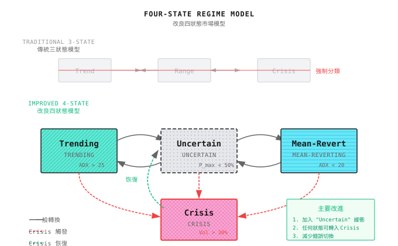

# 第13課：Regime 誤判與系統性崩潰

> **Max drawdown 往往來自：錯誤的狀態判斷 + 啟動了錯誤的策略。**

---

## 一個典型場景（示意）

> 注意：以下為虛構例子，用來說明常見現象；數字僅供示意，並不對應任何特定機構/產品。

2020 年 2 月，一間量化基金的 Regime Detection 系統顯示：**「Ranging 市場」**。

這是合理的判斷 - 市場 volatility 已經低企數月，ADX 低於 20，沒有明顯趨勢。

基於這個判斷，系統啟動了 **mean reversion 策略**，每逢下跌就加倉。

然後 3 月到了。

| 日期 | S&P 500 | 系統狀態判斷 | 策略動作 | 結果 |
|------|---------|----------------------|-----------------|--------|
| 2/20 | 3,373 | Ranging | 正常持倉 | - |
| 2/24 | 3,225 (-4.4%) | Ranging | 加倉（buy the dip） | 虧損 |
| 2/27 | 2,954 (-8.4%) | Transition | 繼續持有 | 虧損擴大 |
| 3/9 | 2,746 (-7.6%) | Trending? | 混亂 | 深度被套 |
| 3/12 | 2,480 (-9.5%) | Crisis! | 觸發 stop loss | 虧損 25% |
| 3/16 | 2,386 (-3.8%) | Crisis | 已清倉 | 錯過反彈 |
| 3/23 | 2,237 (谷底) | Crisis | 空倉 | - |
| 4/9 | 2,789 (+24.7%) | Transition | 觀望 | 錯過反彈 |

**最終結果**：
- 由高位 drawdown **32%**
- 比單純持有指數多蝕 **7%**
- Regime 系統非但沒有幫助，反而**放大了虧損**

**點解會咁？**

1. **偵測滯後**：由「Ranging」切換到「Crisis」用了 3 星期
2. **啟動錯誤策略**：Ranging 策略在趨勢市場中不斷加倉
3. **Stop loss 太遲**：確認 crisis 時，已錯過最佳逃生時機
4. **復原太慢**：確認 crisis 後太保守，錯過反彈

這就係 **Regime 誤判的代價** - 它往往發生在你最需要正確判斷的時刻。

---

## 13.1 點解 Regime Detection 永遠會出錯

### 13.1.1 無可避免的滯後

任何 Regime Detection 方法都需要**觀察一段歷史數據**才能作出判斷。這意味著：

```
Actual state change point ----------------------+
                                    |
                                    v
         +-------------------------+-------+-------------------+
Timeline:|     Old State          |Window | New State         |
         +-------------------------+-------+-------------------+
                                    |       |
                                    v       v
                            System confirms new state

Lag = Detection window + Confirmation delay
Typical value: 3-10 trading days
```

**紙上練習：滯後的代價**

假設市場由「Ranging」切換到「Crisis」，S&P 500 在 5 日內下跌 15%。

| 滯後日數 | 幾時確認 Crisis | 蝕咗幾多 | 可以做什麼 |
|----------|------------------------|---------------|-----------------|
| 1 日 | 第 2 日 | -3% | Stop loss，慳返 12% |
| 3 日 | 第 4 日 | -9% | Stop loss，慳返 6% |
| 5 日 | 第 6 日 | -15% | 已經跌晒 |
| 10 日 | 第 11 日 | -15% | 市場可能已經反彈 |

**結論**：在急跌中，3 日滯後可能意味著錯過 60% 的 stop loss 機會。

### 13.1.2 後視鏡問題

```
+-------------------------------------------------------------+
|                                                             |
|   Hindsight:  ------------------+------------------         |
|                               |                             |
|              Clearly ranging   |      Clearly trending      |
|                               |                             |
|   Real-time:  ------------------+------------------         |
|                               |                             |
|              Is ranging ending?|   Is this a false breakout?|
|              Or trend starting?|   Or a real trend?         |
|                               |                             |
+-------------------------------------------------------------+
```

**關鍵洞察**：在 backtest 中，你知道之後會發生什麼。在實盤中，你唔知。

### 13.1.3 邊界模糊

市場狀態唔係離散的開關，而係連續的光譜：

```
       Ranging <----------------------------------------> Trending
         |                                           |
  ADX=15 |                                           | ADX=35
  Vol=10%|                                           | Vol=25%
         |                                           |
         |        +---------------------+            |
         |        |                     |            |
         |        |   Gray Zone         |            |
         |        |   ADX 18-25         |            |
         |        |   Vol 12-20%        |            |
         |        |                     |            |
         |        +---------------------+            |
         |                                           |
         v                                           v
    Clear Ranging                              Clear Trending

Problem: The market is in the gray zone 70% of the time
```

---

## 13.2 五種典型誤判模式

### 13.2.1 模式一：False Positive（將 Ranging 誤判為 Trending）

**場景**：
- ADX 短暫突破 25
- 連續 3 日上升 5%
- 系統判斷：趨勢開始，啟動 momentum 策略

**現實**：
- 只係 ranging 區間內的正常波動
- 價格其後回落至區間中部
- Momentum 策略高位買入，低位止蝕

**虧損來源**：
- 追高的虧損
- 頻繁 stop loss 的交易成本
- 策略切換的摩擦成本

```
Price chart:
      /\            /\
     /  \    <-- Misjudged as trend
    /    \  /  \
---/------\/----\------  Actually a ranging zone
                 \
```

### 13.2.2 模式二：False Negative（將 Trending 誤判為 Ranging）

**場景**：
- 趨勢剛開始，volatility 未升
- ADX 仍低於 20
- 系統判斷：Ranging，啟動 mean reversion 策略

**現實**：
- 真正的趨勢已經開始
- Mean reversion 策略不斷買入下跌
- 越陷越深

**這就係開篇故事中發生的事。**

### 13.2.3 模式三：滯後誤判

**特徵**：方向判斷正確，但時機太遲。

| 時間 | 真實狀態 | 系統判斷 | 錯配 |
|------|------------|-----------------|----------|
| T | 趨勢開始 | Ranging | X |
| T+3 | 趨勢中段 | Transition | X |
| T+7 | 趨勢尾聲 | 確認 Trend！ | X |
| T+10 | 趨勢結束 | Trending | X |
| T+13 | 新的 ranging | Transition | X |

**虧損來源**：
- 錯過最佳趨勢入場點
- 在趨勢尾聲入場
- 趨勢結束後仍然持倉

### 13.2.4 模式四：過度敏感誤判

**特徵**：對 noise 過度敏感，狀態頻繁切換。

```
Real state:  =============================================
             Persistent ranging

System:      -+--+--+--+--+--+--+--+--+--+--+--+--+--+--+--
            |  |  |  |  |  |  |  |  |  |  |  |  |  |  |
            R  T  R  T  R  Tr R  T  R  Cr R  T  R  Tr R
            a  r  a  r  a  an a  r  a  is a  r  a  an a
            n  e  n  e  n  si n  e  n  is n  e  n  si n
            g  n  g  n  g  ti g  n  g     g  n  g  ti g
            i  d  i  d  i  on i  d  i     i  d  i  on i
            n  i  n  i  n     n  i  n     n  i  n     n
            g  n  g  n  g     g  n  g     g  n  g     g
               g     g

Switch count: 15 times/month
Cost per switch: 0.5%
Total cost: 7.5%/month
```

**虧損來源**：
- 每次切換的交易成本
- 策略來不及發揮作用
- 系統資源消耗

### 13.2.5 模式五：邊界震盪誤判

**特徵**：在閾值附近反覆切換。

```
Threshold line (ADX = 25): -----------------------------------------
                           ^  v  ^  v  ^v
Actual ADX:          -----/\-/\-/\-/\-\/----------------
                       24 26 24 26 2324

System state:               R  T  R  T  RTR
                            a  r  a  r  ara
                            n  e  n  e  nrn
                            g  n  g  n  geg
                            i  d  i  d  idn
                            n  i  n  i  nig
                            g  n  g  n  gng
                               g     g

Problem: ADX oscillates between 23-27, system keeps switching
```

---

## 13.3 量化誤判成本

### 13.3.1 建立誤判成本模型

```
Total misjudgment cost = Direct loss + Opportunity cost + Switching cost

Where:
  Direct loss = Sum(wrong strategy losses in wrong state)
  Opportunity cost = Sum(what right strategy would have earned in right state)
  Switching cost = Switch count x Cost per switch
```

### 13.3.2 歷史案例分析

**案例：2020 年 3 月崩盤**

| 策略類型 | 正確 Regime 判斷 | 錯誤 Regime 判斷 | 差距 |
|---------------|------------------------|----------------------|-----|
| Momentum | -5%（提早減倉） | -25%（持倉不動） | 20% |
| Mean Reversion | -8%（停止 buy the dip） | -35%（持續 buy the dip） | 27% |
| Risk Parity | -12%（被動跟隨） | -18%（主動加倉） | 6% |

**案例：2022 年加息周期**

| 月份 | 正確判斷 | 錯誤判斷 | 差距原因 |
|-------|------------------|----------------|-----------|
| 1月 | 識別趨勢逆轉 | 仍然認為係牛市 | 高位冇減倉 |
| 3月 | 確認下跌趨勢 | 以為只是回調 | 持續 buy the dip |
| 6月 | 保持防守 | 以為已見底 | 又一次 buy the dip 失敗 |

### 13.3.3 紙上練習：計算你的誤判敏感度

假設你的策略在不同狀態組合下的預期回報：

| 實際狀態 | 啟動的策略 | 月回報 |
|--------------|-------------------|----------------|
| Trending | Trend 策略 | +5% |
| Trending | Mean reversion | -8% |
| Ranging | Trend 策略 | -3% |
| Ranging | Mean reversion | +3% |
| Crisis | Trend 策略 | -15% |
| Crisis | Mean reversion | -25% |
| Crisis | Defense 策略 | -5% |

**問題**：如果你的 Regime Detection accuracy 係 70%，年化回報損失係多少？

<details>
<summary>點擊展開分析框架</summary>

**分析方法**：

1. 假設狀態分佈：Trending 30%、Ranging 50%、Crisis 20%

2. 正確識別時的回報：
   - Trending 正確（30% x 70%）：21% x 5% = 1.05%
   - Ranging 正確（50% x 70%）：35% x 3% = 1.05%
   - Crisis 正確（20% x 70%）：14% x (-5%) = -0.7%
   - 月回報約 1.4%

3. 錯誤識別時的回報（假設隨機錯配）：
   - Trending 誤判為 ranging（30% x 30% / 2）：4.5% x (-8%) = -0.36%
   - Trending 誤判為 crisis（30% x 30% / 2）：4.5% x (-5%) = -0.23%
   - ...（其他組合）

4. 綜合月回報約 0.5%（遠低於 1.4%）

**結論**：30% 的誤判率可以令回報減少 **65%**。

</details>

---

## 13.4 設計「Uncertain」狀態

### 13.4.1 由三狀態到四狀態



### 13.4.2 「Uncertain」狀態的定義

| 觸發條件 | 說明 |
|-------------------|-------------|
| HMM 最高機率 < 50% | 沒有任何狀態佔主導 |
| 多個 indicator 互相矛盾 | ADX 話 trending，volatility 話 ranging |
| 剛完成狀態切換 | 切換後維持 uncertain N 日 |
| 接近閾值邊界 | ADX 介乎 22-28 |

### 13.4.3 「Uncertain」狀態下的策略

```
+-------------------------------------------------------------+
|                  Uncertain State Handling Strategies          |
+-------------------------------------------------------------+
|                                                             |
|  Strategy 1: Reduce and Wait                                |
|  +---------------------------------------------+            |
|  | Position in certain state: 100%              |            |
|  | Position in uncertain state: 50%             |            |
|  | Wait until state is clear to restore         |            |
|  +---------------------------------------------+            |
|                                                             |
|  Strategy 2: Strategy Mix                                   |
|  +---------------------------------------------+            |
|  | Trend prob 40%, Ranging prob 40%, Crisis 20% |            |
|  | Trend strategy weight: 40%                   |            |
|  | Mean reversion weight: 40%                   |            |
|  | Defense strategy weight: 20%                 |            |
|  +---------------------------------------------+            |
|                                                             |
|  Strategy 3: Worst-Case Preparation                         |
|  +---------------------------------------------+            |
|  | Uncertain = possible crisis precursor        |            |
|  | Proactively start hedging                    |            |
|  | Tighten stop-loss                            |            |
|  | Better miss opportunity than amplify risk    |            |
|  +---------------------------------------------+            |
|                                                             |
+-------------------------------------------------------------+
```

### 13.4.4 狀態切換確認機制

為減少過度敏感誤判，引入 confirmation delay：

```
State Switching Rules:
1. Single trigger: Record but don't switch
2. N consecutive days triggered: Enter "pending confirmation"
3. No reversal during pending period: Confirm switch
4. Reversal during pending period: Restore original state

Parameter Suggestions:
- N = 3 (fast response) to N = 5 (robust)
- Pending confirmation period = 2-3 days
```

**切換流程圖**：

```
Current state: Ranging
      |
      v
Trend signal detected -----------> Record signal
      |                              |
      |                              v
      |                         Counter +1
      |                              |
      |             +----------------+----------------+
      |             |                                 |
      |        Count < 3                        Count >= 3
      |             |                                 |
      |             v                                 v
      |         Stay Ranging                   Enter Pending
      |                                              |
      |                    +-------------------------+-------------------------+
      |                    |                                                   |
      |              Still Trend after 2 days                      Back to Ranging after 2 days
      |                    |                                                   |
      |                    v                                                   v
      |              Confirm Switch to Trend                            Restore Ranging
      |                                                                 Reset Counter
      v
Next signal
```

---

## 13.5 Multi-Agent 視角

### 13.5.1 Meta Agent 的 Degradation 策略

當 Regime Detection 不可靠時，系統需要 fallback 機制：

```
+-------------------------------------------------------------+
|                 Meta Agent Degradation Strategy               |
+-------------------------------------------------------------+
|                                                             |
|  Level 0: Normal Mode                                       |
|  |-- Regime clear (probability > 70%)                       |
|  |-- Route to corresponding expert by state                 |
|  +-- Run at normal position                                 |
|                                                             |
|  Level 1: Cautious Mode                                     |
|  |-- Regime fuzzy (50% < probability < 70%)                 |
|  |-- Multiple experts parallel, weights mixed               |
|  +-- Position reduced to 70%                                |
|                                                             |
|  Level 2: Defensive Mode                                    |
|  |-- Regime detection failing (consecutive contradictory signals) |
|  |-- Activate defense strategy as primary                   |
|  +-- Position reduced to 50%                                |
|                                                             |
|  Level 3: Safe Mode                                         |
|  |-- System detects anomaly (data quality, latency)         |
|  |-- Stop all active trading                                |
|  +-- Only maintain hedges and stop-loss execution           |
|                                                             |
+-------------------------------------------------------------+
```

### 13.5.2 Regime Agent 自身的 Health Monitoring

```
Regime Agent Health Indicators:

1. Stability Indicators
   - State switching frequency < 3 times/week (otherwise may be oversensitive)
   - Average state duration > 5 days (otherwise may be noise)

2. Consistency Indicators
   - Agreement rate between multiple detection methods > 70%
   - Match rate with market performance (ex-post)

3. Timeliness Indicators
   - Crisis detection lag < 3 days
   - Major turning point capture rate > 60%

4. Self-Check Mechanism
   - Daily compare prediction vs actual
   - Auto-degrade when cumulative misjudgment exceeds threshold
```

### 13.5.3 誤判後的歸因與學習

```
Handling Process After Misjudgment:

1. Identify Misjudgment
   |-- Strategy loss + Regime change = Suspected misjudgment
   +-- Confirm actual state ex-post

2. Attribution Analysis
   |-- Is it detection method or parameter issue?
   |-- Too much lag or too sensitive?
   +-- Single indicator failure or systemic issue?

3. Feedback Learning
   |-- Record misjudgment case
   |-- Update detection parameters (online learning)
   +-- Consider method change if frequent failures

4. Notify Other Agents
   |-- Risk Agent: Update risk assessment
   |-- Signal Agent: Adjust signal thresholds
   +-- Evolution Agent: Include in training data
```

---

## 驗收標準

完成本課後，用以下標準驗證學習成果：

| 檢查點 | 標準 | 自測方法 |
|------------|----------|------------------|
| 理解滯後 | 可以解釋點解 Regime Detection 總會有滯後 | 列出滯後來源 |
| 識別五種誤判 | 可以描述每種的特徵與虧損來源 | 舉例說明 |
| 量化誤判成本 | 可以用框架估算對回報的影響 | 完成紙上練習 |
| 設計 uncertain 狀態 | 可以說出觸發條件與處理策略 | 設計一條規則 |
| 理解 degradation | 可以描述 Meta Agent 的四級 degradation | 畫出 degradation 流程 |

---

## 課程成果

完成本課後，你將擁有：

1. **Regime 誤判分類框架** - 識別五種典型誤判模式
2. **誤判成本量化方法** - 評估誤判對回報的影響
3. **四狀態 model** - 加入「uncertain」狀態的改良設計
4. **Degradation 策略模板** - Meta Agent 如何處理不可靠的 Regime

---

## 課程總結

- [x] Regime Detection 永遠會有滯後 - 這由其方法論決定
- [x] 五種典型誤判：False Positive、False Negative、滯後、過度敏感、邊界震盪
- [x] Max drawdown 往往來自：錯誤狀態 + 啟動了錯誤策略
- [x] 加入「Uncertain」狀態可以減少強行分類的錯誤
- [x] Meta Agent 需要完善的 degradation 策略

---

## 延伸閱讀

- [第12課：Regime Detection](第12課：市場狀態識別.md) - Regime Detection 的基本方法
- [第15課：風險控制與資金管理](第15課：風險控制與資金管理.md) - Risk control 如何處理 Regime 誤判
- [背景知識：歷史著名量化事故](../Part1-快速體驗/背景知識/歷史著名量化事故.md) - Regime 誤判的真實案例

---

## 下一課預覽

**第14課：LLM 在量化中的應用**

Regime Detection 告訴我們「而家係咩市況」，但市況背後的「原因」往往隱藏在新聞、財報同社交媒體之中。下一課我們探討如何用 LLM 提取這些非結構化資訊，增強我們的 Regime 判斷。
