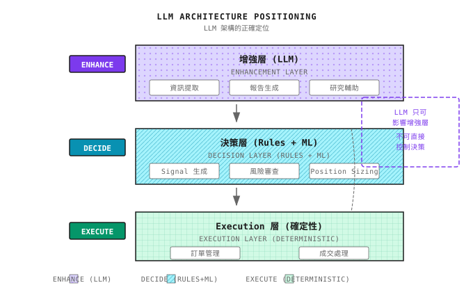
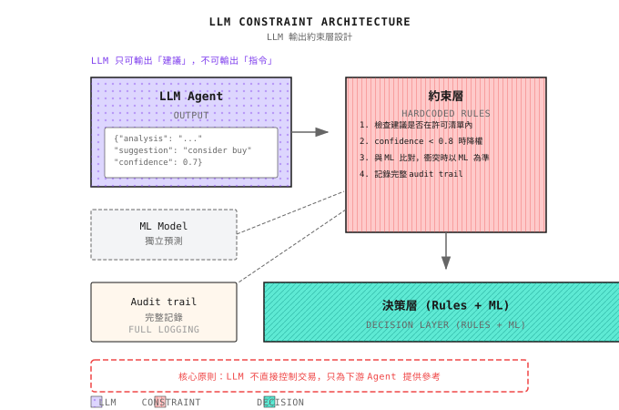

# 第 14 課：LLM 在量化中的應用

> **LLM 是最強大的研究助手，卻是最差勁的 trader。讓它做它擅長的事。**

---

## GPT Trader 的幻想與現實

2023 年，一個團隊做了一個實驗：讓 GPT-4 直接做交易決策。

他們給 GPT-4：
- 過去 20 日的價格數據
- 最新財經新聞
- 目前持倉

然後問：「應該買入、沽出還是持有？」

**3 個月後的結果**：

| 指標 | GPT-4 策略 | 隨機策略 | S&P 500 |
|--------|----------------|-----------------|---------|
| 回報 | -12% | -3% | +8% |
| Sharpe ratio | -0.8 | -0.2 | 0.5 |
| Max drawdown | 25% | 18% | 10% |

**GPT-4 甚至跑輸隨機策略。**

**點解會失敗？**

1. **Hallucination 問題**：GPT-4 會編造不存在的「市場規律」
2. **數學能力弱**：無法準確計算回報、volatility
3. **沒有記憶**：每次調用都是獨立的，無法累積經驗
4. **高 latency**：一次 inference 需要數秒，追不上快速變化的市場
5. **不可重現**：相同輸入可能產生不同輸出

**但在同一時期**，用 GPT-4 做財報分析的團隊報告：

- 財報解讀質素提升 3 倍
- 研究報告生成時間由 4 小時縮短至 30 分鐘
- 新聞 sentiment 分析準確率 85%

**結論**：LLM 不適合直接交易，但在研究與分析方面非常強大。

---

## 14.1 LLM 的正確角色

### LLM 可以做甚麼？

| 能力 | 量化應用 | 價值評級 |
|------------|-------------------|--------------|
| **文本理解** | 財報解讀、新聞分析 | 5/5 |
| **資訊抽取** | 從 10-K 抽取關鍵指標 | 5/5 |
| **報告生成** | 策略診斷報告、postmortem 摘要 | 4/5 |
| **代碼生成** | 協助編寫 backtest 代碼 | 4/5 |
| **知識問答** | 解釋金融概念 | 3/5 |

### LLM 不可以做甚麼？

| 嘗試 | 點解會失敗 | 替代方案 |
|---------|--------------|-------------|
| **直接預測價格** | 無法取得實時數據，計算不準確 | 傳統 ML 模型 |
| **實時交易決策** | Latency 太高，不可重現 | 規則 + ML 系統 |
| **精確計算** | 大數字錯誤率高 | 專用計算模組 |
| **長期記憶** | Context 有限，無法累積 | 外部知識庫 |

### 核心原則：LLM 作為增強層



---

## 14.2 新聞與 Sentiment 分析

### 應用場景

從財經新聞中抽取與交易相關的資訊：

| 新聞類型 | 抽取內容 | 量化價值 |
|-----------|-------------------|-------------|
| **業績公佈** | 是否超出／低於預期、guidance 變化 | Event-driven 信號 |
| **產品新聞** | 新產品發佈、召回、合作 | 基本面變化 |
| **宏觀政策** | 利率決議、監管變化 | 系統性風險 |
| **分析師意見** | 評級變動、目標價調整 | Sentiment 指標 |

### Sentiment 分析示例

**輸入新聞**：
> Apple reported quarterly revenue of $123 billion, beating Wall Street expectations of $118 billion. However, iPhone sales in China declined 15% year-over-year due to increased competition from Huawei.

**LLM 抽取結果**：
```json
{
  "company": "AAPL",
  "event_type": "earnings",
  "sentiment_overall": 0.6,
  "key_points": [
    {"topic": "revenue", "sentiment": 0.8, "value": "beat by 4%"},
    {"topic": "china_iphone", "sentiment": -0.7, "value": "-15% YoY"}
  ],
  "trading_signal": "mixed",
  "confidence": 0.7
}
```

**使用方法**：
- 不要直接交易，而是作為信號的其中一個輸入 feature
- 結合價格 momentum、技術指標
- 用歷史數據驗證 LLM sentiment 的預測能力（backtest）

### Prompt Engineering 要點

**差的 prompt**：
> Is this news bullish or bearish?

**好的 prompt**：
```
You are a financial analyst. Please analyze the following news:
[News content]

Please output in the following format:
1. Company/asset involved (ticker symbol)
2. Event type (earnings/product/policy/other)
3. Overall sentiment score (-1 to 1, -1 extremely negative, 1 extremely positive)
4. 3 key information points, each with topic, sentiment score, specific value
5. Possible short-term price impact (up/down/neutral)
6. Confidence (0 to 1)

Output JSON only, no explanation.
```

---

## 14.3 財報自動化

### 10-K/10-Q 資訊抽取

美國上市公司的年報（10-K）和季報（10-Q）包含大量資訊，但通常超過 100 頁。

**LLM 可以自動抽取**：

| 抽取內容 | 位置 | 用途 |
|-------------------|----------|-----|
| 收入增長 | Financial Statements | 基本面篩選 |
| 毛利率變化 | MD&A | 盈利能力趨勢 |
| 風險因素變化 | Risk Factors | 風險預警 |
| 管理層討論語氣 | MD&A | Sentiment 指標 |
| 訴訟進展 | Legal Proceedings | 事件風險 |

### 結構化抽取流程

```
+-------------------+
|  Download 10-K PDF |
+--------+----------+
         |
         v
+-------------------+
|   PDF -> Text     |
+--------+----------+
         |
         v
+-------------------+
| Segment (by section) |
+--------+----------+
         |
         v
+-------------------+
| LLM extract per segment |  <- Process each segment separately to avoid context overflow
+--------+----------+
         |
         v
+-------------------+
| Store structured data | -> Database for backtesting
+-------------------+
```

### 財報語氣變化偵測

比較連續兩份財報中 MD&A 的語氣變化：

| 上一次表述 | 今次表述 | 信號 |
|--------------------|-------------------|--------|
| "We expect growth" | "We remain cautiously optimistic" | 語氣轉弱 |
| "Facing challenges" | "Facing significant challenges" | 風險加劇 |
| "Exploring" | "Have initiated" | 進展加快 |

**注意**：語氣變化是**相對指標**，需要與歷史比較才有意義。

---

## 14.4 研究報告生成

### 策略診斷報告

讓 LLM 協助撰寫 postmortem 報告：

**輸入**：
```
Strategy name: Momentum Strategy v2.3
Time range: 2024-01-01 to 2024-03-31
Performance data:
  - Return: +8.5%
  - Benchmark return: +12.0%
  - Max drawdown: -6.2%
  - Sharpe ratio: 1.2
  - Turnover: 420%

Trade details: (attach CSV)
```

**LLM 輸出**：
```
# Momentum Strategy v2.3 Q1 2024 Postmortem

## Summary
Strategy underperformed benchmark by 3.5% in Q1, mainly due to consecutive
stop-losses during February's ranging period.

## Core Problem Diagnosis
1. **High turnover cost**: 420% turnover means ~2.1% annualized trading cost
2. **February anomaly**: February return -4.3%, 70% of total drawdown
3. **Sector concentration**: Tech stocks 65% of holdings, lacking diversification

## Improvement Recommendations
1. Add holding period filter to reduce short-term noise trades
2. Reduce position or pause strategy when ADX < 20
3. Add sector diversification constraint, single sector < 30%

## Next Steps
- [ ] Backtest performance after adding ADX filter
- [ ] Test effect of minimum holding period = 3 days
```

### 報告質素控制

LLM 生成的報告需要驗證：

| 檢查項目 | 風險 | 應對 |
|------------|------|----------|
| **數據準確性** | LLM 可能捏造數據 | 從來源抽取關鍵數據，不要讓 LLM 計算 |
| **因果錯誤** | 將相關性誤當因果 | 人手審核關鍵結論 |
| **遺漏重要資訊** | 只看到部分輸入 | 檢查是否涵蓋所有輸入維度 |

---

## 14.5 LLM 安全約束

### 點解需要硬約束？

LLM 的輸出並不可靠。如果直接用於交易：

| 風險 | 場景 | 後果 |
|------|----------|-------------|
| **Hallucination** | 「根據數據，建議全倉買入」 | 實際數據並不支持 |
| **計算錯誤** | 「回報 15%」實際是 1.5% | 錯誤決策 |
| **不一致** | 同一個問題，答案不同 | 不可重現 |

### 硬約束設計



### Audit Trail

每一次 LLM 調用都必須記錄：

```json
{
  "timestamp": "2024-01-15 09:30:00",
  "input_prompt": "Analyze AAPL earnings...",
  "output_raw": "...",
  "output_parsed": {"sentiment": 0.6, ...},
  "model": "gpt-4-0125-preview",
  "temperature": 0.1,
  "action_taken": "Used as feature input to signal model",
  "final_decision": "No trade executed"
}
```

**用途**：
- 事後檢討 LLM 有否誤導決策
- 偵測 LLM 表現退化，以便及時調整
- 監管合規

---

## 14.6 LLM Agent 架構

### 在 Multi-Agent 系統中的位置

```
+-------------------------------------------------------------+
|                      Meta Agent                              |
+----------------------------+--------------------------------+
                             |
    +------------------------+------------------------+
    |                        |                        |
    v                        v                        v
+---------+            +---------+              +---------+
|  LLM    |            | Signal  |              |  Risk   |
|Research |  --------> |  Agent  | -----------> |  Agent  |
|  Agent  |   Input    +---------+              +---------+
+---------+  Sentiment
             Features

LLM Agent Position:
  - Not on critical decision path
  - Only provides "reference information"
  - Downstream Agents decide whether to adopt
```

### LLM Agent 職責邊界

| 可以做 | 不可以做 |
|--------|-----------|
| 分析新聞 sentiment | 直接生成買賣信號 |
| 抽取財報數據 | 計算 position size |
| 生成報告初稿 | 修改風控參數 |
| 解釋策略邏輯 | 執行訂單 |
| 標記異常事件 | 停用 stop loss |

> **LLM 能力邊界**
> LLM 是出色的研究分析員，但絕不應直接參與交易決策。它們可以解析年報、偵測財報電話會議中的語氣變化、標記會計異常、生成 factor 假設——但它們不能生成訂單、計算 position size、修改風控參數或執行交易。這條邊界必須在架構層面強制執行：LLM 的輸出只可作為信號輸入，絕不可直接進入 execution 或風控路徑。完整的邊界表見第 22 課。

---

## 14.7 實務考慮

### 成本控制

| 場景 | 調用頻率 | 成本控制策略 |
|----------|----------------|----------------------|
| 實時新聞分析 | 每條新聞 | 用規則預先過濾無關新聞 |
| 財報分析 | 每季 | 成本可接受 |
| 每日報告生成 | 每日 | 用 caching 避免重複調用 |
| 實時問答 | 按需 | 限制每日調用次數 |

### Latency 管理

| 應用 | 可接受 latency | 策略 |
|-------------|-------------------|----------|
| Event-driven 交易 | < 1 秒 | 不用 LLM，用規則 |
| 每日策略 | 數分鐘 | 可用 LLM，批量處理 |
| 研究分析 | 數小時 | 隨意使用 |

### 模型選擇

| 任務 | 建議模型 | 原因 |
|------|-------------------|--------|
| Sentiment 分析 | GPT-3.5 / Claude Haiku | 任務簡單，成本低 |
| 財報分析 | GPT-4 / Claude Opus | 需要深入理解 |
| 代碼生成 | Claude Opus / GPT-4 | 需要精確 |
| 簡單分類 | Fine-tuned 小模型 | 成本最低，latency 最小 |

---

## 本課成果

完成本課後，你將擁有：

1. **對 LLM 在量化中角色的清晰理解** - 知道它可以做甚麼、不可以做甚麼
2. **Sentiment 分析能力** - 能設計新聞／財報的 LLM 分析流程
3. **安全約束意識** - 理解為何必須有硬約束
4. **架構整合方法** - 知道 LLM Agent 如何融入 multi-agent 系統

### 驗收標準

| 檢查點 | 驗收標準 | 自我測試方法 |
|------------|---------------------|------------------|
| **角色理解** | 能分別列出 LLM 可以做和不可以做的各 3 件事 | 不看筆記列出 |
| **Prompt 設計** | 能寫出結構化的 sentiment 分析 prompt | 給定新聞，設計 prompt |
| **安全約束** | 能解釋為何 LLM 不應直接交易 | 列出 3 個風險 |
| **架構定位** | 能在 multi-Agent 架構圖中標出 LLM 的位置 | 畫出架構圖 |

**設計練習**：

設計一個 LLM 新聞分析流程，要求：
1. 每日處理 500 條財經新聞
2. Latency 要求 < 1 小時內完成全部
3. 成本預算 < $50/日
4. 輸出 sentiment feature 供每日策略使用

<details>
<summary>點擊查看參考方案</summary>

**流程設計**：

1. **預先過濾**（規則）：
   - 關鍵字過濾，只保留與持倉股票相關的新聞
   - 預計過濾後剩下 100 條

2. **批量處理**：
   - 使用 GPT-3.5-turbo（$0.002/1K tokens）
   - 每條新聞約 500 tokens 輸入 + 200 tokens 輸出
   - 100 條 x 700 tokens x $0.002/1K = $0.14

3. **並行調用**：
   - 10 個並發調用
   - 每個約 3 秒，100 條合共約 30 秒

4. **輸出格式**：
   ```json
   {
     "symbol": "AAPL",
     "sentiment": 0.6,
     "event_type": "earnings",
     "key_point": "beat expectations"
   }
   ```

5. **後處理**：
   - 彙總每隻股票的多條新聞
   - 計算加權平均 sentiment 分數
   - 儲存到 feature database

**成本估算**：
- $0.14/日 x 30 日 = $4.2/月
- 遠低於 $50/日 的預算

</details>

---

## 本課總結

- [x] 理解 LLM 在量化中的正確角色：研究助手，而非 trader
- [x] 掌握新聞 sentiment 分析與財報資訊抽取的應用
- [x] 認清 LLM 的風險：hallucination、計算錯誤、不可重現
- [x] 學會設計安全約束：硬約束層 + audit trail
- [x] 理解 LLM Agent 在 multi-agent 架構中的位置

---

## 延伸閱讀

- [背景知識：LLM 量化研究進展](../Part3-機器學習/背景知識/LLM量化研究進展.md) - 學術前沿
- *GPT-4 Technical Report* - 理解 LLM 能力邊界

---

## 下一課預告

**第 15 課：風險控制與資金管理**

即使最好的策略也會虧損——關鍵在於「虧損多少是可以接受的」。Risk Agent 擁有否決權，是保護資本的最後一道防線。下一課我們深入探討風險控制的核心邏輯。
