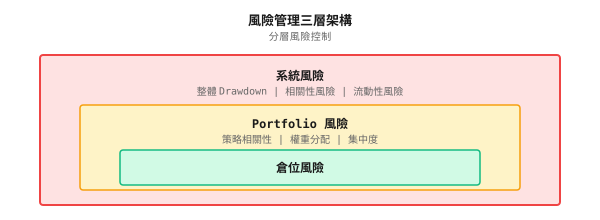
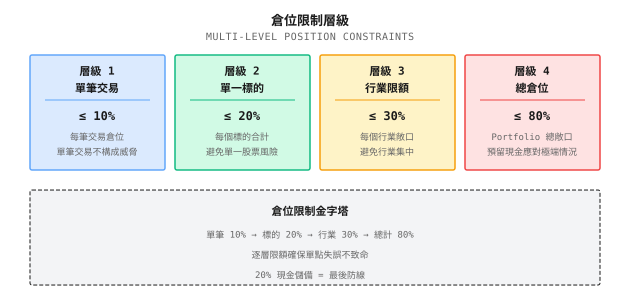
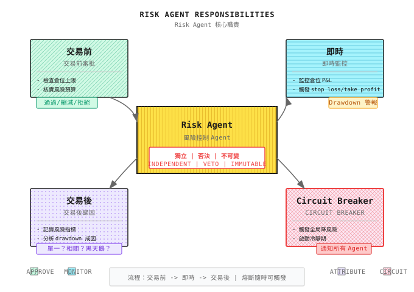
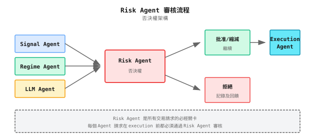

# 第 15 課：風險控制與資金管理

> **目標**：明白「生存」比「賺更多」更重要，並掌握 Risk Agent 的設計原則。

---

## 一個真實故事（公開案例：LTCM，1998）

> 注意：以下是對公開歷史案例的簡化回顧，用以說明風險管理的要點；細節以公開資料為準。

1998 年，Long-Term Capital Management（LTCM）是華爾街最耀眼的 hedge fund。創辦人包括兩位諾貝爾經濟學獎得主，團隊匯集了頂尖的數學家與 trader。

他們的策略很簡單：利用債券市場中微小的定價差異進行套利。Backtest 顯示回報穩定，風險看似很低。

問題是他們用了 **25 倍 leverage**。

1998 年俄羅斯債務危機爆發，市場恐慌令流動性枯竭。那些「微小的差異」不但沒有收斂，反而急劇擴大。LTCM 的模型假設這是「百年一遇」的事件，但它發生了。

結果：46 億美元的資本，在數星期內灰飛煙滅。美國聯儲局不得不協調 14 家華爾街大型銀行進行緊急救援，以防止系統性崩潰。

**教訓是甚麼？**
1. 模型假設會失效，尤其是在極端情況下
2. Leverage 放大回報，同時也放大風險
3. 在流動性危機中，所有資產的相關性趨近於 1
4. **風險控制必須獨立於策略，並擁有否決權**

這正是我們需要獨立的 **Risk Agent** 的原因——它不理會策略能賺多少，只關心系統能否生存。

---

## 15.1 風險的三個層次

### 分層風險管理



| 層次 | 關注點 | 控制機制 | 觸發條件 |
|-------|-------|-------------------|-------------------|
| **Position Risk** | 單筆交易虧損 | Stop loss、position limit | 單筆交易虧損達到閾值 |
| **Portfolio Risk** | 策略疊加 | 分散投資、相關性 monitoring | Portfolio drawdown 達到閾值 |
| **System Risk** | 整個賬戶的生存 | Circuit breaker、全面減倉 | 賬戶 drawdown 達到閾值 |

### 風險預算思維

**核心想法**：先決定你能虧損多少，再決定你能賺多少。

```
Total risk budget: 20% (maximum acceptable drawdown)
    |
    |-- Strategy A: 8% (momentum strategy, high volatility)
    |-- Strategy B: 6% (mean reversion, medium volatility)
    |-- Strategy C: 4% (arbitrage strategy, low volatility)
    +-- Reserve buffer: 2% (for extreme situations)
```

**紙上練習：分配風險預算**

你有 $1M 資金，最大可接受 drawdown 為 15%。有三個策略：

| 策略 | 歷史 Max Drawdown | 年回報 | Sharpe ratio |
|----------|------------------------|---------------|--------------|
| A | 25% | 35% | 1.4 |
| B | 12% | 18% | 1.5 |
| C | 8% | 12% | 1.5 |

**問題**：應如何分配權重，令 portfolio drawdown 不超過 15%？

<details>
<summary>點擊展開答案</summary>

**方法 1：等風險貢獻（Risk Parity）**

| 策略 | Drawdown | 1/Drawdown | 權重 | 風險貢獻 |
|----------|----------|------------|--------|-------------------|
| A | 25% | 0.04 | 0.04/0.215 = 18.6% | 25% x 18.6% = 4.6% |
| B | 12% | 0.083 | 0.083/0.215 = 38.6% | 12% x 38.6% = 4.6% |
| C | 8% | 0.125 | 0.125/0.215 = 58.1% | 8% x 58.1% = 4.6% |
| **合計** | | 0.215 | 115.3%（需要縮放） | 13.8% |

縮放後的權重：A=16%、B=34%、C=50%，預期 portfolio drawdown 約 12%（低於 15%）

**方法 2：簡化計算**

若假設各策略互不相關，portfolio drawdown ~ sqrt(sum((weight x drawdown)^2))

設 A 的權重 = x，求解 sqrt((0.25x)^2 + (0.12x0.4)^2 + (0.08x0.5)^2) <= 15%

解得：x <= 20%，所以 A 最多分配 20%

**關鍵洞察**：高 volatility 的策略必須低配，否則會主導 portfolio 的風險。

</details>

---

## 15.2 倉位管理

### Kelly 公式：理論上最優的倉位

Kelly 公式告訴你，在已知勝率和賠率的情況下，應下注多大比例才能令長期財富增長最大化：

```
f* = (p x b - q) / b

Where:
- f* = Optimal position proportion
- p = Win rate
- q = 1 - p = Loss rate
- b = Odds (profit/loss ratio)
```

**紙上練習：計算 Kelly 倉位**

| 場景 | 勝率 p | 賠率 b | Kelly f* | 解讀 |
|----------|------------|--------|----------|----------------|
| A | 60% | 1.0 | (0.6x1-0.4)/1 = 20% | 每次下注 20% |
| B | 55% | 1.5 | (0.55x1.5-0.45)/1.5 = 25% | 賠率較高，可下注較多 |
| C | 50% | 1.0 | (0.5x1-0.5)/1 = 0% | 期望值為零，不下注 |
| D | 45% | 2.0 | (0.45x2-0.55)/2 = 17.5% | 勝率低但賠率高 |
| E | 70% | 0.5 | (0.7x0.5-0.3)/0.5 = 10% | 勝率高但賠率低 |

### 實戰中點解用「Half Kelly」

| 問題 | 說明 | 解決方案 |
|---------|-------------|----------|
| 估計誤差 | 勝率和賠率都是估計值，可能不準確 | 使用 1/2 Kelly 或 1/4 Kelly |
| Volatility 過大 | Full Kelly 的 volatility 可能難以承受 | 降低倉位以求安心 |
| 破產風險 | Full Kelly 下連續虧損可能令資金歸零 | 設定最低倉位上限 |
| 相關性 | Kelly 假設獨立，但倉位之間可能相關 | 在 portfolio 層面打折 |

**實務建議**：使用 Kelly/2 作為倉位上限，並結合其他約束。

### Kelly 與參數不確定性

**核心問題**：Kelly 公式假設你知道真實的勝率和賠率，但這些其實都是估計值。

```
Impact of estimation error:

True win rate: 55%
Estimated win rate: 60% (overestimated by 5%)
Odds: 1.0

True Kelly: (0.55x1 - 0.45)/1 = 10%
Estimated Kelly: (0.60x1 - 0.40)/1 = 20% (overestimated by 100%!)

You use 20% position for a strategy that should only use 10%
-> Risk doubles, may blow up
```

#### Bayesian Kelly 公式

一種考慮參數不確定性的方法，是使用 Bayesian 框架：

```python
import numpy as np
from scipy import stats

def bayesian_kelly(wins: int, losses: int,
                   avg_win: float, avg_loss: float,
                   confidence: float = 0.9) -> dict:
    """
    Bayesian Kelly: Consider win rate estimation uncertainty

    wins: Historical win count
    losses: Historical loss count
    avg_win: Average win percentage
    avg_loss: Average loss percentage
    confidence: Confidence level
    """
    n = wins + losses

    # Bayesian posterior for win rate (Beta distribution)
    # Using uniform prior Beta(1,1)
    alpha = wins + 1
    beta = losses + 1

    # Point estimate and interval for win rate
    p_mean = alpha / (alpha + beta)
    p_lower = stats.beta.ppf((1 - confidence) / 2, alpha, beta)
    p_upper = stats.beta.ppf((1 + confidence) / 2, alpha, beta)

    # Odds
    odds = avg_win / avg_loss

    # Kelly under different win rate assumptions
    kelly_mean = (p_mean * odds - (1 - p_mean)) / odds
    kelly_lower = (p_lower * odds - (1 - p_lower)) / odds
    kelly_upper = (p_upper * odds - (1 - p_upper)) / odds

    # Conservative Kelly: use confidence lower bound
    kelly_conservative = max(0, kelly_lower)

    return {
        'p_estimate': p_mean,
        'p_interval': (p_lower, p_upper),
        'kelly_mean': max(0, kelly_mean),
        'kelly_conservative': kelly_conservative,
        'kelly_interval': (max(0, kelly_lower), max(0, kelly_upper)),
        'sample_size': n,
        'recommendation': kelly_conservative / 2  # Half again
    }


# Example
result = bayesian_kelly(wins=60, losses=40, avg_win=0.02, avg_loss=0.015)

print(f"Win rate estimate: {result['p_estimate']:.1%}")
print(f"Win rate 90% CI: [{result['p_interval'][0]:.1%}, {result['p_interval'][1]:.1%}]")
print(f"Kelly (point estimate): {result['kelly_mean']:.1%}")
print(f"Kelly (conservative): {result['kelly_conservative']:.1%}")
print(f"Recommended position: {result['recommendation']:.1%}")
```

**輸出示例**：
```
Win rate estimate: 60.0%
Win rate 90% CI: [51.1%, 68.4%]
Kelly (point estimate): 26.7%
Kelly (conservative): 6.8%
Recommended position: 3.4%
```

**關鍵洞察**：
- 100 筆交易估計出 60% 勝率，真實值可能在 51%-68% 之間
- 使用點估計的 Kelly（26.7%）風險很大
- 保守 Kelly（6.8%）以勝率下限為基礎，較為安全
- 建議倉位再減半（3.4%），預留餘地

#### 樣本量與 Kelly 折扣

| 歷史交易筆數 | 勝率估計誤差 | 建議 Kelly 折扣 |
|-----------------------|--------------------------|-------------------------|
| < 30 | 估計極不可靠 | 不要使用 Kelly |
| 30-100 | +/-10-15% | Kelly x 0.25 |
| 100-300 | +/-5-10% | Kelly x 0.5 |
| 300-1000 | +/-3-5% | Kelly x 0.7 |
| > 1000 | +/-1-3% | Kelly x 0.8 |

**紙上練習：Kelly 折扣**

| 場景 | 交易筆數 | 估計勝率 | 估計賠率 | 點估計 Kelly | 折扣 | 實際倉位 |
|----------|-------------|---------------|-----------|-------------|----------|-----------------|
| A | 50 | 55% | 1.2 | 12.5% | 0.25 | 3.1% |
| B | 200 | 55% | 1.2 | 12.5% | 0.5 | 6.3% |
| C | 500 | 55% | 1.2 | 12.5% | 0.7 | 8.8% |

**結論**：樣本越少，Kelly 折扣越大。數據不足時，絕不可滿倉。

### 倉位上限規則



---

## 15.3 Stop Loss 與 Take Profit

### 三種 Stop Loss

| 類型 | 定義 | 優點 | 缺點 |
|------|------------|------|------|
| **Fixed stop loss** | 虧損達 X% 時離場 | 簡單、確定 | 可能被 volatility 洗出場 |
| **Trailing stop** | 從高位回落 X% 時離場 | 讓利潤奔跑 | 可能回吐利潤 |
| **Time stop** | N 日後仍未有盈利便離場 | 避免資金被佔用 | 可能錯過後續走勢 |

### Stop Loss 水平的計算

**方法 1：ATR 倍數**

```
Stop-loss price = Entry price - N x ATR

Where:
- ATR = Average True Range
- N = Multiple (typically 1.5 - 3)

Example:
- Entry price = $100
- ATR = $2
- N = 2
- Stop-loss price = $100 - 2 x $2 = $96 (4% stop-loss)
```

**方法 2：Volatility 調整**

```
Stop-loss range = k x sigma

Where:
- sigma = Daily volatility of the asset
- k = Multiple (typically 2 - 3)

Example:
- Daily volatility = 2%
- k = 2.5
- Stop-loss range = 2.5 x 2% = 5%
```

**紙上練習：設計 Stop Loss 策略**

| 股票 | 入場價 | 日 Volatility | ATR | 固定 5% Stop | ATRx2 Stop | Volx2.5 Stop |
|--------|-------------|------------------|-----|---------------|------------|--------------|
| AAPL | $180 | 1.5% | $2.7 | $171 | $174.6 | $173.3 |
| TSLA | $250 | 3.5% | $8.8 | $237.5 | $232.4 | $228.1 |
| SPY | $450 | 0.8% | $3.6 | $427.5 | $442.8 | $441 |

**觀察**：
- 固定 stop loss 對高 volatility 資產（TSLA）太緊，容易被洗出場
- ATR／volatility stop 會根據資產特性自動調整
- 低 volatility 資產（SPY）可以設較緊的 stop

### Stop Loss 的心理陷阱

| 陷阱 | 表現 | 後果 |
|------|---------------|-------------|
| **不願止蝕** | 「再等等，會回來的」 | 小虧變大虧 |
| **過早止蝕** | 一見虧損就走 | 頻繁被洗出場，白白損失手續費 |
| **Trailing stop 太緊** | 鎖定小額利潤 | 捉不到大行情 |
| **虧損後攤低成本** | 「攤低我的成本」 | 在錯誤的方向加碼 |

**核心原則**：Stop loss 是交易系統的一部分，不是失敗的標誌。

### 常見誤解

**誤解 1：高 leverage 只會放大回報**

它同時放大風險和情緒壓力。LTCM 用了 25 倍 leverage，在數星期內虧掉 46 億美元。Leverage 令你判斷正確時賺得更多，但判斷錯誤時死得更快。

**誤解 2：分散投資 = 持有更多股票**

持有 10 隻科技股不是分散投資。分散投資的核心是**低相關性**，而非股票數目。股票 + 債券 + 商品的分散效果遠勝 10 隻股票。

**誤解 3：風險控制可以事後補上**

風險控制必須預先設計。虧損 30% 後才想風控已經太遲。正確做法：在開倉之前，先設定好 stop loss、position limit 和 drawdown circuit breaker。

**誤解 4：Risk Agent 的否決可以被「更好的理由」推翻**

絕對不可以。Risk Agent 的硬約束是系統的安全邊界——任何理由都不能繞過。這是防止「一個錯誤毀掉一切」的最後防線。

---

## 15.4 Portfolio 風險管理

### 相關性陷阱

**問題**：你以為自己已經分散投資，其實沒有。

| Portfolio | 看起來 | 實際相關性 | 危機時相關性 |
|-----------|------------|-------------------|-------------------|
| AAPL + MSFT + GOOGL | 三間不同的公司 | 0.7 | 0.9 |
| 股票 + 債券 | 不同資產類別 | 0.2 | 0.6 |
| 美股 + 港股 | 不同市場 | 0.5 | 0.85 |
| Bitcoin + Ethereum | 兩種加密貨幣 | 0.85 | 0.95 |

**關鍵洞察**：相關性在危機中急升，而那正是你最需要分散投資的時候——它卻失效了。

### Portfolio Drawdown 控制

```
Portfolio Drawdown Monitoring Levels:

Warning (Yellow): Drawdown 5%
- Reduce new position sizes
- Increase stop-loss sensitivity

Control (Red): Drawdown 10%
- Stop new positions
- Start reducing positions

Circuit Breaker (Black): Drawdown 15%
- Full reduction to 30%
- Initiate cooling period (e.g., 5 days)
```

### 紙上練習：Drawdown 情景模擬

**初始狀態**：$1M 資金，80% 倉位

| 日 | 淨值 | Drawdown | 觸發級別 | 行動 |
|-----|-----------|----------|---------------|--------|
| 0 | $1M | 0% | - | 正常運作 |
| 5 | $970K | 3% | - | 正常運作 |
| 10 | $940K | 6% | Yellow | 減少新倉、收緊 stop |
| 15 | $910K | 9% | Yellow | 繼續控制 |
| 20 | $880K | 12% | Red | 停止開倉，開始減倉 |
| 25 | $850K | 15% | Black | 減至 30%，進入冷靜期 |
| 30 | $860K | 14% | Red | 維持 30% 倉位 |
| 35 | $890K | 11% | Red | 考慮緩慢加倉 |

---

## 15.5 Risk Agent 設計

### Risk Agent 的核心職責



### 否決權設計

| 場景 | Signal Agent 請求 | Risk Agent 決定 | 原因 |
|----------|---------------------|---------------------|--------|
| 正常 | 買入 10% AAPL | 批准 | 符合所有 limit |
| 過大 | 買入 15% AAPL | 減至 10% | 超出單筆交易上限 |
| 過度集中 | 買入 10% MSFT（已持有 15% AAPL） | 拒絕 | 科技板塊已超出板塊上限 |
| Drawdown | 加倉 | 拒絕 | Portfolio 已觸發 red 級別 |
| Circuit breaker | 任何買入 | 拒絕 | 系統處於冷靜期 |

### Risk Agent 的實作原則

```
1. Hard Constraints Cannot Be Overridden
   - Position limits, drawdown circuit breakers are hardcoded
   - Even if other Agents have "better reasons," cannot bypass
   - Human intervention requires special process (e.g., dual confirmation)

2. Independent Data Source
   - Risk Agent has its own market data source
   - Doesn't fully depend on data from other Agents
   - Prevents being "fed fake data" to bypass risk control

3. Complete Audit Logs
   - Every decision logged: time, request, decision, reason
   - Supports post-hoc review: "Why didn't we stop-loss that day?"
   - Logs cannot be modified

4. Degradation Strategy
   - If Risk Agent itself fails, system enters safe mode
   - Safe mode: No new positions allowed, only reductions
   - Cannot skip risk control because risk control is broken
```

<details>
<summary>代碼實現（供工程師參考）</summary>

```python
from dataclasses import dataclass
from enum import Enum
from typing import Optional
import logging

class Decision(Enum):
    APPROVE = "approve"
    REDUCE = "reduce"
    REJECT = "reject"

@dataclass
class RiskCheckResult:
    decision: Decision
    reason: str
    adjusted_size: Optional[float] = None

class RiskAgent:
    """Risk Control Agent - Has veto power"""

    def __init__(self, config: dict):
        self.max_single_position = config.get("max_single_position", 0.10)
        self.max_symbol_exposure = config.get("max_symbol_exposure", 0.20)
        self.max_sector_exposure = config.get("max_sector_exposure", 0.30)
        self.max_total_exposure = config.get("max_total_exposure", 0.80)
        self.drawdown_warning = config.get("drawdown_warning", 0.05)
        self.drawdown_stop = config.get("drawdown_stop", 0.10)
        self.drawdown_circuit = config.get("drawdown_circuit", 0.15)

        self.is_circuit_breaker_active = False
        self.logger = logging.getLogger("RiskAgent")

    def check_order(
        self,
        symbol: str,
        size: float,  # Proportion of total capital
        current_portfolio: dict,
        current_drawdown: float
    ) -> RiskCheckResult:
        """
        Review order request

        Returns: Approve/Reduce/Reject
        """

        # Check circuit breaker status
        if self.is_circuit_breaker_active:
            return RiskCheckResult(
                Decision.REJECT,
                "Circuit breaker active - no new positions"
            )

        # Check drawdown status
        if current_drawdown >= self.drawdown_stop:
            return RiskCheckResult(
                Decision.REJECT,
                f"Drawdown {current_drawdown:.1%} >= stop threshold"
            )

        # Check single trade limit
        if size > self.max_single_position:
            return RiskCheckResult(
                Decision.REDUCE,
                f"Size {size:.1%} > max {self.max_single_position:.1%}",
                adjusted_size=self.max_single_position
            )

        # Check symbol concentration
        current_symbol_exposure = current_portfolio.get(symbol, 0)
        if current_symbol_exposure + size > self.max_symbol_exposure:
            allowed = self.max_symbol_exposure - current_symbol_exposure
            if allowed <= 0:
                return RiskCheckResult(
                    Decision.REJECT,
                    f"Symbol {symbol} already at max exposure"
                )
            return RiskCheckResult(
                Decision.REDUCE,
                f"Reducing to stay within symbol limit",
                adjusted_size=allowed
            )

        # Check total position
        total_exposure = sum(current_portfolio.values()) + size
        if total_exposure > self.max_total_exposure:
            return RiskCheckResult(
                Decision.REJECT,
                f"Total exposure {total_exposure:.1%} would exceed limit"
            )

        return RiskCheckResult(Decision.APPROVE, "All checks passed")

    def check_drawdown(self, current_drawdown: float) -> str:
        """Check drawdown status and return recommendation"""

        if current_drawdown >= self.drawdown_circuit:
            self.is_circuit_breaker_active = True
            self.logger.critical(f"CIRCUIT BREAKER TRIGGERED: {current_drawdown:.1%}")
            return "circuit_breaker"

        if current_drawdown >= self.drawdown_stop:
            self.logger.warning(f"STOP LEVEL: {current_drawdown:.1%}")
            return "stop_new_positions"

        if current_drawdown >= self.drawdown_warning:
            self.logger.info(f"WARNING LEVEL: {current_drawdown:.1%}")
            return "reduce_risk"

        return "normal"
```

</details>

---

## 15.6 Multi-Agent 協作中的風險控制

### Risk Agent 與其他 Agent 的關係



### 危機期間的協作

| 狀態 | Regime Agent | Signal Agent | Risk Agent | Execution Agent |
|-------|--------------|--------------|------------|-----------------|
| 正常 | 識別趨勢／震盪 | 正常信號 | 正常審核 | 正常 execution |
| 預警 | 標記「可能出現危機」 | 降低信號頻率 | 提高審核標準 | 減少訂單規模 |
| 危機 | 標記「危機已確認」 | 停止做多信號 | 開始減倉 | 優先平倉 |
| Circuit breaker | - | 停止所有信號 | 強制減至目標倉位 | 只執行平倉 |

### 風險歸因

| 歸因維度 | 問題 | 改進方向 |
|----------------------|---------|----------------------|
| **選股** | 某隻股票貢獻了 50% 的 drawdown | 降低該股票的權重上限 |
| **策略選擇** | 趨勢策略在震盪市中大虧 | 加強 Regime 偵測 |
| **時機選擇** | 在高 volatility 時開倉 | 高 volatility 時降低倉位 |
| **倉位過大** | 單筆交易虧損超出預期 | 收緊 position limit |
| **Stop loss 失效** | Stop loss 沒有被執行 | 檢查 stop loss 機制 |

---

## 驗收標準

完成本課後，用以下標準驗證學習成果：

| 檢查點 | 標準 | 自我測試方法 |
|------------|----------|------------------|
| 理解風險層次 | 能分辨 position／portfolio／system 風險 | 為每一層舉出控制機制的例子 |
| 計算 Kelly 倉位 | 能用公式計算最優倉位 | 完成紙上練習 |
| 設計 stop loss 策略 | 能用 ATR／volatility 設計 stop | 為你的策略設計 stop 規則 |
| 理解相關性陷阱 | 能解釋為何分散投資可能失效 | 說明危機時相關性的變化 |
| 設計 Risk Agent | 能描述 Risk Agent 的四項職責 | 畫出風險審核流程圖 |

### 綜合練習

**設計你自己的風控系統**：

1. 定義你的風險預算（最大可接受 drawdown）
2. 設計 position limit 規則（單筆交易／單一股票／板塊／總倉位）
3. 設計 stop loss 策略（類型、參數）
4. 設計 drawdown 觸發機制（預警／控制／circuit breaker 級別）
5. 描述 Risk Agent 如何與其他 Agent 協作

---

## 本課成果

完成本課後，你將擁有：

1. **風險預算框架** - 先決定你能虧損多少，再分配策略
2. **倉位管理規則** - Kelly 公式 + 多層 limit
3. **Stop loss 設計方法** - ATR／volatility stop 的計算
4. **Risk Agent 設計模板** - 四項職責 + 否決機制

---

## 本課總結

- [x] 理解風險管理的三個層次：position、portfolio、system
- [x] 掌握 Kelly 公式及其實務調整
- [x] 理解 stop loss 的類型與參數選擇
- [x] 理解相關性陷阱與 portfolio 風險
- [x] 掌握 Risk Agent 的設計原則：獨立、擁有否決權、不可被推翻

---

## 附錄：風險指標速查表

> 本表總結量化交易中常用的風險指標及其業界標準，方便速查。

### 核心風險指標

| 風險指標 | 優秀標準 | 可接受標準 | 控制方法 |
|-------------|-------------------|---------------------|----------------|
| **Maximum Drawdown** | <10%（market neutral）/ <15%（指數增強） | <20%（market neutral）/ <25%（指數增強） | 動態 stop loss、倉位控制 |
| **Sharpe ratio** | >2.0 | >1.0 | 優化回報與 volatility 比率 |
| **年化 Volatility** | <8%（market neutral）/ <15%（指數增強） | <12%（market neutral）/ <20%（指數增強） | Volatility targeting 策略 |
| **Downside Risk** | <5% | <10% | 非對稱風險管理 |
| **勝率** | >55% | >50% | 提升信號質素 |
| **盈虧比** | >2.0 | >1.5 | 讓利潤奔跑，截短虧損 |
| **Calmar ratio** | >1.5 | >0.5 | 年回報 / Maximum drawdown |

### 倉位控制標準

| Limit 類型 | 保守標準 | 進取標準 | 說明 |
|------------|----------------------|---------------------|-------------|
| 單筆交易風險 | 1% | 2% | 每筆交易最大虧損佔總資金的百分比 |
| 單一股票倉位 | 5% | 10% | 單一股票佔總資金的百分比 |
| 板塊集中度 | 20% | 30% | 單一板塊佔總資金的百分比 |
| 總倉位 | 60-80% | 80-100% | 股票佔總資金的百分比 |
| Leverage | 1x | 1.5x | 除非是專業機構，否則不建議超過 1x |

### Drawdown 觸發機制

| Drawdown 級別 | 行動 | 說明 |
|----------------|--------|-------------|
| 5% | Warning | 開始 monitoring，檢查持倉 |
| 10% | Reduce | 降低倉位 20-30% |
| 15% | Control | 停止新倉，繼續減倉 |
| 20% | Circuit Breaker | 強制減至最低水平 |

---

## 延伸閱讀

- [背景知識：歷史著名量化事故](../Part1-快速體驗/背景知識/歷史著名量化事故.md) - LTCM 及其他風控失效案例
- [背景知識：Sharpe ratio 的統計陷阱](../Part2-量化基礎/背景知識/夏普比率的統計陷阱.md) - 策略評估中的統計陷阱
- [第 12 課：市場狀態識別](第12課：市場狀態識別.md) - 危機偵測與風控的協調
- [第 10 課：從模型到 Agent](../Part3-機器學習/第10課：從模型到Agent.md) - Agent 設計基礎

---

## 下一課預告

**第 16 課：組合構建與風險暴露管理**

當手上有多個策略信號，如何把它們組合成 portfolio？如何分配倉位？如何 monitoring factor exposure？下一課我們深入 portfolio 層面——從 Signal 到 Portfolio 的關鍵一步。
