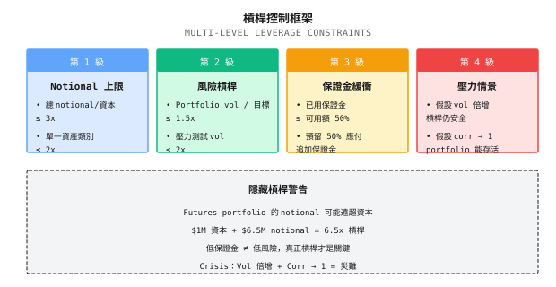
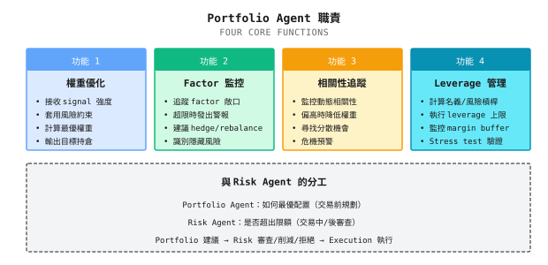

# 第 16 課：Portfolio Construction 與風險暴露管理

> **Multi-strategy 不等於低風險。Correlation 才是風險的本質。**

---

## 典型場景（示例）

> 註：以下為虛構示例，用以說明常見現象；數字僅供說明，並不對應任何特定個人／賬戶。

2022 年初，一位投資者向我展示他的「分散投資組合」：

| Strategy | 類型 | 歷史 Sharpe | 歷史 Max DD | 配置比例 |
|----------|------|-------------|-------------|----------|
| Strategy A | 美股 Momentum | 1.5 | 18% | 30% |
| Strategy B | 科技股 Trend | 1.8 | 22% | 25% |
| Strategy C | Growth Factor | 1.3 | 15% | 25% |
| Strategy D | 多頭輪動 | 1.4 | 20% | 20% |

他問我：「這四個 strategy 都很出色，組合起來應該更穩健吧？」

我做了一個簡單的 correlation 分析：

| | Strategy A | Strategy B | Strategy C | Strategy D |
|---|------------|------------|------------|------------|
| Strategy A | 1.00 | 0.85 | 0.78 | 0.82 |
| Strategy B | 0.85 | 1.00 | 0.88 | 0.80 |
| Strategy C | 0.78 | 0.88 | 1.00 | 0.75 |
| Strategy D | 0.82 | 0.80 | 0.75 | 1.00 |

**發現**：所有 strategy 之間的 correlation 都高於 0.75。

**結果**：2022 年，這個「分散投資組合」drawdown 了 35%，比任何單一 strategy 都差。

**為甚麼？**

這四個 strategy 看似不同，實際上都在做同一件事：**做多美國科技股**。當科技股集體下跌時，它們同時虧損，correlation 趨近 1，分散效果消失。

**這就是欠缺 portfolio 層的代價**：你以為自己在分散風險，實際上是在疊加同一個賭注。

---

## 16.1 Portfolio 層的必要性

### 16.1.1 標準量化流程

```
A complete quant system should be:

Signals -> Portfolio Optimization -> Risk Control -> Execution
 |              |                      |              |
 +-- Each       +-- Unified            +-- Secondary  +-- Real
    Strategy       Allocation             Review         Trading
    Signal

Many systems are missing the "Portfolio Optimization" layer:

Signals -> [Missing] -> Risk Control -> Execution
 |                          |              |
 +-- Direct trading         +-- Passive    +-- May
    from signals               checking       explode
```

### 16.1.2 Portfolio 層解決甚麼問題？

| 問題 | 沒有 Portfolio 層 | 有 Portfolio 層 |
|------|-------------------|-----------------|
| **Weight allocation** | 憑感覺、平均分配 | 基於 risk contribution 和優化目標 |
| **Correlation** | 不知道 strategy 之間的關係 | 明確建模並控制 |
| **Factor exposure** | 隱藏的 exposure 看不見 | 被監控並設有約束 |
| **Leverage 控制** | 可能存在隱藏 leverage | 明確計算真實 leverage |
| **Rebalancing** | 隨機、被動 | 按規則、主動 |

### 16.1.3 Signal 質素不等於 Portfolio 質素

這是許多人忽略的關鍵分別：

```
Single Strategy View:
  Strong signal -> Big position -> High return

Portfolio View:
  Strong signal + High correlation -> Big position -> Concentrated risk -> May lose big
  Strong signal + Low correlation -> Big position -> Diversified risk -> More robust
```

---

## 16.2 Position Sizing 方法

### 16.2.1 四種常見方法比較

| 方法 | 公式 | 優點 | 缺點 | 適用場景 |
|------|------|------|------|----------|
| **Equal Weight** | w_i = 1/N | 簡單 | 忽略風險差異 | Strategy 風險相近 |
| **Equal Volatility** | w_i proportional to 1/sigma_i | 考慮 volatility | 忽略 correlation | 互相獨立的 strategy |
| **Equal Risk Contribution** | RC_i = RC_j | 風險平衡 | 計算複雜 | 長期配置 |
| **Mean-Variance** | max(return/risk) | 理論上最優 | 估計誤差大 | 預期值可靠時 |

### 16.2.2 Equal Weight vs Equal Risk Contribution

**紙面練習**：

你有兩個 strategy：
- Strategy A：年化 volatility 10%
- Strategy B：年化 volatility 30%

| 方法 | Strategy A 權重 | Strategy B 權重 | Portfolio Volatility |
|------|-----------------|-----------------|----------------------|
| Equal Weight | 50% | 50% | ? |
| Equal Volatility | 75% | 25% | ? |

<details>
<summary>點擊展開答案</summary>

假設 correlation = 0（互相獨立）

**Equal Weight 配置**：
- A 的 volatility 貢獻 = 50% x 10% = 5%
- B 的 volatility 貢獻 = 50% x 30% = 15%
- Portfolio volatility = sqrt(5%^2 + 15%^2) = sqrt(0.25% + 2.25%) = 15.8%
- **B 貢獻了 90% 的風險**

**Equal Volatility 配置**：
- w_A = (1/10%) / (1/10% + 1/30%) = 0.1 / 0.133 = 75%
- w_B = (1/30%) / (1/10% + 1/30%) = 0.033 / 0.133 = 25%
- A 的 volatility 貢獻 = 75% x 10% = 7.5%
- B 的 volatility 貢獻 = 25% x 30% = 7.5%
- Portfolio volatility = sqrt(7.5%^2 + 7.5%^2) = 10.6%
- **兩者貢獻相同的風險**

**結論**：Equal weight 配置會令高 volatility 的 strategy 主導 portfolio 風險。

</details>

### 16.2.3 Portfolio 層面的 Kelly

單一 strategy 的 Kelly：
```
f* = (p x b - q) / b
```

Multi-strategy Kelly（考慮 correlation）：
```
f* = Sigma^(-1) x mu

Where:
- f* = Optimal weight vector
- Sigma = Covariance matrix
- mu = Expected return vector

Key:
- High correlation strategies get down-weighted
- Negative correlation strategies get up-weighted
```

**實務建議**：
- 使用 1/2 Kelly 或 1/4 Kelly
- 對 covariance matrix 使用 robust estimation（見下一節）
- 為單一 strategy 設定權重上限

---

## 16.3 Covariance 估計與 Shrinkage

### 16.3.1 Sample Covariance 的問題

Mean-variance optimization 需要 covariance matrix Sigma。最自然的做法是由歷史數據估計：

```
Sample Covariance Matrix:
Sigma_hat = (1/T) x Sum((r_t - mu_hat)(r_t - mu_hat)')

Where:
  r_t = Return vector at time t
  mu_hat = Sample mean vector
  T = Number of samples
```

**問題**：當資產數量 N 接近樣本數量 T，sample covariance matrix 會變得極不穩定。

**紙面練習**：

| 場景 | 資產數 N | 樣本數 T | 問題 |
|------|----------|----------|------|
| 30 隻股票，1 年日線 | 30 | 252 | 尚可，T/N ~ 8 |
| 100 隻股票，1 年日線 | 100 | 252 | 危險，T/N ~ 2.5 |
| 500 隻股票，1 年日線 | 500 | 252 | 災難，T/N < 1 |

**為甚麼 T/N 太小會有問題**：

```
1. High estimation noise
   - Covariance matrix has N x (N+1)/2 parameters
   - 100 stocks = 5,050 parameters
   - 252 samples estimating 5,050 parameters -> extremely unreliable

2. Matrix may be singular
   - When N > T, Sigma_hat is singular (determinant = 0)
   - Cannot invert -> cannot do portfolio optimization

3. Extreme weights
   - Estimation errors get amplified by optimizer
   - Produces unreasonable large weights or short positions
```

### 16.3.2 Ledoit-Wolf Shrinkage 估計

**核心思想**：把不穩定的 sample covariance matrix「收縮」向一個穩定的目標矩陣。

```
Shrinkage estimate:
Sigma_shrunk = delta x F + (1-delta) x Sigma_hat

Where:
  F = Target matrix (structured, stable)
  Sigma_hat = Sample covariance matrix (unbiased but noisy)
  delta = Shrinkage intensity (0 <= delta <= 1)

When delta -> 1: Approaches target matrix (stable but biased)
When delta -> 0: Approaches sample matrix (unbiased but noisy)
```

**常見目標矩陣**：

| 目標類型 | 定義 | 適用場景 |
|----------|------|----------|
| **Single factor model** | F = beta x beta' x sigma_m^2 + D | 股票 portfolio |
| **Constant correlation** | 所有資產有相同 correlation | 同一資產類別 |
| **Diagonal matrix** | 只保留 variance，correlation = 0 | 弱相關資產 |

### 16.3.3 代碼實現

```python
import numpy as np
from sklearn.covariance import LedoitWolf, OAS

def get_shrunk_covariance(returns: np.ndarray, method: str = 'ledoit_wolf') -> dict:
    """
    Calculate shrinkage covariance matrix

    Parameters:
    -----------
    returns : Returns matrix (T x N), each row is a period, each column is an asset
    method : 'ledoit_wolf' or 'oas' (Oracle Approximating Shrinkage)

    Returns:
    --------
    dict : Contains shrinkage covariance matrix and shrinkage intensity
    """
    if method == 'ledoit_wolf':
        estimator = LedoitWolf()
    elif method == 'oas':
        estimator = OAS()
    else:
        raise ValueError(f"Unknown method: {method}")

    estimator.fit(returns)

    return {
        'covariance': estimator.covariance_,
        'shrinkage': estimator.shrinkage_,
        'sample_cov': np.cov(returns, rowvar=False)
    }


def compare_covariance_stability(returns: np.ndarray, n_splits: int = 5) -> dict:
    """
    Compare stability of sample vs shrinkage covariance

    By splitting data, compare consistency of both methods across subsamples
    """
    T, N = returns.shape
    split_size = T // n_splits

    sample_covs = []
    shrunk_covs = []

    for i in range(n_splits):
        start = i * split_size
        end = start + split_size
        subset = returns[start:end]

        sample_covs.append(np.cov(subset, rowvar=False))

        lw = LedoitWolf()
        lw.fit(subset)
        shrunk_covs.append(lw.covariance_)

    # Calculate differences across subsamples (Frobenius norm)
    sample_diffs = []
    shrunk_diffs = []

    for i in range(n_splits):
        for j in range(i+1, n_splits):
            sample_diffs.append(np.linalg.norm(sample_covs[i] - sample_covs[j], 'fro'))
            shrunk_diffs.append(np.linalg.norm(shrunk_covs[i] - shrunk_covs[j], 'fro'))

    return {
        'sample_cov_variation': np.mean(sample_diffs),
        'shrunk_cov_variation': np.mean(shrunk_diffs),
        'stability_improvement': np.mean(sample_diffs) / np.mean(shrunk_diffs)
    }
```

### 16.3.4 使用示例

```python
import numpy as np
from sklearn.covariance import LedoitWolf

# Simulate 50 stocks, 1 year daily data
np.random.seed(42)
n_assets = 50
n_days = 252

# Generate returns with factor structure (more realistic)
factor_returns = np.random.normal(0.0005, 0.015, n_days)
betas = np.random.uniform(0.5, 1.5, n_assets)
idio_returns = np.random.normal(0, 0.02, (n_days, n_assets))
returns = np.outer(factor_returns, betas) + idio_returns

# Sample covariance
sample_cov = np.cov(returns, rowvar=False)

# Ledoit-Wolf shrinkage covariance
lw = LedoitWolf()
lw.fit(returns)
shrunk_cov = lw.covariance_

print(f"Asset count: {n_assets}")
print(f"Sample count: {n_days}")
print(f"T/N ratio: {n_days/n_assets:.2f}")
print(f"Shrinkage intensity delta: {lw.shrinkage_:.3f}")
print(f"Sample cov condition number: {np.linalg.cond(sample_cov):.0f}")
print(f"Shrunk cov condition number: {np.linalg.cond(shrunk_cov):.0f}")

# Example output:
# Asset count: 50
# Sample count: 252
# T/N ratio: 5.04
# Shrinkage intensity delta: 0.234
# Sample cov condition number: 847
# Shrunk cov condition number: 142
```

**解讀**：
- Shrinkage intensity delta = 0.234，代表 23.4% 來自目標矩陣，76.6% 來自 sample 矩陣
- Condition number 由 847 降至 142，代表矩陣更穩定，求逆更可靠

### 16.3.5 何時使用 Shrinkage 估計

| 場景 | T/N 比率 | 建議 |
|------|----------|------|
| T/N > 10 | 充裕 | Sample covariance 可接受，shrinkage 改善有限 |
| 5 < T/N <= 10 | 臨界 | 建議使用 shrinkage，改善明顯 |
| 2 < T/N <= 5 | 危險 | 必須使用 shrinkage |
| T/N <= 2 | 災難 | Shrinkage + 降維（factor model） |

**實務建議**：

```
1. Default to shrinkage estimation
   - Even with high T/N, shrinkage won't hurt
   - sklearn automatically computes optimal shrinkage intensity

2. Rolling windows need shrinkage even more
   - Rolling window = fewer samples
   - Shrinkage helps smooth covariance changes

3. Combine with factor models
   - Large portfolios (>100 assets) use factor models for dimensionality reduction
   - Apply shrinkage to residual covariance
```

---

## 16.4 Factor Exposure 管理

### 16.4.1 甚麼是 Factor Exposure？

**Factor** 是驅動資產回報的共同來源。常見 factor：

| Factor 類型 | Factor 名稱 | 含義 |
|-------------|-------------|------|
| **Market Factor** | Beta | 對整體市場的敏感度 |
| **Style Factors** | Size | 大市值 vs 小市值 |
| | Value | 價值股 vs 增長股 |
| | Momentum | 過去的贏家 vs 輸家 |
| | Quality | 高質素 vs 低質素 |
| | Volatility | 低波動 vs 高波動 |
| **Industry Factors** | Sector | 行業 exposure |

### 16.4.2 隱藏的 Factor Exposure

**問題**：你可能不知道自己正在押注哪些 factor。

```
Case: Four "Different" Strategies

Strategy A: Buy high ROE stocks
Strategy B: Buy low PE stocks
Strategy C: Buy financially solid stocks
Strategy D: Buy high dividend stocks

Looks like: Four different stock selection methods
Actually: All going long "Quality + Value" factor

Result: When Value factor fails (e.g., 2019-2020), all four strategies lose simultaneously
```

### 16.4.3 Factor Exposure 計算

**紙面練習**：

你的 portfolio 持有：

| 股票 | 權重 | Size Beta | Value Beta | Momentum Beta |
|------|------|-----------|------------|---------------|
| AAPL | 30% | 0.8 (large) | -0.5 (growth) | 0.6 |
| MSFT | 25% | 0.7 (large) | -0.3 (growth) | 0.4 |
| JPM | 25% | 0.9 (large) | 0.8 (value) | -0.2 |
| XOM | 20% | 1.0 (large) | 1.2 (value) | -0.5 |

計算 portfolio 的 factor exposure：

<details>
<summary>點擊展開答案</summary>

**Size Exposure**：
= 30% x 0.8 + 25% x 0.7 + 25% x 0.9 + 20% x 1.0
= 0.24 + 0.175 + 0.225 + 0.2
= **0.84（偏向大市值）**

**Value Exposure**：
= 30% x (-0.5) + 25% x (-0.3) + 25% x 0.8 + 20% x 1.2
= -0.15 - 0.075 + 0.2 + 0.24
= **0.215（輕微偏向價值）**

**Momentum Exposure**：
= 30% x 0.6 + 25% x 0.4 + 25% x (-0.2) + 20% x (-0.5)
= 0.18 + 0.1 - 0.05 - 0.1
= **0.13（輕微偏向 momentum）**

**解讀**：
- Portfolio 偏向大市值（可能被動跟隨市場）
- Portfolio 輕微偏向 value factor（但不強）
- Portfolio 有輕微的 momentum exposure

</details>

### 16.4.4 Factor Neutralization

如果你想要 factor-neutral 的 portfolio：

```
Goal: Factor exposure ~ 0

Method 1: Constrained Optimization
  max  Expected return
  s.t. Factor exposure = 0
       Sum of weights = 1
       Weights >= 0

Method 2: Hedging
  If portfolio has 0.5 Value exposure
  Short 0.5 units of Value factor ETF

Method 3: Pair Trading
  For each Value stock bought
  Also buy a Growth stock (with equal Value Beta)
```

---

## 16.5 隱藏 Leverage

### 16.5.1 甚麼是隱藏 Leverage？

**顯性 leverage**：借錢買股票，$1M 本金 + $1M 借款 = 2x leverage

**隱藏 leverage**：沒有借錢，但 portfolio 的風險 exposure 超過本金

```
Case: Futures Portfolio

Capital: $1M
Holdings:
  - Stock index futures long: $2M notional (20% margin)
  - Bond futures long: $3M notional (15% margin)
  - Commodity futures long: $1.5M notional (15% margin)

Margin used: $500K
Idle cash: $500K

Appears to be: Only using 50% of capital
Actually: $6.5M notional exposure = 6.5x leverage!
```

### 16.5.2 計算真實 Leverage

```
True leverage = Sum(|Notional exposure|) / Capital

Or from risk perspective:

Risk leverage = Portfolio volatility / Benchmark volatility

Example:
  Portfolio annualized volatility: 30%
  S&P 500 volatility: 15%
  Risk leverage = 30% / 15% = 2x
```

### 16.5.3 Leverage 陷阱

| 陷阱 | 表現 | 後果 |
|------|------|------|
| **低保證金錯覺** | 「只用了 20% 保證金」 | 實際 leverage 可能是 5x |
| **跨資產疊加** | 期貨橫跨多個資產類別 | 隱藏 leverage 疊加 |
| **Correlation 低估** | 「不同資產，分散風險」 | 危機時 correlation 急升 |
| **Volatility 低估** | 用正常 volatility 計算 leverage | 危機時 volatility 翻倍 |

### 16.5.4 Leverage 控制框架



---

## 16.6 Multi-Strategy Portfolio 的陷阱

### 16.6.1 Correlation 的兩面

**正常時期**：Strategy correlation = 0.3（分散有效）

**危機時期**：Strategy correlation -> 0.9（分散失效）

```
Why does correlation spike in crises?

1. Liquidity squeeze
   Everyone is selling -> All assets drop

2. Risk preference reversal
   "Risk-off" -> Only buy treasuries, sell everything else

3. Leverage liquidation
   Margin calls -> Forced selling -> Prices drop -> More margin calls

4. Panic contagion
   One market crashes -> Investors panic -> Sell all risk assets
```

### 16.6.2 Drawdown 同步問題

**紙面練習**：

你有三個 strategy，每個的歷史 max drawdown 均為 15%。

| 假設 | Portfolio Max Drawdown | 計算 |
|------|------------------------|------|
| 完全獨立（correlation = 0） | ? | 不會同時 drawdown |
| 部分相關（correlation = 0.5） | ? | 可能部分同步 |
| 高度相關（correlation = 0.9） | ? | 幾乎完全同步 |

<details>
<summary>點擊展開答案</summary>

**簡化估算**（equal weight）：

1. **完全獨立**：
   - 同時出現 max drawdown 的機率極低
   - Portfolio max drawdown ~ 8-10%（單一 strategy 貢獻約 15%/3 = 5%，再加上部分同步）

2. **部分相關**：
   - 會有部分同步的 drawdown
   - Portfolio max drawdown ~ 12-13%

3. **高度相關**：
   - 幾乎完全同步
   - Portfolio max drawdown ~ 14-15%（接近單一 strategy）

**關鍵洞察**：Correlation 高時，「分散」只是幻覺。

</details>

### 16.6.3 Strategy 容量限制

| Strategy 類型 | 典型容量 | 原因 |
|---------------|----------|------|
| HFT market making | $10-100M | 流動性限制 |
| Statistical arbitrage | $100M-1B | Alpha decay |
| Momentum strategies | $1-10B | Market impact |
| Passive index | 無上限 | Tracking error 可容忍 |

**問題**：當 strategy 容量不足時，繼續增加資金會導致：
- Slippage 增加
- Alpha decay
- 邊際回報遞減

---

## 16.7 Multi-Agent 視角

### 16.7.1 Portfolio Agent 的職責



### 16.7.2 與 Risk Agent 的分工

| 維度 | Portfolio Agent | Risk Agent |
|------|-----------------|------------|
| **關注點** | 如何最優配置 | 是否超出限額 |
| **時機** | 交易前（規劃階段） | 交易中及交易後（execution 與 monitoring） |
| **權限** | 建議權重 | 否決權 |
| **工具** | Optimizer、factor model | 閾值、circuit breaker |

**協作流程**：

```
Signal Agents --> Portfolio Agent --> Risk Agent --> Execution Agent
                       |                   |
                       v                   v
                  Optimal weights    Review/Reduce/Reject
                  Factor exposures       Leverage check
                  Correlations          Drawdown check
```

### 16.7.3 Portfolio Optimization 頻率

| 頻率 | 適用場景 | 成本 |
|------|----------|------|
| Intraday | HFT strategy | 交易成本高 |
| Daily | 主動型 strategy | 成本中等 |
| Weekly | 戰術性配置 | 成本低 |
| Monthly | 戰略性配置 | 成本最低 |

**建議**：
- 只在權重變動超過閾值（例如 5%）時才 rebalance
- 避免過度交易的成本

---

## 驗收標準

完成本課後，用以下標準檢驗學習成果：

| 檢查點 | 標準 | 自測方法 |
|--------|------|----------|
| 理解 portfolio 層的必要性 | 能解釋 signal 質素 != portfolio 質素 | 舉出反例 |
| 計算權重配置 | 能用 equal weight 和 equal risk 方法計算權重 | 完成紙面練習 |
| 分析 factor exposure | 能計算 portfolio 的 factor beta | 完成 factor 練習 |
| 識別隱藏 leverage | 能計算期貨 portfolio 的真實 leverage | 舉例說明 |
| 理解 correlation 陷阱 | 能解釋危機時 correlation 為何急升 | 分析案例 |

---

## 本課成果

完成本課後，你將擁有：

1. **Position Sizing 方法比較**：Equal weight、equal volatility、equal risk contribution
2. **Factor exposure 計算框架**：識別 portfolio 中隱藏的風險 exposure
3. **Leverage 控制規則**：Notional 與 risk leverage 約束
4. **Portfolio Agent 設計模板**：Portfolio optimization 的職責與工作流程

---

## 本課總結

- [x] Multi-strategy 不等於分散，correlation 決定分散效果
- [x] Equal weight 配置會令高 volatility 的 strategy 主導 portfolio 風險
- [x] Factor exposure 可能是隱藏的，需要明確 monitoring
- [x] 隱藏 leverage 來自 notional exposure 超過本金
- [x] 危機時 correlation 急升，分散效果失效

---

## 延伸閱讀

- [第 08 課：Beta、對沖與市場中性](../Part2-量化基礎/第08課：Beta、對沖與市場中性.md)：Beta 與 factor 的基礎
- [第 15 課：風險控制與資金管理](第15課：風險控制與資金管理.md)：風險控制與 portfolio 層的協作
- [背景知識：Sharpe ratio 的統計陷阱](../Part2-量化基礎/背景知識/夏普比率的統計陷阱.md)：Portfolio 評估中的統計問題
- [背景知識：歷史著名量化事故](../Part1-快速體驗/背景知識/歷史著名量化事故.md)：Leverage 失控的案例

---

## 下一課預告

**第 17 課：Online Learning 與策略進化**

Portfolio 建好之後，市場會變，strategy 必須進化。如何讓系統持續學習、自我更新，而不是等到大虧一場後才發現問題？下一課我們探討 online learning 的方法。
