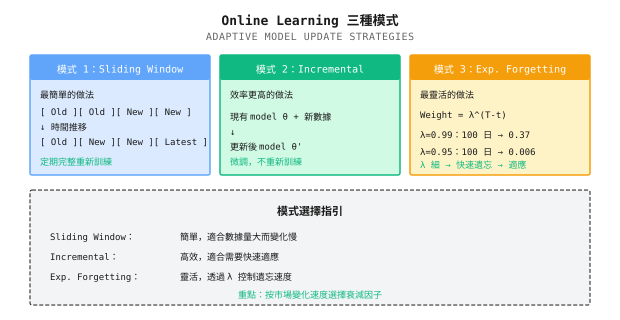
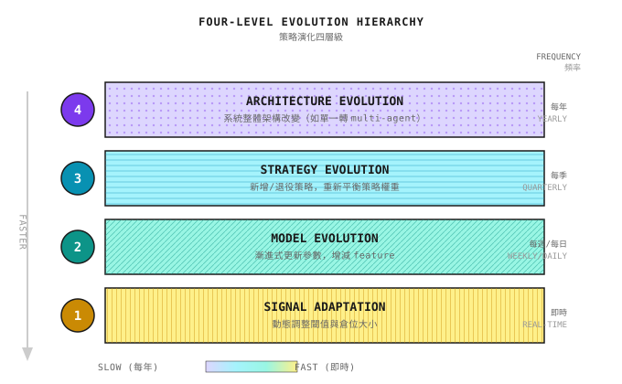
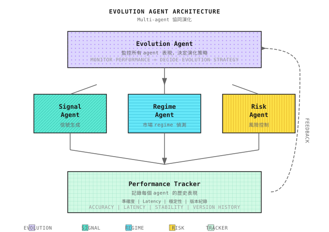
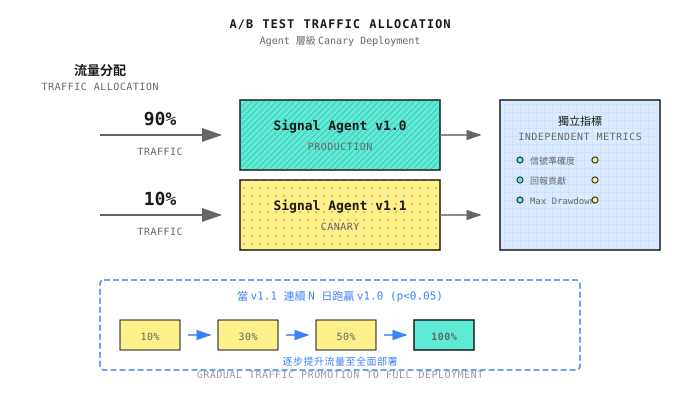

# 第 17 課：Online Learning 與策略進化

> **目標**：理解為何靜態 model 必然衰退，並掌握策略持續進化的核心機制。

---

## 典型場景（示例）

> 註：以下為虛構示例，用以說明常見現象；數字僅供說明，並不對應任何特定個人／賬戶。

2018 年，一位量化交易員為 A 股開發了一個基於 Random Forest 的選股 model。Backtest 顯示年化回報 35%、Sharpe 1.8，各項指標都非常出色。

頭 6 個月，model 表現穩定，與 backtest 吻合。其後，表現開始慢慢下滑。不是突然失效，而像溫水煮蛙：每個月賺少一點，drawdown 多一點。

12 個月後，年化回報由 35% 跌至 8%，僅僅跑贏指數。

他檢查代碼，沒有 bug；檢查數據，沒有錯誤。Model 完全按設計運行，只是**不再賺錢**。

**到底哪裏出錯？** 市場變了，但 model 沒有變。2018 年初，散戶主導市場，momentum factor 有效。到 2018 年底，機構資金入場，momentum factor 被套利掉。Model 學到的規律只屬於那個特定時期，並非永恆真理。

這就是 **concept drift**：model 所學習的數據分佈，與它正在交易的數據分佈不再一致。Model 沒有錯，是世界變了。

---

## 17.1 為何靜態 Model 必然衰退

### 市場的非平穩性

金融市場有一個根本特性：**non-stationarity**（非平穩性）。這意味着：

1. **統計特性會變**：Mean、variance、correlation 都不是常數
2. **規律會失效**：有效的 alpha 會被發現、被套利、然後消失
3. **參與者會適應**：你的 strategy 賺錢 -> 其他人跟風 -> Alpha decay

| 衰退類型 | 表現 | 原因 | 典型週期 |
|----------|------|------|----------|
| **突發型** | 某一天突然失效 | 政策轉變、黑天鵝事件 | 無法預測 |
| **漸進型** | 回報慢慢下滑 | Alpha 被套利、市場結構改變 | 6-18 個月 |
| **週期型** | 時好時壞 | 市場狀態切換（牛熊轉換） | 與經濟週期相關 |

### 紙面練習：計算 Alpha Decay

**場景**：你的 factor IC = 0.05，假設市場效率提升令 IC 每月衰減 5%。

**計算**：
```
Month    IC        Expected Annual (IC x sqrt(252) x sigma, assuming sigma=20%)
0      0.050      15.8%
6      0.050 x 0.95^6 = 0.037      11.7%
12     0.050 x 0.95^12 = 0.027      8.5%
18     0.050 x 0.95^18 = 0.020      6.3%
24     0.050 x 0.95^24 = 0.015      4.7%
```

**結論**：即使每月只衰減 5%，兩年後你的 strategy 回報只剩原來的 30%。

**自我檢查**：計算你目前 strategy 的 IC，假設每月衰減 3%、5%、10%，需要多久才會跌至不可接受的水平？

### 為何「定期 Retraining」並不足夠

許多人的解決方法是「每月 retrain 一次 model」。這比靜態 model 好，但有三個問題：

| 問題 | 說明 | 後果 |
|------|------|------|
| **資訊滯後** | 每月 retrain 一次，最多滯後 30 日 | 對市場變化的反應遲了一個月 |
| **樣本不足** | 新數據只有 20 個交易日 | 訓練樣本太少，overfitting 風險高 |
| **Catastrophic forgetting** | 完全重新訓練會「忘記」歷史規律 | 無法應對類似的歷史情境 |

**正確做法**：不是「重新學習」，而是「持續適應」，在保留歷史知識的同時，逐步調整以適應新環境。

---

## 17.2 Online Learning 的核心機制

### Batch Learning vs Online Learning

| 維度 | Batch Learning | Online Learning |
|------|----------------|-----------------|
| **數據處理** | 收集所有數據，一次訓練 | 每有新數據就更新 |
| **更新頻率** | 定期（例如每月） | 持續（例如每日、每宗交易） |
| **運算資源** | 集中消耗 | 分散消耗 |
| **適應速度** | 慢（最多滯後一個週期） | 快（實時適應） |
| **Overfitting 風險** | 較低（數據較多） | 較高（需要 regularization） |

### Online Learning 的三種模式



### 紙面練習：選擇 Forgetting Factor

**場景**：你的 strategy 在兩種市場環境下測試。

| 環境 | 平均持續時間 | 建議 lambda | 有效回望期（權重 >10%） |
|------|--------------|-------------|--------------------------|
| 快速切換 | 20 日 | 0.90 | ~22 日 |
| 中速切換 | 60 日 | 0.95 | ~44 日 |
| 慢速切換 | 180 日 | 0.99 | ~230 日 |

**公式**：有效回望日數 ~ ln(0.1) / ln(lambda)

**自我檢查**：根據你 strategy 所處的市場環境，選擇合適的 lambda 值。選錯會怎樣？
- Lambda 太大（遺忘太慢）：適應太遲，在新環境中虧損
- Lambda 太小（遺忘太快）：Overfit 近期噪音，穩定性差

<details>
<summary>代碼實現（供工程師參考）</summary>

```python
class ExponentialMovingModel:
    """Online learning model with exponential forgetting"""

    def __init__(self, decay_factor: float = 0.95):
        self.lambda_ = decay_factor
        self.weights = None
        self.cumulative_weight = 0

    def update(self, X: np.ndarray, y: float, learning_rate: float = 0.01):
        """Incremental update"""
        if self.weights is None:
            self.weights = np.zeros(X.shape[0])

        # Predict
        pred = np.dot(self.weights, X)
        error = y - pred

        # Update weights (gradient descent with forgetting)
        self.weights = self.lambda_ * self.weights + learning_rate * error * X
        self.cumulative_weight = self.lambda_ * self.cumulative_weight + 1

        return pred, error

    def get_effective_lookback(self, threshold: float = 0.1) -> int:
        """Calculate effective lookback days"""
        return int(np.log(threshold) / np.log(self.lambda_))
```

</details>

---

## 17.3 策略進化的四個層次

Online learning 只是策略進化的一部分。完整的進化系統有四個層次：



### Level 1：Signal Adaptation（最快）

Signal adaptation 是最快的進化層次，不需要 retrain model。

**示例：動態閾值調整**

```
Static threshold: Buy if signal > 0.5

Dynamic threshold:
- Calculate past N days signal distribution
- Threshold = Signal mean + k x Signal std
- High market volatility, threshold auto-increases, reduce trades
- Low market volatility, threshold auto-decreases, increase trades
```

**紙面練習**：

| 場景 | Signal Mean | Signal Std | k=1.5 閾值 | 解讀 |
|------|-------------|------------|------------|------|
| 正常市場 | 0.3 | 0.15 | 0.525 | 適中 |
| 高 volatility | 0.35 | 0.25 | 0.725 | 更嚴格，減少交易 |
| 低 volatility | 0.28 | 0.08 | 0.40 | 更寬鬆，增加交易 |

### Level 2：Model Evolution（中速）

Model evolution 涉及參數更新與 feature engineering。

**關鍵機制：Feature Importance Monitoring**

```
+-------------------------------------------------+
|           Feature Importance Change Monitoring   |
+----------------+-----------+-----------+---------+
| Feature        | 6 months ago | Now     | Trend  |
+----------------+-----------+-----------+---------+
| Momentum_20D   | 0.25      | 0.08      | Decaying |
| Volatility_30D | 0.15      | 0.22      | Strengthening |
| Volume_Ratio   | 0.18      | 0.05      | Failed |
| Earnings_Surprise | 0.12   | 0.18      | Effective |
+----------------+-----------+-----------+---------+

-> Decision: Lower momentum weight, remove volume ratio, increase volatility weight
```

**進化觸發條件**：

| 觸發訊號 | 閾值 | 行動 |
|----------|------|------|
| Feature importance 下跌 > 50% | 連續 3 個月 | 降低權重或移除 |
| 新 feature 的 IC 顯著 | p-value < 0.05 | 列為候選納入 |
| 整體 model IC 下跌 > 30% | 連續 2 個月 | 觸發 model retraining |

### Level 3：Strategy Evolution（較慢）

Strategy evolution 涉及重新配置 strategy portfolio。

**Strategy 生命週期管理**：

```
                    Incubation      Validation      Maturity        Decay
Return/Risk    ................ ............ ............... .........
               Paper trading    Small live      Main strategy    Phase out
               3-6 months       3-6 months      Indefinite       Indefinite

Entry criteria:     Backtest pass    Sharpe>1.0      Sharpe>1.5       Sharpe<0.8
                   Quality Gate   Live DD<15%   6 months positive  3 months losing

Capital allocation:  0%           5-10%           20-40%          Phase to zero
```

**Strategy portfolio 的動態權重**：

| 權重方法 | 原理 | 優點 | 缺點 |
|----------|------|------|------|
| **Equal weight** | 每個 strategy 1/N | 簡單、分散 | 不區分質素 |
| **Inverse volatility** | 權重與 1/sigma 成正比 | 風險平衡 | 忽略回報差異 |
| **Sharpe proportional** | 權重與 Sharpe 成正比 | 獎勵好的 strategy | 歷史不代表未來 |
| **Kelly weight** | 權重 = mu/sigma^2 | 理論上最優 | 對估計誤差敏感 |
| **Sliding window** | 基於最近 N 日表現 | 自適應 | 可能追逐表現 |

**紙面練習：Strategy 權重配置**

| Strategy | 近 3 個月回報 | 近 3 個月 Volatility | Sharpe | Inverse Vol 權重 | Sharpe 比例權重 |
|----------|---------------|----------------------|--------|-------------------|------------------|
| A | 8% | 5% | 1.6 | 0.40 (1/5 / total) | 0.44 (1.6/3.6) |
| B | 6% | 8% | 0.75 | 0.25 (1/8 / total) | 0.21 (0.75/3.6) |
| C | 10% | 8% | 1.25 | 0.25 | 0.35 (1.25/3.6) |

**計算過程**：
- Inverse volatility：1/5 = 0.20，1/8 = 0.125，1/8 = 0.125，total = 0.45
  - A：0.20/0.45 = 0.44，B：0.125/0.45 = 0.28，C：0.28
- Sharpe proportional：total = 1.6 + 0.75 + 1.25 = 3.6
  - A：1.6/3.6 = 0.44，B：0.75/3.6 = 0.21，C：1.25/3.6 = 0.35

### Level 4：Architecture Evolution（最慢）

Architecture evolution 是最根本的改變，通常需要人手介入。

**典型的 architecture 進化路徑**：

```
Stage 1: Single Strategy
+-- One simple trend following strategy

Stage 2: Strategy Portfolio
+-- Trend + Mean Reversion + Momentum, fixed weights

Stage 3: Dynamic Portfolio
+-- Dynamically adjust strategy weights based on market state

Stage 4: Multi-Agent
+-- Expert Agents + Meta Agent + Risk Agent

Stage 5: Self-Evolving System
+-- System that can automatically discover, test, and deploy new strategies
```

**Architecture evolution 的觸發條件**：

| 訊號 | 說明 | 建議行動 |
|------|------|----------|
| 所有 strategy 同時失效 | 不是單一 strategy 的問題，而是 architecture 的問題 | 檢查 regime detection 是否失效 |
| Correlation 結構改變 | 原本不相關的 strategy 變得高度相關 | 重新設計 strategy 分工 |
| 系統性 drawdown > 30% | 風險控制未能阻止大幅 drawdown | 強化 Risk Agent 的否決權 |
| 出現新的市場狀態 | 例如加密貨幣、新的監管環境 | 增加新的 expert Agent |

---

## 17.4 實現 Online Learning 的關鍵技術

### 1. Concept Drift Detection

在更新 model 之前，先確認 drift 是否真的發生。

**常見偵測方法**：

| 方法 | 原理 | 適用場景 |
|------|------|----------|
| **DDM (Drift Detection Method)** | 監控錯誤率，顯著上升時發出警報 | 分類問題 |
| **ADWIN** | 自適應窗口，偵測分佈變化 | Streaming 數據 |
| **Page-Hinkley** | 累積偏差偵測 | Mean drift |
| **Feature distribution monitoring** | 比較 feature 的 KL divergence | Feature drift |

**紙面練習：簡單 Drift Detection**

```
Monitor metric: Model prediction sliding accuracy

Time    Accuracy    5-Day Mean    Alert? (Mean<50%)
D1      55%       55%           No
D2      52%       53.5%         No
D3      48%       51.7%         No
D4      45%       50.0%         No
D5      42%       48.4%         Yes <- Trigger drift detection
D6      40%       45.4%         Yes
```

偵測到 drift 時才觸發 model 更新，而不是盲目地定期更新。

### 2. 防止 Catastrophic Forgetting

Online learning 的其中一個風險是「catastrophic forgetting」：學習新知識時遺忘舊知識。

**解決方案**：

| 方法 | 原理 | 適用場景 |
|------|------|----------|
| **Elastic Weight Consolidation (EWC)** | 保護重要參數，減少遺忘 | Deep learning model |
| **Memory Replay** | 儲存具代表性的樣本，混入訓練 | 所有 model |
| **Progressive Networks** | 新任務用新模組，不改動舊模組 | Multi-task learning |
| **Knowledge Distillation** | 用舊 model 教新 model | Model 替換 |

**實務建議**：
1. 保留 10-20% 具代表性的歷史樣本
2. 每次更新時，混合新數據與歷史樣本
3. 監控 model 在歷史測試集上的表現，確保沒有遺忘

### 3. 更新時機與頻率

**更新太頻密**：
- Overfit 近期噪音
- 浪費運算資源
- Model 不穩定

**更新太疏**：
- 適應滯後
- 錯過市場變化
- 誤差累積

**建議策略**：

| 市場類型 | 更新觸發 | 最短間隔 | 最長間隔 |
|----------|----------|----------|----------|
| HFT | 每 N 宗交易 | 1 小時 | 1 日 |
| Intraday | 收市後 | 1 日 | 1 週 |
| 中頻 | Drift detection 觸發 | 1 週 | 1 個月 |
| 低頻 | 季度檢討 | 1 個月 | 1 季 |

<details>
<summary>代碼實現（供工程師參考）</summary>

```python
class AdaptiveUpdateScheduler:
    """Adaptive update scheduler"""

    def __init__(self, min_interval: int = 5, max_interval: int = 20):
        self.min_interval = min_interval  # Minimum update interval (days)
        self.max_interval = max_interval  # Maximum update interval (days)
        self.last_update = 0
        self.drift_detector = DDM()  # Drift detector

    def should_update(self, day: int, recent_errors: list) -> tuple[bool, str]:
        """Decide whether model should be updated"""
        days_since_update = day - self.last_update

        # Check drift
        drift_detected = self.drift_detector.detect(recent_errors)

        # Decision logic
        if days_since_update >= self.max_interval:
            return True, "Reached max interval, force update"

        if drift_detected and days_since_update >= self.min_interval:
            return True, "Drift detected, trigger update"

        return False, "No update needed"

    def record_update(self, day: int):
        self.last_update = day
        self.drift_detector.reset()
```

</details>

---

## 17.5 Online Learning 的工程實現

### 1. Sliding Window Retraining 實現

```python
from datetime import datetime, timedelta
from typing import Optional, Tuple
import numpy as np
import pandas as pd
from sklearn.ensemble import RandomForestClassifier

class SlidingWindowRetrainer:
    """Sliding window model retrainer"""

    def __init__(self,
                 window_size_days: int = 252,
                 min_samples: int = 200,
                 retrain_interval_days: int = 20):
        """
        window_size_days: Training window size (days)
        min_samples: Minimum training samples
        retrain_interval_days: Retrain interval (days)
        """
        self.window_size = window_size_days
        self.min_samples = min_samples
        self.retrain_interval = retrain_interval_days

        self.model = None
        self.last_train_date = None
        self.training_history = []

    def should_retrain(self, current_date: datetime) -> Tuple[bool, str]:
        """Decide whether retraining is needed"""
        if self.model is None:
            return True, "Initial training"

        days_since_train = (current_date - self.last_train_date).days

        if days_since_train >= self.retrain_interval:
            return True, f"{days_since_train} days since last training"

        return False, "No retrain needed"

    def train(self, data: pd.DataFrame,
              feature_cols: list,
              target_col: str,
              current_date: datetime) -> dict:
        """
        Train model using sliding window

        data: Must contain 'date' column and feature columns
        """
        # Calculate window boundaries
        window_end = current_date
        window_start = current_date - timedelta(days=self.window_size)

        # Filter data within window
        mask = (data['date'] >= window_start) & (data['date'] < window_end)
        train_data = data[mask]

        if len(train_data) < self.min_samples:
            return {
                'success': False,
                'reason': f'Insufficient samples: {len(train_data)} < {self.min_samples}'
            }

        X = train_data[feature_cols].values
        y = train_data[target_col].values

        # Train model
        self.model = RandomForestClassifier(
            n_estimators=100,
            max_depth=5,
            min_samples_leaf=20,
            random_state=42
        )
        self.model.fit(X, y)

        # Record training
        self.last_train_date = current_date

        train_info = {
            'success': True,
            'date': current_date,
            'window': (window_start, window_end),
            'n_samples': len(train_data),
            'train_accuracy': self.model.score(X, y)
        }
        self.training_history.append(train_info)

        return train_info

    def predict(self, X: np.ndarray) -> np.ndarray:
        """Predict"""
        if self.model is None:
            raise ValueError("Model not yet trained")
        return self.model.predict_proba(X)[:, 1]
```

### 2. Drift Detection 指標實現

#### Population Stability Index (PSI)

PSI 是偵測 feature 分佈 drift 的標準指標。

```python
def calculate_psi(expected: np.ndarray,
                  actual: np.ndarray,
                  n_bins: int = 10) -> float:
    """
    Calculate Population Stability Index

    PSI < 0.1: No significant drift
    0.1 <= PSI < 0.25: Moderate drift, needs attention
    PSI >= 0.25: Significant drift, needs action
    """
    # Create bins
    breakpoints = np.percentile(expected,
                                np.linspace(0, 100, n_bins + 1))
    breakpoints[0] = -np.inf
    breakpoints[-1] = np.inf

    # Calculate bin proportions
    expected_counts = np.histogram(expected, bins=breakpoints)[0]
    actual_counts = np.histogram(actual, bins=breakpoints)[0]

    # Convert to proportions (avoid division by zero)
    expected_pct = (expected_counts + 1) / (len(expected) + n_bins)
    actual_pct = (actual_counts + 1) / (len(actual) + n_bins)

    # Calculate PSI
    psi = np.sum((actual_pct - expected_pct) *
                 np.log(actual_pct / expected_pct))

    return psi


class FeatureDriftMonitor:
    """Feature drift monitor"""

    def __init__(self, psi_threshold: float = 0.2):
        self.baseline_distributions = {}
        self.psi_threshold = psi_threshold
        self.drift_history = []

    def set_baseline(self, feature_name: str, values: np.ndarray):
        """Set baseline distribution"""
        self.baseline_distributions[feature_name] = values.copy()

    def check_drift(self, feature_name: str,
                    current_values: np.ndarray,
                    date: datetime) -> dict:
        """Check single feature drift"""
        if feature_name not in self.baseline_distributions:
            raise ValueError(f"Baseline not set: {feature_name}")

        baseline = self.baseline_distributions[feature_name]
        psi = calculate_psi(baseline, current_values)

        result = {
            'feature': feature_name,
            'date': date,
            'psi': psi,
            'drift_detected': psi >= self.psi_threshold,
            'severity': 'high' if psi >= 0.25 else
                       ('medium' if psi >= 0.1 else 'low')
        }

        self.drift_history.append(result)
        return result

    def check_all_features(self, current_data: pd.DataFrame,
                           date: datetime) -> dict:
        """Check all feature drift"""
        results = {}
        drifted_features = []

        for feature in self.baseline_distributions:
            if feature in current_data.columns:
                result = self.check_drift(
                    feature,
                    current_data[feature].values,
                    date
                )
                results[feature] = result
                if result['drift_detected']:
                    drifted_features.append(feature)

        return {
            'date': date,
            'features_checked': len(results),
            'features_drifted': len(drifted_features),
            'drifted_features': drifted_features,
            'details': results,
            'action_required': len(drifted_features) > 0
        }
```

### 3. Retrain vs Pause 決策框架

```python
class RetrainDecisionEngine:
    """Retrain decision engine"""

    def __init__(self,
                 psi_threshold: float = 0.2,
                 performance_drop_threshold: float = 0.3,
                 min_confidence_for_retrain: float = 0.6):
        self.psi_threshold = psi_threshold
        self.perf_threshold = performance_drop_threshold
        self.min_confidence = min_confidence_for_retrain

    def decide(self,
               drift_report: dict,
               performance_report: dict,
               data_quality_report: dict) -> dict:
        """
        Decide next action

        Returns: 'retrain', 'pause', 'continue', 'investigate'
        """
        # Collect signals
        drift_detected = drift_report.get('action_required', False)
        perf_drop = performance_report.get('ic_change', 0)
        data_quality_ok = data_quality_report.get('quality_score', 1) > 0.8
        sample_size_ok = data_quality_report.get('n_samples', 0) > 200

        # Decision matrix
        #
        #                    Performance Drop?
        #                    Yes        No
        #   Drift?   Yes    [Retrain]  [Observe]
        #            No     [Pause]    [Continue]
        #

        if drift_detected:
            if perf_drop > self.perf_threshold:
                # Drift + Performance drop: Need retrain
                if data_quality_ok and sample_size_ok:
                    return {
                        'action': 'retrain',
                        'confidence': 0.9,
                        'reason': 'Drift detected and performance dropped, data quality sufficient',
                        'urgency': 'high'
                    }
                else:
                    return {
                        'action': 'investigate',
                        'confidence': 0.5,
                        'reason': 'Need retrain but data quality insufficient, human intervention needed',
                        'urgency': 'high'
                    }
            else:
                # Drift but performance OK: Continue observing
                return {
                    'action': 'continue',
                    'confidence': 0.6,
                    'reason': 'Drift detected but performance not yet affected, continue monitoring',
                    'urgency': 'low',
                    'next_check_days': 3
                }
        else:
            if perf_drop > self.perf_threshold:
                # No drift but performance drop: May be overfitting or market change
                return {
                    'action': 'pause',
                    'confidence': 0.7,
                    'reason': 'Performance dropped but no obvious drift, recommend pause and investigate',
                    'urgency': 'medium'
                }
            else:
                # No drift and performance normal: Continue running
                return {
                    'action': 'continue',
                    'confidence': 0.95,
                    'reason': 'All normal',
                    'urgency': 'none'
                }
```

### 4. 紙面練習：何時 Retrain、何時 Pause

| 場景 | PSI | IC 變化 | 數據質素 | 決定 | 原因 |
|------|-----|---------|----------|------|------|
| A | 0.05 | -5% | 良好 | Continue | 沒有明顯 drift，表現正常 |
| B | 0.30 | -40% | 良好 | Retrain | Drift + 表現嚴重下滑 |
| C | 0.25 | -10% | 良好 | Observe | 有 drift，但表現仍然可以 |
| D | 0.08 | -35% | 良好 | Pause | 沒有 drift 但表現異常，需調查 |
| E | 0.35 | -50% | 差 | Investigate | 需要 retrain，但數據質素不足以支持 |

**關鍵原則**：

1. **Drift + 表現下滑 = Retrain**（市場變了，model 需要適應）
2. **沒有 drift + 表現下滑 = Pause**（可能是其他問題，不要盲目 retrain）
3. **Drift + 表現正常 = Observe**（可能只是暫時波動）
4. **數據質素差 = 先修復數據**（否則 retrain 也是徒勞）

---

## 17.6 Multi-Agent 視角下的進化

在 multi-agent architecture 中，進化不單是更新個別 model，更涉及 Agent 之間的協調。

### 進化 Architecture



### Evolution Agent 的職責

| 職責 | 具體內容 | 觸發條件 |
|------|----------|----------|
| **Performance monitoring** | 追蹤每個 Agent 的準確度、latency、穩定性 | 持續 |
| **Drift detection** | 偵測每個 Agent 輸出分佈的變化 | 異常偵測觸發 |
| **更新排程** | 決定哪個 Agent 需要更新及更新次序 | 定期 + 事件驅動 |
| **版本管理** | 維護每個 Agent 的版本歷史，支援 rollback | 更新後 |
| **A/B testing** | 全面部署前先以小流量驗證新版本 | 重大更新 |

### Agent 層面的 A/B Testing



### 協調更新的挑戰

| 挑戰 | 說明 | 解決方案 |
|------|------|----------|
| **更新次序** | Regime Agent 的更新可能影響 Signal Agent 的輸入 | 先更新上游 Agent，下游先觀察再更新 |
| **Rollback 決策** | 新版本表現欠佳時如何決定 rollback | 預設 rollback 閾值，例如 drawdown > 10% |
| **版本兼容性** | 不同 Agent 版本之間的介面是否兼容 | 版本化 API，向後兼容 |
| **全局一致性** | 避免局部更新導致系統狀態不一致 | Canary deployment，逐步過渡 |

---

## 驗收標準

完成本課後，用以下標準檢驗學習成果：

| 檢查點 | 標準 | 自測方法 |
|--------|------|----------|
| 理解 concept drift | 能解釋靜態 model 為何衰退 | 用自己的說話向非技術人士解釋 |
| 計算 alpha decay | 能根據衰減率計算回報預期 | 完成紙面練習：每月衰減 3%，兩年後 IC 的變化 |
| 選擇 forgetting factor | 能根據市場環境選擇合適的 lambda | 解釋為何 HFT 需要較小的 lambda |
| 設計更新策略 | 能為你的 strategy 設計更新時機 | 畫出你 strategy 的更新觸發條件流程圖 |
| 理解進化層次 | 能區分進化的四個層次 | 為每個層次舉出實際應用例子 |

### 綜合練習

**場景**：你有一個 A 股選股 strategy，過往表現如下：

| 時期 | 月回報 | 月 Volatility | IC |
|------|--------|---------------|-----|
| 2022 H1 | 2.5% | 4% | 0.05 |
| 2022 H2 | 1.8% | 5% | 0.04 |
| 2023 H1 | 0.8% | 6% | 0.025 |
| 2023 H2 | -0.2% | 7% | 0.01 |

**問題**：
1. 這屬於哪種衰退類型？（突發／漸進／週期）
2. 計算 IC 的月衰減率
3. 應該在何時觸發 model 更新？
4. 你建議採用甚麼更新策略？

<details>
<summary>參考答案</summary>

1. **漸進型衰退**：回報與 IC 都逐步下降，沒有突然斷崖式下跌

2. **月衰減率計算**：
   - 2022 H1 至 2023 H2 = 24 個月
   - IC 由 0.05 跌至 0.01
   - 0.05 x (1-r)^24 = 0.01
   - (1-r)^24 = 0.2
   - 1-r = 0.934
   - r ~ 6.6%/月

3. **觸發時機**：
   - 應在 IC < 0.03（有效性閾值）時觸發，約在 2023 H1
   - 實際上應在 2022 H2 就開始關注（IC 下跌了 20%）

4. **建議的更新策略**：
   - Level 1：動態調整閾值，降低交易頻率
   - Level 2：檢查 feature importance 的變化，可能需要新 feature
   - Level 3：考慮引入新 strategy 以分散風險
   - Forgetting factor lambda ~ 0.95，每月 incremental 更新

</details>

---

## 本課成果

完成本課後，你將擁有：

1. **Concept drift 的量化理解**：能計算 alpha decay，估算 strategy 壽命
2. **Online learning 實現框架**：三種模式（sliding window、incremental update、exponential forgetting）及其適用場景
3. **四層進化體系**：由 signal adaptation 到 architecture evolution 的完整路徑
4. **Multi-agent 進化機制**：Evolution Agent 的設計思路

---

## 本課總結

- [x] 理解靜態 model 衰退的必然性：Concept drift 是市場的內在特性
- [x] 掌握 online learning 的三種模式及其適用場景
- [x] 理解策略進化的四個層次及其觸發條件
- [x] 理解 multi-agent architecture 中協調更新的挑戰

---

## 延伸閱讀

- [第 11 課：為什麼需要多智能體](第11課：為什麼需要多智能體.md)：理解 multi-agent 協作的基礎
- [第 14 課：LLM 在量化中的應用](第14課：LLM在量化中的應用.md)：LLM 作為進化系統的一部分
- [背景知識：Sharpe ratio 的統計陷阱](../Part2-量化基礎/背景知識/夏普比率的統計陷阱.md)：Model 評估中的統計陷阱
- [第 21 課：項目實戰](../Part5-生產與實戰/第21課：項目實戰.md)：把本課的理論付諸實踐

---

## 下一課預告

**第 18 課：交易成本建模與可交易性**

理論到此為止。下一課我們進入生產與實戰階段：先學習如何為交易成本建模，並評估由紙面回報轉化為真實回報的比率。畢竟，一個 Gross Alpha 很高但 Net Alpha 為負的 strategy，永遠只會停留在 backtest 之中。
