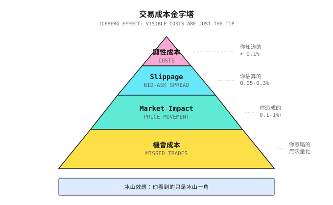
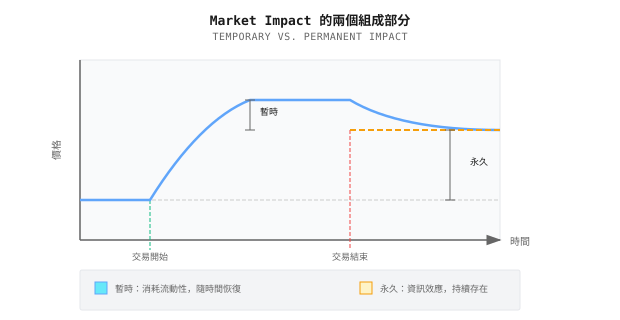
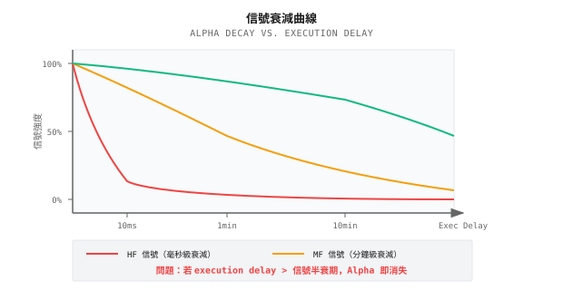
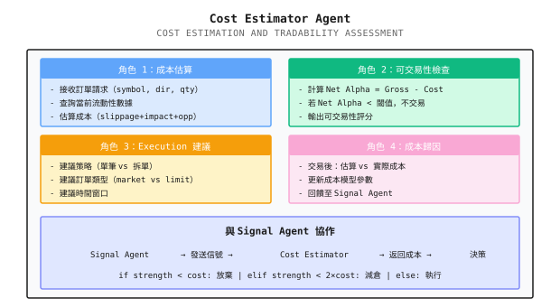

# 第 18 課：交易成本建模與可交易性

> **Alpha 存在 = (Gross Alpha - Cost) > 0**

---

## 一個典型場景（示意）

> 註：以下為合成例子，用以說明常見現象；數字僅供示意，並不對應任何特定團隊／賬戶。

2019 年，一個量化團隊向我展示他們的 machine learning 策略：

```
Backtest Results (2015-2019):
- Annual Return: 45%
- Sharpe Ratio: 2.3
- Maximum Drawdown: 8%
- Monthly Win Rate: 78%
```

「這是我們見過最好的策略！」他們興奮地說。

我只問了一個問題：「你們每日的 turnover 是多少？」

答案：**300%**。

即是說，每日買賣的股票相當於本金的 3 倍。

我請他們重新計算，加入以下真實世界的成本：
- 交易佣金：0.03%（來回）
- Market impact：0.1%（保守估計）
- Slippage：0.05%

```
Cost Calculation:
- Daily cost = 300% x (0.03% + 0.1% + 0.05%) = 0.54%
- Annual cost = 0.54% x 252 = 136%

Adjusted Backtest:
- Gross return: 45%
- Cost: -136%
- Net return: -91%
```

他們的「印鈔機」變成了「碎鈔機」。

**這就是交易成本建模如此重要的原因**，它決定你的 Alpha 是真實還是幻象。

---

## 18.1 成本的真實構成

### 18.1.1 顯性成本 vs. 隱性成本



### 18.1.2 顯性成本詳解

| 成本類型 | 美股 | A 股 | 加密貨幣 |
|-----------|-----------|----------------|----------------|
| **佣金** | 0-0.005% | 0.03% | 0.02-0.1% |
| **印花稅** | 無 | 0.1%（賣方） | 無 |
| **交易所費用** | 0.001% | 包含在佣金內 | 包含在佣金內 |
| **SEC 費用** | 0.00008% | 無 | 無 |
| **過戶費** | 無 | 0.001% | 無 |

**美股顯性成本例子**：
```
Buying $100,000 of AAPL:
- Commission: $0-5 (depends on broker)
- Exchange fees: ~$1
- Total: ~$5 = 0.005%

Same for selling, round trip about 0.01%
```

### 18.1.3 隱性成本：看不見的殺手

#### Slippage

**定義**：你預期的成交價與實際成交價之間的差距

```
Expected to buy AAPL at $100.00
Actual execution price $100.05
Slippage = $0.05 = 0.05%
```

**Slippage 的來源**：

| 來源 | 說明 | 影響因素 |
|--------|-------------|---------------------|
| **Bid-Ask Spread** | 買賣價之間的差距 | 流動性、volatility |
| **價格移動** | 由落盤到成交之間的時間延遲 | 市場 volatility、network latency |
| **Partial Fill** | 訂單被拆成多次成交 | 訂單規模、order book 深度 |

#### Market Impact

**定義**：你的交易本身把價格推向不利的方向

```
Scenario: You want to buy 10,000 shares of AAPL

Order Book:
  Ask 1: $100.00 x 2,000 shares
  Ask 2: $100.02 x 3,000 shares
  Ask 3: $100.05 x 5,000 shares

If you use a market order to buy all at once:
  First 2,000 shares: $100.00
  Next 3,000 shares: $100.02
  Last 5,000 shares: $100.05

Weighted average price: $100.029
Ideal price: $100.00
Market impact: 0.029%

Moreover: You've consumed Ask 2 and Ask 3
         The next buyer can only buy at higher prices
         This is "permanent impact"
```

#### Opportunity Cost

**定義**：因無法成交或延遲成交而錯失的潛在回報

```
Scenario:
  Price when signal fired: $100
  Your limit order: $99.50
  Price immediately rises to $105
  Your order never fills

Opportunity cost = $105 - $100 = 5%
```

---

## 18.2 Slippage 建模

### 18.2.1 Linear Model

最簡單的模型假設 slippage 與訂單規模成正比：

```
Slippage = k x OrderSize / ADV

Where:
- k = empirical coefficient (typically 0.1-0.5)
- OrderSize = order amount
- ADV = Average Daily Volume
```

**紙上練習**：

你想買入 $500,000 的股票，假設 k = 0.3

| 股票 | ADV | 訂單佔比 | 預期 Slippage |
|-------|-----|-------------|-------------------|
| AAPL | $10B | 0.005% | 0.3 x 0.005% = 0.0015% |
| TSLA | $3B | 0.017% | 0.3 x 0.017% = 0.005% |
| 小型股 X | $10M | 5% | 0.3 x 5% = **1.5%** |

**發現**：在小型股上，一張 $500K 的訂單可以產生 $7,500 的 slippage！

### 18.2.2 Square-Root Model

更精確的模型會考慮非線性關係：

```
Slippage = k x sigma x sqrt(OrderSize / ADV)

Where:
- sigma = daily volatility
- k = empirical coefficient (typically 0.5-1.5)
```

**紙上練習**：

| 股票 | Volatility sigma | ADV | 訂單 | Slippage（k=1） |
|-------|------------------|-----|-------|----------------|
| AAPL | 1.5% | $10B | $1M | 1.5% x sqrt(1M/10B) = 0.015% |
| AAPL | 1.5% | $10B | $100M | 1.5% x sqrt(100M/10B) = 0.15% |
| 小型股 | 3% | $10M | $1M | 3% x sqrt(1M/10M) = 0.95% |

**主要發現**：
- Slippage 隨訂單規模以次線性方式增長（平方根關係）
- 高 volatility 的股票 slippage 較大
- 小型股的 slippage 可以是大型股的 60 倍

### 18.2.3 用 Tick Data 估算 Slippage

有 Level-2 數據的話，可以估算得更精確：

```
Method: Simulate order walking through the order book

1. Obtain historical order book snapshots
2. Simulate market order consuming each level
3. Calculate weighted average price vs. mid-price
4. Gather slippage distribution for different order sizes
```

<details>
<summary>代碼框架（工程師參考）</summary>

```python
def estimate_slippage(order_size: float,
                     order_book: dict,
                     side: str = 'buy') -> float:
    """
    Estimate slippage based on order book data

    order_book = {
        'bids': [(price1, size1), (price2, size2), ...],
        'asks': [(price1, size1), (price2, size2), ...]
    }
    """
    if side == 'buy':
        levels = order_book['asks']  # Buying consumes asks
    else:
        levels = order_book['bids']  # Selling consumes bids

    mid_price = (order_book['bids'][0][0] + order_book['asks'][0][0]) / 2
    filled = 0
    cost = 0

    for price, size in levels:
        if filled >= order_size:
            break
        fill_amount = min(size, order_size - filled)
        cost += fill_amount * price
        filled += fill_amount

    if filled < order_size:
        # Order book depth insufficient for full execution
        return float('inf')

    avg_price = cost / order_size
    slippage = (avg_price - mid_price) / mid_price

    return slippage if side == 'buy' else -slippage
```

</details>

---

## 18.3 Market Impact 建模

### 18.3.1 Temporary Impact vs. Permanent Impact



### 18.3.2 Almgren-Chriss Model

這是最著名的 market impact 模型：

```
Total Cost = Temporary Impact + Permanent Impact + Volatility Risk

Where:
  Temporary impact is proportional to trading speed (volume per unit time)
  Permanent impact is proportional to total trading volume
  Volatility risk is proportional to execution time x volatility

Trade-off:
  Trade fast -> High temporary impact, but low volatility risk
  Trade slow -> Low temporary impact, but high volatility risk
```

**直觀解釋**：

> 想像將一桶水倒進池塘。
> 倒得快（一次過倒晒）-> 水花大（temporary impact），但水面很快回復平靜
> 倒得慢（一滴一滴）-> 水花細，但期間可能會颳風落雨（volatility risk）

### 18.3.3 紙上練習：Execution 策略選擇

你想買入 $10M 的 AAPL（ADV = $10B），volatility = 1.5%／日

| Execution 策略 | Execution 時間 | Temporary Impact | Volatility Risk | 總成本 |
|-------------------|----------------|------------------|-----------------|------------|
| 單一市價盤 | 即時 | 高 | 無 | 高 |
| 10 張訂單（1 日） | 1 日 | 低 | 1.5% | 中 |
| 50 張訂單（5 日） | 5 日 | 極低 | 3.4% | 可能更高 |

**最優方案**：按緊急程度與風險偏好作平衡

---

## 18.4 Tradability 評估

### 18.4.1 Fill Probability 建模

**Limit Order 的問題**：你的訂單未必會成交

```
Fill probability P(fill) depends on:
1. Distance of limit price from current price
2. Queue depth at the price level
3. Price volatility range
4. Waiting time

Estimation formula (simplified):
P(fill) ~ 1 - exp(-lambda x time)

Where lambda relates to price distance and volatility
```

**紙上練習**：

你在一隻 $100 的股票上掛 $99 的限價買盤（低於市價 1%）

| 情景 | 每日 Volatility | 預期 Fill Probability |
|----------|------------------|---------------------------|
| 低 volatility | 0.5% | ~20%（難以跌到 -1%） |
| 中 volatility | 1.5% | ~60%（經常觸及） |
| 高 volatility | 3% | ~85%（幾乎肯定觸及） |

**問題**：高 fill probability 代表價格經常下跌，可能不是一個好信號

### 18.4.2 流動性成本指標

| 指標 | 公式 | 含義 |
|--------|---------|---------|
| **訂單佔比** | Order / ADV | 越低越好 |
| **流動性消耗** | Order / Order Book Depth | 越低越好 |
| **等待成本** | Signal Decay x Wait Time | 越低越好 |
| **總成本** | Slippage + Impact + Opportunity Cost | 總成本 |

### 18.4.3 Alpha 提純：由 Gross 到 Net

```
Gross Alpha: Predicted return (from backtest)

Minus:
  - Explicit costs (commission, taxes)
  - Slippage (Bid-Ask + latency)
  - Market impact
  - Opportunity cost

Equals:
  Net Alpha: Actually achievable return

Key Formula:
  Strategy viable <=> Net Alpha > 0
  Strategy viable <=> Gross Alpha > Total Cost
```

**紙上練習**：

| 策略 | Gross Alpha | Turnover | 每筆交易成本 | 年度成本 | Net Alpha |
|----------|-------------|----------|----------------|-------------|-----------|
| A | 15% | 50% | 0.2% | 2% | 13% |
| B | 20% | 200% | 0.2% | 8% | 12% |
| C | 30% | 500% | 0.2% | 20% | 10% |
| D | 40% | 1000% | 0.2% | 40% | 0% |
| E | 50% | 2000% | 0.2% | 80% | -30% |

**發現**：
- 策略 E 的 gross Alpha 最高，但 net return 最低
- 策略 A 的 gross Alpha 最低，但 net return 最高
- **高 turnover 是 Alpha 殺手**

---

## 18.5 策略擁擠：當所有人都交易同一個信號

成本建模關注的是你自己的訂單。但還有一項系統性成本，是任何單一模型都估算不到的：**當數以百計的基金持有相同倉位，並同時嘗試離場時，會發生甚麼事。**

> **案例研究：2024 年中國小盤量化危機**
>
> 2024 年初，中國多家頂尖量化基金在數星期內同時出現 8-13% 的 drawdown。Ubiquant、Lingjun、High-Flyer 等管理數百億資金的機構，CSI 500 增強產品全部錄得雙位數虧損。原因不是單一一筆錯誤交易，而是**策略同質化**：大部分基金都用類似的 momentum 與 size factor 重倉小盤及微盤股。當監管收緊限制微盤股交易時，被迫平倉觸發了正反饋循環：拋售壓縮流動性，令更多拋售不得不發生。以正常市況校準的 backtest slippage 模型，嚴重低估了 impact。
>
> 教訓：你的成本模型必須考慮**擁擠風險**。如果你的策略使用廣泛公開的 factor，並集中在容量受限的股票上，你的真實成本就包括了相關性平倉的 tail risk。

有關策略同質化動態、capacity 估算方法及應對措施的更深入分析，請參閱 [背景知識：策略同質化與容量瓶頸](背景知識/策略同質化與容量瓶頸.md)。

---

## 18.6 為何許多 ML Alpha 無法交易

### 18.6.1 Signal Decay 速度 vs. Execution 延遲



### 18.6.2 高頻 Alpha 的容量限制

| Alpha 類型 | 典型 Decay | Capacity | 可行性 |
|------------|---------------|----------|-----------|
| Market Making | 毫秒 | $1-10M | 需要 HFT 基礎設施 |
| Statistical Arbitrage | 秒至分鐘 | $10-100M | 需要低 latency |
| 技術 Momentum | 分鐘至小時 | $100M-1B | 散戶可能可行 |
| 基本面 Factor | 日至週 | $1B+ | 容量充裕 |

**關鍵洞察**：

> ML 模型很容易發現短期 Alpha（因為 signal-to-noise ratio 高）
> 但這些 Alpha 往往 decay 得太快，散戶根本來不及 execution

### 18.6.3 案例研究：高勝率策略的實盤崩潰

**Backtest 結果**：
- 每日勝率 65%
- 每日平均回報 0.3%
- Sharpe 3.0

**策略特徵**：
- Signal decay 半衰期：2 分鐘
- 平均 execution 延遲：5 分鐘

**問題**：

```
When signal fires: Expected return +0.5%
After 2 minutes: Expected return +0.25% (50% decay)
After 5 minutes (actual execution): Expected return +0.06%

Minus 0.1% cost: Net return -0.04%

65% win rate x (-0.04%) = Continuous losses
```

---

## 18.7 Multi-Agent 視角

### 18.7.1 Cost Estimator Agent



### 18.7.2 成本感知的策略設計

| 設計原則 | 實現方式 |
|------------------|----------------|
| **降低 turnover** | 延長持倉期，提高 signal 門檻 |
| **選擇高流動性資產** | 過濾 ADV 低於門檻的股票 |
| **避開高 volatility 時段** | 開市／收市／事件前後不交易 |
| **使用智能訂單** | TWAP、VWAP、algorithmic trading |
| **Capacity 管理** | 策略 capacity = f(流動性, impact) |

---

## 驗收標準

完成本課後，可用以下標準驗證學習成果：

| 標準 | 要求 | 自我測試方法 |
|-----------|----------|------------------|
| 理解成本構成 | 能列出顯性與隱性成本 | 繪畫成本金字塔 |
| 估算 slippage | 能用 square-root model 計算 slippage | 完成紙上練習 |
| 理解 market impact | 能解釋 temporary 與 permanent impact | 舉例說明 |
| 評估 tradability | 能計算 Net Alpha | 評估一個策略 |
| 理解 ML Alpha 陷阱 | 能解釋 signal decay 問題 | 分析一個高頻策略 |

---

## 本課成果

完成本課後，你將擁有：

1. **成本分類框架** - 顯性、隱性、opportunity cost
2. **Slippage 估算模型** - Linear 與 square-root 模型
3. **Tradability 評估方法** - 由 Gross Alpha 到 Net Alpha
4. **Cost Estimator Agent 設計** - 成本估算與決策協作

---

## 重點總結

- [x] 交易成本 = 顯性成本 + Slippage + Market impact + Opportunity cost
- [x] Slippage 與訂單規模／ADV 呈平方根關係
- [x] 策略可行 = Net Alpha > 0 = Gross Alpha > 總成本
- [x] 高 turnover 是 Alpha 殺手
- [x] ML Alpha 容易發現短期信號，但 execution 延遲可能令它們無法捕捉

---

## 延伸閱讀

- [第 19 課：Execution 系統 - 從信號到真實成交](第19課：執行系統 - 從信號到真實成交.md) - Execution 的更多細節
- [背景知識：高頻交易與市場微結構](../Part2-量化基礎/背景知識/高頻市場微結構.md) - 市場微結構基礎、Kyle's Lambda
- [背景知識：Execution Simulator 實現](背景知識/執行模擬器實現.md) - 四級 execution simulator 的代碼實現
- [附錄 A：實盤交易記錄標準指南](附錄/附錄A：實盤交易記錄標準指南.md) - 需要記錄哪些數據

---

## 下一課預告

**第 19 課：Execution 系統 - 從信號到真實成交**

成本建模告訴我們「交易有幾貴」。下一課我們深入 execution：如何設計訂單？如何處理 slippage？如何在真實市場把 signal 變成實際成交？
