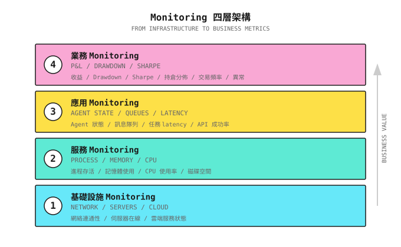
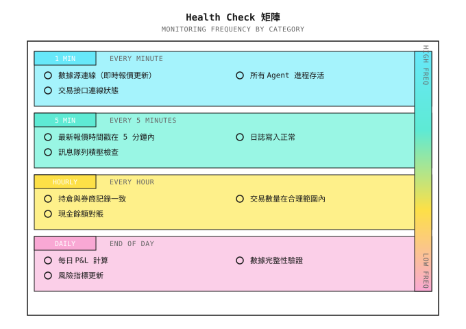
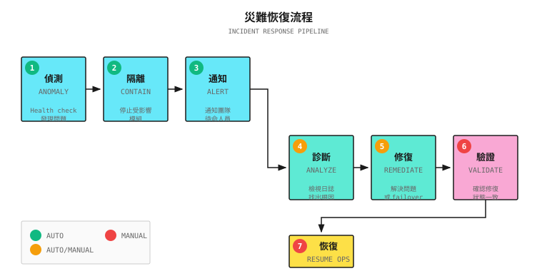
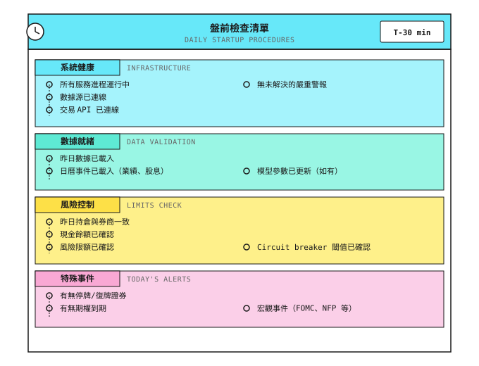
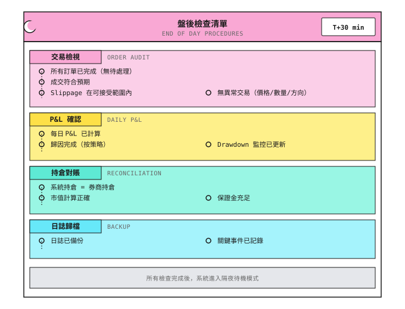
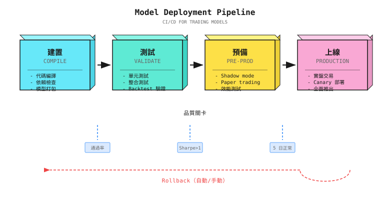
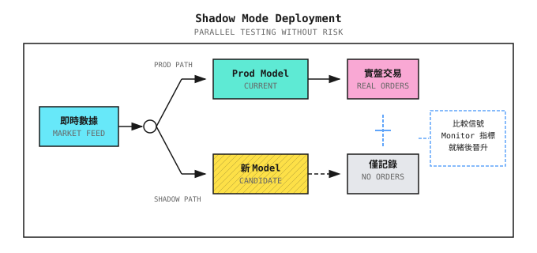
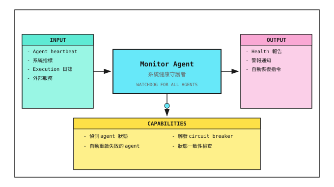

# 第 20 課：Production 運維

> **目標**：令系統在你不在場時也能正確運行，並在出現問題時及時通知你。

---

## 一個典型場景（示意）

> 註：以下為合成例子，用以說明常見現象；數字僅供示意，並不對應任何特定個人／賬戶。

2022 年，一位獨立量化交易員推出了他精心打磨了六個月的自動交易系統。Backtest 完美，paper trading 穩定運行了三個月。他信心十足地投入 $500,000 進行實盤交易。

頭兩個星期，系統表現正常。第三個星期的星期一，他被一則短訊吵醒：賬戶餘額不足。

調查發現：星期五收市後，數據源 API 更新了，返回格式改變。系統解析失敗，拋出 exception，但 exception 被靜默吞掉了。整個週末，系統沒有任何 log 輸出（他以為週末沒有交易，所以沒有留意）。星期一開市時，系統重新連線，但狀態混亂，執行了一連串荒謬的訂單，包括一個巨大的沽空倉位。

當他發現時，賬戶已經蝕了 40%。

**問題出在哪裏？**
1. **沒有 health check**：數據源故障沒有被偵測到
2. **Exception 被吞掉**：錯誤沒有被匯報
3. **沒有 monitoring alert**：兩日零 log，卻沒有人知道
4. **沒有 circuit breaker**：狀態異常時沒有停止交易

這就是為何「代碼能跑」與「系統可靠」是兩回事。運維不是事後補上的東西，而是系統設計的一部分。

---

## 20.1 Monitoring 系統

### Monitoring 的四個層級



### 關鍵 Monitoring 指標

| 層級 | 指標 | 門檻示例 | Alert 級別 |
|-------|--------|-------------------|-------------|
| **Infrastructure** | 伺服器存活 | Heartbeat 逾時 30 秒 | Critical |
| | Network latency | > 200ms | Warning |
| **Service** | CPU 使用率 | > 80% 持續 5 分鐘 | Warning |
| | 記憶體使用率 | > 90% | Critical |
| | 磁碟空間 | < 10GB | Warning |
| **Application** | 數據源連線 | 斷線 > 1 分鐘 | Critical |
| | API 成功率 | < 95% | Warning |
| | 任務隊列積壓 | > 100 項 | Warning |
| | Agent 響應 latency | > 5 秒 | Warning |
| **Business** | 單日 drawdown | > 3% | Warning |
| | 單週 drawdown | > 5% | Critical |
| | 異常交易 | 單筆交易 > 10% 倉位 | Critical |
| | 交易頻率 | 偏離均值 3 倍 | Warning |

### Health Check 設計



---

## 20.2 Logging 系統

### Logging 的黃金法則

> **Log 是產品，不是副產品。**

| 原則 | 說明 | 反面做法 |
|-----------|-------------|--------------|
| **結構化** | JSON 格式，方便查詢與分析 | 自由文字「buy successful」 |
| **可追蹤** | 每條 log 都含 trace_id | 無法關聯同一筆交易的 log |
| **分級** | DEBUG/INFO/WARN/ERROR | 全部用 print() |
| **有上下文** | 包含時間、symbol、價格、數量 | 只寫「Error occurred」 |
| **不可變** | 寫入後不可修改 | Log 存在本機且可編輯 |

### Log 級別

| 級別 | 用途 | 示例 |
|-------|-------|---------|
| **DEBUG** | 開發除錯，production 中停用 | "Calculating RSI for AAPL..." |
| **INFO** | 正常業務流程 | "Order submitted: BUY AAPL 100@$180" |
| **WARN** | 異常但可恢復 | "API rate limited, retrying in 5s" |
| **ERROR** | 異常且需要關注 | "Order rejected: insufficient margin" |
| **CRITICAL** | 系統級故障 | "Database connection lost" |

### 標準交易 Log 格式

```json
{
  "timestamp": "2024-01-15T09:30:00.123Z",
  "level": "INFO",
  "service": "execution_agent",
  "trace_id": "tx_20240115_001",
  "event": "order_submitted",
  "data": {
    "symbol": "AAPL",
    "side": "BUY",
    "quantity": 100,
    "price": 180.50,
    "order_type": "LIMIT",
    "order_id": "ORD_12345"
  },
  "context": {
    "signal_id": "sig_20240115_001",
    "signal_strength": 0.75,
    "regime": "trending",
    "portfolio_value": 1000000
  }
}
```

**關鍵欄位**：
- `trace_id`：串連由 signal 到 execution 的完整鏈條
- `event`：標準化事件名稱，方便統計分析
- `context`：事後 attribution 的決策依據

---

## 20.3 Alerting 系統

### Alert 設計原則

| 原則 | 說明 |
|-----------|-------------|
| **Alert 必須可執行** | 收到 alert 時知道該做甚麼 |
| **避免 alert fatigue** | Alert 太多 = 等於沒有 alert |
| **分級處理** | 不同級別使用不同渠道 |
| **附帶上下文** | Alert 資訊足以診斷問題 |

### Alert 渠道

| 級別 | 渠道 | 響應時間要求 |
|-------|---------|---------------------------|
| **Low** | Email、每日摘要 | 翌日 |
| **Medium** | Slack/Teams 訊息 | 1 小時內 |
| **High** | 短訊 + 電話 | 5 分鐘內 |
| **Critical** | 自動 circuit breaker + 電話 | 即時 |

### Alert 模板

```
[CRITICAL] Trading System Alert

Time: 2024-01-15 10:30:15 EST
Service: Risk Agent
Event: Drawdown triggered control line

Details:
- Current drawdown: 10.2%
- Trigger threshold: 10%
- Today's P&L: -$52,000
- Account equity: $948,000

Actions taken:
- Stopped new positions
- Started deleveraging process

You need to:
- Check for abnormal trades
- Confirm if manual intervention needed

Dashboard: https://dashboard.example.com/alerts/12345
```

### Alert 抑制

| 問題 | 解決方案 |
|---------|----------|
| 同一問題重複 alert | 聚合：同類 alert 每 5 分鐘只發一次 |
| 瞬間抖動觸發 alert | 持續時間：門檻須持續 N 分鐘才 alert |
| 夜間非交易時段 | 靜默期：非交易時段降為低優先級 |
| 已知的維護窗口 | 抑制：預設維護時段內不發 alert |

---

## 20.4 Disaster Recovery

### 故障分類

| 故障類型 | 示例 | 影響 | 恢復策略 |
|--------------|---------|--------|-------------------|
| **數據源故障** | API 無法使用 | 無法取得報價 | 切換到備用數據源 |
| **交易介面故障** | Broker 維護 | 無法落盤 | 暫停交易，記錄待處理訂單 |
| **本地服務故障** | Agent process crash | 部分功能喪失 | 自動重啟 |
| **網絡故障** | 網絡中斷 | 完全失效 | 等待恢復，手動核對狀態 |
| **數據錯誤** | 價格異常跳動 | 錯誤決策 | 偵測異常，暫停處理 |

### 恢復流程



### 狀態一致性檢查

恢復後必須核實：

| 檢查項目 | 方法 | 不一致時的處理 |
|------------|--------|------------------------|
| 持倉一致性 | 比對系統記錄與 broker | 以 broker 為準，更新本地 |
| 訂單狀態 | 查詢所有待處理訂單 | 撤銷或確認 |
| 現金餘額 | 比對計算值與實際值 | 重新計算 |
| 數據完整性 | 檢查有否缺失的市場數據 | 補回缺失數據 |

---

## 20.5 每日運維清單

### 開市前檢查（每日必做）



### 市場時段自動化

最容易被忽視的可靠性要求之一，是**圍繞市場時段的自動化排程**。Production 系統不應依賴人記得每朝啟動系統。

```
Automation Schedule (US Equities, Eastern Time):

09:15 ET  Auto-start: data connections, health checks, position reconciliation
09:25 ET  Pre-market validation: confirm data feeds live, risk parameters loaded
09:30 ET  Market open: trading logic active
15:50 ET  End-of-day: stop new position entries, begin close-only mode
16:00 ET  Market close: final position snapshot
16:05 ET  Post-close: P&L calculation, log aggregation, alert summary
16:30 ET  Auto-stop: graceful shutdown of non-essential processes

Weekday-only: Use cron or systemd timers with market calendar awareness.
Skip holidays (Martin Luther King Day, Thanksgiving, etc.).
```

> **為何重要**：需要手動啟動的系統，每日都帶來人為錯誤的風險。在波動的開市時段忘記啟動一朝，就足以造成本課開首故事所描述的狀態混亂災難。要將整個生命週期自動化，並把人手介入視為例外。

### 收市後檢查（每日必做）



### 每週／每月檢查

| 頻率 | 檢查項目 | 目的 |
|-----------|------------|---------|
| **每週** | 策略表現檢討 | 識別異常趨勢 |
| | 系統資源使用趨勢 | 預防資源耗盡 |
| | Alert 摘要分析 | 發現系統性問題 |
| **每月** | 完整 P&L attribution | 策略評估 |
| | Model drift detection | 識別失效的 signal |
| | Infrastructure 評估 | 成本與性能優化 |
| | Disaster recovery 演練 | 驗證恢復流程 |

---

## 20.6 Provider Abstraction

隨着系統成熟，你將不可避免地更換數據供應商、增加 execution 場所，或同時跨多個 broker 運行。如果你的核心邏輯與某個供應商的 API 緊密耦合，每次更換都會變成重寫。

解決方案是一個**乾淨的 provider interface**，把供應商專屬的細節隔離在穩定的合約之後：

```
Data Provider Interface:
  Connect(config)     -> connection
  Subscribe(symbols)  -> stream
  Stream()            -> MarketDataEvent

Execution Venue Interface:
  SubmitOrder(order)   -> OrderAck
  CancelOrder(id)      -> CancelAck
  GetPositions()       -> []Position
```

每個供應商配一個薄薄的 adapter 來實現這個 interface。你的 Signal Agent、Risk Agent 及 Monitor Agent 完全不知道、也不在乎 interface 背後是哪個 broker 或數據源。這個模式讓多場所交易、failover 到備用數據源，以及用 mock provider 作乾淨測試成為可能，而且全部無需改動核心邏輯。

> **設計原則**：把每一個外部依賴（數據、execution、alert）都視為 interface 背後可替換的模組。第一次更換供應商，就足以令這項抽象的成本多次回本。

---

## 20.7 Model Deployment 與 CI/CD

### 20.7.1 為何交易系統需要 CI/CD

> **每一次 deployment 都是一次風險事件。CI/CD 令這種風險變得可控。**

傳統做法的問題：

| 問題 | 後果 |
|---------|-------------|
| 手動 deployment | 容易遺漏步驟、配置錯誤 |
| 沒有版本追蹤 | 出問題時無法 rollback 到已知良好的版本 |
| 環境不一致 | 「我部機行得通」，但 production 失敗 |
| 測試不足 | 新代碼引入 bug，部署後才發現 |
| 沒有 model 更新記錄 | 不知道 model 何時、為何更新 |

### 20.7.2 交易系統的 CI/CD Pipeline



### 20.7.3 各階段詳解

**階段 1：Build**

```yaml
# Example: GitHub Actions configuration
build:
  steps:
    - name: Checkout code
      uses: actions/checkout@v3

    - name: Install dependencies
      run: pip install -r requirements.txt

    - name: Type checking
      run: mypy src/ --strict

    - name: Code formatting
      run: ruff check src/

    - name: Package model
      run: |
        python -m src.models.package \
          --model-path models/signal_v3.pkl \
          --output artifacts/
```

**階段 2：Test**

| 測試類型 | 內容 | 通過標準 |
|-----------|---------|---------------|
| **Unit test** | 函數邏輯正確 | 100% 通過 |
| **Integration test** | Agent 協作正常 | 100% 通過 |
| **Backtest 驗證** | 在歷史數據上的表現 | Sharpe > 門檻，drawdown < 門檻 |
| **Sanity check** | 沒有明顯 overfitting | Out-of-sample Sharpe > In-sample x 0.7 |

```python
# Backtest validation example
def test_model_performance():
    """Ensure new model meets minimum standards in backtest"""
    results = run_backtest(
        model='models/signal_v3.pkl',
        start_date='2022-01-01',
        end_date='2023-12-31'
    )

    assert results['sharpe'] >= 1.0, f"Sharpe ratio insufficient: {results['sharpe']}"
    assert results['max_drawdown'] <= 0.15, f"Drawdown too large: {results['max_drawdown']}"
    assert results['win_rate'] >= 0.45, f"Win rate insufficient: {results['win_rate']}"

    # Overfitting check
    in_sample_sr = results['in_sample_sharpe']
    out_sample_sr = results['out_sample_sharpe']
    assert out_sample_sr >= in_sample_sr * 0.7, "Out-of-sample performance decay too large, possible overfitting"
```

> **Quality Gate：雙層 Backtest 驗證**
>
> 一個穩健的 CI/CD pipeline 應在任何 deployment 之前要求**兩層** backtest 驗證：
>
> 1. **快速 vectorized backtest** -- 在數秒內測試純 signal 邏輯（factor return、IC、turnover）。快速捕捉 alpha 生成上的退步。
> 2. **整合 OMS 的 backtest** -- 讓 signal 走完整的訂單管理路徑（風控檢查、拆單、帶 slippage 的模擬成交）。捕捉 vectorized 測試遺漏的 execution 與現實之間的落差。
>
> 兩層都必須通過。一個 signal 在 vectorized 測試中看似賺錢，但經過真實的 execution 建模後失敗，就不可部署。把這設為必要的 CI gate，可預防最常見的一類 production 失敗：理論上行得通、卻在摩擦成本中蝕錢的策略。

**階段 3：Stage（預發佈）**

Shadow Mode：



Shadow Mode 運行標準：

| 指標 | 通過標準 | 檢查頻率 |
|--------|---------------|-----------------|
| Signal 一致性 | 新舊 signal 相關性 > 0.9 或有明顯改善 | Real-time |
| Latency | 新 model latency < Production model x 1.2 | 每小時 |
| 資源使用 | CPU／記憶體在預算內 | 每 5 分鐘 |
| 異常 signal | 沒有極端 signal（> 3 個標準差） | Real-time |
| 運行時長 | 至少 5 個交易日 | - |

**階段 4：Prod（Production）**

逐步發佈策略：

| 策略 | 適用場景 | 風險控制 |
|----------|---------------------|--------------|
| **Canary** | 先用一小部分資金跑新 model | 5% -> 25% -> 50% -> 100% |
| **Blue-Green** | 即時切換，保留 rollback 能力 | 隨時可切回舊版本 |
| **Rolling** | 逐步替換 Agent instance | 每次替換一個 |

```python
class CanaryDeployment:
    """Canary deployment controller"""

    def __init__(self, old_model, new_model):
        self.old_model = old_model
        self.new_model = new_model
        self.canary_weight = 0.05  # Start at 5%

    def get_signal(self, market_data: dict) -> dict:
        # Distribute traffic by weight
        if random.random() < self.canary_weight:
            signal = self.new_model.predict(market_data)
            signal['model_version'] = 'canary'
        else:
            signal = self.old_model.predict(market_data)
            signal['model_version'] = 'stable'
        return signal

    def promote_canary(self, new_weight: float):
        """Increase canary weight, gradually ramp up"""
        if new_weight > self.canary_weight:
            log.info(f"Promoting canary weight: {self.canary_weight:.0%} -> {new_weight:.0%}")
            self.canary_weight = new_weight

    def rollback(self):
        """Rollback to stable version"""
        log.warning("Canary rollback! Switching to stable version")
        self.canary_weight = 0.0
```

### 20.7.4 Model 版本管理

**版本命名規範**：

```
Model version format: v{major}.{minor}.{patch}-{timestamp}

Example:
  v2.3.1-20240115  # Version v2.3.1 from January 15, 2024

Version rules:
  major: Model architecture change (e.g., from XGBoost to neural network)
  minor: Feature or parameter adjustment
  patch: Bug fix
```

**Model Registry**：

| 欄位 | 示例 | 說明 |
|-------|---------|-------------|
| `model_id` | `signal_v2.3.1` | 唯一識別碼 |
| `created_at` | `2024-01-15 10:30:00` | 創建時間 |
| `created_by` | `auto_train_pipeline` | 創建者（人或 pipeline） |
| `metrics` | `{"sharpe": 1.5, "drawdown": 0.08}` | 驗證指標 |
| `status` | `staging` / `production` / `retired` | 當前狀態 |
| `artifact_path` | `s3://models/signal_v2.3.1.pkl` | 儲存位置 |
| `config_hash` | `a1b2c3d4...` | 配置檔 hash |
| `data_hash` | `e5f6g7h8...` | 訓練數據 hash（可重現性） |

### 20.7.5 Auto Rollback

```python
class AutoRollback:
    """Auto rollback controller"""

    def __init__(self, rollback_thresholds: dict):
        self.thresholds = rollback_thresholds
        self.metrics_buffer = []

    def check_and_rollback(self, current_metrics: dict) -> bool:
        """Check if rollback is needed"""

        # Immediate rollback conditions (single trigger)
        if current_metrics.get('error_rate', 0) > self.thresholds['max_error_rate']:
            self.trigger_rollback("Error rate too high")
            return True

        if current_metrics.get('latency_p99', 0) > self.thresholds['max_latency']:
            self.trigger_rollback("Latency too high")
            return True

        # Cumulative rollback conditions (trend judgment)
        self.metrics_buffer.append(current_metrics)
        if len(self.metrics_buffer) >= 10:  # Sufficient samples
            recent_sharpe = np.mean([m['sharpe'] for m in self.metrics_buffer[-10:]])
            if recent_sharpe < self.thresholds['min_sharpe']:
                self.trigger_rollback(f"Sharpe declined: {recent_sharpe:.2f}")
                return True

        return False

    def trigger_rollback(self, reason: str):
        """Execute rollback"""
        log.error(f"Triggering auto rollback: {reason}")

        # 1. Switch to last stable version
        model_registry.activate('last_stable')

        # 2. Send alert
        alert_system.send(
            level='critical',
            title='Model Auto Rollback',
            message=f'Reason: {reason}'
        )

        # 3. Record rollback event
        audit_log.record('rollback', {'reason': reason})
```

### 20.7.6 CI/CD 實施清單

```
+-------------------------------------------------------------+
|               CI/CD Implementation Checklist                 |
+-------------------------------------------------------------+
|                                                             |
|  [ ] Version Control                                        |
|    +-- All code in Git                                      |
|    +-- Model files have version numbers                     |
|    +-- Configuration separated from code                    |
|    +-- Training data has snapshots                          |
|                                                             |
|  [ ] Automated Testing                                      |
|    +-- Unit tests cover core logic                          |
|    +-- Backtest as part of CI                               |
|    +-- Performance benchmark tests                          |
|    +-- Overfitting detection                                |
|                                                             |
|  [ ] Deployment Process                                     |
|    +-- One-click deployment (no manual steps)               |
|    +-- Shadow mode validation                               |
|    +-- Gradual release mechanism                            |
|    +-- One-click rollback                                   |
|                                                             |
|  [ ] Observability                                          |
|    +-- Deployment event logging                             |
|    +-- Version and performance correlation                  |
|    +-- Auto-triggered rollback                              |
|    +-- Change audit trail                                   |
|                                                             |
+-------------------------------------------------------------+
```

---

## 20.8 Multi-Agent 視角

### Monitor Agent 的角色



### Agent 之間的健康協作

| Agent | 向 Monitor 匯報 | 從 Monitor 接收 |
|-------|-------------------|----------------------|
| Signal Agent | Signal 生成 latency、成功率 | 暫停／恢復 |
| Risk Agent | 風控觸發次數、狀態 | 強制 circuit breaker |
| Execution Agent | 訂單狀態、execution 質素 | 撤銷待處理訂單 |
| Regime Agent | 偵測 latency、confidence | 切換到預設狀態 |
| Data Agent | 數據更新時間、質素 | 切換數據源 |

---

## 驗收標準

完成本課後，可用以下標準驗證學習成果：

| 標準 | 要求 | 自我測試方法 |
|-----------|----------|------------------|
| 理解 monitoring 層級 | 能描述四個 monitoring 層級的內容 | 列出每個層級的關鍵指標 |
| 設計 log 格式 | 能設計結構化的交易 log | 寫出一份完整的交易 log JSON |
| 設計 alert 規則 | 能區分 alert 級別與渠道 | 為你的系統設計 alert 矩陣 |
| 理解恢復流程 | 能描述故障恢復步驟 | 繪畫恢復流程圖 |
| 掌握每日清單 | 能列出開市前／收市後的檢查項目 | 建立你自己的清單 |

### 綜合練習

**設計你的運維系統**：

1. 列出你需要 monitoring 的關鍵指標（至少 10 個）
2. 設計 log 格式（包含必要欄位）
3. 設計 alert 規則（指標、門檻、級別、渠道）
4. 撰寫開市前檢查清單
5. 為一個故障場景設計恢復流程

---

## 本課成果

完成本課後，你將擁有：

1. **四層 Monitoring 框架** - Infrastructure/Service/Application/Business
2. **Log 標準模板** - 結構化交易 log 格式
3. **Alert 設計指引** - 級別、渠道、抑制策略
4. **運維清單** - 開市前／收市後檢查項目
5. **CI/CD Deployment Pipeline** - Build、test、shadow mode、逐步發佈

---

## 重點總結

- [x] 理解 monitoring 的四個層級及其關鍵指標
- [x] 掌握結構化 log 的設計原則
- [x] 理解 alerting 系統的設計要點
- [x] 掌握故障恢復流程與狀態一致性檢查
- [x] 建立每日運維檢查的習慣
- [x] 設計 CI/CD pipeline 以安全地部署 model

---

## 延伸閱讀

- [第 19 課：Execution 系統](第19課：執行系統 - 從信號到真實成交.md) - Execution 的 monitoring 重點
- [背景知識：Execution Simulator 實現](背景知識/執行模擬器實現.md) - 用於 CI/CD 測試的 execution 模擬
- [第 17 課：Online Learning 與策略演化](../Part4-多智能體/第17課：在線學習與策略進化.md) - Model drift detection 的實現細節
- [附錄 A：實盤交易記錄標準指南](附錄/附錄A：實盤交易記錄標準指南.md) - 詳細的 logging 規範

---

## 下一課預告

**第 21 課：項目實戰**

理論到此為止。下一課，我們會由零開始建立一個完整的 multi-agent 交易系統，整合前 20 課的所有知識，由架構設計到代碼實現，由 backtest 驗證到 production deployment。
