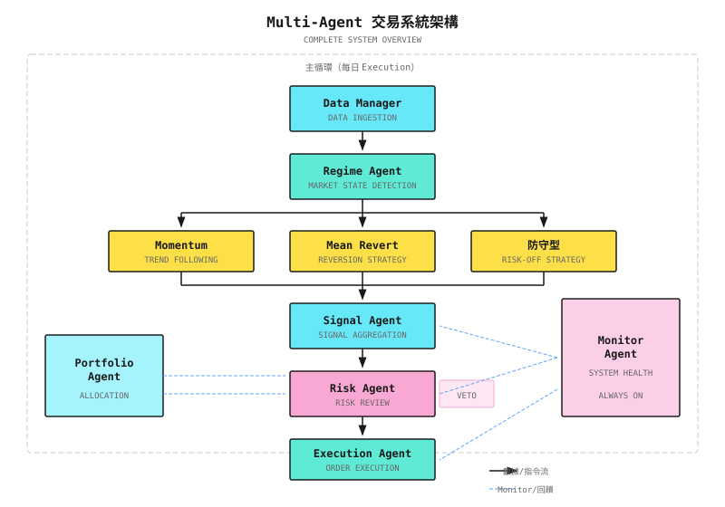

# 第 21 課：項目實戰

> **目標**：整合前 20 課的知識，從零開始構建一個可運行的 multi-agent 交易系統原型。

---

## 項目概覽

本課會帶你構建一個**端到端的 multi-agent 交易系統**。這不是玩具項目，而是一個可以擴展成真實交易系統的框架。

### 系統目標

| 維度 | 目標 | 非目標 |
|------|------|--------|
| **功能** | 識別市場 regime、生成信號、控制風險、執行交易 | 高頻交易、複雜衍生品 |
| **市場** | 美股日頻策略 | 分鐘級以下策略 |
| **規模** | 10-50 隻股票的 portfolio | 從數千隻股票中選股 |
| **運行** | 本地開發環境 + paper trading | 直接實盤交易 |

### 最終交付物

```
multi-agent-trading-system/
├── agents/
│   ├── regime_agent.py      # Market regime detection
│   ├── signal_agent.py      # Signal generation
│   ├── risk_agent.py        # Risk control
│   ├── execution_agent.py   # Order execution
│   └── monitor_agent.py     # System monitoring
├── core/
│   ├── data_manager.py      # Data management
│   ├── portfolio.py         # Portfolio management
│   └── order.py             # Order model
├── strategies/
│   ├── momentum.py          # Momentum strategy
│   └── mean_revert.py       # Mean reversion strategy
├── config/
│   └── settings.yaml        # Configuration file
├── tests/
│   └── ...                  # Test cases
└── main.py                  # Entry point
```

---

## 21.1 系統架構

### 整體架構圖



### 數據流

```
Market Data ---------> Data Manager ---------> All Agents
                         |
                         v
Positions/Balance <---- Portfolio <---------- Execution Agent
                         |
                         v
Logs/Metrics --------> Monitor Agent --------> Alerts
```

### 先做 Modular Monolith

上面的架構圖顯示了邊界清晰的各個 agent。常見的錯誤是一開始就把每個 agent 部署成獨立的 microservice，各自有自己的 process、message queue 和 database。**不要這樣做。**

> **先從 modular monolith 開始**：單一 process，模組邊界清晰，模組之間共用 Protobuf contracts。

上面的 agent 是邏輯上的劃分，不是部署邊界。在第一個版本中，`regime_agent.py`、`signal_agent.py`、`risk_agent.py` 和 `execution_agent.py` 全部在同一個 process 內運行，透過函數調用溝通，並使用定義明確的數據 contracts（dataclasses 或 Protobuf messages）。

**只有在以下情況**才拆分成獨立的 service：
- Scaling 需要獨立部署（例如信號研究需要 GPU，而 execution 不需要）
- 不同組件的 latency 層級根本不同（例如 Rust 寫的 risk checks 在亞毫秒級，而 Python 寫的研究以秒計）
- 團隊規模需要獨立的發佈週期

關鍵洞察：**模組邊界是設計決策；service 邊界是基礎設施決策。** 先把設計做好。過早拆分會增加網絡 latency、分佈式 debug 的複雜度和運維開銷，而這些對驗證你的策略是否有效毫無幫助。

---

## 21.2 逐步實現

### 步驟 1：Data Manager

**目標**：獲取並管理市場數據。

```
Data Manager Responsibilities:
- Fetch historical quotes (for backtesting)
- Fetch real-time quotes (for live trading)
- Data cleaning and standardization
- Calculate technical indicators
```

**紙上設計：數據介面**

| 方法 | 輸入 | 輸出 | 用途 |
|------|------|------|------|
| `get_history` | symbol, days | DataFrame | 獲取歷史數據 |
| `get_latest` | symbols | Dict | 獲取最新價格 |
| `calculate_indicators` | df | df with indicators | 計算技術指標 |
| `validate` | df | bool, errors | 數據質素檢查 |

<details>
<summary>代碼框架（工程師參考）</summary>

```python
import yfinance as yf
import pandas as pd
import numpy as np
from typing import List, Dict, Optional

class DataManager:
    """Data Manager"""

    def __init__(self, cache_dir: str = "./data_cache"):
        self.cache_dir = cache_dir

    def get_history(
        self,
        symbol: str,
        days: int = 252,
        end_date: Optional[str] = None
    ) -> pd.DataFrame:
        """Fetch historical market data"""
        ticker = yf.Ticker(symbol)
        df = ticker.history(period=f"{days}d")

        # Standardize column names
        df = df.rename(columns={
            "Open": "open",
            "High": "high",
            "Low": "low",
            "Close": "close",
            "Volume": "volume"
        })

        return df[["open", "high", "low", "close", "volume"]]

    def calculate_indicators(self, df: pd.DataFrame) -> pd.DataFrame:
        """Calculate technical indicators"""
        # Moving averages
        df["sma_20"] = df["close"].rolling(20).mean()
        df["sma_50"] = df["close"].rolling(50).mean()

        # Volatility
        df["volatility"] = df["close"].pct_change().rolling(20).std() * np.sqrt(252)

        # RSI
        delta = df["close"].diff()
        gain = delta.where(delta > 0, 0).rolling(14).mean()
        loss = (-delta.where(delta < 0, 0)).rolling(14).mean()
        df["rsi"] = 100 - (100 / (1 + gain / loss))

        # ATR
        high_low = df["high"] - df["low"]
        high_close = (df["high"] - df["close"].shift()).abs()
        low_close = (df["low"] - df["close"].shift()).abs()
        tr = pd.concat([high_low, high_close, low_close], axis=1).max(axis=1)
        df["atr"] = tr.rolling(14).mean()

        return df

    def validate(self, df: pd.DataFrame) -> tuple:
        """Data quality check"""
        errors = []

        if df.empty:
            errors.append("DataFrame is empty")

        if df["close"].isnull().any():
            errors.append(f"Missing close prices: {df['close'].isnull().sum()}")

        if (df["close"] <= 0).any():
            errors.append("Invalid prices (<=0)")

        return len(errors) == 0, errors
```

</details>

### 步驟 2：Regime Agent

**目標**：識別當前市場 regime。

```
Regime Agent Output:
- regime: "trending" | "mean_reverting" | "crisis" | "uncertain"
- confidence: 0.0 - 1.0
- regime_weights: {"trending": 0.6, "mean_reverting": 0.3, "crisis": 0.1}
```

**紙上設計：Regime 檢測規則**

| 條件 | 狀態 | 權重分配 |
|------|------|----------|
| ADX > 25 且 Vol < 25% | 趨勢 | 趨勢 80%，mean reversion 15%，防守 5% |
| ADX < 20 且 Vol < 20% | 區間震盪 | 趨勢 20%，mean reversion 70%，防守 10% |
| Vol > 30% 且 Corr > 0.7 | 危機 | 趨勢 10%，mean reversion 10%，防守 80% |
| 其他 | 不確定 | 各 33% |

<details>
<summary>代碼框架（工程師參考）</summary>

```python
from dataclasses import dataclass
from typing import Dict

@dataclass
class RegimeState:
    regime: str
    confidence: float
    weights: Dict[str, float]

class RegimeAgent:
    """Market Regime Detection Agent"""

    def __init__(self, config: dict = None):
        self.config = config or {}
        self.adx_threshold = self.config.get("adx_threshold", 25)
        self.vol_crisis = self.config.get("vol_crisis", 0.30)

    def detect(self, market_data: dict) -> RegimeState:
        """
        Detect market regime

        market_data: {
            "adx": float,
            "volatility": float,
            "correlation": float,
            "trend_strength": float
        }
        """
        adx = market_data.get("adx", 20)
        vol = market_data.get("volatility", 0.15)
        corr = market_data.get("correlation", 0.5)

        # Crisis detection takes priority
        if vol > self.vol_crisis and corr > 0.7:
            return RegimeState(
                regime="crisis",
                confidence=0.8,
                weights={"momentum": 0.1, "mean_revert": 0.1, "defensive": 0.8}
            )

        # Trend detection
        if adx > self.adx_threshold and vol < 0.25:
            return RegimeState(
                regime="trending",
                confidence=0.7,
                weights={"momentum": 0.7, "mean_revert": 0.2, "defensive": 0.1}
            )

        # Range-bound detection
        if adx < 20 and vol < 0.20:
            return RegimeState(
                regime="mean_reverting",
                confidence=0.6,
                weights={"momentum": 0.2, "mean_revert": 0.7, "defensive": 0.1}
            )

        # Uncertain
        return RegimeState(
            regime="uncertain",
            confidence=0.3,
            weights={"momentum": 0.33, "mean_revert": 0.33, "defensive": 0.34}
        )
```

</details>

### 步驟 3：Signal Agent

**目標**：根據策略生成交易信號。

```
Signal Agent Output:
- signals: [
    {"symbol": "AAPL", "direction": "long", "strength": 0.7, "source": "momentum"},
    {"symbol": "MSFT", "direction": "short", "strength": 0.5, "source": "mean_revert"}
  ]
```

**紙上設計：信號聚合邏輯**

| 情景 | 處理方式 |
|------|----------|
| 單一策略信號 | 直接輸出，強度 = 策略信號 x regime 權重 |
| 多個策略一致 | 增強信號強度，取加權平均 |
| 多個策略衝突 | 取權重較高的策略，或不交易 |

<details>
<summary>代碼框架（工程師參考）</summary>

```python
from dataclasses import dataclass
from typing import List, Optional

@dataclass
class Signal:
    symbol: str
    direction: str  # "long" | "short" | "close"
    strength: float  # 0.0 - 1.0
    source: str
    timestamp: str

class SignalAgent:
    """Signal Generation Agent"""

    def __init__(self, strategies: list):
        self.strategies = strategies

    def generate_signals(
        self,
        market_data: dict,
        regime_weights: dict
    ) -> List[Signal]:
        """Aggregate signals from all strategies"""
        all_signals = {}

        for strategy in self.strategies:
            strategy_name = strategy.name
            weight = regime_weights.get(strategy_name, 0.33)

            raw_signals = strategy.generate(market_data)

            for sig in raw_signals:
                key = (sig.symbol, sig.direction)
                weighted_strength = sig.strength * weight

                if key in all_signals:
                    # Same direction signals stack
                    all_signals[key].strength += weighted_strength
                else:
                    all_signals[key] = Signal(
                        symbol=sig.symbol,
                        direction=sig.direction,
                        strength=weighted_strength,
                        source=strategy_name,
                        timestamp=sig.timestamp
                    )

        # Filter weak signals
        return [s for s in all_signals.values() if s.strength > 0.3]
```

</details>

### 步驟 4：Risk Agent

**目標**：審核信號，控制風險。

```
Risk Agent Decisions:
- APPROVE: Pass, can execute
- REDUCE: Pass but reduce position size
- REJECT: Reject
```

**紙上設計：審核規則**

| 規則 | 檢查內容 | 觸發動作 |
|------|----------|----------|
| 單筆交易上限 | 倉位 > 10% | 減至 10% |
| 單一標的上限 | 同一標的 > 20% | 拒絕或減倉 |
| 總倉位上限 | 總 exposure > 80% | 拒絕 |
| Drawdown 控制 | 當前 drawdown > 10% | 拒絕所有新倉位 |
| Circuit breaker | Drawdown > 15% | 強制 deleverage |

<details>
<summary>代碼框架（工程師參考）</summary>

```python
from enum import Enum
from dataclasses import dataclass
from typing import Optional

class Decision(Enum):
    APPROVE = "approve"
    REDUCE = "reduce"
    REJECT = "reject"

@dataclass
class RiskDecision:
    decision: Decision
    reason: str
    adjusted_size: Optional[float] = None

class RiskAgent:
    """Risk Control Agent"""

    def __init__(self, config: dict):
        self.max_single = config.get("max_single_position", 0.10)
        self.max_symbol = config.get("max_symbol_exposure", 0.20)
        self.max_total = config.get("max_total_exposure", 0.80)
        self.drawdown_stop = config.get("drawdown_stop", 0.10)
        self.drawdown_circuit = config.get("drawdown_circuit", 0.15)

    def check(
        self,
        signal: Signal,
        proposed_size: float,
        portfolio: dict,
        current_drawdown: float
    ) -> RiskDecision:
        """Review trading signal"""

        # Circuit breaker check
        if current_drawdown >= self.drawdown_circuit:
            return RiskDecision(Decision.REJECT, "Circuit breaker active")

        # Drawdown control
        if current_drawdown >= self.drawdown_stop:
            if signal.direction != "close":
                return RiskDecision(Decision.REJECT, "Drawdown limit reached")

        # Single trade limit
        if proposed_size > self.max_single:
            return RiskDecision(
                Decision.REDUCE,
                f"Size exceeds single limit",
                adjusted_size=self.max_single
            )

        # Symbol limit
        current_exposure = portfolio.get(signal.symbol, 0)
        if current_exposure + proposed_size > self.max_symbol:
            allowed = self.max_symbol - current_exposure
            if allowed <= 0:
                return RiskDecision(Decision.REJECT, "Symbol limit reached")
            return RiskDecision(
                Decision.REDUCE,
                "Symbol limit",
                adjusted_size=allowed
            )

        # Total exposure limit
        total_exposure = sum(portfolio.values()) + proposed_size
        if total_exposure > self.max_total:
            return RiskDecision(Decision.REJECT, "Total exposure limit")

        return RiskDecision(Decision.APPROVE, "Passed all checks")
```

</details>

### 步驟 5：Execution Agent

**目標**：執行交易訂單。

```
Execution Agent Responsibilities:
- Convert signals to orders
- Select order type (market/limit)
- Manage order status
- Record execution results
```

<details>
<summary>代碼框架（工程師參考）</summary>

```python
from dataclasses import dataclass
from enum import Enum
from datetime import datetime
import uuid

class OrderStatus(Enum):
    PENDING = "pending"
    SUBMITTED = "submitted"
    FILLED = "filled"
    CANCELLED = "cancelled"
    REJECTED = "rejected"

@dataclass
class Order:
    order_id: str
    symbol: str
    side: str  # "buy" | "sell"
    quantity: int
    order_type: str  # "market" | "limit"
    limit_price: float = None
    status: OrderStatus = OrderStatus.PENDING
    filled_price: float = None
    filled_time: str = None

class ExecutionAgent:
    """Order Execution Agent"""

    def __init__(self, broker_client=None, is_paper: bool = True):
        self.broker = broker_client
        self.is_paper = is_paper
        self.orders = {}

    def create_order(
        self,
        symbol: str,
        direction: str,
        size: float,
        portfolio_value: float,
        current_price: float
    ) -> Order:
        """Create order"""
        # Calculate share count
        dollar_amount = portfolio_value * size
        quantity = int(dollar_amount / current_price)

        if quantity <= 0:
            return None

        side = "buy" if direction == "long" else "sell"

        order = Order(
            order_id=str(uuid.uuid4())[:8],
            symbol=symbol,
            side=side,
            quantity=quantity,
            order_type="market"
        )

        self.orders[order.order_id] = order
        return order

    def submit_order(self, order: Order) -> bool:
        """Submit order"""
        if self.is_paper:
            # Simulate fill
            order.status = OrderStatus.FILLED
            order.filled_time = datetime.now().isoformat()
            # Paper trading assumes fill at current price
            return True

        # Live trading calls broker API
        # response = self.broker.submit_order(order)
        # ...
        return True
```

</details>

### 步驟 6：主循環

**目標**：把所有 Agent 連接起來。

```python
# Main loop pseudocode
def main_loop():
    # 1. Get data
    market_data = data_manager.get_latest(symbols)

    # 2. Detect regime
    regime_state = regime_agent.detect(market_data)

    # 3. Generate signals
    signals = signal_agent.generate(market_data, regime_state.weights)

    # 4. Risk review
    for signal in signals:
        proposed_size = calculate_position_size(signal)
        decision = risk_agent.check(signal, proposed_size, portfolio, drawdown)

        if decision.decision == Decision.APPROVE:
            size = proposed_size
        elif decision.decision == Decision.REDUCE:
            size = decision.adjusted_size
        else:
            continue

        # 5. Execute order
        order = execution_agent.create_order(
            signal.symbol, signal.direction, size, portfolio_value, current_price
        )
        execution_agent.submit_order(order)

    # 6. Update portfolio
    portfolio.update()

    # 7. Log
    monitor_agent.log_daily_summary()
```

> **由教學代碼到生產系統**
>
> 本課為方便理解，全部 agent 都用 Python 實現。在生產環境中，不同組件通常會按 latency 要求使用不同語言：
> - **Risk Engine** -- Rust（不可變的硬編碼限額，納秒級 latency）
> - **Order Management** -- Go（高並發，goroutine 模型）
> - **研究/ML** -- Python（豐富的 ML 生態）
>
> 重點不在於語言選擇，而在於**清晰的模組邊界和標準化的通訊協議**（例如 gRPC + Protobuf）。如果你的 Python 原型在 agent 之間已有定義明確的介面，日後把對性能敏感的路徑遷移到 Rust 或 Go，只是 refactor，而不是重寫。

---

## 21.3 Backtest 驗證

### Backtest 框架

```
Backtesting is not to prove the strategy works, but to discover the strategy's problems.
```

**Backtest 檢查清單**（參考第 7 課 Quality Gate）：

| 檢查項目 | 通過標準 |
|----------|----------|
| 沒有 look-ahead bias | 所有數據在 T+1 可得 |
| 真實的成本建模 | 包含 slippage、佣金 |
| Out-of-sample 驗證 | OOS Sharpe > IS Sharpe x 0.7 |
| 參數穩定性 | 參數 +/-20% 時策略不會崩潰 |
| 極端情景測試 | 分別測試 2008、2020 |

### 關鍵 Backtest 指標

| 指標 | 目標 | 警戒水平 |
|------|------|----------|
| 年化回報 | > 15% | < 10% |
| Sharpe ratio | > 1.0 | < 0.5 |
| 最大 drawdown | < 20% | > 30% |
| 勝率 | > 50% | < 40% |
| 盈虧比 | > 1.5 | < 1.0 |
| Turnover | < 500%/年 | > 1000%/年 |

---

## 21.4 由 Paper 到實盤

### 分階段驗證

```
Stage 1: Historical Backtest (2-4 weeks)
├── Validate strategy logic is correct
├── Validate system can run completely
└── Goal: Backtest metrics meet standards

Stage 2: Paper Trading (2-4 weeks)
├── Use real quotes, fake trades
├── Validate real-time data processing
└── Goal: Execution error-free

Stage 3: Small Capital Live (4-8 weeks)
├── Deploy 5-10% of planned capital
├── Validate real execution
└── Goal: Live performance close to backtest

Stage 4: Gradual Scale-Up (Ongoing)
├── Monthly evaluation, gradually increase capital
├── Continuous monitoring and tuning
└── Goal: Stable profitability
```

### 上線前檢查清單

```
[ ] System Check
  +-- All Agent processes stable running > 1 week
  +-- Alert system tested
  +-- Logging complete
  +-- Disaster recovery process verified

[ ] Strategy Check
  +-- Backtest passed Quality Gate
  +-- Paper trading > 2 weeks
  +-- Slippage estimates reasonable
  +-- Extreme scenario contingency plans

[ ] Operations Check
  +-- Pre/post-market checklists ready
  +-- Contact info updated
  +-- Backup plans prepared
  +-- Capital transfer confirmed

[ ] Mental Preparation
  +-- Clear on risk tolerance
  +-- Set clear stop-loss line
  +-- Ready to face drawdowns
```

---

## 21.5 項目擴展方向

### 可選增強

| 方向 | 說明 | 複雜度 |
|------|------|--------|
| **Multi-market** | 支持 A 股、港股、crypto | 中 |
| **Multi-timeframe** | 支持分鐘級策略 | 高 |
| **LLM 整合** | 新聞分析、研究報告解析 | 中 |
| **Online Learning** | 策略自動進化 | 高 |
| **Web 介面** | 可視化 monitoring | 中 |
| **分佈式部署** | 多伺服器運行 | 高 |

### 持續改進循環

```
+------------------------------------------------------------+
|                                                            |
|    Monitor ------> Discover Issues ------> Analyze Cause   |
|      ^                                          |          |
|      |                                          v          |
|    Deploy <------- Test Validate <------- Improvement Plan |
|                                                            |
+------------------------------------------------------------+
```

---

## 驗收標準

### 項目驗收清單

| 階段 | 標準 | 通過條件 |
|------|------|----------|
| **代碼** | 系統可運行 | `python main.py` 無錯誤 |
| | 所有 Agent 正常工作 | 日誌顯示各 Agent 輸出 |
| | 配置可修改 | 修改 settings.yaml 後生效 |
| **Backtest** | Backtest 可運行 | 生成 backtest 報告 |
| | 指標計算正確 | 手動驗證 2-3 筆交易 |
| | 沒有明顯 bug | Backtest 曲線合理 |
| **Paper Trading** | 可獲取實時數據 | 日誌顯示最新價格 |
| | 可生成信號 | 信號列表不為空 |
| | 風險控制有效 | 超限訂單被拒絕 |
| **文檔** | 有 README | 其他人明白如何運行 |
| | 有配置文檔 | 參數含義清晰 |

### 自我評估問題

完成項目後，回答以下問題：

1. 你的系統在甚麼市場 regime 下表現最好/最差？
2. 最大的 drawdown 由甚麼引起？
3. 如果明天就實盤上線，你最擔心甚麼？
4. 系統還有哪些方面可以改進？

---

## 本課交付物

完成本課後，你將擁有：

1. **完整的代碼框架** - 可運行的 multi-agent 系統
2. **Backtest 驗證結果** - 策略表現評估
3. **上線前檢查清單** - 由 paper 到實盤的路徑
4. **擴展方向指南** - 未來改進的思路

---

## 本課要點

- [x] 理解 multi-agent 系統的整體架構
- [x] 掌握各個 Agent 的職責與介面設計
- [x] 能把前 20 課的知識整合成一個系統
- [x] 理解由 backtest 到實盤的驗證路徑

---

## 延伸閱讀

- [第 01 課：量化交易全景圖](../Part1-快速體驗/第01課：量化交易全景圖.md) - 重溫起點
- [第 07 課：回測系統的陷阱](../Part2-量化基礎/第07課：回測系統的陷阱.md) - Backtest quality gate
- [第 20 課：生產運維](第20課：生產運維.md) - 運維最佳實踐

---

## 下一課預告

**第 22 課：總結與進階方向**

本課程即將完結。在最後一課，我們會回顧整個學習旅程，總結核心洞察，並展望進階方向 - 由個人項目到職業發展，由技術深度到行業視野。
