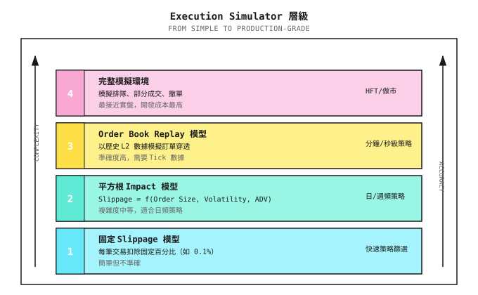
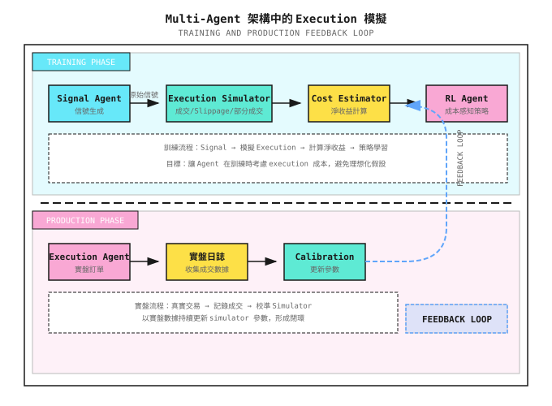

# 背景知識：Execution Simulator 實現

> 「用 K 線收市價做 backtest，就像用地圖上的直線距離規劃行山路線，完全忽略了所有真實存在的障礙。」

---

## 一、為甚麼需要 Execution Simulator？

### 1.1 Backtest 與實盤之間的落差

| Backtest 假設 | 實盤現實 |
|---------------|----------|
| Signal 一出現就即時 execution | 從 signal 到 execution 存在延遲 |
| 以 Close 價成交 | 必須逐級穿越 order book |
| 流動性無限 | Order book 深度有限 |
| 訂單不會影響市場 | 大額訂單會推動價格 |
| 100% 成交率 | Limit order 未必成交 |

**Execution Simulator 的目標**：在 backtest 中模擬這些真實世界的約束，篩走那些「只在理想世界中才有利潤」的策略。

### 1.2 Simulator 層級



---

## 二、Level 1：Fixed Slippage Model

### 2.1 原理

最簡單的模擬：每筆交易扣除固定成本。

```
Actual execution price = Theoretical price x (1 + slippage direction x slippage rate)

Buy: Actual price = Theoretical price x (1 + slippage)
Sell: Actual price = Theoretical price x (1 - slippage)
```

### 2.2 典型參數

| 市場 | 建議 Slippage | 適用場景 |
|------|--------------|----------|
| 美國大型股 | 0.02-0.05% | AAPL、MSFT、SPY |
| 美國小型股 | 0.1-0.3% | ADV < $10M |
| A 股 | 0.05-0.1% | 滬深 300 成分股 |
| 加密貨幣主流幣 | 0.03-0.1% | BTC、ETH |
| 加密貨幣山寨幣 | 0.3-1% | 小市值幣種 |

### 2.3 代碼實現

```python
class FixedSlippageSimulator:
    """Fixed slippage execution simulator"""

    def __init__(self, slippage_rate: float = 0.001,
                 commission_rate: float = 0.0003):
        self.slippage_rate = slippage_rate
        self.commission_rate = commission_rate

    def execute(self, order: dict) -> dict:
        """
        Simulate order execution

        order = {
            'symbol': 'AAPL',
            'side': 'buy',  # 'buy' or 'sell'
            'quantity': 100,
            'price': 185.0,  # Theoretical price (e.g., Close)
        }
        """
        price = order['price']
        quantity = order['quantity']

        # Slippage adjustment
        if order['side'] == 'buy':
            exec_price = price * (1 + self.slippage_rate)
        else:
            exec_price = price * (1 - self.slippage_rate)

        # Calculate costs
        notional = exec_price * quantity
        commission = notional * self.commission_rate
        slippage_cost = abs(exec_price - price) * quantity

        return {
            'exec_price': exec_price,
            'exec_quantity': quantity,
            'fill_rate': 1.0,  # Fixed model assumes 100% fill
            'commission': commission,
            'slippage_cost': slippage_cost,
            'total_cost': commission + slippage_cost
        }
```

### 2.4 局限

- 無法反映訂單大小的影響
- 無法區分流動性質素
- 沒有模擬 partial fill
- 過於樂觀或悲觀（取決於參數設定）

---

## 三、Level 2：Square-Root Impact Model

### 3.1 理論基礎

根據 Almgren-Chriss 等研究，market impact 與訂單規模的平方根成正比：

```
Slippage = k x sigma x sqrt(Q / ADV)

Where:
  k   = impact coefficient (empirical value 0.5-1.5)
  sigma = daily volatility
  Q   = order amount
  ADV = Average Daily Volume
```

**直觀解釋**：
- 越大的訂單會「消耗」越深的 order book 層級
- 但關係並非線性：第一層的影響大於後面各層
- Volatility 越高，市場對 impact 越敏感

### 3.2 代碼實現

```python
import numpy as np

class SquareRootImpactSimulator:
    """Square-root impact model execution simulator"""

    def __init__(self,
                 impact_coef: float = 1.0,
                 commission_rate: float = 0.0003,
                 min_slippage: float = 0.0001):
        self.impact_coef = impact_coef
        self.commission_rate = commission_rate
        self.min_slippage = min_slippage

    def execute(self, order: dict, market_data: dict) -> dict:
        """
        order = {
            'symbol': 'AAPL',
            'side': 'buy',
            'quantity': 100,
            'price': 185.0,
        }

        market_data = {
            'volatility': 0.015,   # Daily volatility
            'adv': 10_000_000_000, # Average daily volume in dollars
            'spread': 0.0001,     # Bid-ask spread ratio
        }
        """
        price = order['price']
        quantity = order['quantity']
        notional = price * quantity

        vol = market_data['volatility']
        adv = market_data['adv']
        spread = market_data.get('spread', 0.0001)

        # Square-root impact model
        participation = notional / adv
        impact = self.impact_coef * vol * np.sqrt(participation)

        # Add half spread (crossing the spread)
        total_slippage = max(impact + spread / 2, self.min_slippage)

        # Execution price
        if order['side'] == 'buy':
            exec_price = price * (1 + total_slippage)
        else:
            exec_price = price * (1 - total_slippage)

        # Cost calculation
        commission = notional * self.commission_rate
        slippage_cost = abs(exec_price - price) * quantity

        return {
            'exec_price': exec_price,
            'exec_quantity': quantity,
            'fill_rate': 1.0,
            'commission': commission,
            'slippage_cost': slippage_cost,
            'total_cost': commission + slippage_cost,
            'impact_bps': impact * 10000,  # Impact in basis points
        }
```

### 3.3 紙上演練

**情景**：買入 $1,000,000 的股票

| 股票 | Volatility | ADV | Participation | 預期 Slippage |
|------|------------|-----|---------------|---------------|
| AAPL | 1.5% | $10B | 0.01% | 1.5% x sqrt(0.0001) = 0.015% |
| TSLA | 3% | $3B | 0.033% | 3% x sqrt(0.00033) = 0.055% |
| Small Cap X | 4% | $10M | 10% | 4% x sqrt(0.1) = **1.26%** |

**發現**：同樣是 $1M 的訂單，小型股的 slippage 比 AAPL 高出 84 倍！

---

## 四、Level 3：Order Book Replay Model

### 4.1 原理

使用真實的歷史 Level-2 數據，模擬訂單「穿越」order book 的過程。

```
Order Book Snapshot (t=09:30:01.123):

Ask 5: $100.10 x 500
Ask 4: $100.08 x 300
Ask 3: $100.06 x 200
Ask 2: $100.04 x 100
Ask 1: $100.02 x 50
---------------------
Bid 1: $100.00 x 80
Bid 2: $99.98  x 150
...

Market Buy 400 shares:
  50 shares @ $100.02  (clear Ask 1)
  100 shares @ $100.04 (clear Ask 2)
  200 shares @ $100.06 (clear Ask 3)
  50 shares @ $100.08  (partial Ask 4)

VWAP = (50x100.02 + 100x100.04 + 200x100.06 + 50x100.08) / 400
     = $100.055

Mid price = ($100.02 + $100.00) / 2 = $100.01
Slippage = ($100.055 - $100.01) / $100.01 = 0.045%
```

### 4.2 完整實現

```python
from typing import List, Tuple, Optional
from dataclasses import dataclass

@dataclass
class OrderBookLevel:
    """Single order book level"""
    price: float
    size: float  # Shares or dollar amount

@dataclass
class OrderBook:
    """Order book snapshot"""
    timestamp: float
    bids: List[OrderBookLevel]  # Buy side, price descending
    asks: List[OrderBookLevel]  # Sell side, price ascending

    @property
    def mid_price(self) -> float:
        if self.bids and self.asks:
            return (self.bids[0].price + self.asks[0].price) / 2
        return 0.0

    @property
    def spread(self) -> float:
        if self.bids and self.asks:
            return self.asks[0].price - self.bids[0].price
        return float('inf')

class OrderBookReplaySimulator:
    """Order book replay execution simulator"""

    def __init__(self,
                 commission_rate: float = 0.0003,
                 partial_fill_enabled: bool = True):
        self.commission_rate = commission_rate
        self.partial_fill_enabled = partial_fill_enabled

    def execute_market_order(self,
                             order_book: OrderBook,
                             side: str,
                             quantity: float) -> dict:
        """
        Simulate market order walking through order book
        """
        if side == 'buy':
            levels = order_book.asks
        else:
            levels = order_book.bids

        if not levels:
            return self._empty_fill(quantity)

        mid_price = order_book.mid_price
        remaining = quantity
        total_cost = 0.0
        filled = 0.0
        fills = []

        for level in levels:
            if remaining <= 0:
                break

            fill_qty = min(remaining, level.size)
            fill_price = level.price

            fills.append({
                'price': fill_price,
                'quantity': fill_qty
            })

            total_cost += fill_qty * fill_price
            filled += fill_qty
            remaining -= fill_qty

        if filled == 0:
            return self._empty_fill(quantity)

        # Calculate results
        avg_price = total_cost / filled

        if side == 'buy':
            slippage = (avg_price - mid_price) / mid_price
        else:
            slippage = (mid_price - avg_price) / mid_price

        commission = total_cost * self.commission_rate
        slippage_cost = abs(avg_price - mid_price) * filled

        return {
            'exec_price': avg_price,
            'exec_quantity': filled,
            'fill_rate': filled / quantity,
            'unfilled': remaining,
            'commission': commission,
            'slippage_cost': slippage_cost,
            'total_cost': commission + slippage_cost,
            'slippage_bps': slippage * 10000,
            'fills': fills,
            'levels_consumed': len(fills),
        }

    def execute_limit_order(self,
                            order_book: OrderBook,
                            side: str,
                            quantity: float,
                            limit_price: float,
                            queue_position: float = 0.5) -> dict:
        """
        Simulate limit order execution

        queue_position: Queue position at that price level (0=front, 1=back)
        """
        if side == 'buy':
            # Buy order: if limit >= ask 1, immediately fill part
            if order_book.asks and limit_price >= order_book.asks[0].price:
                return self.execute_market_order(order_book, side, quantity)
            # Otherwise enter queue
            return self._simulate_queue(order_book, side, quantity,
                                        limit_price, queue_position)
        else:
            # Sell order: if limit <= bid 1, immediately fill part
            if order_book.bids and limit_price <= order_book.bids[0].price:
                return self.execute_market_order(order_book, side, quantity)
            return self._simulate_queue(order_book, side, quantity,
                                        limit_price, queue_position)

    def _simulate_queue(self, order_book: OrderBook, side: str,
                        quantity: float, limit_price: float,
                        queue_position: float) -> dict:
        """
        Simulate limit order queue (simplified version)

        In practice, need subsequent order flow data to determine fill
        This returns an estimated fill probability
        """
        mid = order_book.mid_price
        spread = order_book.spread

        if side == 'buy':
            # Buy order at limit_price
            distance_from_mid = (mid - limit_price) / mid
        else:
            distance_from_mid = (limit_price - mid) / mid

        # Simplified fill probability estimate
        # Farther distance = lower fill probability
        fill_prob = max(0, 1 - distance_from_mid * 100)
        fill_prob *= (1 - queue_position * 0.5)  # Queue position penalty

        return {
            'exec_price': limit_price,
            'exec_quantity': 0,  # Not immediately filled
            'fill_rate': 0,
            'fill_probability': fill_prob,
            'status': 'pending',
            'queue_position': queue_position,
        }

    def _empty_fill(self, quantity: float) -> dict:
        return {
            'exec_price': 0,
            'exec_quantity': 0,
            'fill_rate': 0,
            'unfilled': quantity,
            'commission': 0,
            'slippage_cost': 0,
            'total_cost': 0,
            'error': 'no_liquidity'
        }
```

### 4.3 使用示例

```python
# Construct order book
order_book = OrderBook(
    timestamp=1704067200.123,
    bids=[
        OrderBookLevel(100.00, 80),
        OrderBookLevel(99.98, 150),
        OrderBookLevel(99.96, 400),
    ],
    asks=[
        OrderBookLevel(100.02, 50),
        OrderBookLevel(100.04, 100),
        OrderBookLevel(100.06, 200),
        OrderBookLevel(100.08, 300),
        OrderBookLevel(100.10, 500),
    ]
)

simulator = OrderBookReplaySimulator()

# Small order: only consumes ask 1
result_small = simulator.execute_market_order(order_book, 'buy', 30)
print(f"Small order 30 shares: exec price ${result_small['exec_price']:.4f}, "
      f"slippage {result_small['slippage_bps']:.2f} bps")

# Medium order: consumes first 3 levels
result_medium = simulator.execute_market_order(order_book, 'buy', 300)
print(f"Medium order 300 shares: exec price ${result_medium['exec_price']:.4f}, "
      f"slippage {result_medium['slippage_bps']:.2f} bps")

# Large order: walks through all levels still not enough
result_large = simulator.execute_market_order(order_book, 'buy', 2000)
print(f"Large order 2000 shares: filled {result_large['exec_quantity']} shares, "
      f"fill rate {result_large['fill_rate']:.1%}")
```

**輸出**：
```
Small order 30 shares: exec price $100.0200, slippage 1.00 bps
Medium order 300 shares: exec price $100.0467, slippage 3.67 bps
Large order 2000 shares: filled 1150 shares, fill rate 57.5%
```

---

## 五、Level 4：Full Simulation Environment

### 5.1 額外考慮的因素

| 因素 | 說明 | 實現複雜度 |
|------|------|------------|
| Queue position | 你的訂單在該價位的排隊位置 | 高 |
| Time decay | 排隊時間越長，排在前面的人成交越多 | 中 |
| Cancel simulation | 其他人可能撤單，令你的位置前移 | 高 |
| 隱藏訂單 | Iceberg order、dark pool 訂單不可見 | 極高 |
| Self-impact | 你的訂單影響後續價格 | 高 |

### 5.2 設計框架

```python
class FullSimulationEngine:
    """
    Full simulation execution engine (framework illustration)

    Actual implementation needs:
    - Complete tick data stream
    - Event-driven architecture
    - Order state machine
    """

    def __init__(self):
        self.order_book = None
        self.pending_orders = {}
        self.fills = []
        self.clock = 0

    def on_market_data(self, event: dict):
        """Process market data update"""
        if event['type'] == 'order_book_update':
            self._update_order_book(event)
            self._check_pending_fills()
        elif event['type'] == 'trade':
            self._process_trade(event)

    def submit_order(self, order: dict) -> str:
        """Submit order, return order ID"""
        order_id = self._generate_order_id()
        order['status'] = 'pending'
        order['submit_time'] = self.clock
        order['queue_position'] = self._estimate_queue_position(order)
        self.pending_orders[order_id] = order
        return order_id

    def _check_pending_fills(self):
        """Check if pending orders can fill"""
        for order_id, order in list(self.pending_orders.items()):
            fill = self._try_fill(order)
            if fill:
                self.fills.append(fill)
                if fill['remaining'] == 0:
                    del self.pending_orders[order_id]

    def _try_fill(self, order: dict) -> Optional[dict]:
        """Attempt to fill order"""
        # Check if price is reached
        # Check if queue position is reached
        # Calculate fillable quantity
        # Return fill result
        pass

    def _estimate_queue_position(self, order: dict) -> int:
        """Estimate queue position in order book"""
        # Count existing orders at that price level
        pass
```

---

## 六、Simulator Calibration

### 6.1 以實盤數據 Calibrate

最準確的 simulator 參數來自你自己的實盤交易記錄。

**Calibration 流程**：

```
1. Collect live execution data
   - Order submit time, price, quantity
   - Actual execution time, price, quantity
   - Order book snapshot at time (if available)

2. Calculate actual slippage distribution
   - Slippage = (actual exec price - mid price at submit) / mid price
   - Group statistics by order size

3. Fit model parameters
   - For square-root model: fit k value
   - For order book model: validate walk-through logic

4. Validate model prediction vs. actual
   - Calculate prediction error distribution
   - Iteratively adjust parameters
```

### 6.2 保守原則

當參數不確定時，寧可高估成本：

```python
class ConservativeSimulator:
    """Conservative simulator: prefer to overestimate costs"""

    def __init__(self,
                 base_simulator,
                 safety_margin: float = 1.5):
        self.base = base_simulator
        self.margin = safety_margin

    def execute(self, order: dict, market_data: dict) -> dict:
        result = self.base.execute(order, market_data)

        # Amplify slippage
        result['slippage_cost'] *= self.margin

        # Reduce fill rate
        result['fill_rate'] = min(1.0, result['fill_rate'] / self.margin)

        # Recalculate total cost
        result['total_cost'] = (result['commission'] +
                                result['slippage_cost'])

        return result
```

---

## 七、Multi-Agent 視角

Execution simulator 在 multi-agent 系統中的位置：



---

## 八、常見誤區

**誤區 1：越複雜的 simulator 越好**

不一定。複雜的 simulator 需要更多數據、更多參數，還可能引入新的不確定性。應選擇與策略頻率相匹配的 simulator：

| 策略頻率 | 建議 Simulator |
|----------|----------------|
| 日／週 | Level 2（Square-root model） |
| 分鐘級 | Level 2-3 |
| 秒級／Tick 級 | Level 3-4 |

**誤區 2：Simulator 參數設定一次就完事**

市場流動性會變化：
- 市場恐慌期間，slippage 會成倍上升
- 個股事件（業績、新聞）會影響短期流動性
- 市場結構變化（例如 market maker 調整策略）

**誤區 3：忽略 partial fill**

Limit order 的 partial fill 是常態，而非例外。這意味着：
- 倉位可能失衡
- 需要追單邏輯
- 風險敞口與預期不同

---

## 九、實務建議

### 9.1 分階段實施

```
Phase 1: Basic Validation
  - Use Level 1 (fixed slippage) for quick strategy screening
  - Eliminate strategies with gross profit < 0.5%/trade

Phase 2: Refinement
  - Upgrade to Level 2 (square-root model)
  - Set different parameters by asset liquidity
  - Eliminate strategies with net profit < 0

Phase 3: Live Calibration
  - Small capital live trading to collect data
  - Use live data to calibrate simulator
  - Form closed loop

Phase 4: Continuous Optimization
  - Regularly update parameters with new live data
  - Monitor simulation vs. actual deviation
  - Trigger alerts on anomalies
```

### 9.2 關鍵指標監控

```python
def compare_simulated_vs_actual(simulated: dict, actual: dict) -> dict:
    """Compare simulated results with actual execution"""

    slippage_error = (actual['slippage_bps'] -
                      simulated['slippage_bps'])

    fill_rate_error = (actual['fill_rate'] -
                       simulated['fill_rate'])

    return {
        'slippage_error_bps': slippage_error,
        'fill_rate_error': fill_rate_error,
        'is_conservative': slippage_error < 0,  # Simulation more pessimistic than actual
        'needs_recalibration': abs(slippage_error) > 5,  # Over 5bps needs recalibration
    }
```

---

## 十、總結

| 要點 | 說明 |
|------|------|
| 核心目的 | 在 backtest 中模擬真實的 execution 約束 |
| 層級選擇 | 策略頻率越高，simulator 需要越精細 |
| 保守原則 | 參數不確定時，寧可高估成本 |
| 閉環 Calibration | 持續以實盤數據 calibrate simulator |
| 最終目標 | 令 backtest 結果貼近實盤表現 |

---

## 延伸閱讀

- [第 18 課：交易成本建模與可交易性](../第18課：交易成本建模與可交易性.md) - 成本模型理論
- [第 19 課：執行系統 - 從信號到真實成交](../第19課：執行系統 - 從信號到真實成交.md) - 執行系統設計
- [背景知識：Tick 級 Backtest 框架](../../Part2-量化基礎/背景知識/Tick級回測框架.md) - Event-driven backtest 與 queue 模擬
- [背景知識：高頻與市場微結構](../../Part2-量化基礎/背景知識/高頻市場微結構.md) - Kyle's Lambda 與 order flow
- [背景知識：交易所與訂單簿機制](../../Part2-量化基礎/背景知識/交易所與訂單簿機制.md) - Order book 基礎
