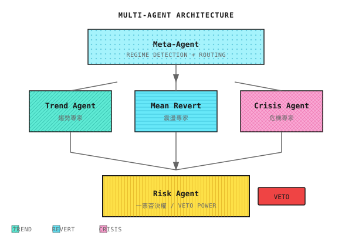

# AI量化交易從0到1

> **用多智能體架構構建可落地的量化交易系統**

本書系統講解如何從零構建一個多智能體量化交易系統，涵蓋市場基礎、數據工程、機器學習、多智能體架構、風險控制到生產部署的完整鏈路。

> 📝 **繁體中文（香港）版本進度**：目前已完成 Part 1－Part 2，其餘章節陸續翻譯中。如需完整內容，請參閱[簡體中文版](../cn/)或[英文版](../en/)。

---

## ⚠️ 免責聲明

本書內容僅供學習和研究目的，**不構成任何投資建議**。量化交易涉及重大風險，可能導致本金損失。讀者應在充分了解風險後，獨立做出投資決策。作者不對任何因使用本書內容而產生的損失承擔責任。

---

## 目錄

### Part 1：快速體驗

> 建立全局視野，理解量化世界和多智能體架構

| 課程 | 標題 |
|------|------|
| 第01課 | [量化交易全景圖](Part1-快速體驗/第01課：量化交易全景圖.md) |

**背景知識**：[Alpha與Beta](Part1-快速體驗/背景知識/Alpha%20與%20Beta.md) · [中美量化市場差異](Part1-快速體驗/背景知識/中美量化市場差異.md) · [主流量化基金排名](Part1-快速體驗/背景知識/主流量化基金排名.md) · [歷史著名量化事故](Part1-快速體驗/背景知識/歷史著名量化事故.md) · [量化推薦書單](Part1-快速體驗/背景知識/量化推薦書單.md)

---

### Part 2：量化基礎

> 建立扎實根基，理解市場、數據、策略和回測

| 課程 | 標題 |
|------|------|
| 第02課 | [金融市場與交易基礎](Part2-量化基礎/第02課：金融市場與交易基礎.md) |
| 第03課 | [數學與統計基礎](Part2-量化基礎/第03課：數學與統計基礎.md) |
| 第04課 | [技術指標的真實角色](Part2-量化基礎/第04課：技術指標的真實角色.md) |
| 第05課 | [經典策略範式](Part2-量化基礎/第05課：經典策略範式.md) |
| 第06課 | [數據工程的殘酷現實](Part2-量化基礎/第06課：數據工程的殘酷現實.md) |
| 第07課 | [回測系統的陷阱](Part2-量化基礎/第07課：回測系統的陷阱.md) |
| 第08課 | [Beta、對沖與市場中性](Part2-量化基礎/第08課：Beta、對沖與市場中性.md) |

**背景知識**：[交易所與訂單簿機制](Part2-量化基礎/背景知識/交易所與訂單簿機制.md) · [高頻市場微結構](Part2-量化基礎/背景知識/高頻市場微結構.md) · [Tick級回測框架](Part2-量化基礎/背景知識/Tick級回測框架.md) · [夏普比率的統計陷阱](Part2-量化基礎/背景知識/夏普比率的統計陷阱.md) · [K線形態與量價分析](Part2-量化基礎/背景知識/K線形態與量價分析.md) · [加密貨幣交易特點](Part2-量化基礎/背景知識/加密貨幣交易特點.md) · [數據源與API對比](Part2-量化基礎/背景知識/數據源與API對比.md)

---

## 其餘章節

Part 3（機器學習）、Part 4（多智能體）、Part 5（生產與實戰）及附錄暫未翻譯為繁體中文（香港），敬請期待。
